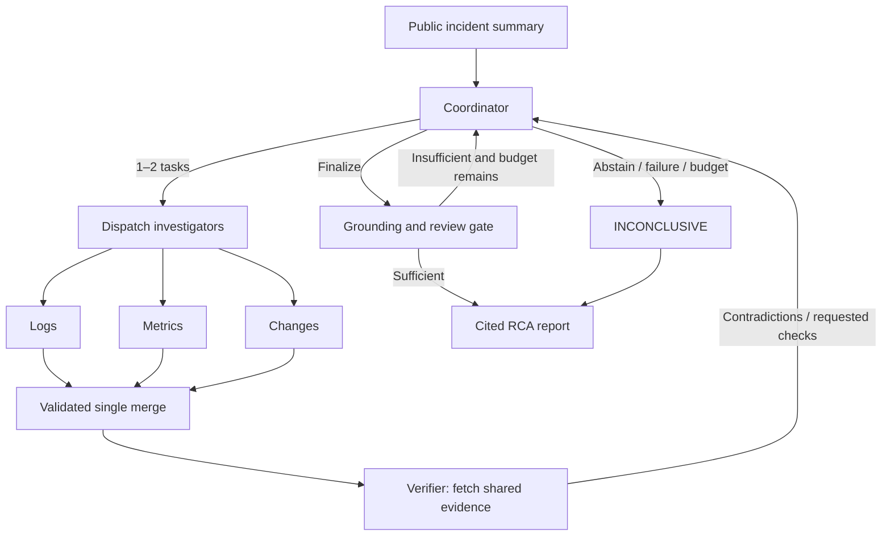

# IncidentLens

An evidence-driven multi-agent system for software incident investigation.
The MVP dynamically investigates five mechanisms: backend pool configuration,
PostgreSQL connections, Redis outages, external payment timeouts and backend
resource saturation. It produces a cited root-cause report or explicit abstention.

## Quick start (PowerShell)

Python 3.11+ is declared; Windows / Python 3.13 is verified. Install dependencies
once; Mock investigation then works offline without API keys or model weights.

```powershell
python -m venv .venv
.venv\Scripts\python.exe -m pip install -r requirements.lock
.venv\Scripts\python.exe -m pip install -e '.[dev]'
.venv\Scripts\python.exe -m incident_lens.cli validate-data
.venv\Scripts\python.exe -m incident_lens.cli list-cases
.venv\Scripts\python.exe -m incident_lens.cli run --case incident_001 --provider mock --cache-mode off --out results/demo001
.venv\Scripts\python.exe -m incident_lens.cli replay --trace results/demo001/trace.json
.venv\Scripts\python.exe -m streamlit run src/incident_lens/ui/app.py --server.headless true --server.address 127.0.0.1
```

Runs export `result.json`, `report.md` and `trace.json`. Replay validates saved
state without calling graph, tools or provider. The UI shows timeline, hypothesis
transitions, evidence, permissions, cache events and downloads; Recorded Replay
and Mock are visibly labeled.

## Architecture



LangGraph StateGraph drives the entire loop. Investigators return local outputs;
one merge validates the complete batch against issued identity and actual-query
ledger before publishing. Coordinator receives findings and evidence references,
without raw tool-event history. Verifier receives only authorized fetched records.
Review fingerprints bind candidate and evidence versions. Finalization rejects
rejected candidates, unresolved questions, competing hypotheses and missing causal
support. Reporter is deterministic.

Defaults: 4 rounds, 12 tools, 16 actual model requests, 90 seconds, one JSON repair.
CLI reads `configs/system.yaml`; flags override it. `--max-tokens` prevents further
requests after measured usage exhausts the cap; an in-flight response may exceed
it. Known subtotals are retained; unknown usage is explicitly marked incomplete.

## Providers and configuration

Copy `.env.example` to project-local `.env`. Real mode requires:

| Variable | Meaning |
| --- | --- |
| `INCIDENT_LENS_BASE_URL` | Chat-completions base URL or full endpoint |
| `INCIDENT_LENS_API_KEY` | Local secret, never exported or committed |
| `INCIDENT_LENS_MODEL` | Provider model identifier |
| `CACHE_MODE` | off (default), exact, semantic |
| `CACHE_DB_PATH` | SQLite file path |
| `CACHE_SIMILARITY_THRESHOLD` | At least 0.95 |
| `CACHE_TTL_HOURS` | Expiry, default 24 |
| `CACHE_EMBEDDING_MODEL` | fake or an explicitly installed local model |

```powershell
.venv\Scripts\python.exe -m incident_lens.cli run --case incident_001 --provider real --out results/real001
```

The endpoint must support the emitted strict JSON Schema. Missing configuration,
incompatibility and transport failures are explicit; real never falls back to
Mock. HTTP fixture tests validate adapter behavior, not live endpoint compatibility.
Mock is deterministic over supplied public evidence and never reads private
labels or looks up answers by incident ID. Its results demonstrate correctness,
not real-model accuracy or architecture superiority.

## Evidence and permissions

The dataset contains 6 seed, 10 dev and 20 held-out synthetic cases with neutral
IDs and frozen split files. Missing-data cases require abstention. Shared causal
templates are smoke fixtures, not an independently collected production benchmark.
See [data generation and limitations](data/README.md).

The six tools are read-only: query_logs; query_metrics/get_dependencies;
query_changes/get_config_diff; fetch_evidence_by_ids. Server-issued immutable
contexts enforce role/workspace/incident/run and actual-query ledgers. Public file
allowlists reject private truth, traversal and symlink/junction escapes. Excerpts
are untrusted data. This is application isolation, not an OS Python sandbox.

## Local explanation cache

Only logs/metrics/changes explanations are cacheable. Routing, reviews, reports
and tool queries execute normally. Hits require current queried records, strict
namespace and valid citations; finding/task/run identities are rebound before
merge. Each run refreshes dataset revision. Namespace also includes evidence hash,
identity, task type, prompt, model/parameters, schema and ACL versions.

Semantic reuse combines NumPy cosine with conservative ordered-token equivalence.
FakeEmbedder is an offline test aid, not a learned semantic model. Optional
SentenceTransformer uses explicitly installed local weights. See [cache](docs/cache.md).

```powershell
.venv\Scripts\python.exe scripts/run_cache_eval.py --provider mock --out results/cache-experiment
```

## Evaluation and validation

```powershell
.venv\Scripts\python.exe scripts/run_eval.py --split dev --variant all --provider mock --out results/eval-mock
.venv\Scripts\python.exe scripts/run_eval.py --split dev --variant all --provider real --out results/eval-real
.venv\Scripts\python.exe scripts/run_eval.py --split test --variant all --provider real --out results/final
.venv\Scripts\python.exe -m pytest -q
.venv\Scripts\python.exe -m ruff check src tests scripts
.venv\Scripts\python.exe scripts/verify_install.py --out results/fresh-install
```

Single (all tools plus self-reflection), fixed (one fixed expert batch),
dynamic_no_verifier and full share inputs, model, temperature, budgets and
grounding rules. Architecture comparisons force cache off. Evaluator reads truth
only after execution. Outputs: case-level.csv, aggregate.csv, raw-runs.jsonl and
error-analysis.md. Accuracy/abstention/citation denominators remain separate;
unknown tokens/cost and unreviewed semantic support stay blank. Equal tool budgets
do not imply equal tokens. See [evaluation protocol](docs/evaluation.md).

Installation verification builds a wheel, installs pinned dependencies in a fresh
environment and runs validation/investigation/replay. It preserves logs and
refuses to overwrite an existing verification environment.

## Documents and limitations

See [protocol](docs/protocol.md), [dependencies/ownership](docs/phase-plan.md),
[demo](docs/demo.md), [acceptance evidence](docs/acceptance/),
[source snapshots](docs/source/) and [contribution mapping](docs/contributions.md).
Generated commits do not prove individual students' personal contributions.
Live LLM comparisons, learned embedding performance and manual semantic citation
review require separate measured acceptance before research-performance claims.
