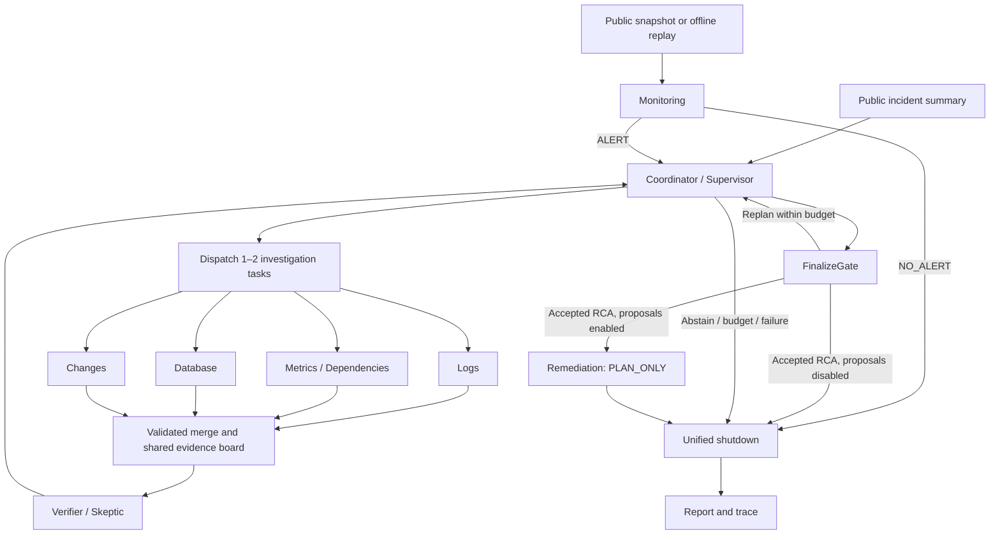

# IncidentLens

**English** | [简体中文](README.zh-CN.md)

An evidence-driven multi-agent system for software incident investigation.
The system cross-checks logs, metrics, database observations and changes to investigate
pool configuration, PostgreSQL connection exhaustion, lock contention and slow queries,
Redis outages, external payment timeouts and resource saturation. It produces a cited
root-cause report or explicit abstention. An optional response workflow adds public
snapshot monitoring and remediation proposals without executing production changes.

## Background

Production incident review is evidence-heavy: logs, metrics and change history
must be cross-checked before any causal claim is credible. Generic LLM agents
tend to over-claim here — they summarize plausible stories without citations,
ignore data-access boundaries, and rarely admit when the evidence is not enough.

IncidentLens is a personal research project built from scratch to explore a
stricter contract for agent-driven root-cause analysis (RCA):

- every conclusion must cite the exact records that support it;
- agents operate inside explicit permission boundaries over read-only evidence;
- when the visible evidence does not identify a cause, the system abstains
  (`INCONCLUSIVE`) instead of guessing.

The codebase doubles as a reproducible playground for studying multi-agent
orchestration: dynamic dispatch, batch validation, verifier feedback loops and
deterministic grounding gates are all inspectable end to end.

## Highlights

- **Dynamic investigation and response** — one LangGraph workflow connects monitoring,
  coordination, four specialist roles, verification, finalization, proposals and unified stopping.
- **Cited or abstain** — deterministic gates check candidates, citations and review versions;
  insufficient evidence produces `INCONCLUSIVE`.
- **Evidence-first permissions** — role-scoped read-only tools, immutable contexts,
  actual-query ledgers and public file allowlists.
- **Bounded provider recovery** — classified transport failures, atomic request permits,
  task-local stage budgets and one targeted structured repair, enabled explicitly.
- **Offline Mock provider** — deterministic over supplied public evidence, without API keys or model weights.
- **Reproducible evaluation** — four original ablation variants, paired database ablations and task recovery experiments.
- **Replay and UI** — Web and retained Streamlit dashboards expose evidence, hypotheses,
  alerts, proposals, tasks and stop events.
- **Optional explanation cache** — exact or conservative semantic reuse with strict namespaces and citation validation.

## Use cases

- **Learning and prototyping** — study how a coordinator/investigator/verifier
  multi-agent loop behaves under strict evidence and budget constraints.
- **Offline demos and teaching** — run a full investigation, replay and UI tour
  on a laptop with no model access.
- **Architecture ablation studies** — compare single-agent, fixed-expert,
  dynamic-no-verifier and full variants under identical budgets.
- **Agent sandboxing patterns** — reference implementation for permission
  ledgers, allowlists and untrusted-excerpt handling around LLM tool calls.

## Quick start (PowerShell)

Python 3.11+ is declared; Windows / Python 3.13 is verified. Install dependencies
once; Mock investigation then works offline without API keys or model weights.

```powershell
python -m venv .venv
.venv\Scripts\python.exe -m pip install -r requirements.lock
.venv\Scripts\python.exe -m pip install -e '.[dev]'
.venv\Scripts\python.exe -m incident_lens.cli validate-data
.venv\Scripts\python.exe -m incident_lens.cli list-cases
.venv\Scripts\python.exe -m incident_lens.cli run --case incident_001 --provider mock --cache-mode off --out results/demo001
.venv\Scripts\python.exe -m incident_lens.cli replay --trace results/demo001/trace.json
.venv\Scripts\python.exe -m incident_lens.cli web
```

Open the [local Web dashboard](http://127.0.0.1:8022) for the Web dashboard: overview, investigation,
run details and trace library, with light/dark themes and responsive navigation.
Use `web --port 8023` to change the port. The original Streamlit dashboard remains
available via `python -m streamlit run src/incident_lens/ui/app.py`.

Runs export `result.json`, `report.md` and `trace.json`. Replay validates saved
state without calling graph, tools or provider. The UI shows timeline, hypothesis
transitions, evidence, permissions, cache events and downloads; Recorded Replay
and Mock are visibly labeled.

## Agent workflow architecture



The diagram shows the full dynamic workflow: default `legacy_rca` starts from an
incident summary, while optional `incident_response` can begin with public snapshots
or offline replay and finish immediately on `NO_ALERT`. Monitoring is disabled by default;
the response profile can also start directly from an incident ID. `full` uses verifier
feedback, `dynamic_no_verifier` skips verification, `fixed` retains one original
three-expert batch, and `single` uses the single-agent baseline. Proposals run only after
an accepted RCA; terminal paths from every phase pass through the shutdown protocol.

### Agent responsibilities

| Agent / role ID | Responsibility in one sentence |
| --- | --- |
| Monitoring (`monitoring`) | Detect anomalies in public snapshots or replay and emit alerts, allowing `NO_ALERT` for normal or insufficient evidence. |
| Coordinator / Supervisor (`coordinator`) | Assign or replan investigations from evidence gaps and remaining budgets, then choose finalization or abstention. |
| Log Investigator (`logs`) | Reconstruct error chronology and propagation from logs while separating causal signals from symptoms. |
| Metrics & Dependency Investigator (`metrics`) | Inspect service health, capacity and dependencies to locate the scope of an anomaly. |
| Database Investigator (`database`) | Analyze connections, sessions, locks and slow queries to distinguish database faults, application pool issues and downstream symptoms. |
| Change Investigator (`changes`) | Compare deployments and configuration changes with incident onset to identify possible triggers. |
| Verifier / Skeptic (`verifier`) | Challenge candidate causes using authorized shared evidence and request concrete checks for contradictions or gaps. |
| Remediation (`remediation`) | Produce evidence-supported proposals with preconditions, risks, verification and rollback steps for an accepted cause. |
| Single-Agent baseline (`single`) | Use one agent for planning, investigation and self-reflection in architecture comparisons. |

### Runtime and budgets

All roles run in one LangGraph StateGraph with centralized communication. Investigators
return local outputs; Merge validates each batch against issued identities and actual-query
ledgers before publication to the shared evidence board. Coordinator receives findings and
evidence references; Verifier fetches authorized records, and review fingerprints bind
candidate and evidence versions. FinalizeGate rejects rejected candidates, unresolved
questions, competing hypotheses and missing causal support. TaskManager manages bounded
retries; StopController freezes tasks and tools, cancels work and waits for acknowledgements.
These components and the deterministic Reporter are runtime components, not additional
LLM agents. Tree communication is unsupported.

| Configuration | Workflow | Rounds | Tool calls | Actual model requests | Total time |
| --- | --- | --- | --- | --- | --- |
| [system.yaml](configs/system.yaml) (default) | `legacy_rca` | 4 | 12 | 16 | 600 seconds |
| [incident-response.yaml](configs/incident-response.yaml) | `incident_response` | 6 | 24 | 24 | 600 seconds |

The response configuration also limits monitoring to 8 calls, remediation to 2 calls,
each task to 2 attempts and stop acknowledgements to 5 seconds. Phase limits share global
budgets, including JSON repair requests. Defaults allow 180 seconds per model request and
one JSON repair. CLI flags override configuration; `--max-tokens` blocks further requests
after measured usage exhausts the cap, although an in-flight response may exceed it.
Unknown usage is explicitly marked incomplete.

Diagnosis (`RESOLVED` / `INCONCLUSIVE`), remediation (`NOT_STARTED` / `PLAN_READY` /
`PLAN_FAILED` / `SKIPPED`) and workflow (`RUNNING` / `STOPPING` / `FINISHED` / `FAILED`)
statuses are recorded separately. The original `RCAReport.status` still supports
`RESOLVED` / `INCONCLUSIVE` / `ERROR`; `PLAN_READY` means a proposal exists, not that service recovered.

## Incident response workflow

```powershell
.venv\Scripts\python.exe -m incident_lens.cli run --case incident_001 --provider mock --out results/legacy-demo
.venv\Scripts\python.exe -m incident_lens.cli run --case incident_037 --provider mock --config configs/incident-response.yaml --out results/response-demo
.venv\Scripts\python.exe -m incident_lens.cli run --case incident_037 --provider mock --config configs/incident-response.yaml --monitor-mode manual_snapshot --snapshot data/monitoring/normal.json --out results/no-alert-demo
.venv\Scripts\python.exe -m incident_lens.cli run --case incident_037 --provider mock --config configs/incident-response.yaml --monitor-mode offline_replay --snapshot data/monitoring/anomaly.json --out results/replay-demo
```

Monitoring JSON contains public `EvidenceRecord` objects for the selected incident.
`manual_snapshot` analyzes a supplied snapshot; `offline_replay` uses offline input without
connecting to production monitoring. Remediation is `PLAN_ONLY` and executes none of its proposed actions.

## Providers and configuration

Copy `.env.example` to project-local `.env`. Real mode requires:

| Variable | Meaning |
| --- | --- |
| `INCIDENT_LENS_BASE_URL` | Chat-completions base URL or full endpoint |
| `INCIDENT_LENS_API_KEY` | Local secret, never exported or committed |
| `INCIDENT_LENS_MODEL` | Provider model identifier |
| `CACHE_MODE` | off (default), exact, semantic |
| `CACHE_DB_PATH` | SQLite file path |
| `CACHE_SIMILARITY_THRESHOLD` | At least 0.95 |
| `CACHE_TTL_HOURS` | Expiry, default 24 |
| `CACHE_EMBEDDING_MODEL` | fake or an explicitly installed local model |

```powershell
.venv\Scripts\python.exe -m incident_lens.cli run --case incident_001 --provider real --out results/real001
```

The default `json_schema` mode requires server support for strict JSON Schema.
For a JSON-mode endpoint, explicitly select `--response-format json_object`;
both modes validate every response against the same local Pydantic contract.
`--thinking disabled` and `--request-timeout 60` are explicit optional transport
settings. The corresponding project-local environment variables are
`INCIDENT_LENS_RESPONSE_FORMAT`, `INCIDENT_LENS_THINKING`, and
`INCIDENT_LENS_REQUEST_TIMEOUT`; the dashboard exposes these settings too.
Missing configuration,
incompatibility and transport failures are explicit; real never falls back to
Mock. HTTP fixture tests validate adapter behavior, not live endpoint compatibility.
Mock is deterministic over supplied public evidence and never reads private
labels or looks up answers by incident ID. Its results demonstrate correctness,
not real-model accuracy or architecture superiority.

### Provider reliability and recovery

`provider_recovery.enabled` defaults to `false`, retaining the legacy single structured repair.
Enable it explicitly in YAML to classify provider failures, retry transient HTTP/transport faults
within request, wall and stage budgets, and perform at most one targeted syntax/schema repair.
Every physical dispatch, including a repair or retry, consumes a permit. STOP interrupts backoff;
concurrent stage guards use task-local context. Domain/citation guards remain authoritative.

```yaml
provider_recovery:
  enabled: true
  format_capability: json_object
  max_transport_retries: 2
  max_structured_repairs: 1
  max_physical_attempts_per_call: 4
  min_request_time_seconds: 5.0
```

CLI `--response-format` overrides the environment, then the enabled capability setting.
There is no automatic format/model/provider fallback. Missing usage stays unknown; token
limits are best effort without a validated provider output cap. Diagnostic trace events contain
safe categories and attempt IDs, and old trace envelopes remain readable. Identity proposal
binding is deferred; existing prompts and evidence schemas remain unchanged.

Run deterministic fault injection, or a separately recorded compatibility probe and paired
Seed/Dev pilot, from the repository root:

```powershell
.venv\Scripts\python.exe scripts/run_reliability_eval.py --out results/v13-eval/NEW-ID
.venv\Scripts\python.exe scripts/run_v13_pilot.py --out results/v13-eval/NEW-PILOT --response-format json_schema
.venv\Scripts\python.exe scripts/analyze_v13_pilot.py --source results/v13-eval/NEW-PILOT --out results/v13-eval/NEW-ANALYSIS
```

The real pilot requires local API configuration and can incur provider charges. Choose the
response format accepted by that endpoint. Output directories must be new; analysis reads
saved traces without model calls or private oracle access. See [runtime contracts](docs/v1.3/contracts.md) and
[evaluation protocol](docs/v1.3/evaluation_protocol.md). Offline technical recovery does not
establish live RCA accuracy or targeted-repair quality.

## Evidence and permissions

The dataset contains the original 6 seed, 10 dev and 20 held-out synthetic cases plus
4 cases (`incident_037`–`incident_040`) in a separate [database set](data/splits/database_ids.json),
for 40 cases total. Original splits remain frozen. Added scenarios cover connection exhaustion,
application pool misconfiguration with a healthy database, locks and slow queries, and insufficient
evidence. Missing evidence requires abstention; synthetic templates are not an independently
collected production benchmark. See [data generation and limitations](data/README.md).

All tools are read-only:

| Evidence type | Tools |
| --- | --- |
| Logs | `query_logs` |
| Metrics and dependencies | `query_metrics`, `get_dependencies` |
| Changes | `query_changes`, `get_config_diff` |
| Database | `get_db_connections`, `get_db_active_sessions`, `get_db_lock_waits`, `get_db_slow_queries`, `get_db_health_metrics` |
| Shared evidence | `fetch_evidence_by_ids` |

Database observations use optional `public/database.jsonl`; older packs need no additional file.
ToolRegistry enforces role permissions; fair comparisons can explicitly enable
`database_equivalent_tools` for equivalent database access by Metrics / Single.
Server-issued immutable contexts constrain role, workspace, incident, run and actual-query ledgers.
Public file allowlists reject private truth, traversal and symlink/junction escapes. Excerpts are
untrusted data. This is application isolation, not an OS Python sandbox.

## Local explanation cache

Only local logs/metrics/database/changes explanations are cacheable. Monitoring, routing,
reviews, proposals, final acceptance, reports and tool queries execute normally. Hits require current queried records, strict
namespace and valid citations; finding/task/run identities are rebound before
merge. Each run refreshes dataset revision. Namespace also includes evidence hash,
identity, task type, prompt, model/parameters, schema and ACL versions.

Semantic reuse combines NumPy cosine with conservative ordered-token equivalence.
FakeEmbedder is an offline test aid, not a learned semantic model. Optional
SentenceTransformer uses explicitly installed local weights. See [cache](docs/cache.md).

```powershell
.venv\Scripts\python.exe scripts/run_cache_eval.py --provider mock --out results/cache-experiment
```

## Evaluation and validation

```powershell
.venv\Scripts\python.exe scripts/run_eval.py --split dev --variant all --provider mock --out results/eval-mock
.venv\Scripts\python.exe scripts/run_eval.py --split dev --variant all --provider real --out results/eval-real
.venv\Scripts\python.exe scripts/run_eval.py --split test --variant all --provider real --out results/final
.venv\Scripts\python.exe scripts/run_v12_eval.py --provider mock --incidents incident_037 incident_038 incident_039 incident_040 --out results/v12-eval
.venv\Scripts\python.exe scripts/run_v12_eval.py --provider mock --incidents incident_001 incident_037 --skip-legacy --inject-transient-failure --out results/v12-recovery
.venv\Scripts\python.exe -m pytest -q
.venv\Scripts\python.exe -m ruff check src tests scripts
.venv\Scripts\python.exe scripts/verify_install.py --out results/fresh-install
```

Single (all tools plus self-reflection), fixed (one fixed expert batch),
dynamic_no_verifier and full share inputs, model, temperature, budgets and
grounding rules. Architecture comparisons force cache off. Evaluator reads truth
only after execution. Outputs: case-level.csv, aggregate.csv, raw-runs.jsonl and
error-analysis.md. Accuracy/abstention/citation denominators remain separate;
unknown tokens/cost and unreviewed semantic support stay blank. Equal tool budgets
do not imply equal tokens. See [evaluation protocol](docs/evaluation.md).

Paired database evaluation gives Metrics equivalent database tools in both arms with
cache off to compare the additional Database role. Failure injection checks bounded retries
and recovery. Mock results establish deterministic behavior; real-model quality and remediation
effectiveness require separate measurement.

Installation verification builds a wheel, installs pinned dependencies in a fresh
environment and runs validation/investigation/replay. It preserves logs and
refuses to overwrite an existing verification environment.

## Documentation

- [Investigation protocol](docs/protocol.md) — run lifecycle, gates and budgets
- [Dependencies and ownership](docs/phase-plan.md) — phase plan and module map
- [Demo walkthrough](docs/demo.md) — recorded demo script
- [Evaluation protocol](docs/evaluation.md) — variants, metrics and scoring rules
- [Cache design](docs/cache.md) — namespaces, hits and semantic reuse
- [Analysis](docs/analysis.md) — result analysis notes
- [Data generation and limitations](data/README.md) — synthetic fixtures and scope
- [Acceptance evidence](docs/acceptance/) — acceptance runs and audits
- [Source snapshots](docs/source/) — design and plan snapshots
- [Contribution mapping](docs/contributions.md) — responsibility-to-evidence matrix

Generated commits do not prove individual students' personal contributions.

## Contributing

Contributions, questions and feature ideas are welcome — this is a personal
project maintained on a best-effort basis, so small, focused changes are the
easiest to review.

- **Report a bug** — open an issue describing the case ID, provider
  (`mock`/`real`), the exact CLI command and, if possible, the run's
  `trace.json`. Mock runs are fully reproducible offline, which makes them the
  preferred vehicle for bug reports.
- **Suggest a feature or improvement** — open an issue first to discuss scope
  before investing in a large change. Honest-scope additions (docs, evaluation
  scripts, isolation tests) are especially welcome.
- **Submit a pull request** — keep PRs focused on one change; keep the offline
  Mock path working; update the matching section in both `README.md` and
  `README.zh-CN.md` when behavior or commands change.
- **Development checks** — before submitting, run:

```powershell
.venv\Scripts\python.exe -m pytest -q
.venv\Scripts\python.exe -m ruff check src tests scripts
```

Code style follows Ruff (`line-length = 100`, `py311`). New roles should update public
contracts, read-only tool permissions and corresponding tests. Never commit local secrets.

## Limitations and honest scope

This is a personal research and learning project. Live LLM comparisons, learned
embedding performance and manual semantic citation review require separate
measured acceptance before research-performance claims. The synthetic dataset
uses shared causal templates and does not establish production generalization;
test membership is a holdout convention, not proof of blind evaluation. Mock
results demonstrate correctness of the pipeline, not real-model accuracy or
architecture superiority. See the sections above and linked documents for the
full boundary of every claim.

### Termination and scoring

New runs emit `WORKFLOW_STOP_REQUESTED`, actual `STOP_ACK` acknowledgments and a final `NORMAL_TERMINATION` or `RUNTIME_FAILURE`. State and report share a structured termination result. Normal shutdown and recovered model-call failures preserve accepted diagnosis credit; plan generation failure and shutdown failure are reported separately and fail the complete workflow. `PLAN_ONLY` never implies service recovery. Historical STOP traces remain readable through conservative normalization. See [evaluation semantics](docs/evaluation.md) for applicable denominators and offline rescoring.

### IncidentBench

IncidentBench adds a separate versioned evidence dataset and evaluator-only oracle store. Public validation checks evidence contracts, hashes and source-family leakage before investigations start. Its paired runner uses the existing Graph with equivalent database tools, an explicit fixed-four schedule, independent per-run budgets and cache disabled. Durable raw traces support rescoring, anonymous citation-review exports and source-clustered statistical analysis; technical failures remain in denominators and unknown usage stays null.

The included Seed fixtures are pending development candidates from a shared encoder. Frozen Test sealing requires independent reviewed labels and provider readiness; formal execution is currently gated. See the [IncidentBench guide](docs/incidentbench/README.md) for actual commands, data/evaluation/model cards and research limitations. Legacy datasets and evaluators remain available.

### Optional active evidence selection

CAES ranks bounded investigation candidates using published hypothesis predictions,
open questions, missing evidence sources, redundancy and conservative request/tool
costs. It adds no model or tool call to candidate generation. `current_dynamic` remains
the default; Shadow records recommendations while retaining Coordinator tasks. Enabled
selection uses the existing role permissions, TaskManager, budgets, Verifier and
FinalizeGate. Scores are heuristic estimates, not calibrated information gain.

```powershell
.venv\Scripts\python.exe -m incident_lens.cli run --case incident_001 --provider mock --shadow-caes --out results/v15/NEW-shadow
.venv\Scripts\python.exe -m incident_lens.cli run --case incident_001 --provider mock --selection-policy active_evidence --out results/v15/NEW-active
.venv\Scripts\python.exe scripts/run_v15_active_eval.py --dataset data/incidentbench_v1 --split seed --variants B0 B1 B1c B2 B3 B4 --provider mock --out results/v15/NEW-seed
.venv\Scripts\python.exe scripts/replay_v15_selection.py --trace results/v15/NEW-active/trace.json
```

The six groups execute fixed-four, original dynamic, common-candidate first selection,
without-cost, without-discrimination and full CAES paths. Current uniform cost fallback
does not establish action-specific cost sensitivity in production. Seed diagnostics
have no accepted Oracle or semantic review; Dev calibration, formal Frozen Test and
real performance claims require upstream gates. See [CAES contracts](docs/v1.5/contract-freeze.md)
and [algorithm](docs/v1.5/algorithm-spec.md).
