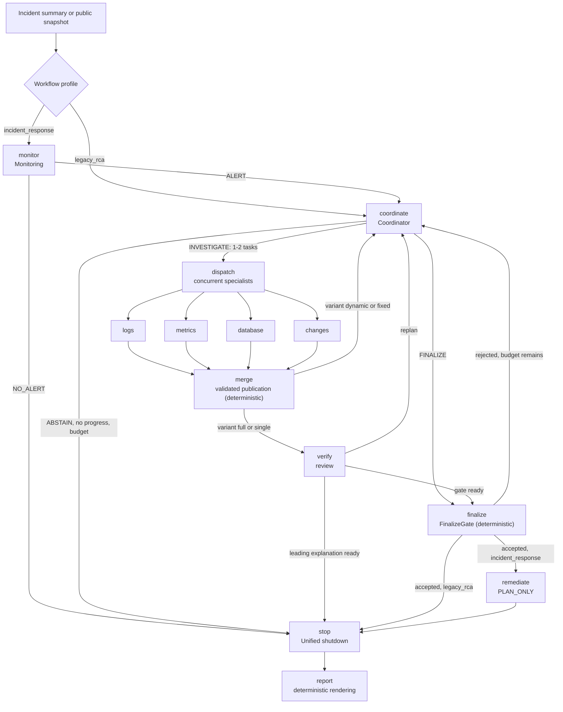

# IncidentLens

## Presentation materials

The current group presentation is **version_b**, a 21-slide English deck (15 main + 6 backup) with complete English speaker notes. Download the [PPTX](presentation/IncidentLens_Deck_version_b/IncidentLens_Deck_version_b.pptx), [slides PDF](presentation/IncidentLens_Deck_version_b/IncidentLens_Deck_version_b.pdf), [illustrated presenter script](presentation/IncidentLens_Deck_version_b/Presentation_Script_version_b.pdf), or [editable script](presentation/IncidentLens_Deck_version_b/speech.md). The deck uses complete slide images; individual text/chart objects are not editable. The prior editable deck is archived as [version_a](presentation/version_a/README.md). See [version history](presentation/VERSIONS.md) and [production/validation details](presentation/IncidentLens_Deck_version_b/README.md).


**English** | [简体中文](README.zh-CN.md)

IncidentLens is an evidence-driven multi-agent system for software incident investigation and
root-cause analysis. It coordinates specialist agents over read-only logs, metrics, database
observations, changes and configuration diffs, then produces either a cited root-cause report
or an explicit `INCONCLUSIVE` abstention. An optional response workflow adds public-snapshot
monitoring and a `PLAN_ONLY` remediation proposal.

This is a **COMP5584 Large Language Models for Agents** group course project at The Hong Kong
Polytechnic University (2026/27 Semester 1). It is a research and teaching prototype over
synthetic incident packs, not a production incident platform and not an official PolyU product.
No production change is executed.

## Why this project

Incident review is evidence-heavy. A credible root cause has to connect an observed failure
mechanism to temporally compatible impact across more than one source, and the same evidence
often supports several plausible explanations. Generic LLM agents tend to summarize a
plausible story without citations, ignore data-access boundaries and rarely admit that the
visible evidence is insufficient.

IncidentLens explores a stricter contract:

- every conclusion must cite records the run actually observed;
- each agent has a fixed, read-only tool ceiling;
- a candidate needs cross-source support and a cause-specific discriminator;
- Merge and FinalizeGate are deterministic, so model confidence cannot override them;
- when those conditions fail, the run abstains instead of guessing.

**One-sentence contract:** a conclusion must cite records observed in this run, survive
deterministic source-diversity and mechanism checks, or be reported as `INCONCLUSIVE`.

## Highlights

- **Dynamic is the primary architecture and runtime default.** A coordinator selects one or
  two specialists per round from evidence gaps and budget, instead of asking every specialist
  once.
- **Cited or abstain.** Deterministic gates check citation provenance, source diversity,
  cause-specific mechanism, competing explanations and budget audits. Model confidence is not
  an input to acceptance.
- **Evidence-first permissions.** Role-scoped read-only tools, immutable runtime contexts, an
  actual-query ledger and a fixed public-file allowlist.
- **Deterministic Merge.** Specialists return local results; only Merge can publish findings
  and shared evidence, after validating task identity, role, observed IDs and citation scope.
- **Bounded recovery.** Classified transport failures, atomic request permits, task-local
  retry budgets and one targeted structured-output repair, enabled explicitly.
- **Recorded replay.** A saved `trace.json` can be reloaded without calling the graph, tools
  or provider; the dashboard binds companion metadata by identity.
- **Reproducible comparison.** Four matched architectures, an offline Mock provider, and a
  scripted four-architecture batch over a 36-case hardened development set.
- **Honest evaluation boundary.** Results are development-visible, label-pending, one model,
  one repeat; the verifier ablation is reported as a negative result.

## Quick start

Python 3.11 or newer is required; the project is verified on Windows with Python 3.13.
The Mock provider is deterministic over the supplied public evidence and needs no API key or
model weights.

### PowerShell

```powershell
python -m venv .venv
.venv\Scripts\python.exe -m pip install -r requirements.lock
.venv\Scripts\python.exe -m pip install -e '.[dev]'
.venv\Scripts\python.exe -m incident_lens.cli check-environment
.venv\Scripts\python.exe -m incident_lens.cli validate-data
.venv\Scripts\python.exe -m incident_lens.cli list-cases
.venv\Scripts\python.exe -m incident_lens.cli run --case incident_001 --provider mock --variant dynamic --cache-mode off --out results/quickstart
.venv\Scripts\python.exe -m incident_lens.cli replay --trace results/quickstart/trace.json
.venv\Scripts\python.exe -m incident_lens.cli web
```

### bash

```bash
python -m venv .venv
.venv/bin/python -m pip install -r requirements.lock
.venv/bin/python -m pip install -e '.[dev]'
.venv/bin/python -m incident_lens.cli validate-data
.venv/bin/python -m incident_lens.cli run --case incident_001 --provider mock --variant dynamic --cache-mode off --out results/quickstart
.venv/bin/python -m incident_lens.cli replay --trace results/quickstart/trace.json
.venv/bin/python -m incident_lens.cli web
```

The dashboard serves on `http://127.0.0.1:8022` by default and has six views: overview, new
investigation, trace library, run detail, system design and evaluation. The evaluation view is
a static snapshot of the recorded hardened batch, not a live feed. The bundled interface is in
Chinese; trace and case identifiers are unchanged. Use `web --port 8767` to change the port. A
retained Streamlit dashboard is available with
`python -m streamlit run src/incident_lens/ui/app.py`.

Full command reference, provider setup, budgets and troubleshooting are in the
[Run Guide](docs/RUN_GUIDE.md).

## Architecture



LangGraph nodes: `monitor -> coordinate -> dispatch -> merge -> verify -> finalize ->
remediate -> stop -> report`, with conditional routing from every active phase. `monitor` is
entered only by the response profile. `verify` runs for `full` and `single`; for `single` it
is self-review by the same identity, not an independent review. A `NO_ALERT` decision ends the
response workflow immediately. Every terminal path passes through `stop`, which cancels
in-flight work, freezes tools and writes a `TerminationResult` before deterministic reporting.
Merge, FinalizeGate and reporting are runtime components, not additional LLM agents.

### Architecture variants

| CLI value | Display name | Role in the study |
| --- | --- | --- |
| `dynamic` | Dynamic | Primary architecture and runtime default |
| `full` | Dynamic (with verifier) | Ablation control for independent review |
| `fixed` | Fixed-4 | Fixed-schedule baseline |
| `single` | Single | Strong single-agent baseline |

`dynamic_no_verifier` is a frozen historical alias of `dynamic`; saved traces and protocols
keep replaying under that spelling, but new runs never write it. Behavior for each variant,
and the CLI flags that select it, are in the [Run Guide](docs/RUN_GUIDE.md#4-architecture-variants).

## Agent responsibilities

One coordinator, four read-only specialists (`logs`, `metrics`, `database`, `changes`), an
optional independent verifier, a plan-only remediation step and a deterministic reporter.
Tool authority is a role ceiling: `AgentContext` is frozen and cannot accept an
`allowed_tools` list above it, and a task may narrow it further. Coordinator, monitoring and
remediation have no tools at all.

The role catalog, ACL table, coordinator policy and hypothesis lifecycle are in
[Agent Design](docs/AGENT_DESIGN.md).

## Results

The hardened batch ran four matched architectures over the same 36 cases — 144 slots in
total. **Within its own 36 slots, Dynamic, the primary architecture, resolved 33/36 with
27/27 correct root causes and 0 wrong root causes.** At the batch level, eight slots failed
technically and stay in the denominator, and all 19 identifiable misses across the four
architectures ended `INCONCLUSIVE`, so the observed failure mode is over-abstention, not
fabrication.

| Architecture | Quality success | Avg latency | Avg tokens |
| --- | ---: | ---: | ---: |
| Single | 32/36 (88.9%) | 680.9 s | 245,971 |
| Fixed-4 | 22/36 (61.1%) | 196.3 s | 58,042 |
| **Dynamic** | **33/36 (91.7%)** | 412.9 s | 149,216 |
| Dynamic (with verifier) | 30/36 (83.3%) | 503.8 s | 233,772 |

Dynamic used 39.4% less latency and 39.3% fewer tokens than Single for one more quality
success; the verifier loop cost 56.7% more tokens than Dynamic with no measured quality gain.
These are descriptive differences on one repeat, not significance tests.

> **Evidence boundary.** These are development-visible batches with provisional candidate
> labels (`annotator_status: pending`, `accepted_labels = 0`, one model, one repeat). There is
> no blind or held-out test, no confidence interval and no significance test. See
> [Evaluation](docs/EVALUATION.md) for full tables, denominators, levers, ablations and
> non-claims.

## Limitations

- **Synthetic evidence, closed vocabulary.** All 40 public packs and 36 hardened benchmark
  cases are synthetic, and the guard layer accepts seven fixed failure modes; an incident
  outside that vocabulary is rejected even when a human would recognise the cause.
- **Provisional labels, one model, one repeat.** Labels are candidate labels with zero
  accepted human annotations, so no variance, multi-model sensitivity or significance
  estimate exists.
- **Over-abstention, not fabrication.** The system avoids wrong root causes in the measured
  batches but loses coverage; Fixed-4 in particular abstained on 12 of 27 identifiable cases.
- **Auxiliary experiments are narrow.** Cache and fault recovery were measured on Mock only;
  the evidence-gap guard's token reduction is replay-estimated, not a new measured run.

The full technical, empirical, ethical and scope discussion is in
[Limitations](docs/LIMITATIONS.md).

## Documentation

| Document | What it covers |
| --- | --- |
| [Run Guide](docs/RUN_GUIDE.md) | Install, commands, variants, replay, dashboard, real providers, budgets, tests, packaging |
| [Architecture](docs/ARCHITECTURE.md) | System context, graph, state, deterministic gates, security, recovery, web layer |
| [Agent Design](docs/AGENT_DESIGN.md) | Roles, ACL, coordination policy, hypothesis lifecycle, verifier ablation, stop protocol |
| [Evaluation](docs/EVALUATION.md) | Research questions, datasets, metrics, 144-slot results, levers, failures, ablations, validity |
| [Demo Guide](docs/DEMO_GUIDE.md) | 8-10 minute dashboard and CLI demonstration plan, fallbacks, recording checklist |
| [Limitations](docs/LIMITATIONS.md) | Technical, empirical, ethical and scope limits; what would change the conclusions |
| [Documentation map](docs/README.md) | Where current guides, frozen contracts, benchmark records and archives live |
| [Operations guide](docs/guides/readme-guide.md) | CAES, budgets, providers, permissions and the local explanation cache |
| [Investigation protocol](docs/reference/protocol.md) | Frozen lifecycle, gates and scoring contracts |
| [IncidentBench guide](docs/incidentbench/README.md) | Datasets, scoring, reproduction commands and known limits |
| [Data notes](data/README.md) | Synthetic fixture generation and scope |
| [Hardened batch report](analysis/wp_d/reports/hardened144-20261101/README.md) | Recomputation source and English summary |
| [Code wiki](docs/code_wiki/README.md) | Deep module and implementation reference |
| [Submission package handoff](docs/handoff/submission-package/README.md) | Chinese package README for the group: deck, script, Q&A, run-guide copy, checklist, contribution statement, the demo-website startup guide and the full Chinese handoff guide (`project-handoff.zh-CN.md`) |

## Project status

Version 1.6.1, Python 3.11 or newer. The project is a course submission; member names and
individual contributions are intentionally not asserted here. No license file is currently
declared. The evaluation artifacts and their boundaries are the authoritative statement of
what was measured.
