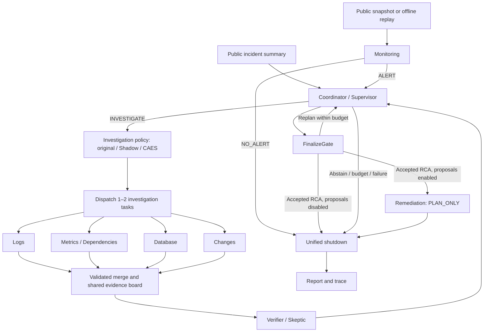

# IncidentLens

**English** | [简体中文](README.zh-CN.md)

An evidence-driven multi-agent system for software incident investigation.
The system cross-checks logs, metrics, database observations and changes to investigate
pool configuration, PostgreSQL connection exhaustion, lock contention and slow queries,
Redis outages, external payment timeouts and resource saturation. It produces a cited
root-cause report or explicit abstention. An optional response workflow adds public
snapshot monitoring and remediation proposals without executing production changes.

## Background

Production incident review is evidence-heavy: logs, metrics and change history
must be cross-checked before any causal claim is credible. Generic LLM agents
tend to over-claim here — they summarize plausible stories without citations,
ignore data-access boundaries, and rarely admit when the evidence is not enough.

IncidentLens is a personal research project built from scratch to explore a
stricter contract for agent-driven root-cause analysis (RCA):

- every conclusion must cite the exact records that support it;
- agents operate inside explicit permission boundaries over read-only evidence;
- when the visible evidence does not identify a cause, the system abstains
  (`INCONCLUSIVE`) instead of guessing.

The codebase doubles as a reproducible playground for studying multi-agent
orchestration: dynamic dispatch, batch validation, verifier feedback loops and
deterministic grounding gates are all inspectable end to end.

## Highlights

- **Dynamic investigation and response** — one LangGraph workflow connects monitoring,
  coordination, four specialist roles, verification, finalization, proposals and unified stopping.
- **Cited or abstain** — deterministic gates check candidates, citations and review versions;
  insufficient evidence produces `INCONCLUSIVE`.
- **Evidence-first permissions** — role-scoped read-only tools, immutable contexts,
  actual-query ledgers and public file allowlists.
- **Bounded provider recovery** — classified transport failures, atomic request permits,
  task-local stage budgets and one targeted structured repair, enabled explicitly.
- **Optional CAES selection** — deterministic candidate generation, heuristic action scoring
  and budget-aware selection, with a default bypass and observational Shadow mode.
- **Offline Mock provider** — deterministic over supplied public evidence, without API keys or model weights.
- **Reproducible evaluation** — four original ablation variants, paired database ablations and task recovery experiments.
- **IncidentBench** — a separate evidence corpus, evaluator-only candidate labels,
  equivalent-tool Graph comparisons, offline resume and saved-state rescoring.
- **Replay and UI** — Web and retained Streamlit dashboards expose evidence, hypotheses,
  alerts, proposals, tasks and stop events.
- **Optional explanation cache** — exact or conservative semantic reuse with strict namespaces and citation validation.

## Quick start (PowerShell)

Python 3.11+ is declared; Windows / Python 3.13 is verified. Install dependencies
once; Mock investigation then works offline without API keys or model weights.

```powershell
python -m venv .venv
.venv\Scripts\python.exe -m pip install -r requirements.lock
.venv\Scripts\python.exe -m pip install -e '.[dev]'
.venv\Scripts\python.exe -m incident_lens.cli validate-data
.venv\Scripts\python.exe -m incident_lens.cli list-cases
.venv\Scripts\python.exe -m incident_lens.cli run --case incident_001 --provider mock --cache-mode off --out results/demo001
.venv\Scripts\python.exe -m incident_lens.cli replay --trace results/demo001/trace.json
.venv\Scripts\python.exe -m incident_lens.cli web
```

Open the [local Web dashboard](http://127.0.0.1:8022) for the Web dashboard: overview, investigation,
run details and trace library, with light/dark themes and responsive navigation.
Use `web --port 8023` to change the port. The original Streamlit dashboard remains
available via `python -m streamlit run src/incident_lens/ui/app.py`.

Runs export `result.json`, `report.md` and `trace.json`. Replay validates saved
state without calling graph, tools or provider. The UI shows timeline, hypothesis
transitions, evidence, permissions, cache events and downloads; Recorded Replay
and Mock are visibly labeled.

## Agent workflow architecture



The diagram shows the full dynamic workflow: default `legacy_rca` starts from an
incident summary, while optional `incident_response` can begin with public snapshots
or offline replay and finish immediately on `NO_ALERT`. Monitoring is disabled by default;
the response profile can also start directly from an incident ID. `full` uses verifier
feedback, `dynamic_no_verifier` skips verification, `fixed` retains one original
three-expert batch, and `single` uses the single-agent baseline. Proposals run only after
an accepted RCA; terminal paths from every phase pass through the shutdown protocol.
The optional CAES module sits before dispatch in the `full` variant. It ranks tasks;
Verifier and FinalizeGate retain authority over evidence acceptance and conclusions.

### Agent responsibilities

| Agent / role ID | Responsibility in one sentence |
| --- | --- |
| Monitoring (`monitoring`) | Detect anomalies in public snapshots or replay and emit alerts, allowing `NO_ALERT` for normal or insufficient evidence. |
| Coordinator / Supervisor (`coordinator`) | Assign or replan investigations from evidence gaps and remaining budgets, then choose finalization or abstention. |
| Log Investigator (`logs`) | Reconstruct error chronology and propagation from logs while separating causal signals from symptoms. |
| Metrics & Dependency Investigator (`metrics`) | Inspect service health, capacity and dependencies to locate the scope of an anomaly. |
| Database Investigator (`database`) | Analyze connections, sessions, locks and slow queries to distinguish database faults, application pool issues and downstream symptoms. |
| Change Investigator (`changes`) | Compare deployments and configuration changes with incident onset to identify possible triggers. |
| Verifier / Skeptic (`verifier`) | Challenge candidate causes using authorized shared evidence and request concrete checks for contradictions or gaps. |
| Remediation (`remediation`) | Produce evidence-supported proposals with preconditions, risks, verification and rollback steps for an accepted cause. |
| Single-Agent baseline (`single`) | Use one agent for planning, investigation and self-reflection in architecture comparisons. |

### Runtime and configuration

All roles use centralized LangGraph coordination, validated Merge, bounded task retries,
STOP handling and deterministic reporting. Budgets count physical requests, retries and
structured repairs. Budget exhaustion is a runtime failure; ordinary evidence
insufficiency ends in `INCONCLUSIVE`.

See the [operations and configuration guide](docs/readme-guide.md#runtime-and-budgets)
for profile budgets, phase limits, status semantics and stop behavior.

## Operations and configuration

The detailed operational material is now kept in the
[operations and configuration guide](docs/readme-guide.md):

- [Cost-Aware Evidence Selection](docs/readme-guide.md#cost-aware-evidence-selection-caes)
- [Runtime and budgets](docs/readme-guide.md#runtime-and-budgets)
- [Providers and configuration](docs/readme-guide.md#providers-and-configuration)
- [Evidence and permissions](docs/readme-guide.md#evidence-and-permissions)
- [Local explanation cache](docs/readme-guide.md#local-explanation-cache)

## IncidentBench tests

IncidentBench keeps public observations separate from evaluator-only labels and runs
the actual Graph under matched model, temperature, response format, public-data,
tool, budget and cache-off settings:

| Benchmark variant | Behavior |
| --- | --- |
| `strong_single_equivalent_tools` | One identity with equivalent tools and self-reflection |
| `fixed_four_equivalent_tools` | One fixed logs, metrics, database and changes batch |
| `dynamic_no_verifier` | Dynamic specialist selection without independent review |
| `full` | Dynamic selection with Verifier feedback and FinalizeGate |

Technical failures remain in attempted-case denominators. A normal evidence-insufficient
`INCONCLUSIVE` is scored as abstention. Public development fixtures share encoder lineage
and are not independent blind Test data. See the
[IncidentBench guide](docs/incidentbench/README.md) for datasets, scoring and commands.

### Test result summary

A development-visible WP-D run used `auto/deepseek-v4.1-flash`, four jobs and one
repeat over 10 cases with provisional candidate-oracle labels. All 40 final slots
completed. Only Full/3010 required retries.

| Architecture | Technical completion | Root correct | Correct abstention | Quality success | Avg latency | Avg requests | Avg tools | Avg tokens |
| --- | ---: | ---: | ---: | ---: | ---: | ---: | ---: | ---: |
| Single | 10/10 | 8/8 | 2/2 | 10/10 | 391.2s | 17.6 | 15.0 | 257,146 |
| Fixed-4 | 10/10 | 5/8 | 2/2 | 7/10 | 96.9s | 7.9 | 7.6 | 56,586 |
| Dynamic no Verifier | 10/10 | 8/8 | 2/2 | 10/10 | 233.5s | 14.0 | 11.8 | 145,035 |
| Full | 10/10 | 8/8 | 2/2 | 10/10 | 438.9s | 18.8 | 15.9 | 269,832 |

**Multi-Agent advantage.** Dynamic no Verifier matched Single and Full at 10/10
quality while reducing average latency by 40.3%, requests by 20.5%, tool queries
by 21.3% and tokens by 43.6% versus Single. Fixed-4 was fastest and cheapest but
incorrectly abstained on three identifiable cases. Full tied Single in quality but
used more latency, requests, tools and tokens. See the
[full Chinese report](results/v16/wp-d/full40-local-gateway-c4-20261031/report-final-all-success.zh-CN.md)
and [structured comparison](results/v16/wp-d/full40-local-gateway-c4-20261031/final-success-comparison.json).

## Documentation

- [Course project handoff](docs/project-handoff.zh-CN.md) — Chinese onboarding guide for testing, reporting, slides, demo recording and presentation
- [Operations and configuration](docs/readme-guide.md) — CAES, budgets, providers, permissions and cache
- [IncidentBench tests](docs/incidentbench/README.md) — datasets, protocols, scoring and commands
- [Investigation protocol](docs/protocol.md) — run lifecycle, gates and budgets
- [Evaluation protocol](docs/evaluation.md) — variants, metrics and scoring rules
- [Cache design](docs/cache.md) — namespaces, hits and semantic reuse
- [Data generation and limitations](data/README.md) — synthetic fixtures and scope
- [Acceptance evidence](docs/acceptance/) — runs and audits
- [Code wiki](docs/code_wiki/README.md) — architecture, modules and implementation contracts
- [Demo walkthrough](docs/demo.md) — recorded demo script
