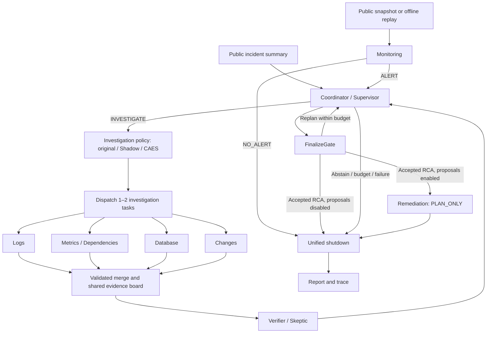

# IncidentLens

**English** | [简体中文](README.zh-CN.md)

An evidence-driven multi-agent system for software incident investigation.
The system cross-checks logs, metrics, database observations and changes to investigate
pool configuration, PostgreSQL connection exhaustion, lock contention and slow queries,
Redis outages, external payment timeouts and resource saturation. It produces a cited
root-cause report or explicit abstention. An optional response workflow adds public
snapshot monitoring and remediation proposals without executing production changes.

## Background

Production incident review is evidence-heavy: logs, metrics and change history
must be cross-checked before any causal claim is credible. Generic LLM agents
tend to over-claim here — they summarize plausible stories without citations,
ignore data-access boundaries, and rarely admit when the evidence is not enough.

IncidentLens is a personal research project built from scratch to explore a
stricter contract for agent-driven root-cause analysis (RCA):

- every conclusion must cite the exact records that support it;
- agents operate inside explicit permission boundaries over read-only evidence;
- when the visible evidence does not identify a cause, the system abstains
  (`INCONCLUSIVE`) instead of guessing.

The codebase doubles as a reproducible playground for studying multi-agent
orchestration: dynamic dispatch, batch validation, verifier feedback loops and
deterministic grounding gates are all inspectable end to end.

## Highlights

- **Dynamic investigation and response** — one LangGraph workflow connects monitoring,
  coordination, four specialist roles, finalization, proposals and unified stopping; the
  Verifier review is an optional, separately measured ablation.
- **Cited or abstain** — deterministic gates check candidates, citations and review versions;
  insufficient evidence produces `INCONCLUSIVE`.
- **Evidence-first permissions** — role-scoped read-only tools, immutable contexts,
  actual-query ledgers and public file allowlists.
- **Bounded provider recovery** — classified transport failures, atomic request permits,
  task-local stage budgets and one targeted structured repair, enabled explicitly.
- **Optional CAES selection** — deterministic candidate generation, heuristic action scoring
  and budget-aware selection, with a default bypass and observational Shadow mode.
- **Offline Mock provider** — deterministic over supplied public evidence, without API keys or model weights.
- **Reproducible evaluation** — the `dynamic` primary architecture plus `single`, `fixed`
  and `dynamic (with verifier)` controls, paired database ablations and task recovery experiments.
- **IncidentBench** — a separate evidence corpus, evaluator-only candidate labels,
  equivalent-tool Graph comparisons, offline resume and saved-state rescoring.
- **Replay and UI** — Web and retained Streamlit dashboards expose evidence, hypotheses,
  alerts, proposals, tasks and stop events.
- **Optional explanation cache** — exact or conservative semantic reuse with strict namespaces and citation validation.

## Quick start (PowerShell)

Python 3.11+ is declared; Windows / Python 3.13 is verified. Install dependencies
once; Mock investigation then works offline without API keys or model weights.

```powershell
python -m venv .venv
.venv\Scripts\python.exe -m pip install -r requirements.lock
.venv\Scripts\python.exe -m pip install -e '.[dev]'
.venv\Scripts\python.exe -m incident_lens.cli validate-data
.venv\Scripts\python.exe -m incident_lens.cli list-cases
.venv\Scripts\python.exe -m incident_lens.cli run --case incident_001 --provider mock --cache-mode off --out results/demo001
.venv\Scripts\python.exe -m incident_lens.cli replay --trace results/demo001/trace.json
.venv\Scripts\python.exe -m incident_lens.cli web
```

Open the [local Web dashboard](http://127.0.0.1:8022) for the Web dashboard: overview, investigation,
run details and trace library, with light/dark themes and responsive navigation.
Use `web --port 8023` to change the port. The original Streamlit dashboard remains
available via `python -m streamlit run src/incident_lens/ui/app.py`.

Runs export `result.json`, `report.md` and `trace.json`. Replay validates saved
state without calling graph, tools or provider. The UI shows timeline, hypothesis
transitions, evidence, permissions, cache events and downloads; Recorded Replay
and Mock are visibly labeled.

## Agent workflow architecture



The diagram shows the full dynamic workflow: default `legacy_rca` starts from an
incident summary, while optional `incident_response` can begin with public snapshots
or offline replay and finish immediately on `NO_ALERT`. Monitoring is disabled by default;
the response profile can also start directly from an incident ID.

`dynamic` is the primary architecture and the runtime default: the Coordinator selects
specialists round by round, while Merge and FinalizeGate remain deterministic and do not
depend on a model review. `full` — displayed as *dynamic (with verifier)* — adds the
Verifier feedback loop and is retained only as an ablation control. `fixed` retains one
original three-expert batch, and `single` uses the single-agent baseline. Proposals run
only after an accepted RCA; terminal paths from every phase pass through the shutdown
protocol. The optional CAES module sits before dispatch and is currently scoped to the
`full` variant. It ranks tasks; FinalizeGate retains authority over evidence acceptance
and conclusions.

### Agent responsibilities

| Agent / role ID | Responsibility in one sentence |
| --- | --- |
| Monitoring (`monitoring`) | Detect anomalies in public snapshots or replay and emit alerts, allowing `NO_ALERT` for normal or insufficient evidence. |
| Coordinator / Supervisor (`coordinator`) | Assign or replan investigations from evidence gaps and remaining budgets, then choose finalization or abstention. |
| Log Investigator (`logs`) | Reconstruct error chronology and propagation from logs while separating causal signals from symptoms. |
| Metrics & Dependency Investigator (`metrics`) | Inspect service health, capacity and dependencies to locate the scope of an anomaly. |
| Database Investigator (`database`) | Analyze connections, sessions, locks and slow queries to distinguish database faults, application pool issues and downstream symptoms. |
| Change Investigator (`changes`) | Compare deployments and configuration changes with incident onset to identify possible triggers. |
| Verifier / Skeptic (`verifier`) | Challenge candidate causes using authorized shared evidence and request concrete checks for contradictions or gaps. |
| Remediation (`remediation`) | Produce evidence-supported proposals with preconditions, risks, verification and rollback steps for an accepted cause. |
| Single-Agent baseline (`single`) | Use one agent for planning, investigation and self-reflection in architecture comparisons. |

### Runtime and configuration

All roles use centralized LangGraph coordination, validated Merge, bounded task retries,
STOP handling and deterministic reporting. Budgets count physical requests, retries and
structured repairs. Budget exhaustion is a runtime failure; ordinary evidence
insufficiency ends in `INCONCLUSIVE`.

See the [operations and configuration guide](docs/readme-guide.md#runtime-and-budgets)
for profile budgets, phase limits, status semantics and stop behavior.

## Operations and configuration

The detailed operational material is now kept in the
[operations and configuration guide](docs/readme-guide.md):

- [Cost-Aware Evidence Selection](docs/readme-guide.md#cost-aware-evidence-selection-caes)
- [Runtime and budgets](docs/readme-guide.md#runtime-and-budgets)
- [Providers and configuration](docs/readme-guide.md#providers-and-configuration)
- [Evidence and permissions](docs/readme-guide.md#evidence-and-permissions)
- [Local explanation cache](docs/readme-guide.md#local-explanation-cache)

## IncidentBench tests

IncidentBench keeps public observations separate from evaluator-only labels and runs
the actual Graph under matched model, temperature, response format, public-data,
tool, budget and cache-off settings:

| Benchmark variant | Behavior |
| --- | --- |
| `strong_single_equivalent_tools` | One identity with equivalent tools and self-reflection |
| `fixed_four_equivalent_tools` | One fixed logs, metrics, database and changes batch |
| `dynamic_no_verifier` | Dynamic specialist selection without independent review (the `dynamic` primary architecture; the condition name is frozen for saved protocols) |
| `full` | Dynamic selection with Verifier feedback and FinalizeGate (the `dynamic (with verifier)` ablation) |

Technical failures remain in attempted-case denominators. A normal evidence-insufficient
`INCONCLUSIVE` is scored as abstention. Public development fixtures share encoder lineage
and are not independent blind Test data. See the
[IncidentBench guide](docs/incidentbench/README.md) for datasets, scoring and commands.

### Test result summary

**Hardened 36-case batch (2026-11-01).** `causal-world-v2-hardened`, 36 development
cases (29 identifiable, 7 abstaining), the same four architectures, four jobs and one
repeat — 144 slots in 4 h 39 min: 136 completed and 8 technical failures kept in the
denominator. Scored offline against the evaluator oracle; labels remain provisional.

| Architecture | Technical completion | Root correct | Correct abstention | Quality success | Avg latency | Avg requests | Avg tools | Avg tokens |
| --- | ---: | ---: | ---: | ---: | ---: | ---: | ---: | ---: |
| Single | 35/36 | 25/28 | 7/7 | 32/36 | 680.9s | 17.3 | 14.5 | 245,971 |
| Fixed-4 | 34/36 | 15/27 | 7/7 | 22/36 | 196.3s | 7.8 | 7.4 | 58,042 |
| **Dynamic (primary)** | 33/36 | **27/27** | 6/6 | **33/36** | 412.9s | 14.6 | 12.0 | 149,216 |
| Full (dynamic with verifier) | 34/36 | 23/27 | 7/7 | 30/36 | 503.8s | 17.6 | 15.5 | 233,772 |

`dynamic` leads and is the cheapest of the dynamic family: against Single it gains one
success with 39.4% less latency and 39.3% fewer tokens; against Full it gains three
successes with 18.0% less latency and 36.2% fewer tokens, so the Verifier loop produced
no measurable quality gain here and cost 56.7% more tokens. Fixed-4 is cheapest per run
(196s, 58k tokens) but wrongly abstained on 12 of 27 identifiable cases.

**No run named a wrong root cause.** All 19 identifiable misses ended in `INCONCLUSIVE`,
and all seven unidentifiable cases were correctly abstained in every completed run; the
observed failure mode is over-abstention, not fabrication. `dynamic` is also the only
variant at 7/7 on competing causes and 6/6 on counterfactual pairs. Six of the eight
technical failures were truncated structured output and two were identity-mismatched
findings, spread across all four variants — a provider-layer issue, not an architecture
defect.

Chinese report: [report.zh-CN.md](analysis/wp_d/reports/hardened144-20261101/report.zh-CN.md);
English summary and regenerate script: [analysis/wp_d/reports/hardened144-20261101](analysis/wp_d/reports/hardened144-20261101/README.md).

**Earlier 10-case batch (2026-10-31).** A development-visible WP-D run used
`auto/deepseek-v4.1-flash`, four jobs and one repeat over 10 cases with provisional
candidate-oracle labels. All 40 final slots completed. Only Full/3010 required retries.

| Architecture | Technical completion | Root correct | Correct abstention | Quality success | Avg latency | Avg requests | Avg tools | Avg tokens |
| --- | ---: | ---: | ---: | ---: | ---: | ---: | ---: | ---: |
| Single | 10/10 | 8/8 | 2/2 | 10/10 | 391.2s | 17.6 | 15.0 | 257,146 |
| Fixed-4 | 10/10 | 5/8 | 2/2 | 7/10 | 96.9s | 7.9 | 7.6 | 56,586 |
| **Dynamic (primary)** | 10/10 | 8/8 | 2/2 | 10/10 | 233.5s | 14.0 | 11.8 | 145,035 |
| Full (dynamic with verifier) | 10/10 | 8/8 | 2/2 | 10/10 | 438.9s | 18.8 | 15.9 | 269,832 |

**Why `dynamic` is the primary architecture.** Against Single: quality is identical
(10/10) while latency falls 40.3%, requests 20.5%, tool queries 21.3% and tokens 43.6%,
supporting the design claim that dynamic dispatch removes wasted queries and context.
Against Full (dynamic with verifier): quality is identical while latency is 88.0% higher,
requests 34.3% higher, tools 34.7% higher and tokens 86.0% higher — so the independent
Verifier produced no measurable quality gain in this batch, and we describe that only as
"no gain observed", not as proof that a Verifier can never help. Against Fixed-4: Fixed
is far cheaper (96.9s, 7.9 requests, 56,586 tokens) but wrongly abstains on three
identifiable cases (3004, 3005, 3010), which is exactly what a single fixed batch cannot
recover and what `dynamic` multi-round follow-up can.

This is one development-visible batch of 10 cases with a single repeat and candidate
labels; it is not a blind test and does not establish production behaviour. See the
[full Chinese report](results/v16/wp-d/full40-local-gateway-c4-20261031/report-final-all-success.zh-CN.md)
and [structured comparison](results/v16/wp-d/full40-local-gateway-c4-20261031/final-success-comparison.json).
The [primary-architecture analysis](analysis/wp_d/reports/dynamic-primary-architecture-20261101/README.md)
recomputes every figure above and states the evidence boundary; it also documents the
frozen `correctness` field in the saved comparison without rewriting it.

**Known weakness and what was done about it.** On the two unidentifiable cases of this
batch, `dynamic` used 2.39× the tokens it used on identifiable cases; `incident_3008` alone
cost 386.3s and 274,794 tokens but still ended in a correct abstention. Both cases were
actively abstained by the Coordinator rather than exhausted by a budget ceiling. A
deterministic cost guard now arms on "no candidate gained a cause-specific discriminator
for N consecutive rounds" (`WorkflowOptions.evidence_gap_rounds`, default 5, `0` disables),
emits `INVESTIGATION_EVIDENCE_EXHAUSTED` with a cost snapshot and publishes `INCONCLUSIVE`.
It changes only the budget, never what `FinalizeGate` would accept. Replaying it over the
frozen traces estimates −44.0% tokens on 3003, −21.9% on 3008 and −12.3% across the batch;
the default `max_rounds: 4` means the threshold cannot fire under the stock configuration.
The `causal-world-v2-hardened` lineage adds 36 development cases (29 identifiable,
7 abstaining) with standard, boundary, competing-rival, missing-discriminator,
misleading-evidence and counterfactual-pair levers; the 144-slot batch above measures
all of them.
Priority, ownership and acceptance criteria are in the
[optimization roadmap](docs/optimization-roadmap.zh-CN.md).

## Documentation

- [Course project handoff](docs/project-handoff.zh-CN.md) — Chinese onboarding guide for testing, reporting, slides, demo recording and presentation
- [Operations and configuration](docs/readme-guide.md) — CAES, budgets, providers, permissions and cache
- [IncidentBench tests](docs/incidentbench/README.md) — datasets, protocols, scoring and commands
- [Investigation protocol](docs/protocol.md) — run lifecycle, gates and budgets
- [Evaluation protocol](docs/evaluation.md) — variants, metrics and scoring rules
- [Optimization roadmap](docs/optimization-roadmap.zh-CN.md) — prioritized work with ownership and acceptance criteria
- [Cache design](docs/cache.md) — namespaces, hits and semantic reuse
- [Data generation and limitations](data/README.md) — synthetic fixtures and scope
- [Acceptance evidence](docs/acceptance/) — runs and audits
- [Code wiki](docs/code_wiki/README.md) — architecture, modules and implementation contracts
- [Demo walkthrough](docs/demo.md) — recorded demo script
