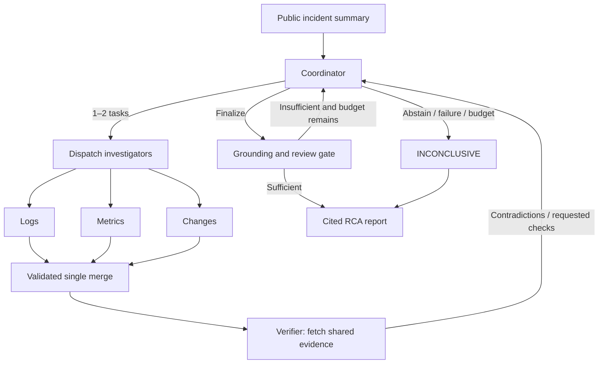

# IncidentLens

**English** | [简体中文](README.zh-CN.md)

An evidence-driven multi-agent system for software incident investigation.
The MVP dynamically investigates five mechanisms: backend pool configuration,
PostgreSQL connections, Redis outages, external payment timeouts and backend
resource saturation. It produces a cited root-cause report or explicit abstention.

## Background

Production incident review is evidence-heavy: logs, metrics and change history
must be cross-checked before any causal claim is credible. Generic LLM agents
tend to over-claim here — they summarize plausible stories without citations,
ignore data-access boundaries, and rarely admit when the evidence is not enough.

IncidentLens is a personal research project built from scratch to explore a
stricter contract for agent-driven root-cause analysis (RCA):

- every conclusion must cite the exact records that support it;
- agents operate inside explicit permission boundaries over read-only evidence;
- when the visible evidence does not identify a cause, the system abstains
  (`INCONCLUSIVE`) instead of guessing.

The codebase doubles as a reproducible playground for studying multi-agent
orchestration: dynamic dispatch, batch validation, verifier feedback loops and
deterministic grounding gates are all inspectable end to end.

## Highlights

- **Dynamic investigation loop** — LangGraph StateGraph drives coordinator,
  investigators, verifier and a grounding/review gate.
- **Cited or abstain** — finalization rejects rejected candidates, unresolved
  questions and missing causal support; otherwise the run ends in explicit
  abstention.
- **Evidence-first permissions** — six read-only tools, server-issued immutable
  contexts, actual-query ledgers and public file allowlists.
- **Offline Mock provider** — deterministic over supplied public evidence; no
  API keys or model weights required.
- **Reproducible evaluation** — four ablation variants sharing inputs, budgets
  and grounding rules, with separated accuracy/abstention/citation denominators.
- **Replay and UI** — saved traces replay without calling graph, tools or
  provider; a Streamlit dashboard shows timelines, hypothesis transitions,
  evidence, permissions and cache events.
- **Optional explanation cache** — exact or conservative semantic reuse with
  strict namespaces and citation validation.

## Use cases

- **Learning and prototyping** — study how a coordinator/investigator/verifier
  multi-agent loop behaves under strict evidence and budget constraints.
- **Offline demos and teaching** — run a full investigation, replay and UI tour
  on a laptop with no model access.
- **Architecture ablation studies** — compare single-agent, fixed-expert,
  dynamic-no-verifier and full variants under identical budgets.
- **Agent sandboxing patterns** — reference implementation for permission
  ledgers, allowlists and untrusted-excerpt handling around LLM tool calls.

## Quick start (PowerShell)

Python 3.11+ is declared; Windows / Python 3.13 is verified. Install dependencies
once; Mock investigation then works offline without API keys or model weights.

```powershell
python -m venv .venv
.venv\Scripts\python.exe -m pip install -r requirements.lock
.venv\Scripts\python.exe -m pip install -e '.[dev]'
.venv\Scripts\python.exe -m incident_lens.cli validate-data
.venv\Scripts\python.exe -m incident_lens.cli list-cases
.venv\Scripts\python.exe -m incident_lens.cli run --case incident_001 --provider mock --cache-mode off --out results/demo001
.venv\Scripts\python.exe -m incident_lens.cli replay --trace results/demo001/trace.json
.venv\Scripts\python.exe -m incident_lens.cli web
```

Open http://127.0.0.1:8022 for the Web dashboard: overview, investigation,
run details and trace library, with light/dark themes and responsive navigation.
Use `web --port 8023` to change the port. The original Streamlit dashboard remains
available via `python -m streamlit run src/incident_lens/ui/app.py`.

Runs export `result.json`, `report.md` and `trace.json`. Replay validates saved
state without calling graph, tools or provider. The UI shows timeline, hypothesis
transitions, evidence, permissions, cache events and downloads; Recorded Replay
and Mock are visibly labeled.

## Architecture



LangGraph StateGraph drives the entire loop. Investigators return local outputs;
one merge validates the complete batch against issued identity and actual-query
ledger before publishing. Coordinator receives findings and evidence references,
without raw tool-event history. Verifier receives only authorized fetched records.
Review fingerprints bind candidate and evidence versions. Finalization rejects
rejected candidates, unresolved questions, competing hypotheses and missing causal
support. Reporter is deterministic.

Defaults: 4 rounds, 12 tools, 16 actual model requests, 90 seconds, one JSON repair.
CLI reads `configs/system.yaml`; flags override it. `--max-tokens` prevents further
requests after measured usage exhausts the cap; an in-flight response may exceed
it. Known subtotals are retained; unknown usage is explicitly marked incomplete.

## Providers and configuration

Copy `.env.example` to project-local `.env`. Real mode requires:

| Variable | Meaning |
| --- | --- |
| `INCIDENT_LENS_BASE_URL` | Chat-completions base URL or full endpoint |
| `INCIDENT_LENS_API_KEY` | Local secret, never exported or committed |
| `INCIDENT_LENS_MODEL` | Provider model identifier |
| `CACHE_MODE` | off (default), exact, semantic |
| `CACHE_DB_PATH` | SQLite file path |
| `CACHE_SIMILARITY_THRESHOLD` | At least 0.95 |
| `CACHE_TTL_HOURS` | Expiry, default 24 |
| `CACHE_EMBEDDING_MODEL` | fake or an explicitly installed local model |

```powershell
.venv\Scripts\python.exe -m incident_lens.cli run --case incident_001 --provider real --out results/real001
```

The default `json_schema` mode requires server support for strict JSON Schema.
For a JSON-mode endpoint, explicitly select `--response-format json_object`;
both modes validate every response against the same local Pydantic contract.
`--thinking disabled` and `--request-timeout 60` are explicit optional transport
settings. The corresponding project-local environment variables are
`INCIDENT_LENS_RESPONSE_FORMAT`, `INCIDENT_LENS_THINKING`, and
`INCIDENT_LENS_REQUEST_TIMEOUT`; the dashboard exposes these settings too.
Missing configuration,
incompatibility and transport failures are explicit; real never falls back to
Mock. HTTP fixture tests validate adapter behavior, not live endpoint compatibility.
Mock is deterministic over supplied public evidence and never reads private
labels or looks up answers by incident ID. Its results demonstrate correctness,
not real-model accuracy or architecture superiority.

## Evidence and permissions

The dataset contains 6 seed, 10 dev and 20 held-out synthetic cases with neutral
IDs and frozen split files. Missing-data cases require abstention. Shared causal
templates are smoke fixtures, not an independently collected production benchmark.
See [data generation and limitations](data/README.md).

The six tools are read-only: query_logs; query_metrics/get_dependencies;
query_changes/get_config_diff; fetch_evidence_by_ids. Server-issued immutable
contexts enforce role/workspace/incident/run and actual-query ledgers. Public file
allowlists reject private truth, traversal and symlink/junction escapes. Excerpts
are untrusted data. This is application isolation, not an OS Python sandbox.

## Local explanation cache

Only logs/metrics/changes explanations are cacheable. Routing, reviews, reports
and tool queries execute normally. Hits require current queried records, strict
namespace and valid citations; finding/task/run identities are rebound before
merge. Each run refreshes dataset revision. Namespace also includes evidence hash,
identity, task type, prompt, model/parameters, schema and ACL versions.

Semantic reuse combines NumPy cosine with conservative ordered-token equivalence.
FakeEmbedder is an offline test aid, not a learned semantic model. Optional
SentenceTransformer uses explicitly installed local weights. See [cache](docs/cache.md).

```powershell
.venv\Scripts\python.exe scripts/run_cache_eval.py --provider mock --out results/cache-experiment
```

## Evaluation and validation

```powershell
.venv\Scripts\python.exe scripts/run_eval.py --split dev --variant all --provider mock --out results/eval-mock
.venv\Scripts\python.exe scripts/run_eval.py --split dev --variant all --provider real --out results/eval-real
.venv\Scripts\python.exe scripts/run_eval.py --split test --variant all --provider real --out results/final
.venv\Scripts\python.exe -m pytest -q
.venv\Scripts\python.exe -m ruff check src tests scripts
.venv\Scripts\python.exe scripts/verify_install.py --out results/fresh-install
```

Single (all tools plus self-reflection), fixed (one fixed expert batch),
dynamic_no_verifier and full share inputs, model, temperature, budgets and
grounding rules. Architecture comparisons force cache off. Evaluator reads truth
only after execution. Outputs: case-level.csv, aggregate.csv, raw-runs.jsonl and
error-analysis.md. Accuracy/abstention/citation denominators remain separate;
unknown tokens/cost and unreviewed semantic support stay blank. Equal tool budgets
do not imply equal tokens. See [evaluation protocol](docs/evaluation.md).

Installation verification builds a wheel, installs pinned dependencies in a fresh
environment and runs validation/investigation/replay. It preserves logs and
refuses to overwrite an existing verification environment.

## Documentation

- [Investigation protocol](docs/protocol.md) — run lifecycle, gates and budgets
- [Dependencies and ownership](docs/phase-plan.md) — phase plan and module map
- [Demo walkthrough](docs/demo.md) — recorded demo script
- [Evaluation protocol](docs/evaluation.md) — variants, metrics and scoring rules
- [Cache design](docs/cache.md) — namespaces, hits and semantic reuse
- [Analysis](docs/analysis.md) — result analysis notes
- [Data generation and limitations](data/README.md) — synthetic fixtures and scope
- [Acceptance evidence](docs/acceptance/) — acceptance runs and audits
- [Source snapshots](docs/source/) — design and plan snapshots
- [Contribution mapping](docs/contributions.md) — responsibility-to-evidence matrix

Generated commits do not prove individual students' personal contributions.

## Contributing

Contributions, questions and feature ideas are welcome — this is a personal
project maintained on a best-effort basis, so small, focused changes are the
easiest to review.

- **Report a bug** — open an issue describing the case ID, provider
  (`mock`/`real`), the exact CLI command and, if possible, the run's
  `trace.json`. Mock runs are fully reproducible offline, which makes them the
  preferred vehicle for bug reports.
- **Suggest a feature or improvement** — open an issue first to discuss scope
  before investing in a large change. Honest-scope additions (docs, evaluation
  scripts, isolation tests) are especially welcome.
- **Submit a pull request** — keep PRs focused on one change; keep the offline
  Mock path working; update the matching section in both `README.md` and
  `README.zh-CN.md` when behavior or commands change.
- **Development checks** — before submitting, run:

```powershell
.venv\Scripts\python.exe -m pytest -q
.venv\Scripts\python.exe -m ruff check src tests scripts
```

Code style follows Ruff (`line-length = 100`, `py311`). All external calls use
explicit error handling and logging; coordinates, keys and thresholds are read
from configuration rather than hardcoded.

## Limitations and honest scope

This is a personal research and learning project. Live LLM comparisons, learned
embedding performance and manual semantic citation review require separate
measured acceptance before research-performance claims. The synthetic dataset
shares five causal templates and does not establish production generalization;
test membership is a holdout convention, not proof of blind evaluation. Mock
results demonstrate correctness of the pipeline, not real-model accuracy or
architecture superiority. See the sections above and linked documents for the
full boundary of every claim.
