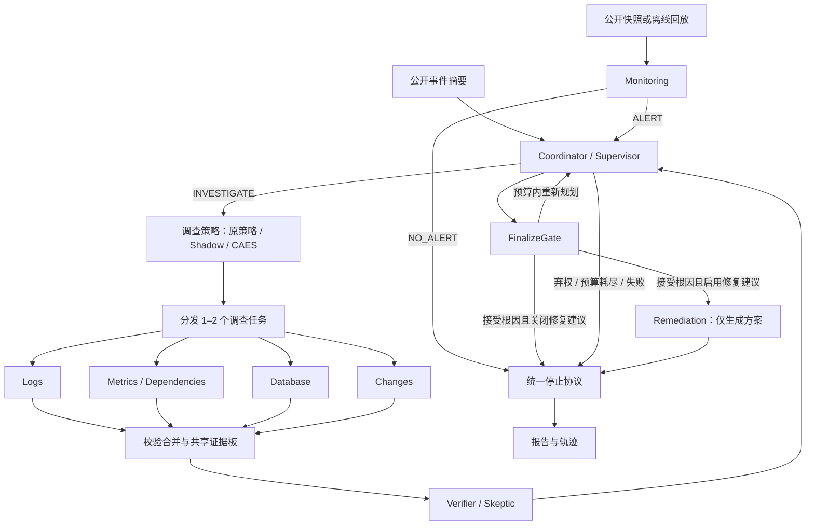

# IncidentLens

[English](README.md) | **简体中文**

一个以证据为驱动的软件事故排查多智能体系统。
系统交叉调查日志、指标、数据库与变更记录，覆盖连接池配置、PostgreSQL 连接耗尽、
锁竞争与慢查询、Redis 不可用、外部支付超时以及资源饱和，产出带引用的根因报告或明确弃权。
可选事件响应流程支持公开快照监控和修复方案生成；修复阶段只输出建议，不执行生产变更。

## 项目背景

生产事故复盘是一项高度依赖证据的工作:任何因果结论都必须经过日志、指标与
变更历史的交叉验证。通用 LLM 智能体在这里容易"过度断言"——给出看似合理却
没有引用的故事,无视数据访问边界,也很少承认证据不足。

IncidentLens 是一个从零构建的个人研究项目,旨在探索智能体驱动根因分析(RCA)
的更严格契约:

- 每个结论都必须引用支撑它的具体记录;
- 智能体在显式的权限边界内操作只读证据;
- 当可见证据无法定位根因时,系统选择弃权(`INCONCLUSIVE`),而不是猜测。

代码库同时也是一个可复现的多智能体编排研究场:动态任务分发、批量校验、
验证器反馈回路与确定性落地门控,全部端到端可检查。

## 功能亮点

- **动态调查与事件响应** —— 单一 LangGraph 工作流连接监控、协调、四类调查者、验证、定稿、修复建议和统一停止。
- **有据可依，否则弃权** —— 确定性门控检查候选、引用与评审版本，证据不足时输出 `INCONCLUSIVE`。
- **证据优先的权限体系** —— 按角色授权的只读工具、不可变上下文、实际查询账本与公共文件白名单。
- **有界 Provider 恢复** — 显式启用故障分类、原子请求 permit、任务局部阶段预算和至多一次定向结构化修复。
- **可选 CAES 选择** —— 确定性候选生成、启发式行动评分与预算约束选择，默认保持原策略，支持观测式 Shadow。
- **离线 Mock 提供方** —— 在给定公共证据上确定性运行，无需 API 密钥或模型权重。
- **可复现评估** —— 四个原有消融变体、数据库配对消融与任务失败恢复实验。
- **IncidentBench** —— 独立证据数据、评测器专用候选标签、等价工具 Graph 对比、离线恢复与保存状态重算。
- **回放与 UI** —— Web 控制台和保留的 Streamlit 页面展示证据、假设、告警、修复方案、任务与停止事件。
- **可选解释缓存** —— 精确匹配或保守语义复用，带严格命名空间与引用校验。

## 快速开始 (PowerShell)

项目声明支持 Python 3.11+;已在 Windows / Python 3.13 上验证。安装一次依赖后,
Mock 排查即可完全离线运行,无需 API 密钥或模型权重。

```powershell
python -m venv .venv
.venv\Scripts\python.exe -m pip install -r requirements.lock
.venv\Scripts\python.exe -m pip install -e '.[dev]'
.venv\Scripts\python.exe -m incident_lens.cli validate-data
.venv\Scripts\python.exe -m incident_lens.cli list-cases
.venv\Scripts\python.exe -m incident_lens.cli run --case incident_001 --provider mock --cache-mode off --out results/demo001
.venv\Scripts\python.exe -m incident_lens.cli replay --trace results/demo001/trace.json
.venv\Scripts\python.exe -m incident_lens.cli web
```

打开 [本地 Web 控制台](http://127.0.0.1:8022) 使用 Web 控制台：总览、新建调查、运行详情与痕迹档案库，
支持深浅主题和移动端导航。可用 `web --port 8023` 更改端口。
原 Streamlit 页面仍可通过 `python -m streamlit run src/incident_lens/ui/app.py` 启动。

运行会导出 `result.json`、`report.md` 与 `trace.json`。回放仅校验已保存的状态,
不调用图、工具或提供方。UI 展示时间线、假设迁移、证据、权限、缓存事件与下载;
录制回放和 Mock 均有明确标识。

## Agent 工作流架构



图中展示完整动态流程：默认 `legacy_rca` 从事件摘要进入协调者；可选
`incident_response` 可从公开快照或离线回放进入监控，无告警时直接收尾。
监控默认关闭，事件响应模式也可直接由事件 ID 启动。`full` 使用验证反馈回路，
`dynamic_no_verifier` 跳过验证器，`fixed` 保留一次原有三专家批次，`single` 使用单智能体基线。
只有定稿门控接受根因后，启用的修复阶段才生成方案；各阶段终止路径统一经过停止协议。
可选 CAES 模块位于 `full` 变体的任务分发之前，负责调查任务排序；证据接纳和最终
结论仍由原 Verifier 与 FinalizeGate 决定。

### Agent 职责

| Agent / 角色标识                                  | 一句话职责                                 |
| --------------------------------------------- | ------------------------------------------- |
| Monitoring (`monitoring`)                     | 根据公开快照或回放识别异常并生成告警，证据不足或正常时允许输出 `NO_ALERT`。 |
| Coordinator / Supervisor (`coordinator`)      | 根据证据缺口和剩余预算分配或重规划调查任务，并决定定稿或弃权。             |
| Log Investigator (`logs`)                     | 从日志还原错误时间线与传播过程，区分因果信号和伴随症状。                |
| Metrics & Dependency Investigator (`metrics`) | 检查服务健康、容量与依赖状态，定位异常影响范围。                    |
| Database Investigator (`database`)            | 分析连接、会话、锁和慢查询，区分数据库内部故障、应用连接池问题与下游症状。       |
| Change Investigator (`changes`)               | 对照事故起点检查部署和配置差异，识别可能触发故障的变更。                |
| Verifier / Skeptic (`verifier`)               | 基于授权共享证据质疑候选根因，并提出矛盾或具体补充检查。                |
| Remediation (`remediation`)                   | 为已接受的根因生成带证据、前提、风险、验证与回滚步骤的修复建议。            |
| Single-Agent 基线 (`single`)                    | 由同一智能体完成规划、调查和自我反思，用于架构对比。                  |

### 运行机制与配置

所有角色使用中心化 LangGraph 协调、校验合并、有限任务重试、STOP 处理和确定性报告。
预算计量物理请求、重试和结构化修复。预算耗尽属于运行时失败；普通证据不足则以
`INCONCLUSIVE` 正常弃答。

两种工作流的预算、阶段限制、状态语义和停止规则见
[运行与配置指南](docs/readme-guide.zh-CN.md#运行机制与预算)。

## 运行与配置

详细操作说明已移至 [运行与配置指南](docs/readme-guide.zh-CN.md)：

- [成本感知证据选择（CAES）](docs/readme-guide.zh-CN.md#成本感知证据选择caes)
- [运行机制与预算](docs/readme-guide.zh-CN.md#运行机制与预算)
- [模型提供方与配置](docs/readme-guide.zh-CN.md#模型提供方与配置)
- [证据与权限](docs/readme-guide.zh-CN.md#证据与权限)
- [本地解释缓存](docs/readme-guide.zh-CN.md#本地解释缓存)

## IncidentBench 测试

IncidentBench 将公开观测与评测器专用标签分离，并在相同模型、温度、响应格式、
公开数据、工具权限、预算和关闭缓存条件下运行实际 Graph：

| 测试变体 | 调查方式 |
| --- | --- |
| `strong_single_equivalent_tools` | 同一运行身份使用全部等价工具并自我反思 |
| `fixed_four_equivalent_tools` | 日志、指标、数据库和变更专家执行一次固定批次 |
| `dynamic_no_verifier` | 动态选择专家，不执行独立审核 |
| `full` | 动态选择专家，并由 Verifier 反馈和 FinalizeGate 定稿 |

技术失败保留在尝试案例分母中；正常证据不足的 `INCONCLUSIVE` 计为弃答。
公开开发夹具共享编码器来源，不是独立盲测 Test。数据、评分和命令见
[IncidentBench 测试指南](docs/incidentbench/README.md)。

### 测试结果简述

一次开发可见的完整 WP-D 测试使用 `auto/deepseek-v4.1-flash`、4 并发和单次重复，
覆盖 10 个候选 oracle 案例。40 个最终槽位全部完成；仅 Full/3010 经过重试。

| 架构 | 技术完成 | 根因正确 | 正确弃答 | 质量成功 | 平均耗时 | 平均请求 | 平均工具 | 平均 Token |
| --- | ---: | ---: | ---: | ---: | ---: | ---: | ---: | ---: |
| Single | 10/10 | 8/8 | 2/2 | 10/10 | 391.2s | 17.6 | 15.0 | 257,146 |
| Fixed-4 | 10/10 | 5/8 | 2/2 | 7/10 | 96.9s | 7.9 | 7.6 | 56,586 |
| Dynamic（无 Verifier） | 10/10 | 8/8 | 2/2 | 10/10 | 233.5s | 14.0 | 11.8 | 145,035 |
| Full | 10/10 | 8/8 | 2/2 | 10/10 | 438.9s | 18.8 | 15.9 | 269,832 |

**多 Agent 优势。** Dynamic（无 Verifier）与 Single、Full 的质量同为 10/10，
但相对 Single 将平均耗时降低 40.3%、请求降低 20.5%、工具查询降低 21.3%、
Token 降低 43.6%。Fixed-4 最快且最省，但在 3 个可识别案例中错误弃答。
Full 与 Single 质量相同，却使用更多耗时、请求、工具和 Token。
[完整报告](results/v16/wp-d/full40-local-gateway-c4-20261031/report-final-all-success.zh-CN.md)
与 [结构化对比](results/v16/wp-d/full40-local-gateway-c4-20261031/final-success-comparison.json)。

## 文档

- [课程项目交接指南](docs/project-handoff.zh-CN.md) —— 面向测试、报告、PPT、Demo 与现场汇报的完整上手说明
- [运行与配置指南](docs/readme-guide.zh-CN.md) —— CAES、预算、模型配置、证据权限与缓存
- [IncidentBench 测试指南](docs/incidentbench/README.md) —— 数据、协议、评分与命令
- [排查协议](docs/protocol.md) —— 运行生命周期、门控与预算
- [评估协议](docs/evaluation.md) —— 变体、指标与计分规则
- [缓存设计](docs/cache.md) —— 命名空间、命中与语义复用
- [数据生成与局限](data/README.md) —— 合成夹具与适用范围
- [验收证据](docs/acceptance/) —— 验收运行与审计
- [代码百科](docs/code_wiki/README.md) —— 架构、模块与实现契约
- [演示脚本](docs/demo.md) —— 录制演示流程
