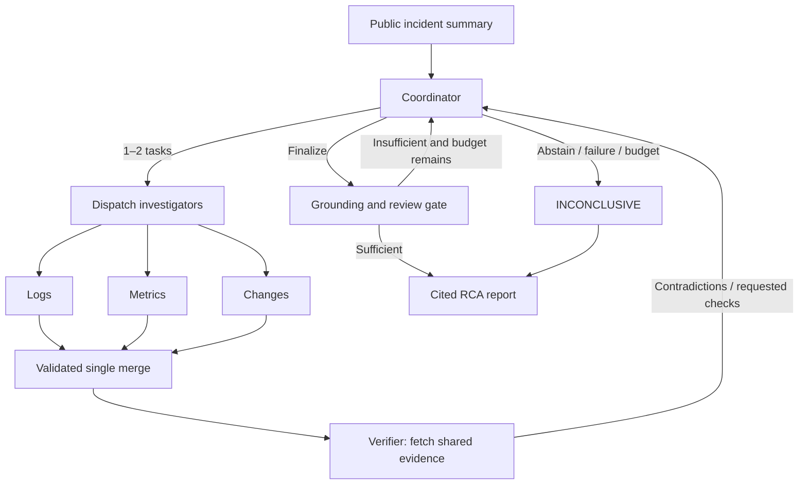

# IncidentLens

[English](README.md) | **简体中文**

一个以证据为驱动的软件事故排查多智能体系统。
MVP 会动态排查五类故障机制:后端连接池配置、PostgreSQL 连接、Redis 不可用、
外部支付超时以及后端资源饱和。最终产出一份带引用的根因报告,或明确弃权。

## 项目背景

生产事故复盘是一项高度依赖证据的工作:任何因果结论都必须经过日志、指标与
变更历史的交叉验证。通用 LLM 智能体在这里容易"过度断言"——给出看似合理却
没有引用的故事,无视数据访问边界,也很少承认证据不足。

IncidentLens 是一个从零构建的个人研究项目,旨在探索智能体驱动根因分析(RCA)
的更严格契约:

- 每个结论都必须引用支撑它的具体记录;
- 智能体在显式的权限边界内操作只读证据;
- 当可见证据无法定位根因时,系统选择弃权(`INCONCLUSIVE`),而不是猜测。

代码库同时也是一个可复现的多智能体编排研究场:动态任务分发、批量校验、
验证器反馈回路与确定性落地门控,全部端到端可检查。

## 功能亮点

- **动态排查循环** —— LangGraph StateGraph 驱动协调者、调查者、验证器与
  落地/评审门控。
- **有据可依,否则弃权** —— 定稿阶段拒绝被否决的候选、未解决的疑问与缺失的
  因果支撑;否则本次运行以明确弃权收尾。
- **证据优先的权限体系** —— 六个只读工具、服务端签发的不可变上下文、实际查询
  账本与公共文件白名单。
- **离线 Mock 提供方** —— 在给定公共证据上完全确定;无需 API 密钥或模型权重。
- **可复现的评估体系** —— 四个消融变体共享输入、预算与落地规则,准确率/弃权率/
  引用率的分母彼此分离。
- **回放与 UI** —— 保存的轨迹无需调用图、工具或提供方即可回放;Streamlit
  仪表盘展示时间线、假设迁移、证据、权限与缓存事件。
- **可选解释缓存** —— 精确匹配或保守的语义复用,带严格命名空间与引用校验。

## 使用场景

- **学习与原型验证** —— 观察协调者/调查者/验证器多智能体循环在严格证据与
  预算约束下的行为。
- **离线演示与教学** —— 在一台笔记本上完成完整排查、回放与 UI 演示,无需
  访问任何模型。
- **架构消融研究** —— 在相同预算下对比单智能体、固定专家组、动态无验证器
  与完整变体。
- **智能体沙箱模式参考** —— 围绕 LLM 工具调用实现权限账本、白名单与
  不可信摘录处理的参考实现。

## 快速开始 (PowerShell)

项目声明支持 Python 3.11+;已在 Windows / Python 3.13 上验证。安装一次依赖后,
Mock 排查即可完全离线运行,无需 API 密钥或模型权重。

```powershell
python -m venv .venv
.venv\Scripts\python.exe -m pip install -r requirements.lock
.venv\Scripts\python.exe -m pip install -e '.[dev]'
.venv\Scripts\python.exe -m incident_lens.cli validate-data
.venv\Scripts\python.exe -m incident_lens.cli list-cases
.venv\Scripts\python.exe -m incident_lens.cli run --case incident_001 --provider mock --cache-mode off --out results/demo001
.venv\Scripts\python.exe -m incident_lens.cli replay --trace results/demo001/trace.json
.venv\Scripts\python.exe -m incident_lens.cli web
```

打开 http://127.0.0.1:8022 使用 Web 控制台：总览、新建调查、运行详情与痕迹档案库，
支持深浅主题和移动端导航。可用 `web --port 8023` 更改端口。
原 Streamlit 页面仍可通过 `python -m streamlit run src/incident_lens/ui/app.py` 启动。

运行会导出 `result.json`、`report.md` 与 `trace.json`。回放仅校验已保存的状态,
不调用图、工具或提供方。UI 展示时间线、假设迁移、证据、权限、缓存事件与下载;
录制回放和 Mock 均有明确标识。

## 架构



LangGraph StateGraph 驱动整个循环。调查者返回局部输出;单次合并会在发布前,
依据已签发的身份与实际查询账本校验完整批次。协调者接收发现与证据引用,
而不接收原始工具事件历史。验证器仅接收已授权拉取的记录。评审指纹绑定候选与
证据版本。定稿阶段拒绝被否决的候选、未解决的疑问、相互竞争的假设与缺失的
因果支撑。报告生成器是确定性的。

默认预算:4 轮、12 次工具调用、16 次实际模型请求、90 秒、一次 JSON 修复。
CLI 读取 `configs/system.yaml`;命令行参数可覆盖配置。`--max-tokens` 在已计量
用量达到上限后阻止进一步请求;进行中的响应可能略微超出上限。已知的小计会被
保留;未知用量会显式标记为不完整。

## 模型提供方与配置

将 `.env.example` 复制为项目本地的 `.env`。真实模式需要:

| 变量 | 含义 |
| --- | --- |
| `INCIDENT_LENS_BASE_URL` | Chat-completions 基础 URL 或完整端点 |
| `INCIDENT_LENS_API_KEY` | 本地密钥,永不导出或提交 |
| `INCIDENT_LENS_MODEL` | 提供方模型标识 |
| `CACHE_MODE` | off(默认)、exact、semantic |
| `CACHE_DB_PATH` | SQLite 文件路径 |
| `CACHE_SIMILARITY_THRESHOLD` | 至少 0.95 |
| `CACHE_TTL_HOURS` | 过期时间,默认 24 |
| `CACHE_EMBEDDING_MODEL` | fake 或显式安装的本地模型 |

```powershell
.venv\Scripts\python.exe -m incident_lens.cli run --case incident_001 --provider real --out results/real001
```

默认的 `json_schema` 模式要求服务端支持严格 JSON Schema。对于 JSON-mode 端点,
请显式选择 `--response-format json_object`;两种模式都使用同一份本地 Pydantic
契约校验每个响应。`--thinking disabled` 与 `--request-timeout 60` 是显式的可选
传输设置。对应的项目本地环境变量为 `INCIDENT_LENS_RESPONSE_FORMAT`、
`INCIDENT_LENS_THINKING` 与 `INCIDENT_LENS_REQUEST_TIMEOUT`;仪表盘同样暴露
这些设置。配置缺失、不兼容与传输失败都会显式报告;真实模式永不回退到 Mock。
HTTP fixture 测试验证的是适配器行为,而非在线端点兼容性。Mock 在给定公共证据上
是确定性的,从不读取私有标签,也不会按事故 ID 查答案。其结果证明的是正确性,
而不是真实模型精度或架构优越性。

## 证据与权限

数据集包含 6 个种子、10 个开发与 20 个留出的合成用例,使用中性 ID 与冻结的
划分文件。证据缺失的用例要求弃权。共享因果模板只是冒烟测试夹具,并非独立
采集的生产基准。参见[数据生成与局限](data/README.md)。

六个工具均为只读:query_logs;query_metrics/get_dependencies;
query_changes/get_config_diff;fetch_evidence_by_ids。服务端签发的不可变上下文
强制执行角色/工作区/事故/运行与实际查询账本。公共文件白名单拒绝私有真值、
路径穿越与符号链接/junction 逃逸。摘录被视为不可信数据。这是应用层隔离,
不是操作系统级 Python 沙箱。

## 本地解释缓存

仅日志/指标/变更的解释可被缓存。路由、评审、报告与工具查询照常执行。
命中要求当前已查询记录、严格命名空间与有效引用;finding/task/run 身份在合并前
会重新绑定。每次运行都会刷新数据集修订号。命名空间还包含证据哈希、身份、
任务类型、提示词、模型/参数、schema 与 ACL 版本。

语义复用结合 NumPy 余弦相似度与保守的有序 token 等价判定。FakeEmbedder 是
离线测试辅助工具,不是学习得到的语义模型。可选的 SentenceTransformer 使用
显式安装的本地权重。参见[缓存设计](docs/cache.md)。

```powershell
.venv\Scripts\python.exe scripts/run_cache_eval.py --provider mock --out results/cache-experiment
```

## 评估与验证

```powershell
.venv\Scripts\python.exe scripts/run_eval.py --split dev --variant all --provider mock --out results/eval-mock
.venv\Scripts\python.exe scripts/run_eval.py --split dev --variant all --provider real --out results/eval-real
.venv\Scripts\python.exe scripts/run_eval.py --split test --variant all --provider real --out results/final
.venv\Scripts\python.exe -m pytest -q
.venv\Scripts\python.exe -m ruff check src tests scripts
.venv\Scripts\python.exe scripts/verify_install.py --out results/fresh-install
```

Single(全部工具加自我反思)、fixed(一次固定专家组)、dynamic_no_verifier 与
full 共享输入、模型、温度、预算与落地规则。架构对比强制关闭缓存。评估器
仅在执行结束后读取真值。输出:case-level.csv、aggregate.csv、raw-runs.jsonl
与 error-analysis.md。准确率/弃权率/引用率的分母彼此分离;未知 token/成本与
未复核的语义支撑保持空白。相同的工具预算不意味着相同的 token 用量。参见
[评估协议](docs/evaluation.md)。

安装验证会构建 wheel,在全新环境中安装锁定依赖并执行验证/排查/回放。它会
保留日志,并拒绝覆盖已存在的验证环境。

## 文档

- [排查协议](docs/protocol.md) —— 运行生命周期、门控与预算
- [依赖与归属](docs/phase-plan.md) —— 阶段计划与模块地图
- [演示脚本](docs/demo.md) —— 录制演示流程
- [评估协议](docs/evaluation.md) —— 变体、指标与计分规则
- [缓存设计](docs/cache.md) —— 命名空间、命中与语义复用
- [分析笔记](docs/analysis.md) —— 结果分析记录
- [数据生成与局限](data/README.md) —— 合成夹具与适用范围
- [验收证据](docs/acceptance/) —— 验收运行与审计
- [源码快照](docs/source/) —— 设计与计划快照
- [贡献映射](docs/contributions.md) —— 职责与证据对应矩阵

生成的提交记录不能证明任何学生个体的个人贡献。

## 贡献指引

欢迎贡献、提问与功能建议 —— 这是一个尽力维护的个人项目,小而聚焦的改动
最容易被评审。

- **报告 Bug** —— 提 issue,写明用例 ID、提供方(`mock`/`real`)、完整 CLI
  命令,以及可能的话附上该次运行的 `trace.json`。Mock 运行可完全离线复现,
  是报告问题的首选方式。
- **建议功能或改进** —— 大改动请先提 issue 讨论范围。尤其欢迎"诚实边界"
  类的补充(文档、评估脚本、隔离测试)。
- **提交 Pull Request** —— 保持 PR 聚焦于单一改动;保持离线 Mock 路径可用;
  当行为或命令变化时,同步更新 `README.md` 与 `README.zh-CN.md` 中对应的
  章节。
- **开发检查** —— 提交前请运行:

```powershell
.venv\Scripts\python.exe -m pytest -q
.venv\Scripts\python.exe -m ruff check src tests scripts
```

代码风格遵循 Ruff(`line-length = 100`、`py311`)。所有外部调用都使用显式
错误处理与日志;坐标、密钥与阈值均从配置读取,不硬编码。

## 局限性与诚实声明

这是一个个人研究与学习项目。在线 LLM 对比、学习型嵌入的性能与人工语义引用
复核,都需要单独的实测验收后才能支撑研究性结论。合成数据集共享五套因果模板,
不能证明生产泛化能力;测试集归属只是留出约定,并非盲测证明。Mock 结果证明的
是流水线的正确性,而不是真实模型精度或架构优越性。每项声明的完整边界详见
上文章节与所链接的文档。
