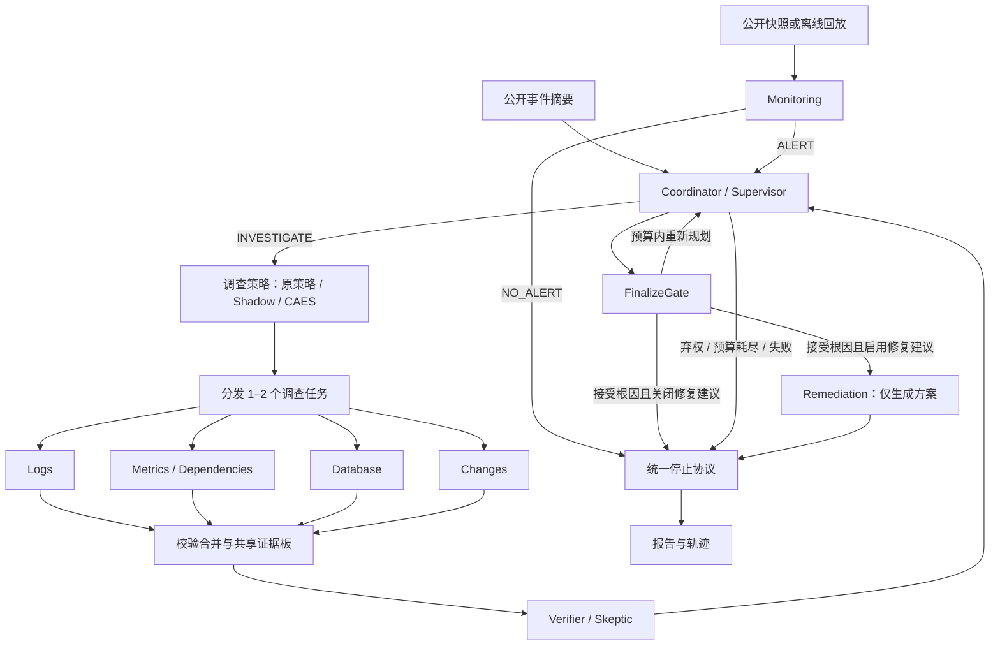

# IncidentLens

[English](README.md) | **简体中文**

一个以证据为驱动的软件事故排查多智能体系统。
系统交叉调查日志、指标、数据库与变更记录，覆盖连接池配置、PostgreSQL 连接耗尽、
锁竞争与慢查询、Redis 不可用、外部支付超时以及资源饱和，产出带引用的根因报告或明确弃权。
可选事件响应流程支持公开快照监控和修复方案生成；修复阶段只输出建议，不执行生产变更。

## 项目背景

生产事故复盘是一项高度依赖证据的工作:任何因果结论都必须经过日志、指标与
变更历史的交叉验证。通用 LLM 智能体在这里容易"过度断言"——给出看似合理却
没有引用的故事,无视数据访问边界,也很少承认证据不足。

IncidentLens 是一个从零构建的个人研究项目,旨在探索智能体驱动根因分析(RCA)
的更严格契约:

- 每个结论都必须引用支撑它的具体记录;
- 智能体在显式的权限边界内操作只读证据;
- 当可见证据无法定位根因时,系统选择弃权(`INCONCLUSIVE`),而不是猜测。

代码库同时也是一个可复现的多智能体编排研究场:动态任务分发、批量校验、
验证器反馈回路与确定性落地门控,全部端到端可检查。

## 功能亮点

- **动态调查与事件响应** —— 单一 LangGraph 工作流连接监控、协调、四类调查者、验证、定稿、修复建议和统一停止。
- **有据可依，否则弃权** —— 确定性门控检查候选、引用与评审版本，证据不足时输出 `INCONCLUSIVE`。
- **证据优先的权限体系** —— 按角色授权的只读工具、不可变上下文、实际查询账本与公共文件白名单。
- **有界 Provider 恢复** — 显式启用故障分类、原子请求 permit、任务局部阶段预算和至多一次定向结构化修复。
- **可选 CAES 选择** —— 确定性候选生成、启发式行动评分与预算约束选择，默认保持原策略，支持观测式 Shadow。
- **离线 Mock 提供方** —— 在给定公共证据上确定性运行，无需 API 密钥或模型权重。
- **可复现评估** —— 四个原有消融变体、数据库配对消融与任务失败恢复实验。
- **IncidentBench** —— 独立证据数据、评测器专用候选标签、等价工具 Graph 对比、离线恢复与保存状态重算。
- **回放与 UI** —— Web 控制台和保留的 Streamlit 页面展示证据、假设、告警、修复方案、任务与停止事件。
- **可选解释缓存** —— 精确匹配或保守语义复用，带严格命名空间与引用校验。

## 使用场景

- **学习与原型验证** —— 观察协调者/调查者/验证器多智能体循环在严格证据与
  预算约束下的行为。
- **离线演示与教学** —— 在一台笔记本上完成完整排查、回放与 UI 演示,无需
  访问任何模型。
- **架构消融研究** —— 在相同预算下对比单智能体、固定专家组、动态无验证器
  与完整变体。
- **智能体沙箱模式参考** —— 围绕 LLM 工具调用实现权限账本、白名单与
  不可信摘录处理的参考实现。

## 快速开始 (PowerShell)

项目声明支持 Python 3.11+;已在 Windows / Python 3.13 上验证。安装一次依赖后,
Mock 排查即可完全离线运行,无需 API 密钥或模型权重。

```powershell
python -m venv .venv
.venv\Scripts\python.exe -m pip install -r requirements.lock
.venv\Scripts\python.exe -m pip install -e '.[dev]'
.venv\Scripts\python.exe -m incident_lens.cli validate-data
.venv\Scripts\python.exe -m incident_lens.cli list-cases
.venv\Scripts\python.exe -m incident_lens.cli run --case incident_001 --provider mock --cache-mode off --out results/demo001
.venv\Scripts\python.exe -m incident_lens.cli replay --trace results/demo001/trace.json
.venv\Scripts\python.exe -m incident_lens.cli web
```

打开 [本地 Web 控制台](http://127.0.0.1:8022) 使用 Web 控制台：总览、新建调查、运行详情与痕迹档案库，
支持深浅主题和移动端导航。可用 `web --port 8023` 更改端口。
原 Streamlit 页面仍可通过 `python -m streamlit run src/incident_lens/ui/app.py` 启动。

运行会导出 `result.json`、`report.md` 与 `trace.json`。回放仅校验已保存的状态,
不调用图、工具或提供方。UI 展示时间线、假设迁移、证据、权限、缓存事件与下载;
录制回放和 Mock 均有明确标识。

## Agent 工作流架构



图中展示完整动态流程：默认 `legacy_rca` 从事件摘要进入协调者；可选
`incident_response` 可从公开快照或离线回放进入监控，无告警时直接收尾。
监控默认关闭，事件响应模式也可直接由事件 ID 启动。`full` 使用验证反馈回路，
`dynamic_no_verifier` 跳过验证器，`fixed` 保留一次原有三专家批次，`single` 使用单智能体基线。
只有定稿门控接受根因后，启用的修复阶段才生成方案；各阶段终止路径统一经过停止协议。
可选 CAES 模块位于 `full` 变体的任务分发之前，负责调查任务排序；证据接纳和最终
结论仍由原 Verifier 与 FinalizeGate 决定。

### Agent 职责

| Agent / 角色标识 | 一句话职责 |
| --- | --- |
| Monitoring (`monitoring`) | 根据公开快照或回放识别异常并生成告警，证据不足或正常时允许输出 `NO_ALERT`。 |
| Coordinator / Supervisor (`coordinator`) | 根据证据缺口和剩余预算分配或重规划调查任务，并决定定稿或弃权。 |
| Log Investigator (`logs`) | 从日志还原错误时间线与传播过程，区分因果信号和伴随症状。 |
| Metrics & Dependency Investigator (`metrics`) | 检查服务健康、容量与依赖状态，定位异常影响范围。 |
| Database Investigator (`database`) | 分析连接、会话、锁和慢查询，区分数据库内部故障、应用连接池问题与下游症状。 |
| Change Investigator (`changes`) | 对照事故起点检查部署和配置差异，识别可能触发故障的变更。 |
| Verifier / Skeptic (`verifier`) | 基于授权共享证据质疑候选根因，并提出矛盾或具体补充检查。 |
| Remediation (`remediation`) | 为已接受的根因生成带证据、前提、风险、验证与回滚步骤的修复建议。 |
| Single-Agent 基线 (`single`) | 由同一智能体完成规划、调查和自我反思，用于架构对比。 |

### 运行机制与预算

所有角色运行在同一个 LangGraph StateGraph 中，采用中心化通信。
调查者返回局部输出，Merge 在发布到共享证据板前按签发身份和实际查询账本校验批次；
协调者接收发现与证据引用，验证器仅获取授权记录，评审指纹绑定候选和证据版本。
FinalizeGate 拒绝被否决的候选、未解疑问、竞争假设和缺失的因果支撑。
TaskManager 管理有限重试；StopController 冻结任务与工具调用、取消工作并等待停止确认。
这些组件及确定性 Reporter 是运行时组件，不是额外的 LLM Agent；不支持树形通信。

| 配置 | 工作流 | 轮次 | 工具调用 | 实际模型请求 | 总时限 |
| --- | --- | --- | --- | --- | --- |
| [system.yaml](configs/system.yaml)（默认） | `legacy_rca` | 4 | 12 | 16 | 600 秒 |
| [incident-response.yaml](configs/incident-response.yaml) | `incident_response` | 6 | 24 | 24 | 600 秒 |

事件响应配置还限制监控调用为 8 次、修复调用为 2 次、单任务尝试为 2 次、停止确认等待为 5 秒；
阶段限额共享全局预算，JSON 修复请求也计入实际模型请求。默认单次模型请求时限为 180 秒，允许一次 JSON 修复。
CLI 参数可覆盖配置；`--max-tokens` 在已计量用量耗尽后阻止进一步请求，进行中的响应可能超过上限，未知用量显式标记不完整。

根因状态（`RESOLVED` / `INCONCLUSIVE`）、修复状态（`NOT_STARTED` / `PLAN_READY` / `PLAN_FAILED` / `SKIPPED`）
与工作流状态（`RUNNING` / `STOPPING` / `FINISHED` / `FAILED`）分别记录。
原有 `RCAReport.status` 仍支持 `RESOLVED` / `INCONCLUSIVE` / `ERROR`；`PLAN_READY` 只表示方案就绪，不表示服务恢复。

## 事件响应工作流

```powershell
.venv\Scripts\python.exe -m incident_lens.cli run --case incident_001 --provider mock --out results/legacy-demo
.venv\Scripts\python.exe -m incident_lens.cli run --case incident_037 --provider mock --config configs/incident-response.yaml --out results/response-demo
.venv\Scripts\python.exe -m incident_lens.cli run --case incident_037 --provider mock --config configs/incident-response.yaml --monitor-mode manual_snapshot --snapshot data/monitoring/normal.json --out results/no-alert-demo
.venv\Scripts\python.exe -m incident_lens.cli run --case incident_037 --provider mock --config configs/incident-response.yaml --monitor-mode offline_replay --snapshot data/monitoring/anomaly.json --out results/replay-demo
```

监控 JSON 是所选事件的公开 `EvidenceRecord` 列表；`manual_snapshot` 分析给定快照，
`offline_replay` 使用离线输入，不连接生产监控。修复阶段采用 `PLAN_ONLY`，不会执行建议中的动作。

## 模型提供方与配置

将 `.env.example` 复制为项目本地的 `.env`。真实模式需要:

| 变量 | 含义 |
| --- | --- |
| `INCIDENT_LENS_BASE_URL` | Chat-completions 基础 URL 或完整端点 |
| `INCIDENT_LENS_API_KEY` | 本地密钥,永不导出或提交 |
| `INCIDENT_LENS_MODEL` | 提供方模型标识 |
| `CACHE_MODE` | off(默认)、exact、semantic |
| `CACHE_DB_PATH` | SQLite 文件路径 |
| `CACHE_SIMILARITY_THRESHOLD` | 至少 0.95 |
| `CACHE_TTL_HOURS` | 过期时间,默认 24 |
| `CACHE_EMBEDDING_MODEL` | fake 或显式安装的本地模型 |

```powershell
.venv\Scripts\python.exe -m incident_lens.cli run --case incident_001 --provider real --out results/real001
```

默认的 `json_schema` 模式要求服务端支持严格 JSON Schema。对于 JSON-mode 端点,
请显式选择 `--response-format json_object`;两种模式都使用同一份本地 Pydantic
契约校验每个响应。`--thinking disabled` 与 `--request-timeout 60` 是显式的可选
传输设置。对应的项目本地环境变量为 `INCIDENT_LENS_RESPONSE_FORMAT`、
`INCIDENT_LENS_THINKING` 与 `INCIDENT_LENS_REQUEST_TIMEOUT`;仪表盘同样暴露
这些设置。配置缺失、不兼容与传输失败都会显式报告;真实模式永不回退到 Mock。
HTTP fixture 测试验证的是适配器行为,而非在线端点兼容性。Mock 在给定公共证据上
是确定性的,从不读取私有标签,也不会按事故 ID 查答案。其结果证明的是正确性,
而不是真实模型精度或架构优越性。

### Provider 可靠性与恢复

`provider_recovery.enabled` 默认 `false`，保留旧版至多一次结构化修复。显式启用后，
按安全分类处理 Provider 故障，在请求、墙钟和阶段预算内恢复瞬态 HTTP/网络故障，
至多执行一次定向 Syntax/Schema 修复。每次实际发送（含重试和修复）均消耗独立 permit；
STOP 会取消退避，阶段 guard 使用任务局部上下文。Domain 与引用门禁仍由原运行时校验。

```yaml
provider_recovery:
  enabled: true
  format_capability: json_object
  max_transport_retries: 2
  max_structured_repairs: 1
  max_physical_attempts_per_call: 4
  min_request_time_seconds: 5.0
```

格式优先级为 CLI `--response-format`、环境变量、启用后的能力配置；不会自动切换格式、
模型或 Provider。缺失 usage 保持未知；没有已验证的服务端 output cap 时，token 上限仅为
best effort。Trace 增加安全分类与尝试标识，旧记录仍可 Replay。身份 proposal 绑定延期，
现有 Prompt、证据 Schema 和事实门禁保持原语义。

在仓库根目录运行确定性故障注入，或独立记录真实预检与 Seed/Dev 配对：

```powershell
.venv\Scripts\python.exe scripts/run_reliability_eval.py --out results/v13-eval/NEW-ID
.venv\Scripts\python.exe scripts/run_v13_pilot.py --out results/v13-eval/NEW-PILOT --response-format json_schema
.venv\Scripts\python.exe scripts/analyze_v13_pilot.py --source results/v13-eval/NEW-PILOT --out results/v13-eval/NEW-ANALYSIS
```

真实 Pilot 需要本地 API 配置，可能产生 Provider 费用；请选择端点支持的响应格式。
输出目录必须不存在，分析脚本仅读取已保存 trace，不调用模型或读取私有真值。参见[运行时契约](docs/v1.3/contracts.md)与
[评测协议](docs/v1.3/evaluation_protocol.md)。离线恢复结果不代表真实 RCA 精度或定向修复质量提升。

## 证据与权限

数据集包含原有 6 个种子、10 个开发与 20 个留出合成用例，以及独立
[数据库用例集](data/splits/database_ids.json)中的 4 个用例（`incident_037`–`incident_040`），共 40 个。
原有划分保持冻结；新增用例覆盖连接耗尽、健康数据库下的应用连接池误配置、锁竞争与慢查询、证据不足。
证据不足时要求弃权；合成模板不是独立采集的生产基准。参见[数据生成与局限](data/README.md)。

所有工具均为只读：

| 证据类型 | 工具 |
| --- | --- |
| 日志 | `query_logs` |
| 指标与依赖 | `query_metrics`、`get_dependencies` |
| 变更 | `query_changes`、`get_config_diff` |
| 数据库 | `get_db_connections`、`get_db_active_sessions`、`get_db_lock_waits`、`get_db_slow_queries`、`get_db_health_metrics` |
| 共享证据 | `fetch_evidence_by_ids` |

数据库观测位于可选 `public/database.jsonl`，旧数据包无需补充该文件。
ToolRegistry 强制执行角色权限；公平对比可显式启用 `database_equivalent_tools`，为 Metrics / Single 提供等价数据库工具。
服务端签发的不可变上下文约束角色、工作区、事件、运行与实际查询账本；公共文件白名单拒绝私有真值、
路径穿越和符号链接/junction 逃逸。摘录视为不可信数据；这是应用层隔离，不是操作系统级 Python 沙箱。

## IncidentBench

IncidentBench 将版本化公开观测与仅供评测器读取的因果标签分开保存。调查开始前，
校验证据契约、manifest 哈希与同源家族泄漏。Runner 复用现有 Graph，关闭缓存，
为每次运行创建独立 Provider 和预算，并开放等价数据库工具：

| 条件 | 调查方式 |
| --- | --- |
| `strong_single_equivalent_tools` | 同一运行身份使用全部等价工具并进行自我反思 |
| `fixed_four_equivalent_tools` | 日志、指标、数据库和变更专家执行一次固定批次 |
| `dynamic_no_verifier` | 动态选择专家，不执行 Verifier 审核 |
| `full` | 动态选择专家，并由 Verifier 提供反馈 |

Benchmark 显式启用固定四专家；旧 `fixed` 继续使用三专家。完成或失败的状态先持久化，
评测器随后才读取标签。保存产物支持候选标签重算、匿名引用审核导出和按来源聚类的配对分析。
技术失败保留在尝试案例的分母内；正常证据不足弃答与运行失败分开计分。
未知 token、费用和人工语义支撑保持 null。显式恢复支持离线 Mock 运行，暂不支持真实 Provider 恢复。

IncidentBench 要求 editable 源码安装；独立 wheel 环境暂不支持，因为可复现性锁包含仓库中的
脚本、提示词和配置。下面的命令校验公开数据，并执行不读取私有标签的离线对比：

```powershell
.venv\Scripts\python.exe scripts/validate_incidentbench.py --dataset data/incidentbench_v1 --mode public
.venv\Scripts\python.exe scripts/run_incidentbench.py --dataset data/incidentbench_v1 --split seed --provider mock --cache-mode off --jobs 1 --out results/incidentbench/NEW-seed
```

输出目录必须不存在。示例没有提供私有 Oracle，因此不产生因果准确率分数。
数据生成与候选标签计分示例见 [IncidentBench 使用说明](docs/incidentbench/README.md)。
真实开发运行还需模型一致的协议和实际 Provider 就绪证据，不会自动回退到 Mock。
重算时需保留原始状态、完成凭据及锁文件的原路径；产物搬迁暂不支持。

公开开发夹具共享编码器来源，不是独立复核真值或盲测 Test。
生成的标注，包括用户确认的模型审核，均保留真实来源。
正式 Frozen Test 仍受独立审核、标签保管与封存条件限制。
数据卡、评测卡和模型卡见使用说明；原有数据与评测入口继续保留。

## 本地解释缓存

仅日志/指标/数据库/变更的局部解释可被缓存。监控、路由、评审、修复建议、最终定稿、报告与工具查询照常执行。
命中要求当前已查询记录、严格命名空间与有效引用;finding/task/run 身份在合并前
会重新绑定。每次运行都会刷新数据集修订号。命名空间还包含证据哈希、身份、
任务类型、提示词、模型/参数、schema 与 ACL 版本。

语义复用结合 NumPy 余弦相似度与保守的有序 token 等价判定。FakeEmbedder 是
离线测试辅助工具,不是学习得到的语义模型。可选的 SentenceTransformer 使用
显式安装的本地权重。参见[缓存设计](docs/cache.md)。

```powershell
.venv\Scripts\python.exe scripts/run_cache_eval.py --provider mock --out results/cache-experiment
```

## 评估与验证

```powershell
.venv\Scripts\python.exe scripts/run_eval.py --split dev --variant all --provider mock --out results/eval-mock
.venv\Scripts\python.exe scripts/run_eval.py --split dev --variant all --provider real --out results/eval-real
.venv\Scripts\python.exe scripts/run_eval.py --split test --variant all --provider real --out results/final
.venv\Scripts\python.exe scripts/run_v12_eval.py --provider mock --incidents incident_037 incident_038 incident_039 incident_040 --out results/v12-eval
.venv\Scripts\python.exe scripts/run_v12_eval.py --provider mock --incidents incident_001 incident_037 --skip-legacy --inject-transient-failure --out results/v12-recovery
.venv\Scripts\python.exe -m pytest -q
.venv\Scripts\python.exe -m ruff check src tests scripts
.venv\Scripts\python.exe scripts/verify_install.py --out results/fresh-install
```

Single(全部工具加自我反思)、fixed(一次固定专家组)、dynamic_no_verifier 与
full 共享输入、模型、温度、预算与落地规则。架构对比强制关闭缓存。评估器
仅在执行结束后读取真值。输出:case-level.csv、aggregate.csv、raw-runs.jsonl
与 error-analysis.md。准确率/弃权率/引用率的分母彼此分离;未知 token/成本与
未复核的语义支撑保持空白。相同的工具预算不意味着相同的 token 用量。参见
[评估协议](docs/evaluation.md)。

数据库配对评估在两组中均为 Metrics 开放等价数据库工具，并关闭缓存，以比较新增 Database 角色的效果；
失败注入实验检查有限重试与恢复行为。Mock 结果只验证确定性流程，真实模型质量和修复有效性需另行测量。

安装验证会构建 wheel,在全新环境中安装锁定依赖并执行验证/排查/回放。它会
保留日志,并拒绝覆盖已存在的验证环境。

## 成本感知证据选择（CAES）

CAES 在完整动态调查中增加有界任务选择步骤。CandidateGenerator 合并 Coordinator
提案、已公开的 Verifier 补查与公共角色模板；ActionScorer 估计公开假说间的区分性、
问题覆盖、缺少的证据来源、重复程度及请求/工具成本；Selector 最多选择两个可执行
任务，无有用任务时以 `NO_USEFUL_ACTION` 弃权。候选生成和评分不调用模型或工具，
不读取私有 Oracle。实际任务继续经过原 TaskManager、角色 ACL、物理请求 permit、
STOP 协议、校验合并、Verifier 和 FinalizeGate。

| 策略 | 行为 |
| --- | --- |
| `current_dynamic` | 默认策略：执行原 Coordinator 任务，绕过 CAES。 |
| `first_eligible` | 按候选生成顺序选择满足约束的任务。 |
| `active_no_cost` | 排序时去除成本分母，仍保留硬预算。 |
| `active_no_discrimination` | 去除区分性权重，仍保留成本和可执行性约束。 |
| `active_evidence` | 完整 CAES 启发式价值/成本排序及多样性检查。 |

`--shadow-caes` 记录完整 CAES 建议，实际仍执行 Coordinator 任务；观测时使用默认
策略。观测失败回退至原提案，STOP 与截止时间检查仍有效。CAES 选项要求
`--variant full`；FINALIZE 与 ABSTAIN 绕过选择步骤。默认参数与权重见
[配置示例](configs/active-investigation.example.yaml)。

```powershell
# 观测建议、启用选择，或加载配置示例。
.venv\Scripts\python.exe -m incident_lens.cli run --case incident_001 --provider mock --cache-mode off --shadow-caes --out results/caes-shadow
.venv\Scripts\python.exe -m incident_lens.cli run --case incident_001 --provider mock --cache-mode off --selection-policy active_evidence --out results/caes-active
.venv\Scripts\python.exe -m incident_lens.cli run --case incident_001 --provider mock --config configs/active-investigation.example.yaml --out results/caes-config
# 使用启用 CAES 的配置时，可显式恢复原策略。
.venv\Scripts\python.exe -m incident_lens.cli run --case incident_001 --provider mock --selection-policy current_dynamic --out results/caes-original
# 仅重放已保存的选择，不调用模型或工具。
.venv\Scripts\python.exe scripts/replay_v15_selection.py --trace results/caes-active/trace.json
# 公开 Seed 工程诊断与离线分析；使用新的输出目录。
.venv\Scripts\python.exe scripts/run_v15_active_eval.py --dataset data/incidentbench_v1 --split seed --variants B0 B1 B1c B2 B3 B4 --provider mock --out results/caes-seed
.venv\Scripts\python.exe scripts/analyze_v15_active.py --input results/caes-seed --out results/caes-analysis
.venv\Scripts\python.exe scripts/run_v15_active_eval.py --dataset data/incidentbench_v1 --split seed --resume --out results/caes-seed
```

B0 执行 IncidentBench 固定四专家，B1 原动态，B1c 先选可执行候选，B2 去成本，
B3 去区分性，B4 完整 CAES；各组使用真实不同的控制路径及一致的协议设置。
保存产物包括公开候选/特征/选择快照、实际执行与用量、原始失败、持久化进度及
源码/协议哈希。经过校验的 Mock 续跑保留已尝试记录，拒绝不兼容或被修改的账本。
仓库脚本从 editable checkout 运行；运行时与 CLI 同时包含在 wheel 中。

评分是启发式估计，不是校准后的信息增益；统一成本回退可能使去成本与完整排序一致。
冷启动采用公开的 Logs/Metrics 优先顺序，区分性保持零；未知 token 与估计延迟保持
null。紧预算仍可能在后续工作流调用中耗尽。Seed Mock 只验证功能，不能证明准确率或
效率；已审核的 Dev 校准、真实 Provider 评测和封板 Frozen Test 仍受 Gate 约束，
尚无 CAES 性能改善结论。详见[算法](docs/v1.5/algorithm-spec.md)与
[公平实验协议](docs/v1.5/fairness-protocol.md)。

## 文档

- [IncidentBench 使用说明](docs/incidentbench/README.md) —— 基准安装、数据与评测契约
- [CAES 算法与契约](docs/v1.5/algorithm-spec.md) —— 特征、选择和权限边界
- [CAES 实验协议](docs/v1.5/fairness-protocol.md) —— 受控执行、重放和恢复
- [排查协议](docs/protocol.md) —— 运行生命周期、门控与预算
- [依赖与归属](docs/phase-plan.md) —— 阶段计划与模块地图
- [演示脚本](docs/demo.md) —— 录制演示流程
- [评估协议](docs/evaluation.md) —— 变体、指标与计分规则
- [缓存设计](docs/cache.md) —— 命名空间、命中与语义复用
- [分析笔记](docs/analysis.md) —— 结果分析记录
- [数据生成与局限](data/README.md) —— 合成夹具与适用范围
- [验收证据](docs/acceptance/) —— 验收运行与审计
- [源码快照](docs/source/) —— 设计与计划快照
- [贡献映射](docs/contributions.md) —— 职责与证据对应矩阵

生成的提交记录不能证明任何学生个体的个人贡献。

## 贡献指引

欢迎贡献、提问与功能建议 —— 这是一个尽力维护的个人项目,小而聚焦的改动
最容易被评审。

- **报告 Bug** —— 提 issue,写明用例 ID、提供方(`mock`/`real`)、完整 CLI
  命令,以及可能的话附上该次运行的 `trace.json`。Mock 运行可完全离线复现,
  是报告问题的首选方式。
- **建议功能或改进** —— 大改动请先提 issue 讨论范围。尤其欢迎"诚实边界"
  类的补充(文档、评估脚本、隔离测试)。
- **提交 Pull Request** —— 保持 PR 聚焦于单一改动;保持离线 Mock 路径可用;
  当行为或命令变化时,同步更新 `README.md` 与 `README.zh-CN.md` 中对应的
  章节。
- **开发检查** —— 提交前请运行:

```powershell
.venv\Scripts\python.exe -m pytest -q
.venv\Scripts\python.exe -m ruff check src tests scripts
```

代码风格遵循 Ruff（`line-length = 100`、`py311`）。新增角色应同步维护公共契约、只读工具权限和对应测试；不要提交本地密钥。

## 局限性与诚实声明

这是一个个人研究与学习项目。在线 LLM 对比、学习型嵌入的性能与人工语义引用
复核,都需要单独的实测验收后才能支撑研究性结论。合成数据集使用共享因果模板,
不能证明生产泛化能力;测试集归属只是留出约定,并非盲测证明。Mock 结果证明的
是流水线的正确性,而不是真实模型精度或架构优越性。每项声明的完整边界详见
上文章节与所链接的文档。

### 终止协议与计分

新运行发送 `WORKFLOW_STOP_REQUESTED`、实际停止后的 `STOP_ACK`，以及最终 `NORMAL_TERMINATION` 或 `RUNTIME_FAILURE`；state 与 report 保存一致的结构化终止结果。正常停止与恢复后的模型调用失败保留已确认诊断的分数；方案生成失败、停止确认失败分别计分，并使完整工作流失败。`PLAN_ONLY` 不表示服务已经恢复。历史 STOP trace 通过保守兼容分类继续读取；分母与离线重算规则见[评测说明](docs/evaluation.md)。
