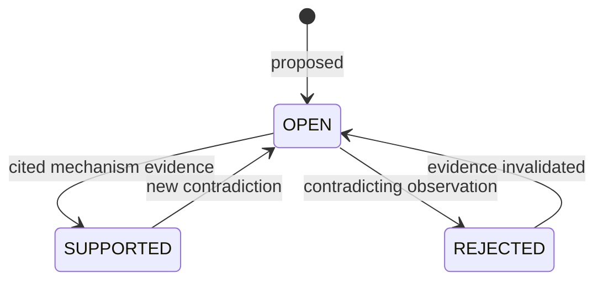

# Agent Design

This document explains how IncidentLens decomposes incident investigation among agents, how
the coordinator decides what to do next, how hypotheses move through their lifecycle, and why
the acceptance boundaries are deterministic. It describes implemented behavior in version
1.6.1. Prompt text is not reproduced wholesale; the contracts and validation rules that
constrain model output are the relevant design surface.

See [Architecture](ARCHITECTURE.md) for the graph and gates, and [Evaluation](EVALUATION.md)
for the measured comparison of the four variants.

## 1. Design goals and non-goals

### Goals

- Give each specialist only the evidence access needed for its role.
- Let investigation adapt to observed evidence gaps instead of running a fixed checklist.
- Require every claim to cite records the agent actually observed.
- Make hypothesis identity stable across rounds so evidence accumulates on a concept rather
  than on a wording.
- Keep acceptance, publication and shutdown outside model discretion.
- Bound every run by explicit rounds, calls, time and budget.

### Non-goals

- Maximizing the number of agents or simulated debate.
- Letting agents vote on truth or aggregate confidence scores.
- Executing remediation in production.
- Learning from incidents or retaining cross-run memory.
- Establishing that multi-agent decomposition is universally better than a single agent.

The design is deliberately small: four specialist roles, one optional verifier, one
coordinator, and deterministic runtime components.

## 2. Role catalog

| Role | Primary question | Inputs | Output | Tools |
| --- | --- | --- | --- | --- |
| `monitoring` | Is there an anomaly worth investigating? | Public snapshot or replay observations | `ALERT` or `NO_ALERT` with rationale | none |
| `coordinator` | What is the next best investigative move? | Incident summary, hypotheses, findings, evidence gaps, budget | `INVESTIGATE`, `FINALIZE` or `ABSTAIN` | none |
| `logs` | What failed, in what order, and how did it propagate? | Task scope, public log records | Chronology, cited findings, hypothesis updates | `query_logs` |
| `metrics` | Is this a load, capacity or dependency problem? | Task scope, metric windows, dependency graph | Saturation or dependency findings with citations | `query_metrics`, `get_dependencies`; database tools only under equivalent-tool configuration |
| `database` | Is the database exhausted, locked or slow? | Task scope, connection/session/query observations | Mechanism-specific database finding | five read-only `get_db_*` tools |
| `changes` | Did a deployment or configuration change align with onset? | Task scope, change and config records | Change correlation and diff finding | `query_changes`, `get_config_diff` |
| `verifier` | Does the candidate survive its own evidence? | Published evidence and a target hypothesis | Review verdict, contradictions, requested checks | `fetch_evidence_by_ids` |
| `remediation` | What safe plan follows from an accepted cause? | Accepted report | Plan-only proposal | none |
| `reporter` | How is the accepted result rendered? | State and report payload | Deterministic report | `fetch_evidence_by_ids` |
| `single` | Can one identity plan, investigate and reflect adequately? | Full public incident scope | Findings and self-review | all investigator tools plus evidence fetch |

Tool authority is a ceiling, not a suggestion. `ROLE_TOOL_ACL` in
`src/incident_lens/security/context.py` defines the maximum. The runtime issues a frozen
`AgentContext`; a task may request a subset, never a superset. The validator also rejects
duplicate tool names and a context that exceeds the role ceiling.

The metrics role normally has only metrics and dependency tools. Under the
equivalent-tool benchmark configuration it may also receive database tools so the four
architectures are compared with comparable public access. That grant is configuration
specific and is recorded in the protocol, not silently available in every run.

The `verifier` and `reporter` can fetch evidence by ID, but only records already published to
the shared board. They cannot run fresh log, metric or database queries. This is what makes
the review a review of the candidate's evidence rather than an independent second
investigation.

## 3. Coordinator policy

The coordinator is an LLM agent with no tools. It sees a compact view of the incident,
current hypotheses, findings, evidence coverage, open questions and remaining budget. It must
choose one of three actions:

- **`INVESTIGATE`** — assign one or two specialist tasks with a specific scope, a question,
  expected discriminator and a reason.
- **`FINALIZE`** — ask the deterministic FinalizeGate to evaluate the current candidate.
- **`ABSTAIN`** — stop because the evidence is insufficient or further work is unlikely to
  help.

The decision schema caps assignments at two. `DynamicDecision.assignments` has
`max_length=2`, and the coordinator cannot create a third concurrent task. Concurrency is
also capped at two in the dispatch node; the cap is a structural limit, not a prompt request.

### Assignment constraints

Every assignment is validated before dispatch:

1. the role exists and is allowed to investigate;
2. the requested tools are within the role ceiling and within the task's own list;
3. the task has a non-empty scope and a concrete expected discriminator;
4. the task ID is new and does not reuse an earlier identity;
5. the task is not a duplicate of a completed scope or an already-consumed signature;
6. the assignment fits the remaining round, tool and LLM budget with reserve preserved.

The coordinator sees completed task IDs and scopes. A repeated task signature is not sent
again; if the run has no remaining productive move, it terminates as `INCONCLUSIVE` rather
than looping. A coordinator's own declared completion does not bypass the gate.

### Budget reserve

The coordinator must leave enough budget for merge, review when applicable, finalization and
reporting. It cannot spend the last call on another specialist and then discover that it
cannot close the run. The runtime also enforces the hard caps, so a mistaken coordinator
decision cannot overshoot them.

### Fixed schedule

The `fixed` variant does not use dynamic allocation. It dispatches one batch of logs,
metrics, database and changes. A legacy fixed-three schedule remains for compatibility; the
benchmark-specific fixed-four schedule adds the fourth role. The fixed schedule runs once,
not once per round. After merge it routes back to coordinate for finalization or abstention.

### Single variant

`single` is one identity with the union of investigator tools. It plans its own calls
(`InvestigatorPlan.calls` is capped at two per plan), analyzes records and can request at most
two follow-up checks (`AnalysisOutput.requested_checks`). Its verify phase is self-review:
the same identity reviews its own candidate. The grounding and discriminator gates still
apply. It cannot fabricate an independent verifier verdict.

## 4. Task and output contracts

The handoff from coordinator to specialist is a typed `InvestigationTask`: role, permitted
tool declarations, filters, reason, expected discriminator and scope. The specialist returns
a typed result with runtime-stamped run, incident and task identity, findings, citations,
hypothesis updates and usage.

Structured output is constrained in three ways:

- **Schema-constrained citations.** `analysis_schema(records)` builds the allowed citation
  vocabulary from the records actually returned by that task's tool calls. A model cannot
  cite an arbitrary record ID and hope it exists.
- **Tool advertisement intersection.** `plan_tools` advertises only the intersection of the
  role context and the task's permitted tools. A plan cannot request a tool the task did not
  authorize.
- **Identity and observation checks.** `analyze()` raises `FINDING_IDENTITY_MISMATCH` when
  finding and task identities disagree, and `UNOBSERVED_CITATION` when a cited record was not
  observed. These are runtime errors, not repairable prose.

The schemas also validate hypothesis updates, prevent duplicate hypothesis IDs within a
result, and regenerate invalid task IDs rather than accepting a collision. A structured-output
parse failure can receive one targeted repair attempt when recovery is enabled; a second
failure remains a technical failure.

These checks establish structural provenance: the cited record exists and was observed by the
right agent in the right task. They do not establish that the record semantically supports
the sentence. That residual gap is why the evaluation does not claim human-verified semantic
support.

## 5. Hypothesis lifecycle

A hypothesis represents a candidate explanation: a culprit service plus a failure mode. Its ID
is a stable hash of that pair, so the same concept keeps the same identity across rounds even
if the description is rewritten.

The lifecycle is a working model, not a promise that every transition is used in every
variant. Implemented rules that matter:

- New hypotheses enter as `OPEN`.
- A specialist can propose `SUPPORTED` or `REJECTED` with cited evidence.
- Merge normalizes the ID to the concept key and reconciles conflicts. If one worker supports
  and another rejects the same concept, the merged status is `OPEN`, not whichever update
  arrived last.
- A rejected hypothesis stays in the state and can be reconsidered only if new valid evidence
  changes the picture.

`LIKELY` is a **report** status, not a confirmed hypothesis state: it is an `INCONCLUSIVE`
report carrying at most three cited, still-`OPEN` provisional hypotheses. A verifier verdict
of `likely_hypothesis_supported` can permit that provisional report, but it does not turn the
explanation into a `RESOLVED` root cause. FinalizeGate must still satisfy the evidence and
mechanism requirements for any resolved report.

The hypothesis board is therefore an evidence ledger, not a leaderboard. No confidence score
is summed across agents, and no majority vote can promote a hypothesis.

## 6. Merge reconciliation

Merge is the communication boundary between agents. It guarantees four things:

1. **Identity** — a finding belongs to the task and role that produced it; run and incident
   IDs match.
2. **Evidence** — only records observed in that task are publishable, and only within the
   worker's authority.
3. **Concept** — hypothesis IDs are normalized to `(culprit_service, failure_mode)`;
   conflicting statuses become `OPEN`.
4. **Collision** — duplicate finding IDs are rejected rather than overwritten.

The ordered procedure that implements these guarantees — identity check, observed-ID check,
publication-scope check, collision detection, ID normalization, status reconciliation, append
— is in [Architecture §5](ARCHITECTURE.md#5-deterministic-merge). Merge is the only
publication boundary; specialists cannot write shared state.

After merge, the shared board is the only evidence the verifier can use. A specialist cannot
retroactively add a citation after merge; it would require another task with another observed
record.

This design sacrifices some flexibility. A specialist cannot collaboratively edit a shared
document or freely message another specialist. Coordination happens through typed tasks and
the merged board, which is slower but auditable.

## 7. Verifier and the ablation

The `full` variant adds an independent verifier. Its job is adversarial but bounded:

- fetch already-published evidence;
- target one candidate hypothesis;
- look for contradictions, missing discriminators and unsupported leaps;
- return a verdict (`sufficient` or `likely_hypothesis_supported`), citations and concrete
  requested checks;
- optionally send the run back to coordinate for another task.

The verifier cannot issue new log or database queries. If it believes a check is missing, it
requests the check; the coordinator decides whether to assign it. The review is bound to a
fingerprint of the target hypothesis and evidence snapshot. FinalizeGate checks that the
fingerprint still matches, so a review of an older evidence set cannot authorize a newer
candidate.

The `single` variant uses the same `verify` node for self-review but not an independent
identity. The `dynamic` and `fixed` variants skip the node entirely. The difference is
architectural, not merely a prompt variation.

The measured ablation is negative on quality in the hardened batch: Dynamic (with verifier)
achieved 30/36 quality success versus Dynamic's 33/36, at 56.7% more tokens. This does not
prove that verification is useless in general. It does mean this implementation of an
independent review did not pay for itself in this corpus, model and budget. That is a design
finding, and it is reported as such.

## 8. Stop protocol

All terminal outcomes pass through `stop`. It performs orderly shutdown:

1. mark the workflow as stopping so no new assignment is accepted;
2. cancel in-flight specialist tasks;
3. close or freeze tool access;
4. persist counters, decisions and usage;
5. write a `TerminationResult` with a reason and termination class;
6. route to deterministic reporting.

Implemented stop reasons include `NO_ALERT`, `DIAGNOSIS_READY`, `PLAN_READY`, `PLAN_FAILED`,
`BUDGET_EXHAUSTED`, `INCONCLUSIVE`, `UNRECOVERABLE_ERROR` and `STOP_TIMEOUT`. Termination
class is `NORMAL_TERMINATION` for intended outcomes and `RUNTIME_FAILURE` for technical
failure.

The distinction matters for evaluation. `INCONCLUSIVE` is a successful, contract-compliant
abstention. `BUDGET_EXHAUSTED` is a technical failure and remains in the run denominator. A
`STRUCTURED_OUTPUT_INVALID` after repair is also a technical failure. Conflating abstention
with error would inflate apparent reliability.

Shutdown has a bounded acknowledgement wait. If a task ignores cancellation, the stop node
records `STOP_TIMEOUT` rather than hanging the run indefinitely.

## 9. Why deterministic gates

LLM agents are useful for selecting evidence, reading unstructured logs and proposing
mechanisms. They are poor final authorities on whether their own narrative is supported,
because the same model that produced a plausible story also produces the confidence that it
is true. IncidentLens therefore keeps proposal and acceptance separate:

- agents propose findings, hypotheses and reviews;
- Merge publishes only validated, observed evidence;
- FinalizeGate applies mechanism and source-diversity checks;
- stop and report are deterministic;
- model confidence is not an acceptance input.

The cost is false abstention. A real incident whose discriminator is outside the current
vocabulary will be rejected even if a human would recognize the cause. In the measured
hardened batch, this was the dominant error: 19 identifiable misses, all `INCONCLUSIVE`, and
zero wrong root causes among completed runs. That trade-off is intentional but not free. See
[Limitations](LIMITATIONS.md).

## 10. Failure taxonomy

| Failure | Where it appears | Classification | Handling |
| --- | --- | --- | --- |
| Insufficient evidence | FinalizeGate / coordinator | Normal `INCONCLUSIVE` | Correct abstention when the case is unidentifiable; over-abstention when identifiable |
| Citation of unobserved record | Agent analysis / gates | Runtime validation error or rejection | Reject; no publication |
| Finding identity mismatch | `analyze()` | Technical failure | Recorded as `FINDING_IDENTITY_MISMATCH` |
| Structured output invalid | Provider/adapter | Technical failure after one repair | Recorded as `STRUCTURED_OUTPUT_INVALID` (envelope, JSON, schema or truncation) |
| Missing verifier review | FinalizeGate for `full` | Gate rejection | Return to coordinate if budget remains |
| Competing observed mechanism | FinalizeGate | Gate rejection | Keep hypothesis open; investigate or abstain |
| Budget exhausted | Runtime accounting | `BUDGET_EXHAUSTED` | Runtime failure, not abstention |
| Partial batch failure | Dispatch/merge | Variant-dependent | Continue with successful tasks or fail the batch per configuration |
| Task stopped late | Stop node | `STOP_TIMEOUT` | Report the shutdown failure |

## 11. Trade-offs

**Two tasks per round.** Two concurrent specialists cover the most common cross-source need
(logs plus one of metrics/database/changes) without turning every round into a full sweep. It
limits throughput on incidents that genuinely need three independent sources in one step, but
it keeps the comparison fair and the budget predictable.

**No inter-agent chat.** Communication is through tasks and merged state. This is less
expressive than free multi-agent conversation and can slow convergence, but it makes it
possible to say exactly which evidence each role observed.

**Role-scoped tools.** Least privilege reduces cross-contamination and prompt-injection
surface, but a specialist may lack a record another role could have found. The coordinator is
expected to assign the complementary role rather than widen the ACL.

**Deterministic acceptance.** It gives reproducibility and auditability, but can reject
legitimate mechanisms that the discriminator vocabulary does not encode.

**One optional verifier, not a panel.** A panel would add cost and correlated errors without
an independent information source. The measured verifier ablation already showed a cost
without a quality gain, so adding more reviewers is not justified by the current evidence.
