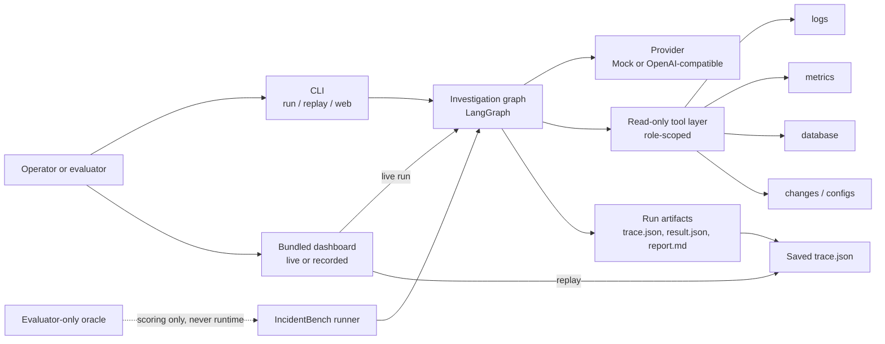
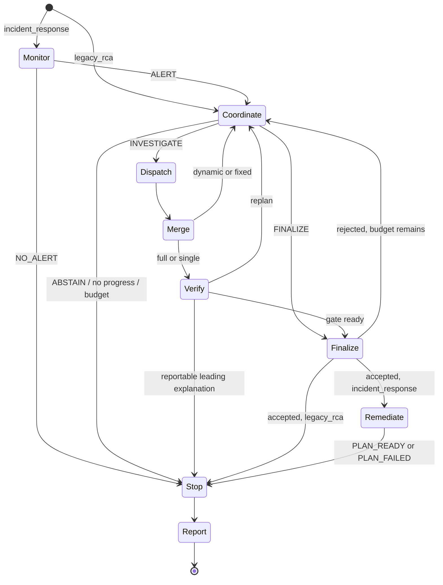

# Architecture

This document describes the implemented IncidentLens 1.6.1 architecture: the runtime graph,
typed state, deterministic acceptance gates, evidence security, recovery and the replay/web
layer. It distinguishes what the code verifiably does from design rationale. It does not
restate the evaluation results; see [Evaluation](EVALUATION.md) for measurements and
[Agent Design](AGENT_DESIGN.md) for role and coordination policy.

## 1. Scope and design problem

IncidentLens investigates a software incident using read-only public evidence: logs, metrics,
database observations, change records and configuration diffs. The system must produce a
root-cause report that a reviewer can audit, or state that the evidence is insufficient. The
central design problem is not generating a plausible narrative; it is constraining when a
narrative may be accepted.

Three requirements drive the architecture:

1. **Cited evidence.** Every claim must reference records observed during the current run,
   not records merely present in the dataset.
2. **Source and mechanism diversity.** A candidate needs support from more than one source
   path, an observed cause-specific discriminator, and temporally compatible cross-source
   corroboration.
3. **Calibrated abstention.** If those conditions are not met, the correct output is
   `INCONCLUSIVE`, even when one explanation looks intuitively likely.

The implementation is a LangGraph state machine with LLM specialist agents at the evidence
edges and deterministic Python components at the acceptance boundaries. That split is
deliberate: agents may propose and interpret, but they cannot publish shared evidence,
override a failed gate or declare final acceptance.

### Evidence status

| Claim type | Status in this document |
| --- | --- |
| Node names, routing, ACL, gate checks, CLI behavior | Verified against source |
| Batch numbers, latency and quality | Measured in the recorded development batches; see Evaluation |
| Why a design choice should help | Rationale, not a measured causal claim |
| Production behavior, real-user outcomes, independent review | Not established |

## 2. System context



The runtime has no access to private benchmark oracles. Oracles are used by the evaluator after
raw run outcomes have been persisted. The public dataset root and the evaluator root are
separate by contract.

## 3. Runtime graph

The compiled graph has nine node types:

```text
monitor -> coordinate -> dispatch -> merge -> verify -> finalize -> remediate -> stop -> report
```

Not every node executes in every run. Routing is conditional:

- `monitor` executes only for the `incident_response` profile. `legacy_rca` starts at
  `coordinate`.
- `dispatch` executes only after an `INVESTIGATE` decision; it runs one or two specialist
  tasks concurrently.
- `merge` always follows a dispatch batch and is deterministic.
- `verify` executes for `full` and `single`, never for `dynamic` or `fixed`.
- `finalize` can be entered from `coordinate` or `verify`. Its gate decides acceptance.
- `remediate` executes only for an accepted root cause under `incident_response`, and only in
  `PLAN_ONLY` mode.
- `stop` is the single shutdown path for every terminal outcome.
- `report` renders the final artifact deterministically after termination.



### Node responsibilities

| Node | Responsibility | Determinism |
| --- | --- | --- |
| `monitor` | Interpret a public snapshot; emit `ALERT` or `NO_ALERT`; no tools | LLM decision, typed result |
| `coordinate` | Select `INVESTIGATE`, `FINALIZE` or `ABSTAIN`; create at most two tasks; update hypotheses; enforce budget reserve | LLM decision plus deterministic validation |
| `dispatch` | Execute each task with its role-scoped agent; concurrent for multi-task batches; handle partial failure | LLM agents, bounded orchestration |
| `merge` | Validate and publish findings, evidence and hypothesis changes; reconcile conflicts | Deterministic |
| `verify` | Challenge a candidate using published evidence; return a review and requested checks | LLM reviewer, deterministic fingerprint |
| `finalize` | Apply grounding, competitor, review and budget gates; accept or reject | Deterministic |
| `remediate` | Produce a plan-only proposal and validate it | LLM proposal, deterministic validation |
| `stop` | Cancel in-flight work, freeze tools, write termination; classify normal vs runtime failure | Deterministic |
| `report` | Render report, citations, decisions and termination | Deterministic |

Merge, FinalizeGate, stop and report are not extra LLM agents even though they are graph
nodes. No model confidence value is read by an acceptance gate.

## 4. State and contracts

`InvestigationState` is the single typed state passed through the graph. Implemented fields
include workspace, incident and run identity; a public summary; budgets; round index;
findings; evidence index; hypotheses; tasks; reviews; decisions; events; report; stop reason;
open questions; requested checks; completed task IDs; tool, LLM and token usage; alert
context; task records; workflow status; and termination.

The state is governed by Pydantic v2 models with `extra=forbid` and strict validation.
Important contracts:

- **`Budget`** defaults to 4 rounds, 12 tool calls, 16 LLM request permits, 600 wall-clock
  seconds and no mandatory token cap. The permit cap counts HTTP requests actually issued,
  so a transport retry or a structured-output repair consumes one. Token usage is recorded when a provider reports it.
- **`AgentContext`** is a frozen descriptor of role, task, permitted tools and scope. It
  cannot be widened after construction; a runtime validator rejects a tool set above the
  role ceiling.
- **`ToolResult`** carries call identity, records, error code, elapsed time and count. A
  failed call carries no records. Return size is runtime-bounded.
- **`TraceEvent`** records public decisions and usage summaries, never hidden reasoning or
  credentials.
- **`RCAReport`** validates status coherence: `RESOLVED` requires a supported root cause with
  evidence and a causal chain; a non-resolved report cannot assert a root cause; rejected
  hypotheses must carry `REJECTED` status.

A provenance validator checks that finding, task and role identities agree; that IDs are
unique; and that every cited evidence ID exists in the evidence index for the same run and
incident. This is structural validation. It proves reference integrity, not that a citation
semantically supports the sentence attached to it.

Hypothesis IDs are stable for a concept: they are derived from the pair
`(culprit_service, failure_mode)`, so a later round updates the same hypothesis rather than
creating a duplicate because the wording changed. A `LIKELY` report status is an `INCONCLUSIVE`
report carrying up to three cited, still-`OPEN` provisional hypotheses; it is not a
`RESOLVED` root cause.

## 5. Deterministic Merge

Specialists return local proposals. They cannot write shared state. `merge` is the only
publication boundary and performs, in order:

1. verify worker identity, run identity, incident identity and task match;
2. reject evidence IDs not actually observed by that worker in that task;
3. reject publication IDs the worker is not entitled to publish;
4. detect finding-ID collisions;
5. normalize hypothesis IDs to the concept-stable key;
6. reconcile conflicting `SUPPORTED` and `REJECTED` assessments to `OPEN`;
7. append accepted findings, evidence and hypothesis updates to shared state.

This prevents a specialist from citing another worker's evidence as if it had queried it, and
prevents a task from publishing outside its assigned scope. Merge can be replayed
deterministically from the saved task results and ledger.

## 6. FinalizeGate

The gate is the acceptance boundary. A candidate is rejected if any required condition fails.
Implemented checks, in `src/incident_lens/orchestration/guards.py`, include:

- citation of a record that was not observed in this run;
- fewer than two supporting records or fewer than two distinct source paths;
- no observed, cause-specific discriminator for the proposed failure mode;
- no temporally compatible cross-source corroboration between logs and metrics;
- a cited `against_id` that blocks the candidate;
- a competing hypothesis whose mechanism is observed and whose own citations are valid;
- an explicit `REJECTED` status;
- for `full`, a missing or insufficient verifier review, unresolved contradictions or
  blockers, or a review fingerprint that does not match the current hypothesis and evidence.

The discriminator is mechanism-specific, not a generic symptom. Examples implemented in the
guard layer include a pool or concurrency configuration decrease, a database connection limit,
connection-refused or zero-availability signals, payment latency at or above 3,000 ms,
CPU/thread saturation at or above 90%, a lock `blocked_by` relation, and a slow-query
category. Generic latency or error spikes alone do not satisfy the check.

Competing explanations are handled asymmetrically: a rival blocks acceptance only when its
mechanism is actually observed and its citations are valid. A generic symptom or an
unobserved rival does not veto a well-supported candidate. This avoids turning every
alternative story into an automatic abstention.

For `full`, the Verifier's review is bound by a SHA-256 fingerprint over the target
hypothesis and its evidence snapshot. A stale review cannot be reused after the evidence or
hypothesis changes. The gate also checks that the review verdict is `sufficient` or
`likely_hypothesis_supported`, that there are no unresolved contradictions or blockers, and
that the review cites valid evidence.

For `single`, the same grounding and mechanism gates apply, but the review is self-review by
the same identity. It is not an independent check and is not presented as one.

## 7. Evidence provenance and security

Security is layered rather than prompt-based.

| Layer | Mechanism |
| --- | --- |
| Role authority | `ROLE_TOOL_ACL` ceiling: coordinator/monitoring/remediation have no tools; logs only `query_logs`; metrics only `query_metrics` and `get_dependencies`; changes only `query_changes` and `get_config_diff`; database only the five `get_db_*` tools; verifier/reporter only `fetch_evidence_by_ids` |
| Context integrity | `AgentContext` is frozen and validated; a task may narrow but not widen the ceiling |
| Actual observation | The runtime ledger records which tool query returned which record; citations must come from that ledger |
| Publication control | Only Merge writes shared findings and evidence; task and role scope are checked |
| Input boundary | Public-file allowlist for incident data; evaluator oracles are outside the runtime root |
| Tool boundary | Read-only tools, bounded result size, stable record IDs and explicit error codes |
| Trace hygiene | Public decisions and usage summaries only; no hidden reasoning or secrets |
| Replay boundary | Web replay is confined to `results/**/trace.json`; it does not execute the graph |

Under the equivalent-tool benchmark configuration, the metrics role may additionally receive
database tools so all four variants have comparable public access. That grant is recorded in
the protocol; it is not part of the default role ceiling.

An equal-valued but caller-created context is not accepted as role authentication: contexts
are issued at runtime and matched against the server-owned ledger. This matters because a
prompt instruction such as "only use logs" is not an access control.

The local explanation cache, when enabled, is also subordinate to observation. A cache hit
may supply a summary, but the current run must still have observed every cited record. The
cache namespace excludes `run_id` deliberately and includes workspace, incident, role, task,
evidence hash, dataset revision, prompt version, model parameters hash, schema version and
ACL version. Coordinator, verifier and report paths are not cached. Cache content is never
treated as new evidence.

## 8. Budgets, failure handling and recovery

Budget accounting is centralized in the run, not delegated to agents. The runtime tracks
rounds, tool calls, LLM request permits, physical requests, retries, structured-output repair
attempts, tokens when reported, and wall-clock time. A request permit is acquired atomically
so concurrent specialists cannot overshoot a shared cap.

Failure classes are kept distinct:

- **Ordinary insufficiency** produces a normal `INCONCLUSIVE` report. It is not an error.
- **Budget exhaustion** produces a runtime failure with `BUDGET_EXHAUSTED`.
- **Unrecoverable orchestration failure** produces `UNRECOVERABLE_ERROR`.
- **Shutdown timeout** produces `STOP_TIMEOUT`.
- **No alert** in the response profile produces `NO_ALERT`.
- **Accepted diagnosis** produces `DIAGNOSIS_READY`; accepted remediation produces
  `PLAN_READY` or `PLAN_FAILED`.

Every terminal path emits either `NORMAL_TERMINATION` or `RUNTIME_FAILURE`. `stop` cancels
in-flight work, prevents new tool calls, records termination and only then lets `report`
render. The full stop protocol, the complete list of stop reasons and the distinction between
abstention and technical failure are in [Agent Design §8](AGENT_DESIGN.md#8-stop-protocol).

Recovery is opt-in and disabled in the shipped profiles. When enabled, it classifies
transport failures and applies task-level retry with backoff and stage budgets. A partial
batch can either continue with successful tasks or fail the batch, according to
configuration. Structured output gets at most one targeted repair attempt; it is not an
unbounded regeneration loop.

These mechanisms were exercised in Mock recovery tests and, separately, a real-provider retest
that encountered no failures. Neither establishes production reliability. See
[Evaluation §8](EVALUATION.md#8-ablations-and-auxiliary-experiments) for the measured boundary.

## 9. Replay and the web layer

A run writes `trace.json`, `result.json` and `report.md`. `trace.json` contains the event
stream, a state snapshot, the report and the termination record. Replay reads that file and
reconstructs the timeline without calling the graph, tools or provider. This is what makes a
demo reproducible after the original network conditions, model version or credentials are
gone.

The bundled web application is a Starlette service. It exposes health, metadata, case list,
run submission, trace list, replay and download endpoints. A live run started from the UI is
written under `results/ui/<run_id>/`. Replay is restricted to traces under `results/` and
must match the expected trace filename; the server does not accept arbitrary filesystem paths.
The UI marks a replayed trace as `Recorded Replay` and the offline provider as `Mock`.

The dashboard also exposes a static evaluation view (`#/evaluation`) that renders a hard-coded
snapshot of the recorded hardened batch from `web/static/js/knowledge.js`. It reads no truth
from disk and is not a live feed; evaluation evidence proper remains a document and
saved-artifact concern. The retained Streamlit app is a separate presentation surface and does
not change the core runtime.

## 10. Extension points

The architecture is intentionally narrow at the boundaries and replaceable in the middle.

| Extension | Where to work | Constraint to preserve |
| --- | --- | --- |
| New failure mode | Failure-mode catalog, cause discriminator, prompt vocabulary | Must define an observable discriminator and a support path, not only a label |
| New specialist role | Role prompt, `ROLE_TOOL_ACL`, task schema | Least-privilege read-only ceiling; at most two tasks per round |
| New evidence source | Tool layer, role ACL, public allowlist | Stable IDs, bounded results, actual-query ledger |
| New provider | Provider adapter | Structured-output behavior and usage reporting must remain observable; no silent Mock fallback |
| New coordinator policy | Selection policy | Cannot exceed assignment, budget or stop limits |
| New report format | Deterministic reporter | Must preserve status coherence and citations |
| New evaluator | Separate evaluator root | Must not enter the runtime public root or prompt |

Adding a role or tool does not by itself improve the architecture. The evaluation result is
that adding an independent verifier increased cost without a measured quality gain in these
batches. Any extension should be tested against the same matched protocol, not assumed to
help.

## 11. Design rationale and trade-offs

**Why a state machine rather than free-form agent conversation.** A graph gives explicit
termination, budget accounting and deterministic acceptance. Free-form delegation makes it
hard to prove which evidence was observed or why a run stopped.

**Why dynamic assignment.** Fixed schedules spend calls on roles that cannot help a given
incident. Dynamic selection lets the coordinator chase an evidence gap, but it introduces
policy variance and depends on the quality of the coordinator's task specification. The
measured result is descriptive: Dynamic had the highest quality success in the hardened
batch, with fewer resources than Single, but one model and one repeat cannot establish that
this generalizes.

**Why deterministic gates.** A model can be persuaded by a confident narrative. Gates make
acceptance auditable and reproducible, at the cost of false abstentions when a legitimate
mechanism is not expressible in the current discriminator vocabulary. The observed failure
mode in the measured batches was over-abstention, not fabrication.

**Why a verifier was still implemented.** Independent review is a plausible defense against
subtle evidentiary gaps, and the ablation is scientifically useful even when negative. In the
hardened batch the verifier variant used 56.7% more tokens than Dynamic with no measured
quality gain. The component remains available for research; it is not the primary
configuration.

**Why Mock matters.** Mock isolates orchestration and contract behavior from model variance.
It is deterministic and offline, which makes installation, replay and gate behavior
reproducible. It is not a learned model and says nothing about real diagnostic accuracy.

**Known architectural limits.** The runtime is single-incident and read-only. It does not
integrate with production observability, execute remediation, learn from feedback, or
evaluate semantic support with human reviewers. Those are scope decisions, not hidden
capabilities. The complete boundary is in [Limitations](LIMITATIONS.md).
