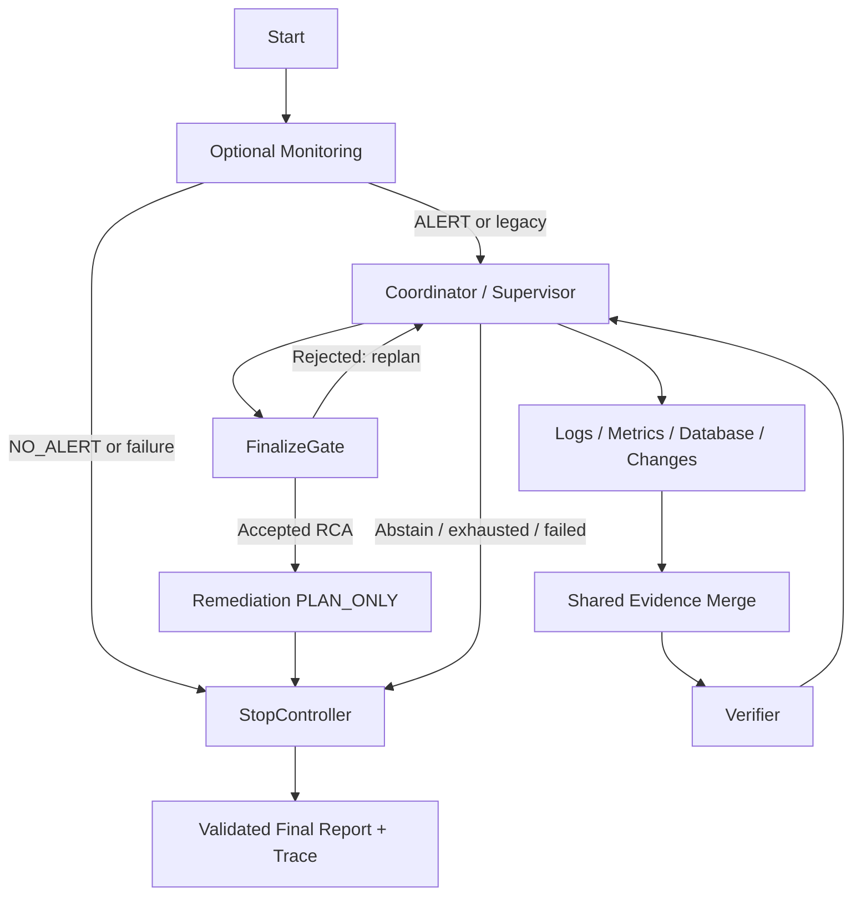

# IncidentLens V1.2 delivery and validation

Project: IncidentLens: An Evidence-Driven Multi-Agent System for Software Incident Investigation.

## Repository baseline and scope

The starting checkout had 17 dirty files (listed in `results/acceptance/v12/p0/initial-diff.txt`). Existing provider timeout, evidence validation, CLI and UI edits were retained; no commit or push was requested or performed.

P0 full test process returned 228 passed, 1 skipped, 1 failed. The schema-export test compared models imported before the interface edits with a subprocess importing the edited models. This was a verification sequencing mistake, not evidence of an initial repository defect. The CLI suite was immediately rerun without concurrent schema edits and passed; both logs are retained in `results/acceptance/v12/p0/`. Final regression runs with source frozen. Public interfaces and file ownership were frozen before worker dispatch in `docs/v12-interface-freeze.md`.

## Incremental architecture

Only the existing LangGraph is compiled. Legacy starts at Coordinator; incident response optionally starts at Monitoring. Existing Merge, Verifier, FinalizeGate, dynamic replan, budgets, source discriminators and review fingerprints remain authoritative.



Legacy variants `single`, `fixed`, `dynamic_no_verifier`, `full` retain their investigation schedules. New options default to `legacy_rca`. Tree communication and production action execution are excluded.

## Public contracts and communication

- `SpecialistRole` adds `database`; `Role` adds database/monitoring/remediation; `EvidenceRecord.source_type` adds database. Old JSON remains deserializable.
- Database outputs existing `AnalysisOutput(Finding, Hypothesis[], requested_checks[])`. `requested_checks` is the structured RequestCheck proposal, using `InvestigationTask`; assignments are validated against advertised role ACL before dispatch. Findings and hypotheses still pass observed-ID and identity checks before shared publication.
- `IncidentAlert`: incident identity, ALERT/NO_ALERT, summary, cited observation IDs and affected services. Monitoring sees supplied public observations only, with chronological prefixes for replay.
- `RemediationPlan`: incident/run/content-hash root-cause version, PLAN_ONLY, objective, affected services, actions, preconditions, risks, verification, rollback and accepted evidence IDs. Validation rejects unresolved diagnoses, changed identity/version, unobserved or unaccepted citations and unsupported services.
- `TaskRecord`: task/attempt IDs, role, attempt number, ASSIGNED/RUNNING/COMPLETED/FAILED/CANCELLED and sanitized failure code. Retry reassigns the same task to a fresh attempt, at most configured max_attempts (default two).
- `StopMessage`: WORKFLOW_STOP_REQUESTED/STOP_ACK with protocol_version=2, incident_id, run_id, stop_reason and role. TerminationResult adds strict reason/outcome/failure_stage/stop_completed/runtime_failure, including DIAGNOSIS_READY and STOP_TIMEOUT. State and report contain the same final result.
- Optional report fields separate diagnosis, remediation and workflow statuses. PLAN_READY requires a valid proposal and a resolved matching report; it never represents service recovery.

Twenty-one JSON contracts are exported under `docs/contracts/`. See `schemas/workflow.py` for additive configuration and messages.

## Modified modules

| Area | Added / extended files | Behavior |
|---|---|---|
| Public contracts | `schemas/contracts.py`, `schemas/workflow.py`, CLI schema export, `docs/contracts/*.json` | Additive roles, evidence, plans, alerts, attempts and statuses |
| Database | `agents/database.py`, `agents/service.py`, `tools/database.py`, `tools/{arguments,provider,registry}.py`, `security/{context,authorization}.py` | Five scoped read-only queries, observed ledger, dynamic role, explicit Metrics/Single equivalent-tool opt-in |
| Monitoring / remediation | `agents/monitoring.py`, `agents/remediation.py` | Public-only anomaly proposals and accepted-RCA plan proposals |
| Runtime / integration | `orchestration/{runtime,graph,config,merge,guards,report}.py` | Finite recovery, partial successes, STOP cancellation/ACK timeout, freeze, original gates |
| Cache / Mock | `cache/{policy,semantic}.py`, `llm/mock.py` | Dedicated database explanation namespace; observation-based deterministic demonstration |
| Configuration / entrypoints | `configs/incident-response.yaml`, `configs/agents.yaml`, `cli.py`, `web/server.py` | Legacy defaults, response profile and snapshot inputs, independent stage caps inside global caps |
| Data | `scripts/generate_database_cases.py`, `data/incidents/incident_037..040`, `data/splits/database_ids.json`, `data/monitoring/*.json` | Exhaustion, upstream pool regression, locks/slow query, insufficient evidence; legacy splits unchanged |
| Evaluation | `scripts/run_v12_eval.py`, `scripts/validate_dataset.py`, `evaluation/metrics.py` | Fair paired tools, actual traces, failure injection, structured normal STOP distinguished from runtime failure |
| UI | `ui/app.py`, `web/static/js/{views,components}.js`, `web/static/css/app.css` | Profiles, alerts, database evidence, proposal sections, task history, STOP trace |
| Tests | `unit/test_{database,monitoring,remediation,runtime}.py`, `integration/test_{workflow_v12,v12_ui}.py` | ACL/cache/provenance, agent contracts, lifecycle and cancellation integration |
| Documentation | English/Chinese README, interface freeze, this report | Reproducible setup and evidence boundaries |

All original test files are retained. Previously dirty files not needed for this upgrade were not deliberately modified.

## Run commands

Run from the repository root in PowerShell. All six new README commands were executed verbatim, including their output locations.

```powershell
# Original full workflow
.venv\Scripts\python.exe -m incident_lens.cli run --case incident_001 --provider mock --out results/legacy-demo
# Accepted database RCA and proposal
.venv\Scripts\python.exe -m incident_lens.cli run --case incident_037 --provider mock --config configs/incident-response.yaml --out results/response-demo
# Normal monitoring: NO_ALERT, no investigation tool calls
.venv\Scripts\python.exe -m incident_lens.cli run --case incident_037 --provider mock --config configs/incident-response.yaml --monitor-mode manual_snapshot --snapshot data/monitoring/normal.json --out results/no-alert-demo
# Chronological monitoring followed by response
.venv\Scripts\python.exe -m incident_lens.cli run --case incident_037 --provider mock --config configs/incident-response.yaml --monitor-mode offline_replay --snapshot data/monitoring/anomaly.json --out results/replay-demo
# Evidence-insufficient example
.venv\Scripts\python.exe -m incident_lens.cli run --case incident_040 --provider mock --config configs/incident-response.yaml --out results/acceptance/v12/insufficient
# Paired database arms plus four retained baseline variants
.venv\Scripts\python.exe scripts/run_v12_eval.py --provider mock --incidents incident_037 incident_038 incident_039 incident_040 --out results/v12-eval
# Charged transient failure with bounded recovery
.venv\Scripts\python.exe scripts/run_v12_eval.py --provider mock --incidents incident_001 incident_037 --skip-legacy --inject-transient-failure --out results/v12-recovery
# Existing evaluation script: four variants, seed split
.venv\Scripts\python.exe scripts/run_eval.py --split seed --provider mock --out results/acceptance/v12/legacy-eval
# UI
.venv\Scripts\python.exe -m incident_lens.web --port 8023
```

The response YAML allows 6 rounds, 24 tool calls and 24 model requests. Monitoring max_calls and remediation max_calls are separate caps; actual provider repair attempts consume both stage and global limits. The paired experiment uses identical 32-request caps in both arms to leave room for monitoring and recovery. Cache is off. Legacy YAML retains its prior defaults.

## Trace examples

1. `results/acceptance/v12/database-resolved/trace.json`: incident_037. Logs and Metrics identify the database candidate; Coordinator dynamically assigns Database; `get_db_connections` publishes DB001; Merge updates accepted evidence, Verifier reviews the updated snapshot; FinalizeGate accepts; remediation generates PLAN_ONLY; STOP(PLAN_READY); final statuses RESOLVED/PLAN_READY/FINISHED. 7 tool calls, 12 simulated model requests.
2. `results/acceptance/v12/insufficient/trace.json`: incident_040. Missing discriminating evidence remains unaccepted; no particular remediation plan is generated; STOP(INCONCLUSIVE); final statuses INCONCLUSIVE/SKIPPED/FINISHED. 11 tool calls, 19 simulated model requests.

STOP freezes task creation/retries and registry context issuance, execution, ledger writes and publication. Late Merge proposals are rejected. Same-role active workers are grouped for cancellation; cancellation translated to ProviderError is still recorded as CANCELLED. STOP_ACK follows actual cancellation completion. Hung callbacks are timed out, and late ACKs are suppressed. A normal terminal run has no active workers, so no fictitious ACK is fabricated.

## Executed evaluation and provider evidence

- `results/v12-eval/`: 24 actual Mock executions, 4 cases × 6 modes. Both response arms resolve 037–039 and abstain on 040. Two arms have the same model, data, global budgets and equivalent database queries for Metrics. This establishes executable control conditions, not a specialized-role effectiveness advantage.
- `results/v12-recovery/`: 4 Mock executions with one charged analysis failure per run. Each recovers, accepts the correct diagnosis and produces PLAN_READY. Recovery rate is 1/1 per run. `diagnosis_match` separates diagnosis correctness from the preserved older failure-sensitive `root_cause_correct` score.
- `results/acceptance/v12/legacy-eval/`: 24 executions of the unchanged four variants on six seed cases.
- `results/acceptance/v12/real-monitor-smoke/`: actual RealChatProvider call, deepseek-v4-flash-0731, thinking disabled, request timeout 60 seconds. One request, 918 measured tokens, approximately 41.08 seconds. Normal supplied observation returned NO_ALERT, zero investigation tool calls, STOP(NO_ALERT), FINISHED. Saved trace/provider fields mark real execution. No real RCA/plan quality comparison was executed. The real alert summary is verbose; schema validity does not imply good summary quality.
- Browser: real local UI interaction ran response Mock incident_037, reached PLAN_READY, showed complete proposal/statuses/database timeline. Console had no warning/error entries. Screenshot: `results/acceptance/v12/browser-report.png`. Streamlit tests independently exercise both legacy and response paths. No mobile browser breakpoint claim is made.

Tokens/cost unavailable in Mock runs remain blank. Monitoring anomaly accuracy has no independent labeled dataset here and remains null. Unsupported semantic conclusions remain unreviewed rather than fabricated as zero. Proposal validation establishes identity/version/citation/schema validity; it does not establish that a proposed action will restore production service.

## Remaining boundaries

- Database queries use public offline packs, with no live PostgreSQL connection.
- Remediation is PLAN_ONLY. Idempotence is by incident/root-cause version within a run; separate runs intentionally generate independent reviewable artifacts. Cross-process planning deduplication is not provided.
- Read-only work that ignores cancellation can finish at the underlying transport/thread level; frozen registry/shared-publication guards prevent its result from changing the accepted report. Unacknowledged workers produce STOP_TIMEOUT rather than blocking forever.
- Monitoring inference over every chronological prefix can exhaust its independent cap; supply an appropriate monitor.max_calls or use manual_snapshot.
- Tests and deterministic cases cannot establish real-model superiority, production generalization, or semantic/operational correctness.

Final frozen-source test totals and validation logs are recorded in `results/acceptance/v12/pytest.txt`, `pytest.xml`, `ruff.txt`, `dataset.txt` and `diff-check.txt`.

## Final regression result

`python -m pytest -q --junitxml=results/acceptance/v12/pytest.xml`: **308 passed, 2 skipped, 0 failed**, 64.65 seconds. Both skipped tests need Windows symlink creation privileges. Ruff passed; public/evaluator dataset validation passed; `git diff --check` passed. Final coverage includes cancellation of active Monitoring, Remediation, Coordinator and Verifier model requests, in addition to specialist workers.

The first full regression found one preserved old test whose `SimpleNamespace` analysis result had no newly optional requested_checks attribute. Merge now defaults absent requested_checks to an empty list. The original test was not weakened; the failure log is retained as `pytest-first-regression.txt/xml`, related 25 tests passed, and then the entire suite was rerun successfully.

## Current stopping and scoring contract

The earlier artifact descriptions and verification counts above describe the preserved V1.2 acceptance snapshot. Those historical STOP traces are not rewritten. Current runs use protocol version 2 and scoring version 2; see [stop-protocol-v2.md](stop-protocol-v2.md) for dedicated verification.

Normal stop and recovered MODEL_FAILURE preserve accepted diagnosis credit. PLAN_FAILED and STOP_TIMEOUT retain confirmed RCA credit while failing their corresponding workflow dimensions. Unknown reasons, conflicting terminal fields, late mutations and invalid ACKs cannot earn workflow success. NO_ALERT requires separate monitoring truth; it cannot earn RCA abstention credit. Evaluators consume complete traces without deleting protocol events.
