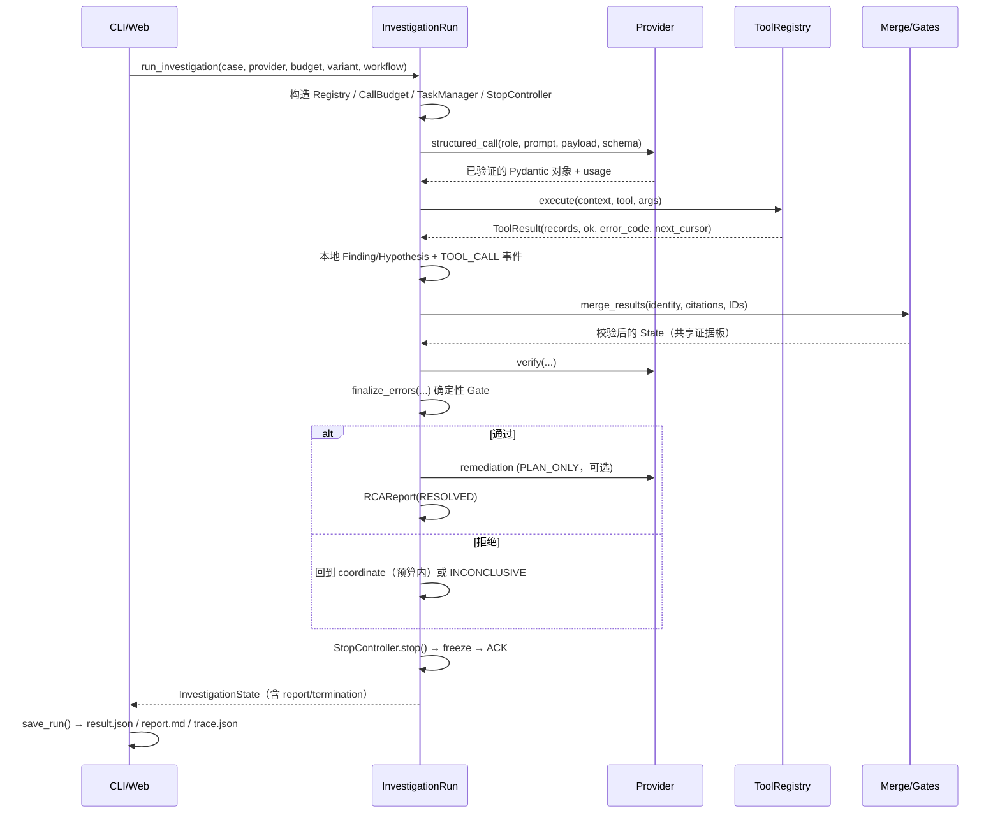

# 01 · 整体架构

## 1. 系统定位

IncidentLens 用一条 LangGraph `StateGraph` 串起"监控 → 协调 → 调查 → 合并 → 审查 → 定稿 → 修复建议 → 终止 → 报告"的完整闭环。所有角色共享一个不可变的 `InvestigationState`，但每个角色只能看到经过裁剪的 payload，只能调用 ACL 允许的只读工具。

设计目标不是"让 LLM 编一个像样的故事"，而是：

1. **可引用**：每条结论必须引用实际查询到的 `evidence_id`；
2. **可拒答**：证据不足时输出 `INCONCLUSIVE`，而不是猜测；
3. **可审计**：每次工具调用、模型调用、任务重试、STOP 与终止原因都进入 trace；
4. **可复现**：Mock Provider + 固定数据 + 确定性 Gate，离线即可复现整条链路；
5. **有预算**：轮数、工具调用、LLM 请求、wall clock、token 全部有上限。

## 2. 分层视图

```text
┌─────────────────────────────────────────────────────────────────────┐
│ 接口层  cli.py · web/server.py + static SPA · ui/app.py (Streamlit)  │
├─────────────────────────────────────────────────────────────────────┤
│ 编排层  orchestration/                                              │
│   graph.py (InvestigationRun, 9 nodes)                              │
│   budget.py · permits.py · runtime.py · merge.py · guards.py        │
│   recovery.py · observability.py · report.py · config.py            │
│   active_investigation/ (CAES 可选选择器)                            │
├─────────────────────────────────────────────────────────────────────┤
│ 角色层  agents/   service.py · monitoring.py · remediation.py       │
│                   database.py（复用共享 planning/analysis 契约）     │
├─────────────────────────────────────────────────────────────────────┤
│ 能力层  llm/      provider.py · mock.py · structured_output.py       │
│                   errors.py · capabilities.py · transport_retry.py  │
│                   usage.py · codex_subscription.py                  │
│         cache/    semantic.py · store.py · embeddings.py · policy.py│
│         tools/    registry.py · provider.py · arguments.py · 各工具  │
├─────────────────────────────────────────────────────────────────────┤
│ 契约层  schemas/  contracts.py · workflow.py · state/agent_io/...    │
│ 安全层  security/ context.py · authorization.py · scoped_client.py  │
├─────────────────────────────────────────────────────────────────────┤
│ 数据层  data/ incidents/*/public|private · topology · splits        │
│         incidentbench_v1 · incidentbench_v16_dev                     │
├─────────────────────────────────────────────────────────────────────┤
│ 评估层  evaluation/ · incidentbench/（独立于运行时，读取已保存状态）  │
└─────────────────────────────────────────────────────────────────────┘
```

依赖方向总体上向下：接口层 → 编排层 → 角色层 → 能力层/契约层/安全层 → 数据层。评估层横切读取产物，不被运行时依赖。

## 3. 一次运行的完整数据流



关键点：

- **状态只在 Merge 后发布**。Investigator 只返回 `(context, task, analysis)` 本地结果，不能直接改共享板。
- **Verifier 只能读取已共享证据**：它通过 `fetch_evidence_by_ids` 重新取数，payload 中只包含这次实际 fetch 的记录。
- **Finalize 是纯函数式 Gate**，不调用模型；模型只负责提出候选与更新假设。
- **STOP 是统一出口**：所有终态（正常、弃权、预算耗尽、错误、NO_ALERT）都经过 `stop` 节点。

## 4. LangGraph 工作流

`InvestigationRun.compile()`（[graph.py L1623-L1665](../../src/incident_lens/orchestration/graph.py#L1623-L1665)）注册 9 个节点：

| 节点 | 类型 | 职责 | 主要出口 |
| --- | --- | --- | --- |
| `monitor` | async | 分析公开快照/离线回放，产出 `IncidentAlert` | `coordinate` / `stop` |
| `coordinate` | async | 决策 `INVESTIGATE` / `FINALIZE` / `ABSTAIN`，分配 1~2 个任务 | `dispatch` / `verify` / `finalize` / `stop` |
| `dispatch` | async | 并发执行调查任务（single 变体串行） | `merge` / `stop` |
| `merge` | sync | 校验身份、引用、ID 冲突并发布共享证据 | `verify`（full/single）/ `coordinate` / `stop` |
| `verify` | async | Verifier 审查候选，产出 `Review` 与请求的检查 | `finalize`（已满足）/ `coordinate` / `stop` |
| `finalize` | sync | 确定性 Gate 验收；构造 `RCAReport` | `remediate` / `coordinate`（拒绝后重规划）/ `stop` |
| `remediate` | async | 生成 `PLAN_ONLY` 修复计划 | `stop` |
| `stop` | async | 计算终止原因、冻结运行时、执行 STOP/ACK | `report` |
| `report` | sync | 兜底生成 `INCONCLUSIVE` 报告、重校验、写 `REPORT` 事件 | `END` |

起始边：

- `legacy_rca`：`START → coordinate`
- `incident_response`：`START → monitor`

条件边统一映射：任何节点返回 `route == "report"` 时实际进入 `stop`，再由 `stop → report → END`。

## 5. 并发与隔离模型

- **调查任务并发**：`dispatch` 用 `asyncio.gather(..., return_exceptions=True)` 并发执行 1~2 个 `execute_task`；`single` 变体串行执行。
- **状态不共享写**：每个任务拿到同一 `state` 的只读视图，各自返回本地 `AnalysisOutput`；只有 `merge` 在全部返回后一次性写回。
- **工具执行线程化**：`ToolRegistry.execute` 用单线程 `ThreadPoolExecutor` + `future.result(timeout=...)`，避免阻塞事件循环，并保证超时的只读任务无法写入账本。
- **预算线程安全**：`RequestPermitIssuer` 用 `threading.Lock()`；`CallBudget` 记录实际物理请求与 token。
- **STOP 传播**：`StopController` 维护 `stopped/frozen`；`TaskManager`、`ToolRegistry`、Provider 的 `stop_guard` 都会在冻结后拒绝新工作。
- **ContextVar**：`call_context`（task_id/attempt_id/stage/call_id）和 `request_stage`（monitoring/remediation）用 `ContextVar`，防止并发调查者串味。

## 6. 两套工作流 Profile

| Profile | 起点 | 特点 |
| --- | --- | --- |
| `legacy_rca` | `coordinate` | 从公开事故摘要直接调查；默认配置 |
| `incident_response` | `monitor` | 可接收 `manual_snapshot` / `offline_replay`；`NO_ALERT` 直接终止；允许 `remediate` 阶段 |

`WorkflowOptions.profile_semantics` 强制：监控模式只能用于 `incident_response`；`benchmark_fixed_four` 必须开启 `benchmark_rca`；`benchmark_rca` 必须使用 `legacy_rca` 且启用等价数据库工具。

## 7. 四种架构消融变体

| Variant | 协调方式 | 审查 | 说明 |
| --- | --- | --- | --- |
| `full` | 动态 1~2 任务，可多轮 | Verifier 必须 `sufficient` | 完整系统；CAES 只允许此变体 |
| `dynamic_no_verifier` | 动态多轮 | 无 | 去掉独立审查，merge 后直接回 coordinate |
| `fixed` | 首轮固定 logs+metrics+changes（benchmark 下可加 database） | 无 | 固定专家批次基线 |
| `single` | 单一身份自规划、自反思 | 自审（同一身份） | 拥有全工具 ACL；串行执行 |

## 8. 确定性保障（Grounding）

`orchestration/guards.py` 提供不依赖模型置信度的验收：

1. **`cause_discriminator`**：针对 7 种 failure_mode 的保守判别规则（例如连接数 ≥ 上限、`duration_ms ≥ 3000` 且有 `blocked_by`、`availability == 0`、CPU ≥ 90…）。
2. **`grounding_errors`**：候选不得为 `REJECTED`；引用必须都在 `evidence_index`；至少 2 条来自不同 `source_path` 的支持记录；必须有预测观测；必须有因果判别器；必须有完成的判别性任务；不得有未决问题或反对证据。
3. **`finalize_errors`**：在 grounding 之上增加"共享问题未清"、"竞争假设未解决"，`full` 变体还要求 Verifier 的 `sufficient` 审查且指纹匹配当前候选与证据快照。
4. **指纹绑定**：`review_fingerprint(hypothesis)` 与 `evidence_fingerprint(state)` 写入 `REVIEW` 事件；后续证据或假设变化会使旧审查失效。
5. **报告重校验**：`report` 节点最后执行一次 `InvestigationState.model_validate_json(state.model_dump_json())`，确保所有嵌套引用合法。

## 9. 失败与恢复哲学

- **失败关闭（fail-closed）**：身份、ACL、引用、协议违规永远不可重试；只有可分类的传输类瞬时错误才重试。
- **双层恢复**：Provider 内部做有界 HTTP 重试 + 至多 1 次结构化修复；运行时在 task/stage 层再做有界重试（`wait_for_retry`）。
- **预算守恒**：每次物理请求（含重试与修复）都消耗 permit；`reserve_verifier_requests` 防止调查阶段耗尽审查预算。
- **不自动降级**：`real` 永不在失败时回退到 Mock；缺失配置直接报 `PROVIDER_CONFIGURATION_REQUIRED`。

## 10. 关键架构约束（改代码前必读）

| 约束 | 位置 |
| --- | --- |
| 只有 Merge 能发布共享证据 | `merge.py` |
| 工具上下文由 Registry 签发且不可变 | `security/authorization.py` |
| 角色 ACL 不可越权，`allowed_tools` 只能收窄 | `security/context.py` |
| 任务 ID 每轮必须新鲜，重复签名视为无进展 | `graph.py coordinate` |
| `EvidenceRecord.source_path` 只能是 `public/` 或 `topology/services.yaml` | `schemas/contracts.py` |
| `RCAReport` 的 `RESOLVED` 必须同时有根因、证据和因果链 | `schemas/contracts.py` |
| `PLAN_READY` 必须携带计划，且计划引用的证据必须属于已接受证据 | `schemas/contracts.py` |
| 终止原因与 outcome/failure_stage 必须一致 | `schemas/workflow.py` |
| 产物目录必须全新，不能覆盖 | `artifacts.save_run`、`cli run` |
| Trace 重放只读、不调用模型/工具 | `artifacts.load_replay`、`web api_replay` |
