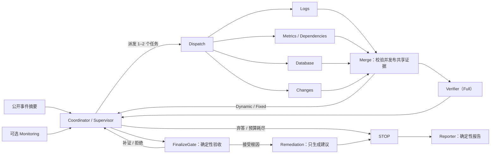

# IncidentLens 课程项目交接指南

本文供后续负责测试验收、报告撰写、PPT 制作、现场汇报和提交打包的成员使用。非技术成员可以先读“项目一句话”和“如何解释结果”，再按自己的角色进入对应章节；技术成员可从运行命令、证据路径和限制直接接手。

> **配套网页版：** [project-handoff.zh-CN.html](project-handoff.zh-CN.html) —— 用浏览器直接打开，含图表、按角色的上手标签页和可勾选的自检清单，适合快速浏览与小组内分享。本 Markdown 是权威版本，网页版数字与之同步。
>
> **当前状态（2026-11-02）：** 演示文稿、讲稿、问答准备和提交清单已经产出，全部在 [submission-package](README.md) 里：`IncidentLens_Deck.pptx/.pdf`（21 页：15 主线 + 6 备用）、`Presentation_Script.md`（9:57 计时）、`QA_Preparation.md`、`RUN_GUIDE.md`、`SUBMISSION_CHECKLIST.md` 和已填好 Group 5 与成员 1–2 的 Individual Contribution Statement（成员 3–6 与百分比留待全组确认）。下面凡是与这些文件重叠的章节，都以 package 里的版本为准。

## 先看结论

**项目一句话：** IncidentLens 让日志、指标与依赖、数据库、变更四类调查员分工取证，由协调者根据当前证据缺口动态派出最需要的 1–2 个调查员；只有经过校验、合并和证据门控的记录才能进入共享证据板，证据不足时系统明确输出 `INCONCLUSIVE`。

最新完整批次是 **硬化集 36 案例 × 四架构 = 144 槽位**（`full144-hardened-c4-20261101`，2026-11-01，4 小时 39 分）：136 槽位技术完成，8 次技术失败按协议保留在分母中，0 中断。**`dynamic`（无独立 Verifier）是本项目的主架构，也是运行时默认**；`full` 保留为消融对照，文档中显示为 *dynamic (with verifier)*。测试基线是 2026-11-02 对最终代码树全量重跑的测试套件：**1179 通过、3 跳过、0 失败（463.23 秒，退出码 0）**，日志存档在 `analysis/submission/pytest-20261102.log`。

| 架构 | 技术完成 | 根因正确 | 正确弃答 | 质量成功 | 平均耗时 | 平均请求 | 平均工具 | 平均 Token |
| --- | ---: | ---: | ---: | ---: | ---: | ---: | ---: | ---: |
| Single | 35/36 | 25/28 | 7/7 | 32/36 | 680.9s | 17.3 | 14.5 | 245,971 |
| Fixed-4 | 34/36 | 15/27 | 7/7 | 22/36 | 196.3s | 7.8 | 7.4 | 58,042 |
| **Dynamic（主架构）** | 33/36 | **27/27** | 6/6 | **33/36** | 412.9s | 14.6 | 12.0 | 149,216 |
| Full（*dynamic with verifier*） | 34/36 | 23/27 | 7/7 | 30/36 | 503.8s | 17.6 | 15.5 | 233,772 |

**为什么以 `dynamic` 为主架构：**

- **对 Single：** 质量多 1 个成功（33 vs 32），耗时、请求、工具查询和 Token 分别降低 **39.4% / 15.6% / 17.2% / 39.3%**，支持“动态分工减少无效查询与上下文”这一设计论点。
- **对 Full（dynamic with verifier）：** 质量多 3 个成功（33 vs 30），Full 的耗时、请求、工具和 Token 分别高 **18.0% / 20.5% / 29.2% / 56.7%**，说明独立 Verifier 在本批没有产出可测的质量增益。我们只表述为“未观测到增益”，不据此断言 Verifier 永远无用。
- **对 Fixed-4：** Fixed 明显更便宜（196.3s、7.8 请求、58,042 Token），但在 27 个可识别案例上错弃 12 个，证明“一次性固定批次无法补证”，这恰恰是 Dynamic 多轮补查的价值所在。

**这一批最值得讲的结论是“零误判”。** 在技术上完成的运行里，`dynamic` 33/33 全部判对；四个架构合计 19 次可识别失分全部以 `INCONCLUSIVE` 结束，没有一次给出错误的 `culprit_service` / `failure_mode`。失分模式是过度弃答，而不是编造根因。

把 `dynamic` 设为默认**不改变产品风险画像**：它的接地门控、引用校验和弃答行为与实验时完全相同，改变的只是被当作主架构的那一档。这些结果来自 36 个开发可见案例、每案例一次重复和候选 oracle，属于描述性开发证据，不是独立盲测、统计显著性或生产部署结论。不能把“Agent 数量更多”当作天然优势。

## 课程交付与责任映射

课程 PDF 要求展示 Agent specialization、communication、coordination 或 collaboration，不能只是多次独立调用 LLM。交付物包括源码与运行说明、不超过 10 分钟的 Demo 视频、Presentation slides 和 Individual Contribution Statement。PPT 需要覆盖问题与动机、多 Agent 设计、实现、系统演示与结果。评分权重是：问题定义与动机 15%，多 Agent 设计 30%，技术实现与功能 25%，分析与创新 15%，展示与提交质量 15%。

| 后续工作 | 必须完成的产物 | 本项目应重点呈现的证据 | 建议负责人 |
| --- | --- | --- | --- |
| 测试与验收 | 可复现命令、批次状态、保留的失败尝试、评分表 | 144 槽位状态（136 完成 / 8 技术失败保留在分母）、失败分类、四架构同条件设置、离线评分脚本 | 测试负责人 + 技术负责人复核 |
| 课程报告 | 方法、架构、实验设置、结果、失败案例、限制 | Dynamic 零误判与四项资源优势；Fixed-4 的 12 次错误弃答；Full 无额外质量收益；8 次技术失败的分类 | 报告负责人 |
| PPT | 覆盖课程四部分的演示文稿 | 角色与协作图、证据流、四架构消融、质量与成本双轴结果 | **已完成**：[IncidentLens_Deck.pptx](IncidentLens_Deck.pptx)，21 页（15 主线 + 6 备用），见 [Presentation_Script.md](Presentation_Script.md) 与 [QA_Preparation.md](QA_Preparation.md) |
| Demo 视频 | 不超过 10 分钟，展示真实工作流和代表性案例 | 动态调度、共享证据、Verifier/门控、明确弃答、离线 replay | **未产出（有意保留）**：录制计划在 `docs/DEMO_GUIDE.md`，全组自行录制 |
| 现场汇报 | 8–10 分钟主讲稿、问答准备、计时演练 | 一句话价值、架构设计、关键数据、证据边界 | **已完成**：`Presentation_Script.md` 主线合计 9:57，六人分工已按页分配 |
| 贡献声明 | 每人负责的模块、与其他模块的接口、可核对证据 | 实际提交、测试、文档、汇报或数据工作 | **已完成初稿**：[Individual_Contribution_Statement.md](Individual_Contribution_Statement.md)，Group 5 与成员 1–2（YANG Ziting、MA Jiyuan）已填，成员 3–6 与百分比待全组补齐 |

课程截止时间为 **2026-11-23 23:59**，通过 Canvas 提交，一人代表全组上传；建议 ZIP 命名为 `COMP5584+GroupProject+Group5.zip`。TA 为 Qi Peng，`qi0125.peng@connect.polyu.hk`，邮件主题建议以 `COMP5584+GroupProject+Group5` 开头。

## Agent 流设计

### 九节点工作流



`monitor → coordinate → dispatch → merge → verify → finalize → remediate → stop → report` 是 LangGraph 中的九个节点。默认 RCA 工作流从 `coordinate` 开始；可选事件响应工作流从 `monitor` 开始。Merge、FinalizeGate、Reporter 是确定性组件，不是额外 LLM Agent。

### 角色与权限

| 角色 | 职责 | 可访问证据 |
| --- | --- | --- |
| Coordinator / Supervisor | 根据共享证据、开放问题和预算，决定调查、补查、定稿或弃答 | 已发布共享状态；无业务查询工具 |
| Logs Investigator | 还原错误时间线与传播过程，区分因果信号与伴随症状 | `query_logs` |
| Metrics & Dependency Investigator | 检查服务健康、容量、依赖和影响范围；基准中可获等价数据库工具 | `query_metrics`、`get_dependencies` |
| Database Investigator | 区分数据库容量、会话、锁、慢查询与应用连接池问题 | 五个只读 `get_db_*` 工具 |
| Changes Investigator | 对照事故时间检查部署和配置差异 | `query_changes`、`get_config_diff` |
| Verifier / Skeptic | 只读取授权共享证据，质疑候选根因并提出具体补查 | `fetch_evidence_by_ids` |
| Remediation | 为已接受根因生成带风险、验证和回滚步骤的方案 | 已接受根因与证据 |
| Single-Agent baseline | 同一身份完成规划、调查和自我反思，串行运行 | 等价的全部公开只读工具 |

所有业务工具都是只读。运行时签发不可变 `AgentContext`，绑定工作区、事件、运行、角色、工具白名单和剩余预算；任务只能进一步收窄权限。公共文件使用固定白名单，拒绝私有真值、路径穿越、符号链接和 Windows junction。证据摘录始终作为不可信数据送入模型。

### 协作不是“自由聊天”

调查员只写自己的局部结果。Merge 先校验任务身份、角色、实际查询账本、引用和来源，再一次性发布到共享证据板；并行任务不能直接覆盖共享状态。Coordinator 只能看到已发布内容。Full 中的 Verifier 通过授权 ID 重新获取共享记录，不能读取未查询证据。候选或证据一变化，旧审查指纹就失效。FinalizeGate 还会检查引用来源多样性、因果判别证据、竞争假设、未决问题和 Verifier 审查。

这套机制回答了课程要求中的四个核心问题：

1. **分工：** 每个调查员有不同证据域、提示词和 ACL。
2. **分解：** Coordinator 每轮最多派出 1–2 个最需要的新检查。
3. **通信：** 调查结果经 Merge 校验后进入共享证据板；Verifier 的补查请求回到 Coordinator。
4. **最终决策：** 证据充分时由确定性门控接受根因，证据不足时正常弃答；Provider 失败不会被伪装成弃答。

### 四种架构

| 架构 | 协调与调查方式 | 独立审查 | 比较目的 |
| --- | --- | --- | --- |
| `single` | 一个身份规划、查询全部证据并自我反思，串行 | 同一身份自审 | 强单 Agent 基线 |
| `fixed` | 首轮一次性固定派出 Logs、Metrics、Database、Changes | 无 | 测试固定四专家批次的成本与覆盖 |
| **`dynamic`（主架构，默认）** | 动态选择专家，多轮补查，Merge + FinalizeGate 确定性接地 | 无 | 主架构：动态分工 + 确定性验收 |
| `full`（*dynamic (with verifier)*） | 动态选择专家 + Verifier 反馈 + FinalizeGate | 有 | 消融对照：隔离独立审查的贡献 |

历史产物、已保存的 protocol 和 WP-D 结果行中仍会出现 `dynamic_no_verifier`；它是 `dynamic` 的冻结别名，运行时入口和聚合都会解析它，新运行不再写出该拼写。IncidentBench 的条件名（`strong_single_equivalent_tools`、`fixed_four_equivalent_tools`、`dynamic_no_verifier`、`full`）同样是冻结契约，因为已保存的 `protocol.json` 必须继续通过校验。

四种架构使用同一公开数据、等价工具、模型、temperature 0、关闭缓存、相同轮次/工具/请求/墙钟上限和相同运行顺序。架构提示词和控制流差异属于实验处理，不应在批次中途热改。

### 为什么适合多 Agent

事故 RCA 不是简单的文本生成，而是多个证据域逐步缩小假设空间。日志可能显示症状，指标提供时间与影响，数据库连接数据区分内部容量与上游池配置，变更记录提供触发机制。单个 Agent 容易把所有材料塞入一次超长上下文，也更容易在相似症状上过度断言。动态分工让每轮只查最有判别价值的一两个来源，再由确定性合并和门控维护证据边界。硬化集批次支持的是两条：一是“减少无效查询和上下文”（对 Single 省 39.4% 耗时、39.3% Token 且多对 1 例），二是在竞争性成因与反事实配对上只有 `dynamic` 做到 7/7、6/6。Full 的额外审查在两批中都没有带来更高正确率。

## 评测设计

### 数据与案例

**最新批次使用 `data/incidentbench_v2_hardened`**（`incident_4001`–`incident_4036`，36 例：29 可识别 / 7 需弃答），由编码器血统 `causal-world-v2-hardened` 生成。它的难度分六类杠杆，每类在四个架构上都跑过：

| 杠杆 | 含义 | 案例数 | 可识别 |
| --- | --- | ---: | --- |
| `standard` | 标准可识别案例 | 7 | 是 |
| `boundary` | 判别证据落在边界条件 | 7 | 是 |
| `competing` | 存在竞争性成因 | 7 | 是 |
| `counterfactual_pair` | 反事实配对的成对案例 | 6 | 是 |
| `misleading` | 含误导性证据 | 2 | 是 |
| `missing` | 判别证据缺失，应弃答 | 7 | 否 |

公开观测与 evaluator-only oracle 分离；Graph 结束后才评分。所有案例为 `development_visible`，oracle 仍为 `pending` / `candidate-v1`，没有独立人工验收或 blind Test 结论，**不能当作验证集或测试集**。

上一批使用的 Dev10（`data/incidentbench_v16_dev` 的 `incident_3001`–`incident_3010`，8 可识别 / 2 需弃答）保持冻结、逐字节可复现，作为早期证据保留在附录与 README 中。详见 [优化路线](../../guides/optimization-roadmap.zh-CN.md) 的 P0-C 章节。

可识别案例要求 `culprit_service` 与 `failure_mode` 同时精确匹配；不可识别案例只有在正常终止且 `INCONCLUSIVE`、无根因时才算正确弃答。技术失败仍在对应分母中；证据不足的正常弃答是有效结果；Provider/网络/预算失败不是弃答。

### 控制变量与最新批次

| 项目 | 本次设置 |
| --- | --- |
| 计划与协议 | `results/acceptance/full144-hardened-c4-20261101/{plan,protocol,readiness}.json` |
| 模型 | `auto/deepseek-v4.1-flash`，本地 OpenAI 兼容网关 |
| 矩阵 | 36 个案例 × 4 架构 × 1 repeat = 144 slots |
| 并发 | 4；每槽独立 provider、预算和公开数据 reader |
| 采样 | temperature 0，cache off |
| 上限 | 8 轮、40 次工具、64 次逻辑请求、7200 秒/调查、请求超时 1200 秒 |
| 顺序 | seed 14100，固定随机化；所有架构保留在配对计划中 |
| 结果目录 | `results/v16/wp-d/full144-hardened-c4-20261101/`（本地产物，gitignore，未随包提交） |
| 最终状态 | `batch_finished_with_errors`；136 completed、8 failed（保留在分母）、0 interrupted |
| 实际耗时 | 4 小时 39 分（16,737.6 秒），输入哈希全程无漂移（144/144 `source_unchanged`） |

### 指标定义

- **技术完成：** 保存产物通过协议、来源不变、STOP 完成、无 runtime failure，且 observability 未降级。
- **正确根因：** 可识别案例的服务和故障模式均匹配 oracle。
- **正确弃答：** 不可识别案例正常输出 `INCONCLUSIVE` 且没有根因。
- **质量成功：** 正确根因与正确弃答之和，分母是全部 36 个案例（技术失败算未成功，即“失败包含”口径）。
- **耗时：** 围绕实际 Graph 执行的单调时钟时长。
- **请求：** 实际 Provider 物理请求，包括重试和结构化修复。
- **工具查询：** 经 ToolRegistry 实际执行的查询。
- **Token：** Provider 返回的测量 usage；未知值不能填成零。

最终成功均值只使用每个 slot 的最后一个成功 attempt。失败和中断尝试另列在全尝试成本中，避免把额外重试隐藏掉，也避免把未完成 attempt 混入成功均值。

## 最新测试结果

### 总体对比

分母口径：`技术完成` 以 36 个槽位为分母；`根因正确` 只在可识别且技术完成的案例上计分；
`正确弃答` 只在不可识别且技术完成的案例上计分；`质量成功` 以 36 为分母，技术失败计为未成功。

| 架构 | 技术完成 | 根因正确 | 正确弃答 | 质量成功 | 平均耗时 | 平均请求 | 平均工具 | 平均 Token |
| --- | ---: | ---: | ---: | ---: | ---: | ---: | ---: | ---: |
| Single | 35/36 | 25/28 | 7/7 | 32/36 | 680.9s | 17.3 | 14.5 | 245,971 |
| Fixed-4 | 34/36 | 15/27 | 7/7 | 22/36 | 196.3s | 7.8 | 7.4 | 58,042 |
| **Dynamic（主架构）** | 33/36 | **27/27** | 6/6 | **33/36** | 412.9s | 14.6 | 12.0 | 149,216 |
| Full（*dynamic with verifier*） | 34/36 | 23/27 | 7/7 | 30/36 | 503.8s | 17.6 | 15.5 | 233,772 |

只看技术上完成的运行，质量成功率是：Dynamic 33/33（100%）、Single 32/35（91.4%）、
Full 30/34（88.2%）、Fixed-4 22/34（64.7%）。报告里这两个口径必须分开说，不能混用。

### 多 Agent 优势分析

**Dynamic（主架构）相对 Single。** Dynamic 多 1 个质量成功（33 vs 32），平均耗时从 680.9 秒降到 412.9 秒（−39.4%），请求从 17.3 降到 14.6（−15.6%），工具从 14.5 降到 12.0（−17.2%），Token 从 245,971 降到 149,216（−39.3%）。这支持“按证据缺口选择专家，减少无关查询与上下文”的设计论点。

**Dynamic 相对 Full（dynamic with verifier）。** Dynamic 多 3 个质量成功（33 vs 30），Full 的耗时、请求、工具和 Token 分别比 Dynamic 高 18.0%、20.5%、29.2% 和 56.7%。两批（10 案例与 36 案例）都没有观察到独立 Verifier 带来的可测质量增益；这只说明“本批未观测到收益”，不能断言 Verifier 永远无用。

**Fixed-4 相对 Single。** Fixed-4 的耗时、请求、工具和 Token 分别降低 71.2%、54.9%、49.0% 和 76.4%，是最便宜的对照，但它在 27 个可识别案例上错弃 12 个，不能作为质量最优架构。

**Full 相对 Single。** Full 略便宜（耗时 −26.0%、Token −5.0%），但质量更低（30 vs 32），且请求与工具略多；本批没有证据支持 Full 优于 Single 或 Dynamic。

**零误判是本批最强的结论。** 四个架构合计 19 次可识别失分，全部以 `INCONCLUSIVE` 结束，没有一次给出错误的 `culprit_service` / `failure_mode`；7 个不可识别案例在所有完成的运行里都正确弃答。也就是说系统“答的时候是准的”，代价在召回。

**配对比较（同一案例内，Dynamic 对其它架构）。**

| 对照 | Dynamic 更好 | Dynamic 更差 | 持平 |
| --- | ---: | ---: | ---: |
| vs Single | 3 | 2 | 31 |
| vs Fixed-4 | 12 | 1 | 23 |
| vs Full | 5 | 2 | 29 |

注意 Dynamic 本批有 3 次技术失败、Full 只有 2 次；在失败更多的前提下仍然赢下配对比较。

### 分难度杠杆

表中的数字是该杠杆下“质量成功 / 案例数”。

| 杠杆 | 案例数 | Single | Fixed-4 | Dynamic | Full |
| --- | ---: | ---: | ---: | ---: | ---: |
| `standard` | 7 | 6/7 | 3/7 | 6/7 | 6/7 |
| `boundary` | 7 | 6/7 | 4/7 | 6/7 | 5/7 |
| `competing` | 7 | 6/7 | 4/7 | **7/7** | 6/7 |
| `counterfactual_pair` | 6 | 5/6 | 3/6 | **6/6** | 4/6 |
| `misleading` | 2 | 2/2 | 1/2 | 2/2 | 2/2 |
| `missing`（应弃答） | 7 | 7/7 | 7/7 | 6/7 | 7/7 |

`dynamic` 的强项正好落在硬化集新增的难点上：竞争性成因 7/7、反事实配对 6/6，其他架构在这两类各丢 1–3 个。
`missing` 一格里 Dynamic 的 6/7 是那 1 次技术失败造成的，不是误判。

### 各架构失分分布

| 架构 | 错误弃答的可识别案例 | 技术失败案例 |
| --- | --- | --- |
| Single | 4020、4025、4036 | 4019（身份不匹配） |
| Fixed-4 | 4001、4006、4007、4008、4014、4019、4020、4023、4024、4025、4035、4036 | 4021、4032（结构化输出） |
| Dynamic | 无 | 4004、4006、4020（结构化输出） |
| Full | 4020、4021、4023、4036 | 4011（结构化输出）、4032（身份不匹配） |

### 全尝试成本与失败分类

| 架构 | Attempts | 结构化输出失败 | 身份不匹配 | 中断 | 失败尝试 Token | 全部 Token | 全部耗时 |
| --- | ---: | ---: | ---: | ---: | ---: | ---: | ---: |
| Single | 36 | 0 | 1 | 0 | 155,973 | 8,764,961 | 24,082.8s |
| Fixed-4 | 36 | 2 | 0 | 0 | 92,902 | 2,066,337 | 7,362.2s |
| Dynamic（主架构） | 36 | 3 | 0 | 0 | 481,787 | 5,405,907 | 15,858.9s |
| Full | 36 | 1 | 1 | 0 | 190,937 | 8,139,190 | 18,115.1s |
| **合计** | **144** | **6** | **2** | **0** | **921,599** | **24,376,395** | **65,419.0s** |

144 个槽位都是第一次 attempt 就进入终态，没有重试；8 次技术失败按预案保留，不重试、也不替换成
“后来挑出的最好一次”。失败尝试占全部 Token 的 3.8%。

8 次失败分两类：

- **6 次 `STRUCTURED_OUTPUT_INVALID`**：5 次响应包完全缺少字符串内容，1 次输出在 token
  上限处截断且修复后仍无效，schema 校验失败（`dispatch` 阶段 4 次、`coordinate` 阶段 2 次）。
- **2 次 `FINDING_IDENTITY_MISMATCH`**：工具返回的 finding 与本轮身份不匹配，被确定性门禁拦下
  （都在 `dispatch` 阶段）。

分布是 Single 1、Fixed-4 2、Dynamic 3、Full 2——四个架构都有，说明这是 provider / 结构化输出层
的偶发问题，不是某一架构的设计缺陷。不能把 Provider 失败解释成模型已经给出正确诊断。

**每质量成功案例的成本**（全部 Token ÷ 质量成功数）：Fixed-4 93,924、Dynamic 163,815、
Full 271,306、Single 273,905。Fixed-4 单看成本最低，但它少答对 11 个案例，不能据此说它“更划算”。

### 上一批：Dev10 40 槽位（2026-10-31，保留作早期证据）

| 架构 | 技术完成 | 根因正确 | 正确弃答 | 质量成功 | 平均耗时 | 平均请求 | 平均工具 | 平均 Token |
| --- | ---: | ---: | ---: | ---: | ---: | ---: | ---: | ---: |
| Single | 10/10 | 8/8 | 2/2 | 10/10 | 391.2s | 17.6 | 15.0 | 257,146 |
| Fixed-4 | 10/10 | 5/8 | 2/2 | 7/10 | 96.9s | 7.9 | 7.6 | 56,586 |
| Dynamic（主架构） | 10/10 | 8/8 | 2/2 | 10/10 | 233.5s | 14.0 | 11.8 | 145,035 |
| Full | 10/10 | 8/8 | 2/2 | 10/10 | 438.9s | 18.8 | 15.9 | 269,832 |

这一批 40/40 全部技术完成，只有 Full/3010 因 provider 结构化失败与终端断连重试了 3 次；
前两次 attempt 被保留并计入全尝试成本，因此该批 Full 的全尝试 Token 与耗时是下界。它的价值是
提供 Dev10 上的干净对照，并说明证据缺口成本护栏的来由；但案例只有 10 个、缺少难度杠杆，
**对外结论一律以硬化集 144 槽位为准**。

### 结果可以怎样讲，不能怎样讲

可以讲：

- “在 36 个硬化开发案例上，Dynamic 取得 33/36，是四个架构中最高的；技术上完成的 33 次全部判对。”
- “Dynamic 比 Single 少用 39.4% 耗时、39.3% Token，并多答对 1 个案例；比 Full 多答对 3 个，耗时低 18.0%、Token 低 36.2%。”
- “四个架构合计 19 次可识别失分全部是弃答，没有一次根因误判——系统答的时候是准的，代价在召回。”
- “Fixed-4 成本最低，但在 27 个可识别案例上错弃 12 个，说明一次性固定批次无法补足证据缺口。”
- “这是候选 oracle 下的开发集描述性结果，下一步应做独立标签验收与更大规模的重复评测。”

不能说：

- “多 Agent 已达到统计显著优势。”
- “Dynamic 在盲测/生产中一定更准确。”
- “136/144 技术完成等于 136/144 诊断正确。”
- “Fixed-4 每成功案例成本最低，所以整体最好。”
- “8 次技术失败说明某个架构不稳定。”（失败分布在四个架构，属 provider 层）
- “Mock 结果证明真实模型能力。”
- “修复建议已执行或生产事故已恢复。”

## 优化路线（先建立可信基础，再提高效率）

主架构定稿后，下一步不是继续增加 Agent，而是先统一成本与质量口径、审计查询覆盖，并推进标签复核
与独立评测。早期 Dev10 批次里 `incident_3003`、`incident_3008` 两个不可识别案例上，Dynamic 的 Token 是它可识别
案例均值的 2.39 倍；3008 单案 386.3 秒 / 274,794 Token，最终是正确弃答。两个案例由 Coordinator
主动 `ABSTAIN`，并非预算耗尽。

**2026-11-01 进展**：这一现象已由证据缺口护栏处理（`WorkflowOptions.evidence_gap_rounds`，
默认 5，`0` 关闭）。判据不是笼统的“连续两轮无新证据”，而是“连续若干轮没有任何候选获得
`cause_discriminator`”；触发时发出 `INVESTIGATION_EVIDENCE_EXHAUSTED` 并携带成本快照，只影响
预算，不改变 `FinalizeGate` 的接受判定。阈值由冻结 WP-D 轨迹重放校准：在 th=5 下 3003 的 Token
降 44.0%、3008 降 21.9%、Dynamic 十例合计 −12.3%（重放估计，非新批次实测）。注意
`configs/system.yaml` 的 `max_rounds: 4` 使该阈值在默认配置下无法触发，需同时调高轮次上限。

**2026-11-02 补充：护栏在硬化批上的触发已实测。** 硬化批次把 `max_rounds` 提到 8，护栏因此真实
触发了 **27 次**（144 条 trace 中，`INVESTIGATION_EVIDENCE_EXHAUSTED`：full 11、single 10、
dynamic 6），全部以 `INCONCLUSIVE` 结束。关键是分布：**Dynamic 的 6 次护栏停止全部落在只应弃答的
案例上，6/6 都是正确弃答，零质量损失；7 次可识别案例的提前释放全部发生在消融对照上（full 4、
single 3）**。所以在主架构上护栏是纯成本停止，不构成成本-准确率权衡；对外的表述仍是“节省是重放
估计、触发是实测事实”。

**2026-11-01 晚：P0-C 的数据集已跑完一轮正式规模批次。** 硬化集 36 案例 × 四架构 = 144 槽位全部
落盘（4 小时 39 分），评分脚本 `analysis/wp_d/reports/hardened144-20261101/score_batch.py` 可离线复算
全部数字。仍**未完成**的是：oracle 标签仍是 `pending`（没有人工复核）、只有单次重复、没有 blind Test
分区。因此 P0-C 的完成标准仍未满足，下一步是把标签送审并做重复评测，而不是再加大并发或换模型。

优先级与验收标准写在 [优化路线](../../guides/optimization-roadmap.zh-CN.md)，要点：

| 优先级 | 合并后的方向 | 完成标准 |
| --- | --- | --- |
| **P0-A** | 评测账本与可观测性 | 原始记录可复算；失败、弃答、全尝试成本与质量口径一致 |
| **P0-B** | 查询覆盖、去重与搜索收敛 | 停止理由与覆盖范围可审计；硬化集上 Dynamic 质量不回归（≥33/36），过度弃答不增加 |
| **P0-C** | 标签验收、未见案例与重复评测 | 标签与数据边界可追踪；同期基线与预定分析方案已冻结 |
| **P1** | 上下文裁剪；判别价值派单与及时定稿 | 分别消融；报告质量和全流程成本，无质量回归 |
| **P2** | 按需 Verifier；提供商与结构化输出可靠性 | 独立实验条件；报告触发率、失败类别和收益边界 |
| **P3** | 模型分工、缓存与并发 | 架构稳定后逐变量实验，计入全尝试成本 |

P0 不改变 `grounding_errors` / `finalize_errors` / 指纹校验。P0-A 与 P0-C 用于改善计数和证据质量；
P0-B 研究何时停止搜索，必须同时通过质量回归，不能假定它不影响风险。所有优化只在
**新批次、新目录**上验收，历史产物一字不改。

## 测试成员上手

### 环境准备

在仓库根目录使用 PowerShell：

```powershell
python -m venv .venv
.venv\Scripts\python.exe -m pip install -r requirements.lock
.venv\Scripts\python.exe -m pip install -e '.[dev]'
.venv\Scripts\python.exe -m incident_lens.cli validate-data
.venv\Scripts\python.exe -m pytest tests/incidentbench/test_cli_e2e.py -q
```

真实网关配置只放在本地 `.env` 或当前进程环境，不能提交密钥。所需变量包括 `INCIDENT_LENS_BASE_URL`、`INCIDENT_LENS_API_KEY`、`INCIDENT_LENS_MODEL`、`INCIDENT_LENS_RESPONSE_FORMAT` 和 `INCIDENT_LENS_THINKING`。运行前确认 readiness 的 `model_id`、`response_format`、`thinking` 与 protocol/runtime config 完全一致。

### 新批次与续跑

每次实验必须新建唯一输出目录，不得覆盖已验收结果，也不得把失败案例换成后来挑出的“最好一次”。批次采用两阶段操作：

```powershell
# 1. 准备：冻结计划、源码、数据、协议、依赖和环境；不调用模型。
.venv\Scripts\python.exe scripts/run_wpd_batch.py `
  --plan results/acceptance/NEW-BATCH/plan.json `
  --out results/v16/wp-d/NEW-BATCH `
  --prepare `
  --readiness results/acceptance/NEW-BATCH/readiness.json

# 2. 明确执行：使用计划中的并发和模型。
.venv\Scripts\python.exe scripts/run_wpd_batch.py `
  --plan results/acceptance/NEW-BATCH/plan.json `
  --out results/v16/wp-d/NEW-BATCH `
  --execute `
  --readiness results/acceptance/NEW-BATCH/readiness.json
```

查看状态，不调用 Provider：

```powershell
.venv\Scripts\python.exe scripts/run_status.py results/v16/wp-d/NEW-BATCH
Get-Content results/v16/wp-d/NEW-BATCH/supervisor-status.json -Raw
```

失败或中断后先看状态并保留原 attempt。继续未启动槽位使用 `--resume`；已结束失败需要显式 `--retry-failed`；中断槽位需要显式 `--retry-interrupted`：

```powershell
.venv\Scripts\python.exe scripts/run_wpd_batch.py `
  --plan results/acceptance/NEW-BATCH/plan.json `
  --out results/v16/wp-d/NEW-BATCH `
  --execute --resume --retry-failed --retry-interrupted `
  --readiness results/acceptance/NEW-BATCH/readiness.json
```

禁止在批次中途修改源码、协议、模型或预算。冻结输入漂移会阻止下一槽位；正确做法是停止并建立新批次。Supervisor 写入的 `STOP_REQUESTED` 会取消在途工作并保留 attempt。

### 验收检查

至少核对以下内容：

```powershell
git status --short --branch
Get-Content results/v16/wp-d/NEW-BATCH/supervisor-status.json -Raw
Get-Content results/v16/wp-d/NEW-BATCH/batch-state.json -Raw
Get-Content results/v16/wp-d/NEW-BATCH/final-success-comparison.json -Raw
```

验收标准不是 `failed_slots=0`。硬化集 144 槽位批次的终点是 `batch_finished_with_errors`（136 completed / 8 failed / 0 interrupted），这正是协议允许的合法终态：每个槽位都必须有终态记录，失败 attempt 保留在 `batch-state.json` 与分母中，不重试、不替换。要核对的是：每个成功 attempt 的 scope/trace/result 身份一致；verification 通过协议和 STOP 检查；最终成功均值不混入失败 attempt；质量正确性按 evaluator oracle 离线单独计算。若重新分析评分，使用 `analysis/wp_d/reports/` 下的新目录，不改写原批次：

```powershell
.venv\Scripts\python.exe analysis/wp_d/reports/hardened144-20261101/score_batch.py
```

脚本只读批次目录，重算 `final-success-comparison.json`（144 条记录，含预测、真值、失败原因、难度杠杆与逐槽资源用量）。

## 报告成员上手

推荐叙事顺序：

1. 问题：事故 RCA 要求跨日志、指标、数据库与变更交叉验证，单 Agent 容易塞满上下文或过度断言。
2. 设计：角色 ACL、动态 1–2 任务派发、Merge 发布、共享证据板、Verifier 反馈、确定性 FinalizeGate。
3. 方法：硬化集 36 个开发案例 × 四架构 = 144 槽位、同模型同工具同预算、cache off、4 并发、单次重复、候选 oracle。
4. 结果：先说明 136/144 技术完成（8 次技术失败保留在分母），再展示质量表：Dynamic 33/36 最高，且在完成的 33 次里 33/33 全对。
5. 失败分析：零根因误判，19 次失分全是过度弃答；Fixed-4 在 27 个可识别案例上错弃 12 个；Full 多耗 56.7% Token 却少 3 个成功；8 次技术失败是 provider 层的结构化输出问题，四个架构都有。
6. 限制与下一步：单次重复、开发可见、`annotator_status: pending` 的临时标签；送审标签、重复评测、blind Test 分区。

报告中的每个结论都应对应到表格或证据文件。不要用“技术完成率”替代“根因正确率”，也不要把“失败包含”的 33/36 和“完成内”的 33/33 混着讲。若要画图，建议用三个清晰面板：质量成功数（36 为分母）与完成内成功率；四项相对 Single 的百分比变化；分难度杠杆的 6 格热力。另用单列图展示全尝试成本，避免把最终成功均值和含失败 attempt 的成本混在同一图。

## PPT 成员上手

**演示文稿已经完成**，不需要再从零做页：`presentation/IncidentLens_Deck.pptx`（同目录有 PDF，
1,047,346 字节），共 **21 页 = 15 页主线 + 6 页备用问答页**。每页主线页都有讲者备注，单页计时合计
9:57，符合 8–10 分钟要求。下面是主线 15 页的实际结构（备用页 16–21 覆盖协议细节、护栏、失败分类、
快速启动命令等 Q&A 弹药）：

| 页 | 内容 |
| --- | --- |
| 1 | 标题：题目、Group 5 与六位成员学号 |
| 2 | 问题与动机：软件事故调查为什么要跨证据域交叉验证 |
| 3 | 系统总览：四专家 + 协调者 + 共享证据板 + 确定性门控 |
| 4 | 一轮证据流：缺口 → 1–2 任务派发 → Merge → 补查/定稿（含库存与基准预算对照） |
| 5 | 角色、ACL、引用校验与弃答边界 |
| 6 | 四架构消融与控制变量 |
| 7 | 评估方法：36 硬化案例、六类难度杠杆、同模型同预算 |
| 8 | 工程可信度：全量测试 1179 通过（2026-11-02，463.2s）+ 可复现命令 |
| 9 | 演示：真实运行的控制台（live trace 深链） |
| 10 | 配对比较：同案例内 Dynamic 对其余架构 |
| 11 | 结果总表：质量 33/32/22/30 与四项资源开销 |
| 12 | 成本对比图：Dynamic vs Single/Verifier |
| 13 | 失败分析：零误判领先，19 次失分全是弃答 |
| 14 | 范围与有效性：护栏实测分布、成本契约、设计决策 |
| 15 | 结论与下一步验证 |

讲稿逐页文本、中文提示和演示提示在 [Presentation_Script.md](Presentation_Script.md)；
最可能被问的 10 个问题、快速应答表、拒答口径和背熟的数字表在 [QA_Preparation.md](QA_Preparation.md)。
小组要做的只剩：指定每页主讲人（讲稿已按六块分好）、两次完整计时排练（其中一次故意让演示失败）。

架构图突出“证据如何流经角色”，少放代码类名。结果页大字写 `33/36 vs 32/36`（质量成功），副标题写 `-39.4% latency / -39.3% tokens vs Single`，再用一行小字补“136/144 技术完成、零根因误判、开发集与 pending oracle”。不要将四个架构画成完全并行的独立 LLM；本项目展示的是中央协调、结构化交接、共享证据和门控。

## 现场汇报与问答

8–10 分钟建议节奏：

- 0:00–1:00：问题与一句话价值。
- 1:00–3:30：Agent 角色、动态派发、Merge/Verifier/门控。
- 3:30–5:00：四架构与公平实验设计，说明 Dynamic 是主架构、Full 是消融对照。
- 5:00–7:00：总体质量、Dynamic 资源优势、Fixed/Full 反例。
- 7:00–8:30：Demo 或界面截图、失败处理与明确弃答。
- 8:30–10:00：限制、下一步和团队贡献。

面向非技术听众时，用“不同调查员各看一类证据，协调员只安排下一两项最关键的检查，结果要经过合并和验收才能写进报告”解释。先讲业务价值与结果，再按需解释 LangGraph、Pydantic、ACL 和 trace。

建议准备这些问答：

| 问题 | 回答要点 |
| --- | --- |
| 为什么不直接用一个更大的模型？ | 单 Agent 仍可做基线，但动态分工减少无关上下文和查询；本批 Dynamic 质量更高（33 vs 32），耗时和 Token 各低约 39%。 |
| 多 Agent 的优势是不是因为模型变多？ | 不是。优势来自专家边界、按缺口派发、校验合并和明确弃答；Full 多一个 Verifier，反而少 3 个成功、多耗 56.7% Token。 |
| 为什么 Fixed-4 更便宜却正确率低？ | 它只做一次固定批次，不能根据缺口补查；27 个可识别案例上错弃 12 个（4001、4006、4007、4008、4014、4019、4020、4023、4024、4025、4035、4036）。 |
| Dynamic 没有 Verifier 是否风险更高？ | 它仍保留 Merge 校验、确定性接地和 FinalizeGate；本批 Dynamic 是四架构最高（33/36，完成内 33/33），设为默认不改变风险画像。Verifier 对更难竞争假设的独立价值需要更大数据验证，按需 Verifier 是计划中的后续实验。 |
| 数据是否独立盲测？ | 不是。36 个 Dev 案例为 `development_visible`，oracle 的 `annotator_status` 仍是 `pending`，每案例一次；结论是描述性开发证据。 |
| 为什么批次以“有错误”结束、退出码是 1？ | 8 个槽位发生技术失败（6 次结构化输出无效：5 次响应包缺少字符串内容、1 次截断且修复后仍无效；另 2 次 finding 身份不匹配），`batch_finished_with_errors` 就是协议允许的合法终态。按预案不重试、不替换，失败保留在分母；失败分布在四个架构，是 provider 层偶发问题。 |
| 弃答是否是失败？ | 在无足够证据案例中，明确弃答是正确业务结果；Provider、网络或预算失败才是技术失败。本批 19 次可识别失分全是弃答，没有一次根因误判。 |
| 下一步最重要的验证是什么？ | 先把 oracle 标签送人工复核、做重复评测并划分 blind Test 分区；再验证搜索收敛、上下文裁剪与判别价值派单。按需 Verifier 在代表性困难案例准备后再测试。 |

## 演示网站与 Demo 视频方案

**演示网站**（中文界面，代码在 `src/incident_lens/web/`，Starlette + 原生 ES 模块单页应用）默认端口
**8022**：

```powershell
.venv\Scripts\python.exe -m incident_lens.cli web --port 8022
```

打开 `http://127.0.0.1:8022/`。六个页面：总览、新建调查、痕迹档案库、运行详情、系统设计、评估结果。
痕迹档案库（Trace Library）里已保存多份真实运行的 trace（含 `results/acceptance/` 下的验收演示
trace，已被 git 跟踪，克隆后即可用）；所有运行与回放在界面上都明确标注 Live / Recorded Replay 与
MOCK / REAL。回放不调用任何 graph、工具或 Provider，是从保存的事件日志重建状态。

**Demo 视频尚未录制**（有意保留给全组），录制计划在 `docs/DEMO_GUIDE.md`。录制时建议用已保存
trace 的离线 replay，不调用模型、工具或私有 oracle，5–8 分钟：

1. 打开 Web 控制台，说明公开证据边界与当前运行身份。
2. 展示 Coordinator 实际派发、专家任务状态和共享 finding；不要伪造聊天或隐藏推理。
3. 展开一条 Evidence ID，核对来源工具、角色、时间和实际查询 provenance。
4. 展示竞争假设、FinalizeGate 阻断或接受、最终引用报告和 STOP。
5. 打开一个正确弃答案例，说明系统没有把证据不足包装成根因。
6. 最后展示四架构结果页，重复质量、资源和限制。

所有演示记录必须标明来源；如果使用 Mock，要在画面和讲解中明确它是离线契约演示，而不是真实模型质量证明。视频应避免逐条播放全部事件，优先选择有证据、审查、补查和终态的章节。

## 贡献声明

贡献声明已经建立了初稿：[Individual_Contribution_Statement.md](Individual_Contribution_Statement.md)。
已填内容：Group 5、课程题目，以及成员 1–2 的具体分工——

- **YANG Ziting（25050315G）**：系统评估与系统集成、系统架构优化（evaluation protocol、四架构对比、
  orchestration/gates/CLI/web/测试的集成、架构优化；消费 MA Jiyuan 的工作流接口）。
- **MA Jiyuan（25116696G）**：系统架构、agent 工作流开发（LangGraph StateGraph、coordinator 决策、
  专家、Merge/FinalizeGate、cited-or-abstain 契约；向评估侧提供工作流接口）。

**待全组补齐**：成员 3–6（Song Xiaowen、Zhang Boxin、YE Mingxi、WANG Huixuechun）的分工行、
每个人的工作占比百分比，以及文件末尾的签名。填完后按 `SUBMISSION_CHECKLIST.md` §8 重建提交 ZIP。
每人的声明应写实际负责的模块、工作接口和证据，不能按代码目录机械分配。

提交前由全组核对：项目源码和运行说明齐全；Demo 视频不超过 10 分钟且文件可播放；slides 覆盖课程四个部分；每人贡献声明与实际工作一致；ZIP 命名与 Canvas 要求一致（`COMP5584+GroupProject+Group5.zip`）；不包含密钥、私有 oracle、原始私有运行路径或不必要的超大产物。逐项清单见
[SUBMISSION_CHECKLIST.md](SUBMISSION_CHECKLIST.md)。

## 证据路径索引

| 证据 | 路径 |
| --- | --- |
| 硬化集中文报告（含 144 行明细与失败表） | [report.zh-CN.md](../../../analysis/wp_d/reports/hardened144-20261101/report.zh-CN.md) |
| 硬化集英文摘要 | [analysis/wp_d/reports/hardened144-20261101](../../../analysis/wp_d/reports/hardened144-20261101/README.md) |
| 硬化集离线评分脚本 | [score_batch.py](../../../analysis/wp_d/reports/hardened144-20261101/score_batch.py) |
| 硬化集机器可读对比（144 条记录） | [final-success-comparison.scored.json](../../../analysis/wp_d/reports/hardened144-20261101/final-success-comparison.scored.json)（跟踪版投影，随包提交） |
| 硬化集最终批次状态 | `supervisor-status.json`（本地产物，gitignore，未随包提交） |
| 硬化集实验计划 | [plan.json](../../../results/acceptance/full144-hardened-c4-20261101/plan.json) |
| 硬化集协议与预算 | [protocol.json](../../../results/acceptance/full144-hardened-c4-20261101/protocol.json) |
| 硬化集 Provider readiness | [readiness.json](../../../results/acceptance/full144-hardened-c4-20261101/readiness.json) |
| 早期 10 案例完整中文报告（40 行明细） | [WP-D 报告](../../../results/v16/wp-d/full40-local-gateway-c4-20261031/report-final-all-success.zh-CN.md) |
| 早期 10 案例机器可读对比 | [final-success-comparison.json](../../../results/v16/wp-d/full40-local-gateway-c4-20261031/final-success-comparison.json) |
| 早期 10 案例计划 / 协议 / readiness | [plan](../../../results/acceptance/local-gateway-full40-20261031/plan.json)、[protocol](../../../results/acceptance/local-gateway-full40-20261031/protocol.json)、[readiness](../../../results/acceptance/local-gateway-full40-20261031/readiness.json) |
| 架构与实现契约 | [架构总览](../../code_wiki/01-architecture.md)、[编排层](../../code_wiki/03-orchestration.md) |
| 指标与评分 | [评估说明](../../guides/evaluation.md)、[V16 协议](../../evaluation/v16-protocol.md) |
| IncidentBench 指南 | [测试指南](../../incidentbench/README.md) |
| 运行、模型、权限与缓存 | [运行与配置指南](../../guides/readme-guide.zh-CN.md) |
| Demo 回放说明 | [V1.6 replay demo](../../v16/replay-demo.md)、[WP-C walkthrough](../../v16/wp-c-demo-walkthrough.md) |
| 主架构论证报告 | [dynamic-primary-architecture-20261101](../../../analysis/wp_d/reports/dynamic-primary-architecture-20261101/README.md) |
| 优化路线 | [优化路线（优先级、责任与验收）](../../guides/optimization-roadmap.zh-CN.md) |

## 交接完成定义

接手成员只有在能够独立回答下面这些问题时，才算完成上手：

1. 本项目为什么需要多 Agent，而不是只调用多个模型？
2. Coordinator、专家、Verifier、Merge、FinalizeGate 各自做什么，哪些不是 LLM Agent？
3. 四种架构如何控制变量，Fixed-4 为什么在 27 个可识别案例上错弃 12 个？
4. Dynamic 作为主架构，对 Single、Full、Fixed-4 的质量与资源变化分别是多少（33 vs 32/30/22，−39.4% 耗时、−39.3% Token vs Single）？
5. 为什么 Full（dynamic with verifier）在本批没有证明优于 Dynamic 甚至 Single，下一步需要什么证据？
6. 技术完成、正确根因、正确弃答、全尝试成本分别如何统计？
7. 新批次如何准备、执行、检查状态、保留失败并显式重试？
8. 哪些表述会越过开发集、候选 oracle 和单次重复的证据边界？

最新完整报告、结构化数据和批次状态是结果事实的权威入口；本指南负责解释如何接手，不替代原始证据。

## 更新记录

- **2026-11-01：** 初版，硬化集 144 槽位批次完成当日。
- **2026-11-02：** 随提交包整理彻底更新——演示文稿（21 页）、讲稿（9:57）、问答准备、提交清单、
  运行指南和贡献声明初稿已经产出并放入本目录（`submission-package`）；本指南与网页版一并迁入；
  演示网站端口更正为 8022；结构化输出失败更正为 5+1 明细；补充护栏在硬化批上的实测触发（27 次，
  Dynamic 6/6 正确弃答零损失）；测试基线记录为 1179 通过 / 463.23 s（2026-11-02，最终代码树）。
