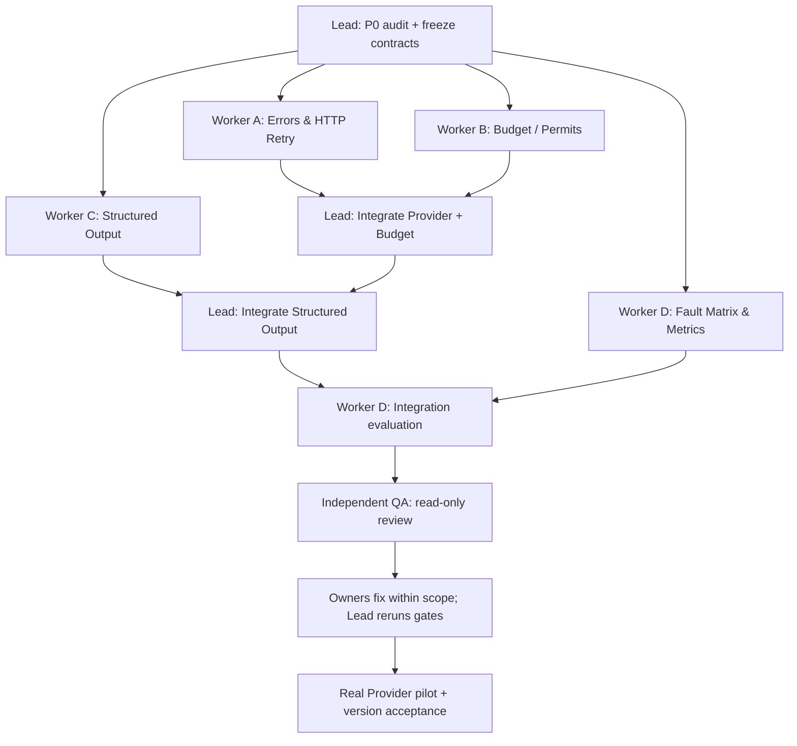

# IncidentLens V1.3 — Reliable Agent Runtime

**Multi-Agent Parallel Implementation Plan / 可直接交给 Codex 的开发任务书**  
**项目全称：** IncidentLens: An Evidence-Driven Multi-Agent System for Software Incident Investigation  
**版本：** Plan v1.0 · 2026-10-13  
**状态：** 设计和执行指令，**不是已实施、已测试或已验证的 V1.3**  
**优先级：** 研究可信度、真实模型可靠性与课程交付 > 新功能数量。  
**仓库：** https://github.com/celvelzel/IncidentLens  
**参考远程主分支：** 2026-10-13 检查的 main（可见 HEAD `3629b0695ed1`）。实施以 Codex 开工时 **本地 Git 工作树** 为准，先比较 `origin/main`，不得覆盖未提交变更。  
**上游：** V1.2（Database / Monitoring / Remediation / TaskManager / StopController），且仍须兼容 `legacy_rca`。

> **执行总纲：** 不重写 Graph、不增 Agent、不改变 RCA 证据门禁、不使用生产系统写操作。只改进 Provider 错误分类、预算感知的有界恢复、结构化输出可靠性及其观测和评测。先冻结契约、并行开发相互独立的模块，最后由唯一 Integrator 合并、运行新旧完整回归。没有真实调用证据就不宣称真实模型效果改善。

---

# 0. MASTER PROMPT — 直接复制给 Codex Lead

```text
You are the Lead Coding Agent for IncidentLens V1.3: Reliable Agent Runtime.

Repo: https://github.com/celvelzel/IncidentLens
Authoritative specification: the FULL markdown file IncidentLens_V1.3_CodingAgent_Implementation_Plan.md supplied with this prompt. Read it entirely before acting.

Goal: deliver a strictly incremental, tested reliability upgrade over the LOCAL V1.2 implementation:
(1) structured, sanitized provider error classification;
(2) centralized budget-aware, bounded HTTP recovery with correct concurrent accounting;
(3) reliable structured output with syntax/schema/domain validation and bounded repairs;
(4) deterministic fault-injection tests plus paired real-provider compatibility experiments;
(5) preserve all legacy RCA, V1.2 workflow, database/monitoring/remediation, stop protocol, evidence isolation, semantic cache, ablations, and UI/CLI behavior.

Critical implementation principles:
- Inspect local git status, branch, current tests, files, configs, and remote differences FIRST. Never overwrite uncommitted work. Do not assume the remote main is the latest V1.2 state.
- Create a baseline trace/test artifact before changing production code.
- Freeze interfaces and file ownership before parallel work. Only Lead edits shared graph.py, schemas/contracts.py, budget.py integration, config/CLI integration, public exported interfaces, or cross-module runtime contracts; subagents own separate modules/worktrees.
- Run up to THREE write-capable subagents concurrently in separate git worktrees; use the assigned work packets (WP-A..WP-E) and dependency DAG in the spec. An independent QA agent must not modify code.
- Do not silently downgrade json_schema to json_object, change the model/provider, bypass grounding, fake citations, substitute Mock for Real, or relax Pydantic and role boundaries to make tests pass.
- Keep provider-level HTTP retry distinct from one bounded structured repair and V1.2 whole-task retry. One actual HTTP attempt = one charged request. No double debit, no nested retry storms, no retry after STOP/cancellation, and unknown tokens NEVER count as zero cost.
- Ensure running stage-specific calls cannot overwrite request guards shared by concurrently running workers. Use per-call immutable context or task-local ContextVar / explicit callback design validated against existing MeasuredProvider and graph.
- Use httpx.MockTransport and injectable monotonic clock/sleeper for deterministic fault injection, avoid network in CI.
- V1.3 research evaluation compares the frozen pre-change behavior against the new behavior with the SAME inputs, model/config, budgets, and precise failure provenance. Separate technical completion from RCA accuracy and correct abstention.
- Build changes and tests in bounded stages; report commands, real results, changed files, open issues. No fabricated successes or numbers.

Start immediately with P0 Repository Audit & Contracts Gate. Then delegate according to WP-A..E, merge one feature at a time, execute P1..P7 and finish with acceptance evidence. Do not implement V1.4 IncidentBench or V1.5 CAES in this task; record interfaces only where essential for observability.
```

**重要：** 如果用户在 Codex 中只附上本文件，Lead 应从本节开始执行；如果用户只粘贴 Master Prompt，则须同时提供本文件的本地路径或正文，不能让 Codex 凭空假定它能读取 ChatGPT 沙盒文件。

---

# 1. 源码审计依据与正确边界

下表基于 2026-10-13 读取的 GitHub 远程源码，不代表此时用户 Windows 本地分支的最终状态。Codex P0 必须复核具体签名和行为。

| 现有位置 | 已存在行为 / 风险 | V1.3 增量切入点 |
|---|---|---|
| `src/incident_lens/llm/provider.py` | `RealChatProvider.structured_call()` 使用 httpx；支持 `json_schema/json_object` 和最多一次 Pydantic 修复；HTTP 400/404/422 基本归为格式兼容错误，其他 4xx/5xx 被笼统记录 | 精准状态码/异常分类、HTTP 有界重试、可靠输出校验与安全事件 |
| `src/incident_lens/orchestration/budget.py` | `CallBudget` 计数请求、已知 token、墙钟、失败 usage；通过 request_guard 在请求开始时扣减 | 原子预算预留、剩余时间可行性检查、重试/修复/阶段预算统一仲裁 |
| `src/incident_lens/orchestration/graph.py` | LangGraph `model_call` / `stage_call`，监控/修复阶段预算；`stage_call` 暂时切换 Provider 的 `request_guard`，需检查并发干扰 | 由 Lead 最小改动接入 RecoveryContext、独立阶段 budget、trace；消除共享 mutable guard 竞争 |
| `src/incident_lens/orchestration/runtime.py` | `TaskManager` 已支持任务尝试和有限重试；`StopController` 冻结并取消工作 | 保留整任务级恢复；区分单个 HTTP 尝试、格式修复、Task attempt；STOP 立即打断退避等待 |
| `src/incident_lens/agents/service.py` | `plan_tools/analyze/decide/verify` 使用结构化模型，`PROMPT_VERSION`、`ROLE_PROMPTS`；部分业务字段由 LLM 输出 | 可选内部 DTO / 身份绑定降低无意义 ID 复制失败，但禁止伪造证据和业务判断 |
| `src/incident_lens/evaluation/runner.py` | `MeasuredProvider` 使用 ContextVar 避免并发取消计数串线；4 个架构实验及完整数据导出 | 精确 HTTP attempt 与 logical structured call 分账、恢复事件与完成率，兼容旧统计字段 |
| `src/incident_lens/evaluation/metrics.py` | `runtime_failure` 与业务完成分离；V1.2 正常 STOP 与运行故障语义已区分 | 不允许正常 STOP 被重新计为失败；Provider 技术失败不得计作正确弃权 |
| `configs/system.yaml`、`configs/incident-response.yaml` | 不同 profile 的 wall/request/tool/round 预算；V1.2 已含监控和修复 | 可选 `provider_recovery` 段；无新配置时保持旧行为 |
| `tests/unit/test_provider.py`、`tests/integration/test_failure_accounting.py`、`tests/evaluation/test_concurrency.py` | Provider/用量/并发回归测试 | 只能增加，不能删除/弱化旧测试 |

**已知历史问题，必须进入动机与对照记录：** `docs/acceptance/live-continuation.md` 的早期真实 Dev 40 次、Test 80 次实验有大量 HTTP 异常、超时和结构化无效输出，无法证明实际 RCA 能力；这不是 V1.3 性能的预测，也不允许修改历史结果。旧实验具体配置、模型与日期保留并在本次报告引用对应历史 Artifact，而不是重跑后覆盖。

**关键边界：** 本版改善「运行可靠性」，不直接改变「根因正确性」。若 Structured Domain 验证发现不真实证据引用，不允许自动删除不支持的引用后把错误报告标为 RESOLVED。`INCONCLUSIVE`（证据不足）与 `RUNTIME_FAILURE`（技术故障）必须分开。

---

# 2. Scope、非目标、Done Definition

## 2.1 In scope

1. **Provider Error Taxonomy**：精确、安全、机器可读的分类及 HTTP / network / format / validation / cancellation 映射。
2. **Budget-Aware Recovery**：实际 HTTP 请求级有限退避、Retry-After、剩余 request/time/token/phase 额度检查、并发保留、停止传播。
3. **Structured Output Reliability**：JSON Syntax、Pydantic Schema、Domain Guard 分级；可预审的 Provider response-format 能力；一次有界定向修复；必要时程序绑定 runtime-issued ID。
4. **Reliable Accounting & Traces**：区分 logical invocation、HTTP attempts、structured repair、task retries；usage 不确定性有独立标记；独立 debug timeline。
5. **Tests & Experiments**：确定性 HTTP 故障注入、并发取消/STOP、四种架构/V1.2 回归、前后真实兼容测试与证据报告。

## 2.2 Out of scope

- 不实施 V1.4 IncidentBench、新数据集或任何 Frozen Test Prompt 调优。
- 不实施 V1.5 CAES 主动行动选择。
- 不引入新的 Agent、树通信、真实修复、外部监控/K8s、持久消息队列、向量数据库。
- 不换默认模型、不引入自动换模型/换 Provider 的隐藏 fallback、不允许自动从 Real 降为 Mock。
- 不推翻现有 FinalizeGate、Evidence ID、RBAC、STOP/ACK、Semantic Cache 的语义。
- 不做无限重试、不因为真实运行失败就提高报告准确率门槛的容忍度。

## 2.3 完成定义（所有 Gate）

- 旧 CLI/legacy & `incident_response`/V1.2 路径不带新配置依然运行；Cache on/off、四架构 benchmark、DB/监控/修复与 STOP 测试通过。
- 错误分类输入/输出稳定，HTTP 429/5xx/401/403/400/404/422 等分类与安全脱敏可测试。
- HTTP 恢复不超过总 request budget、wall budget、阶段预算、全链路尝试次数上限；并发无超卖；STOP 取消等待。
- 非法 JSON、Schema 错误、业务验证错误分别记录；最多指定的一次定向结构化修复，不通过强行放宽校验提高成功率。
- 每个物理 HTTP attempt 只计数一次，`MeasuredProvider`/`CallBudget`/Trace/CSV 可对账；未知 token 不当作已知 0。
- 故障注入 MockTransport fixture 全部通过；历史核心回归无故意改变；新旧运行 trace schema 向后兼容。
- 真实 Provider 对照若无法执行（密钥/配额/限流）应明确保留为 Pending / Inconclusive，不以 Mock 性能代替。
- 独立 QA 验证、README（中英文）与接受文档完备、合并前没有未说明的危险回归。

---

# 3. P0：先冻结“调用、计数、恢复”契约

**Lead 独占共享契约；任何 Worker 在完成 P0 前禁止修改生产代码。**

## 3.1 四层尝试模型（必须统一）

| 层级 | 标识 | 责任主体 | 一次单位 | 预算关系 |
|---|---|---|---|---|
| Investigation task | `task_id/attempt_id` | V1.2 TaskManager | 工具规划 + 实际取证 + 分析等一整个任务 | 复用 `max_attempts`，每次尝试里的模型请求照常累计 |
| Logical structured call | `logical_call_id` | Agent / Provider Adapter | 请求一个 Pydantic 输出（可能内部重试） | 不等于实际 HTTP 调用数 |
| Physical HTTP attempt | `http_attempt_id` | Provider Transport | 真实发起一次 POST 到 API | **每发起一次必须先申请一个 request permit** |
| Structured repair | `repair_index` | Structured Output Policy | 一次因输出无效而进行的纠正请求 | 是一个新的 physical HTTP attempt，**不是免费** |

**绝对禁止：** Provider 内 retry 3 次 + structured repair 1 次 + TaskManager retry 2 次均各自认为可以单独使用最大预算，从而无限乘法增长。必须在 **每一次真实 HTTP POST 之前**统一执行预算检查与计数。逻辑调用成功不代表内部仅发了一次请求。

## 3.2 推荐新增纯数据契约（字段可兼容演化）

```python
from typing import Literal
from pydantic import BaseModel, Field

FailureCategory = Literal[
    "RATE_LIMITED", "TRANSIENT_SERVER_ERROR", "TRANSPORT_TIMEOUT",
    "NETWORK_UNAVAILABLE", "AUTHENTICATION_FAILED", "INVALID_REQUEST",
    "UNSUPPORTED_RESPONSE_FORMAT", "INVALID_JSON", "SCHEMA_VALIDATION_FAILED",
    "DOMAIN_VALIDATION_FAILED", "RESPONSE_TRUNCATED", "CANCELLED",
    "REQUEST_BUDGET_EXHAUSTED", "WALL_BUDGET_EXHAUSTED",
    "TOKEN_BUDGET_EXHAUSTED", "UNKNOWN_PROVIDER_ERROR"
]

class FailureInfo(BaseModel):
    category: FailureCategory
    legacy_code: str                 # 不破坏旧 ProviderError.code 语义
    provider_http_status: int | None = None
    provider_error_code: str | None = None   # sanitized allowlist
    retryable: bool
    retry_after_seconds: float | None = None
    phase: Literal["transport", "syntax", "schema", "domain", "budget", "cancel"]
    logical_call_id: str
    http_attempt_index: int
    elapsed_ms: float = Field(ge=0)
    usage_complete: bool

class RecoveryDecision(BaseModel):
    action: Literal["RETRY_HTTP", "REPAIR_OUTPUT", "FAIL", "ABORT_STOP"]
    reason: str
    delay_seconds: float = Field(ge=0)
    remaining_request_permits: int
    remaining_wall_seconds: float

class ProviderCapabilityProfile(BaseModel):
    response_format: Literal["json_schema", "json_object"]
    supports_output_cap: bool = False
    supports_retry_after: bool = True
    capability_source: Literal["explicit_config", "validated_probe"]
```

这些是**冻结讨论草案**，Lead 应对照已有 `ProviderError`, `Budget`, `TraceEvent`, `WorkflowOptions` 做最小向后兼容实现；可增加内部 dataclass，不要求把每个新对象公开给 LLM，也不在日志持久化完整 HTTP body。

## 3.3 运行时 Context 与权责边界

- `RecoveryContext`（run_id、role、task_id、stage、deadline、remaining budgets、stop guard、request permit issuer）由 Runtime 创建；**不得放到 LLM prompt**。
- `RequestPermitIssuer` 是唯一可以批准并记账 HTTP attempt 的实体，且必须在共享预算上**原子**操作。Provider 不允许自行按“逻辑调用”扣一次然后后台重试多次。
- Provider 分层做 HTTP/JSON/Pydantic 处理；Domain Validator 留在现有 Agent / Merge / Grounding 的安全边界；若允许其触发重新生成，Lead 必须统一接入恢复仲裁，不得绕过 ToolRegistry/权威 Evidence Registry。
- `TaskManager` 管 whole-task retry；Provider 管同 logical call 内的 HTTP retries/structured repair；两者用全局预算和 trace 串联，并明确嵌套上界。
- 退避用 `asyncio.sleep` 的可注入 sleeper，和不可伪造的 monotonic clock；STOP/外部取消能够打断 sleep，并不会再发送 POST。
- `MeasuredProvider` 的实际请求数以唯一 request permit / attempt event 为权威；保留旧 usage 字段，再新增诊断字段。Trace 不应将一次失败重试写成独立的最终调查 Task。

## 3.4 不变项、行为兼容与配置

- **安全默认**：新增 `provider_recovery.enabled: false`，没有该配置时保留 V1.2 旧行为（仍保留已存在的一次结构化修复）。如果需要启用 V1.3，显式配置 `enabled: true`。
- 不得改变 `legacy_rca` vs `incident_response` 的业务语义；已上线的 V1.2 停止事件和根因状态保持原值。
- 旧 Pydantic/JSON/Trace 文件支持加载和 Replay；新增诊断字段必须 optional/default，除非文件格式升级同时提供 reader adapter。
- `CACHE_MODE` 原规则原样保留；Provider 失败、无效输出不能进入成功缓存。
- `max_tokens` 若 Provider 不返回用量或不支持服务端 output cap，只能做**可见的 best-effort**，不可承诺硬 token 上限；request count/wall time 必须硬控。

推荐新增配置（仅示意，Codex 按既有配置 loader 适配）：

```yaml
provider_recovery:
  enabled: false                 # 与旧版兼容；实验组显式启用
  max_transport_retries: 2        # 一次 logical call 内最多 2 次额外 HTTP attempt
  max_structured_repairs: 1       # 保持旧版最多 1 次格式修复
  max_physical_attempts_per_call: 4  # 所有 transport retry + repair 的全链上限
  initial_backoff_seconds: 0.5
  max_backoff_seconds: 4.0
  jitter_mode: none              # 可测确定性；live 可选 seeded/full
  retry_http_statuses: [408, 429, 500, 502, 503, 504]
  reserve_verifier_requests: 1    # 可配、显式、需避免把固定流程比较偏向某组
  min_request_time_seconds: 5.0   # 不够完成安全尝试则不重试
  format_capability: json_object # 仅显式/已预检能力，严禁隐式降级
```

严格约束：`max_physical_attempts_per_call` 不得小于 1；重试总次数必须同 `max_llm_calls` 一起约束；所有参数验证（非负、上限、有限浮点）由 Pydantic 完成。旧已有 `--response-format` 参数保留更高优先级。真实 Provider 的模型/端点兼容性必须预检，不得在测试过程中静默改变格式。

**P0 Exit Gate：** 生成 `docs/v1.3/architecture.md`、`docs/v1.3/contracts.md`、`docs/v1.3/ownership.md`、基线 `results/v13-baseline/`（gitignored）、冻结文件清单、测试命令和现有测试报告；Lead 与只读 QA 同意接口后再启动写 Worker。

---

# 4. Workstream WP-A — Provider Taxonomy & Transport Retry（独立 Worker A）

**文件写权限：** 新建 `src/incident_lens/llm/errors.py`、`src/incident_lens/llm/transport_retry.py`、`tests/unit/test_provider_errors_v13.py`、`tests/unit/test_provider_http_retry_v13.py`。**不可修改** `provider.py`、`budget.py`、`graph.py`、`cli.py`、共享导出文件；这些由 Lead 集成。Worker 在独立 Git worktree 中开发，使用 P0 固定契约。

## A1. 分类矩阵

| 条件 | category | HTTP retry? | 特殊处理 |
|---|---|---|---|
| 429 | RATE_LIMITED | Yes, bounded | `Retry-After` 优先，超过期限或预算则立即失败 |
| 408 | TRANSPORT_TIMEOUT | Yes, bounded | 不把超时视为模型语义错误 |
| 500/502/503/504 | TRANSIENT_SERVER_ERROR | Yes, bounded | exponential backoff + jitter optional |
| httpx.ConnectTimeout/ReadTimeout/WriteTimeout/PoolTimeout | TRANSPORT_TIMEOUT | Yes, bounded | 区分 timeout subtype（安全 metadata） |
| httpx.ConnectError/NetworkError | NETWORK_UNAVAILABLE | Conditional | 必须可配置且有界 |
| 401/403 | AUTHENTICATION_FAILED | No | 不暴露 Authorization header |
| 400/404/422 | INVALID_REQUEST / UNSUPPORTED_RESPONSE_FORMAT | No automatic fallback | **只有可识别明确受限的 API 错误码/已验证能力才归到格式不兼容** |
| 其他 4xx | INVALID_REQUEST | No | 避免无意义重试 |
| 200 但 JSON envelope 错误 | INVALID_JSON 或 UNKNOWN_PROVIDER_ERROR | Format repair only if valid content known | envelope 故障不同于模型 message JSON |
| choices[0].message.content 非合法 JSON | INVALID_JSON | Structured repair | 保留脱敏错误定位摘要 |
| content 合法 JSON 但 Pydantic 失败 | SCHEMA_VALIDATION_FAILED | Structured repair | 反馈字段路径/类型，禁止原始敏感数据 |
| `asyncio.CancelledError` / STOP | CANCELLED | No | 原样传播任务取消语义 |

`Retry-After` 支持整数秒及合法 HTTP-date；负值、NaN、异常超大值、不可解析值必须安全降级；服务端给出的等待时间超过剩余 deadline 时不得睡到过期。日志不含原始响应全文和 credentials。尽量从 HTTP header/安全白名单错误码中抽取数据，不拼接完整 body。

## A2. RetryPlanner

纯函数接口草案：

```python
def classify_http(status_code: int, headers: dict, sanitized_error_code: str | None) -> FailureInfo: ...
def classify_transport(exc: BaseException, ...) -> FailureInfo: ...
def compute_backoff(attempt: int, retry_after: float | None, config, rng) -> float: ...
def decide_http_retry(failure: FailureInfo, budget_snapshot, stop_state, config) -> RecoveryDecision: ...
```

具体函数与 P0 contracts 对齐。`decide_http_retry` 不实际发请求、不扣额度，由 Lead 连接 permit issuer。针对输出请求等 POST，并不保证 Provider 端幂等，网络断开可能在远端已生成内容；账单/usage 无法确认时记为 unknown，不能假定失败调用免费。

## A3. 必测用例

参数化覆盖 HTTP 429/408/500/502/503/504/400/401/403/404/422、transport connect/read timeout、连接错误、Cancellation、Retry-After 不规范输入、超出 deadline、退避序列、最大尝试次数、header/body 脱敏。`httpx.MockTransport` 模拟真实 `POST` 返回序列；测试记录实际 transport attempts，不能仅 mock classify 函数。

**WP-A Gate：** 与共享契约兼容、90%+ 新模块分支覆盖率作为目标（若依赖不可用需记录）、重点故障全部可稳定复现、无真实网络请求、没有重试越界。

---

# 5. Workstream WP-B — Budget-Aware Recovery（独立 Worker B）

**文件写权限：** 新建 `src/incident_lens/orchestration/recovery.py`、`src/incident_lens/orchestration/permits.py`、`tests/unit/test_recovery_policy_v13.py`、`tests/integration/test_recovery_concurrency_v13.py`。**不可直接修改**既有 `budget.py` 或 `runtime.py`；由 Lead 集成。

## B1. 权威预算语义

- request permit 在 POST **发起前**原子领取；取消/中断发生在 POST 之前允许归还未使用 permit；POST 已经发出则请求计一次，即使超时、服务器返回错误或业务修复再次请求。
- 临时“预留”与实际“已发出”严格区分：`reserved`, `dispatched`, `reconciled`；并发请求不能超卖 `max_llm_calls`。
- Token 预算：已知 usage 原子累计，未知 usage 标为 `tokens_complete=False`；如启用 Provider 支持的 output cap 则在兼容性预检后设置。对“未知 token”不声称预算严格无超出。
- 时间预算：从同一个 monotonic deadline 计算；`retry_delay + conservative_request_estimate + safety_margin <= remaining_wall` 才可重试。
- 阶段预算：V1.2 `monitoring_max_calls/remediation_max_calls` 和总上限必须同时满足，不能因为 stage_call 暂时替换 Provider guard 使并发 investigator 扣错阶段计数。
- 调用“保留未来 Verifier/Remediation 预算”是明确可配的调度优化，不应导致无故将所有请求锁住；默认是否启用要由 Lead 结合 V1.2 profile 决定，并在实验两组一致配置。

## B2. Concurrent-safe Permit Contract

```python
class RequestPermitIssuer:
    # 具体同步原语与 runtime async/sync 回调语义须由 Lead 冻结
    def acquire(self, *, run_id, logical_call_id, stage, stop_token) -> Permit: ...
    def mark_dispatched(self, permit_id) -> None: ...
    def release_if_not_dispatched(self, permit_id) -> bool: ...
    def reconcile(self, permit_id, token_usage_or_unknown) -> None: ...
    def snapshot(self) -> BudgetSnapshot: ...
```

如果现有 Provider 的 request_guard 是同步回调，可通过线程安全锁 + ContextVar task-local RecoveryContext，或改为显式 Provider 调用上下文完成；不得在异步 Event Loop 中使用阻塞网络或长锁。重要的是：**并发场景严格证明计数正确**，而不是要求沿用某个类名。

## B3. 恢复策略

- 对 transient errors 考虑重试；对 auth、bad args、domain invalid、STOP 不允许 transport retry。
- 在同一 logical call 内 `transport_retry_count` 受配额限制；structured repair 只有本次真实收到的无效格式才可触发。
- 在 TaskManager 层恢复时，不可清零当次 HTTP attempt、token 或 wall cost；任务失败/部分成功结果策略维持 V1.2。
- `stop_token` 变为 STOPPING/FROZEN 时：取消 pending backoff、不再发 POST、不再写入共享调查 Finding；已发出的请求仍在账目中。
- 对原本 `CallBudget.request_guard/MeasuredProvider.ContextVar` 保持兼容；不得通过两个 guard 双扣一次真实请求。

## B4. 必测竞争场景

1. 剩余 request budget = 1，两个 Agent 同时尝试发送 POST，最多一个成功 acquire；另一方合理失败；实际 request count ≤1。
2. A 收到 429 正在 backoff，Supervisor STOP → A 不得第二次 POST。
3. 修复请求（repair）恰好使用最后一次额度，其他阶段不能借用。
4. 取消发生在 permit acquire 后、POST 前：permit 可归还；发生在 POST 后：不可归还。
5. `monitoring` 与 investigator 并发/交错不覆写 guard；现有 `stage_call` 全局 guard 竞争必须修复并 regression 测试。
6. 真实 token 缺失，不能展示准确总 token，也不能错误标记预算内。
7. Provider 超时但 HTTP 已发送，仍计数一次；再次尝试是第二次。
8. TaskManager 尝试 2 次，Provider 每次内部 retry 不超过配置和全局预算。

**WP-B Gate：** 并发确定性测试可重复通过；所有被允许的请求都有唯一 permit；预算临界点无超卖；STOP 行为可验证。

---

# 6. Workstream WP-C — Structured Output Reliability（独立 Worker C）

**文件写权限：** 新建 `src/incident_lens/llm/structured_output.py`、`src/incident_lens/llm/capabilities.py`、`tests/unit/test_structured_output_v13.py`、`tests/unit/test_provider_capability_v13.py`；不修改现有 `agents/service.py`/`provider.py`/`schemas/contracts.py`，由 Lead 根据提案集成。

## C1. 三层校验

**L1 Syntax：** response envelope 结构合法，选择的内容是字符串/满足 Provider 响应格式；内容可以解析 JSON。对 JSON 截断或显式 `finish_reason=length` 单独标记 `RESPONSE_TRUNCATED`。

**L2 Schema：** `output_model.model_validate_json` / Pydantic v2；保留稳定校验错误类别及字段路径。禁止日志记录模型原始 payload 和用户证据内容；只输出模型名、字段路径、错误类别和安全统计。

**L3 Domain：** 原有 Agent/Runtime/Merge/Grounding/Role 权限验证，不移到可以绕过工具权限的代码里。严格区分“可修复的格式/枚举缺陷”和“不可通过 schema 修复合法化的未经查询引用”。如果 Domain validation 抛错，默认不自动生成新业务事实；确需重跑 entire logical call 只能走 TaskManager/Lead 明确策略和同一总预算。

## C2. 定向修复

- 最多 **1 次 structured repair**（V1.3 默认保持原规则）；每次 repair 是一个新的 HTTP attempt，受总预算控制。
- Prompt 包含本次应满足的 schema 版本、具体字段缺失/类型错误等**安全摘要**，而不是堆积原始日志或隐藏完整模型 CoT。
- 对网络失败使用 HTTP retry，不要发“请输出正确 JSON”试图修网络。
- 不允许把 invalid content 凭空正则修成根因报告；允许的 deterministic normalization 限于不涉及业务事实的表示层（例如 Provider 在文档明确允许的 response envelope 差异），且必须记录所作规范化。
- `json_schema` 与 `json_object` 必须分别测试；格式不兼容不能自动猜测另一个模式然后悄悄继续。已确认的 Capability Profile 可由用户显式选择适合的模式。

## C3. Runtime-issued identity binding（可选、优先收益点）

提出 `LLMProposal`（业务建议）与 Runtime Stamped `Finding/InvestigationTask` 的分离契约：模型无需自行复制已由 server 签发的 `run_id`, `incident_id`, `task_id`，程序绑定后再次进行 Pydantic 和 provenance 校验。但这属于跨 Agent 兼容性敏感变更：

- 先用 Dev fixture 证明它能减少 ID collision/validation failure；
- 由 Lead 审核是否在 V1.3 实施。若变更需大范围调整 Mock/Agent、Schema、Cache，则**延期至未来优化**；
- 即使做 identity binding，也不能修补伪造 evidence ID、根因、引用、服务或未经查询工具结果。
- `PROMPT_VERSION` 与 `schema_version` 变更要清理/失效相应 semantic cache namespace，不能命中旧 schema 缓存。

## C4. 单元和集成测试

L1：合法 JSON、空 response、错误 envelope、多 choices、无 content、截断输出、非 JSON。  
L2：字段缺失、类型错误、枚举错误、未知字段、长度限制、时间字段。  
L3：伪造 evidence ID、跨 role/task identity、未公开共享结果、错误 root candidate，被原系统 Guard 拒绝。  
修复：第一次 schema invalid → 第二次合法，恰好 2 个 HTTP requests；第二次仍 invalid → 明确失败；STOP / max budget 时 repair 不发生。  
兼容：`json_schema`/`json_object` 有独立 fixture，配置错误清晰提示，原 Mock 与 Replay 不回归。

**WP-C Gate：** 所有 JSON/Schema/Domain 失败可正确归类，修复有界且不降低事实门禁；用户无法借格式回退绕过证据校验。

---

# 7. Workstream WP-D — Reliability Evaluation & Fault Injection（独立 Worker D）

**启动时机：** P0 后可以先开发独立 fixture 与指标契约，但集成测试适配应等待 A/B/C 模块合并。  
**写权限：** `tests/reliability/**`、`scripts/run_reliability_eval.py`、`src/incident_lens/evaluation/reliability_metrics.py`、`docs/v1.3/evaluation_protocol.md`；不修改既有 `evaluation/runner.py`/`evaluation/metrics.py`，由 Lead 集成新增字段。

## D1. Fault-injection suite（CI 必跑，无真实网络）

建议创建可配置 Scenario Manifest，每个 scenario 固定响应序列、expected category、expected attempts、expected completion/error、expected budget、expected trace：

| Test ID | 输入序列 / 情况 | 期望 |
|---|---|---|
| F01 | HTTP 200 + valid JSON | 一次 POST，一次逻辑调用 |
| F02 | 429 → 200，足够预算 | 分类 RATE_LIMITED、可控 backoff、两次 POST |
| F03 | 429 + Retry-After 大于 deadline | 无第二次 POST，合理 budget/timeout failure |
| F04 | 503 → 503 → 200 | 不超过 transport retry 上限；若允许三次则成功 |
| F05 | 401/403 | 不重试，保留安全错误类别 |
| F06 | 400/422 unknown code | 不假设格式不兼容，明确 INVALID_REQUEST |
| F07 | ReadTimeout → 200 | 额度允许时重试；未知的第一次账单/usage 不当零 |
| F08 | Invalid JSON → corrected JSON | 1 次修复，计 2 次物理请求 |
| F09 | Schema missing-field → corrected | 定向修复成功，3 层验证可观测 |
| F10 | Invalid JSON → invalid again | 结构化重试上限触发，最终失败 |
| F11 | Fake evidence ID but valid schema | Domain validator 拒绝，不能 finalize |
| F12 | Two agents racing for final permit | 最多一个 actual POST |
| F13 | STOP during backoff | 无第二次 POST、任务取消正确 |
| F14 | STOP during in-flight request | no new POST、结果不得污染 frozen state |
| F15 | Stage budget / whole-task retry | 总请求和阶段上限正确，attempt_id 唯一 |
| F16 | All token usage missing | token total unknown, not zero |
| F17 | Valid real-like response with finish_reason=length | 不能当完整有效结构化输出 |
| F18 | V1.2 normal STOP after PLAN_READY | 不记为 runtime failure |
| F19 | INCONCLUSIVE from insufficient evidence | 正确弃权；与 provider failure 分开 |
| F20 | `legacy_rca`/cache/Replay | 原有输出格式和测试兼容 |

重点覆盖运行失败统计不会无意提升“正确弃权率”，未发送请求不扣实际请求数，发送失败请求仍记录一次。测试 use httpx.MockTransport + FakeClock/FakeSleeper，所有等待可瞬时验证，不调用真实 API。

## D2. 研究指标（冻结定义）

**主要可靠性指标：**

- `logical_call_success_rate` = 最终得到有效 Pydantic/业务允许输出的 logical calls / 全部 logical calls。
- `technical_investigation_completion_rate` = 未因 transport/schema/budget/runtime error 强制终止且进入有效业务终点的 run 数 / 总 run 数。`INCONCLUSIVE`（证据不足）可算技术完成；`RUNTIME_FAILURE` 不可算。
- `retry_recovery_rate` = 遇到**可重试** transport error 的 logical calls 中最终恢复成功的比例（分母与选择偏差明示）。
- `structured_output_validity_rate` = 有效的最终结构化模型输出 / 有响应内容的 logical calls，必须注明修复前/修复后两套口径。

**副指标：** 实际 HTTP attempt 次数、重试数、结构化修复数、每个有效结果的请求数、已测 tokens、cost（只有真实账单可信时）、平均/p50/p95 时延、stop count、budget denial、Provider 错误类别分布、RCA Accuracy 和 Correct Abstention（与技术完成独立）。

将完整率与 RCA 正确率分别报告，避免 Provider 修好了但 RCA 仍不准确时得到虚假的质量结论。每个指标含分子、分母、样本数与不可确认值。样本量不足时不输出无意义的显著性结论。

## D3. 配对实验与可复现性

| 组别 | 内容 | 研究目的 |
|---|---|---|
| R0 | 冻结 V1.2 原 Provider | Existing baseline |
| R1 | Error classifier + bounded HTTP retry | 测试传输恢复价值 |
| R2 | R1 + budget-aware recovery | 测试智能限制减少浪费和错误 |
| R3 | R2 + targeted structured repair | 测试结构化可靠性增量 |

- 在**同一批确定性 HTTP 故障序列**下运行 R0–R3，这是因果上最强的工程可靠性对照；每组相同请求/时间/预算，MockTransport 可以固定结果；所有增加的 retry attempts 都计入预算。
- 真实 Provider 实验至少做 **兼容性预检 → 少量 Seed/Dev → 按可用配额扩充**，不得立即对 Frozen Test 做大量请求。固定 model_id/response mode/temperature/预算/prompt、cache=off；按配对 case 随机化组别运行顺序，记录时间段、jobs、HTTP 分类与实际负载。
- 实际 Provider 服务会波动，若不能在同一窗口控制请求，请标明这是描述性 comparison，不直接宣称因果改善。Token/cost 数据缺失时保持 NULL。
- V1.3 以 Provider runtime 指标为主，不重复用历史 Frozen Test 调优。任何变更 Prompt/Schema 的 V1.3 配置都要记录版本、hash 与有无额外 token。
- 样本不足时用 run-level case 分析和分布表，不捏造可靠提升百分比。

## D4. Artifact 格式

`results/v13-eval/<experiment_id>/` 输出：

```text
manifest.json               # git commit, prompt/schema/config hashes, source revision, dataset hash
case-level.csv              # per-run outcomes + actual request count, stop reason, tokens if known
provider-attempts.jsonl     # redacted attempt events, category, retries, elapsed, usage completeness
aggregate.csv               # numerator/denominator + summary metrics
fault-matrix.csv            # F01..F20 fixture expected vs observed
error-analysis.md           # failure stages, recovery path, residual defects, invalid outputs
protocol.json               # frozen run parameters and fixture schedule
README.md                   # executable reproduction commands
```

实际恢复过程中的私有 API 请求文本与密钥不能写入 artifacts；注入 fixture 可以保存生成的伪造公开数据。`results/` 继续 gitignore；小型、脱敏的审计摘要才考虑放入 `docs/acceptance/V1.3.md`。

**WP-D Gate：** 运行失败统计、未知 usage、并发计数、语义弃权分离正确；报表可从原始 JSONL/CSV 复算。

---

# 8. Workstream WP-E — Independent QA / Contract Review（只读）

**权限：** 全程只读，无生产代码写权限；可以提交审查文档/意见给 Lead，必要测试修复交回相应模块 Owner。  
**职责：** 检查失败分类完整性、预算一致性、重试/修复嵌套上界、Prompt 注入、结构化合法性、STOP/Replay/Cache 兼容、报表统计、历史结果保存、实验公平性。

必须独立复核的反例：

1. 标称真实 HTTP 发送次数 2，但 request budget 只扣 1（拒绝）。
2. Provider 超时导致 usage 不完整却报 tokens=0（拒绝）。
3. Provider 在 STOP 后悄然进行下一次 backoff retry（拒绝）。
4. `stage_call` 为 remediation 设置 request_guard 的同时影响其他 investigator（拒绝）。
5. 无效 citation 通过格式修复而成为 RESOLVED（拒绝）。
6. V1.2 PLAN_READY 正常 STOP 被计为 runtime failure（拒绝）。
7. Repair 使用第二次请求但 `MeasuredProvider` 没记录（拒绝）。
8. 多 Worker 并发更改 provider.py / graph.py 导致接口冲突（拒绝）。
9. R0 与 R3 使用不同模型、数据、Prompt 或预算，却宣称纯 recovery 效果（拒绝）。
10. Test/Oracle 被加载到 Agent runtime（拒绝）。

**QA Gate：** 产出 `docs/v1.3/qa-review.md`，每项 finding 有 severity、affected file、复现命令、是否修复、复验结果；Lead 不得在 High/Critical 未解决时宣布完成。

---

# 9. Lead / Integrator — 唯一共享文件 Owner

**Lead 独占修改**：`llm/provider.py`、`llm/__init__.py`、`orchestration/budget.py`、`orchestration/graph.py`、`orchestration/runtime.py`（如需要）、`schemas/contracts.py`、`schemas/workflow.py`、`orchestration/config.py`、`cli.py`、`evaluation/runner.py` 与 `evaluation/metrics.py`、现有 README、共享现有测试。Worker 仅对这些文件提交建议 patch / interface proposal，不直接写。

## 9.1 Integration Checklist

- **I1 Provider**：`RealChatProvider` 基于 A 分类/RetryPlanner + C Validator 接入；不改变公有 `structured_call()` 返回 `(validated_model, usage_metadata)`，保留安全 `ProviderError.code` 兼容。
- **I2 Budget**：B PermitIssuer 接入 `CallBudget`，移除/避免重复扣费路径；`request_guard` 只由拥有权限的 runtime 注入。注意 `MeasuredProvider` 在 shallow-copy 与异常取消下共享 request counter 的现有约束。
- **I3 Stage concurrency**：检查 `stage_call` 当前对 `provider.request_guard` 的临时覆盖；必要时改为显式 per-request `RequestContext` 或 ContextVar，补充并发监控/修复/调查测试。不能仅凭测试默认串行就忽略潜在数据竞争。
- **I4 Structured**：Provider 的 Syntax/Schema 输出进入原 Agent Domain 验证；业务拒绝与网络失败分开记账；只做合法的 representation normalization。
- **I5 Trace**：新增 `PROVIDER_ATTEMPT`、`PROVIDER_RETRY_SCHEDULED`、`STRUCTURED_REPAIR`、`PROVIDER_FAILURE_CLASSIFIED`、`BUDGET_RETRY_DENIED` 等 events **或**现有 TraceEvent.details 的子结构；所有事件均不带 API Key/prompt/原始响应，Replay 支持旧 trace。避免事件类型字段被 `Identifier` 验证拒绝。
- **I6 Evaluation**：分开 `actual_http_requests`、`logical_structured_calls`、`transport_retries`、`repair_requests`、`task_retries`。如之前字段 `llm_requests` 语义是 HTTP attempts，继续保持原含义并在文档清晰说明。
- **I7 Config**：旧 YAML 不带新段时不变；新配置只影响 RealProvider，MockProvider 仍确定性，不引入 pseudo-retry 使 Mock 评测数值混乱。
- **I8 Cache**：缓存命中时不应创建虚假 Provider attempt；缓存未命中、LLM 最终成功并通过 domain validator 后才写缓存，非法格式永不缓存。
- **I9 StopController**：取消正在 sleep 的 backoff，止住后续 HTTP，预算账目不丢失，迟到模型结果不修改 frozen state。
- **I10 Docs & Versioning**：更新 README 中英文、provider config/CLI、V1.3 limitations、artifact schema、版本号标识；不可破坏旧 Test 数据与历史接受记录。

## 9.2 兼容性模式

- `provider_recovery.enabled=false`：Legacy Recovery Mode；除必要 bug fix（如并发计数修复）外，实际策略和结果与 V1.2 一致。
- `provider_recovery.enabled=true`：V1.3 Recovery Mode；可用 fault injection 和 real compatibility 验证。
- 任何模式均不得修改 `single/fixed/dynamic_no_verifier/full` 研究变体的核心控制流与证据门禁。
- 原 `--response-format`, `--thinking`, `--request-timeout`, `--max-tokens` 参数应保留原优先级；新增字段在帮助说明明确默认值与覆盖关系。

---

# 10. 多 Agent 并行编排 DAG 与文件写锁

**推荐最多三个同时写代码的 Subagents**（以已有项目多 Agent 开发策略为界，Codex 若支持不同并发度也不要让多个 Writer 修改相同共享文件）。每人独立 Git worktree 或隔离分支。Lead 对公共代码集中集成、QA 全程只读。



**允许并行：** 第一波 A/B/C 三个 Writer；D 可先由只读研究/评测 Worker 制定 test manifest 而不写共享源码。A/B/C 完成后，D 实施评测脚本与 integration tests。Lead 集成 Provider/Budget 时暂停并行写共享文件。

**每个 Worker 必须接受：** 固定基线 commit、具体任务描述、允许写的文件/目录、禁止写的文件、依赖的 Frozen Schema、可执行测试、预期 PR/patch、开放问题，以及**禁止自行修改别人拥有的文件**。子 Agent 不能继续无限委派其他 Agent。

**每个 Subagent 回复格式：**

```text
WORK_PACKET: WP-A/B/C/D/E
BASE_REVISION:
BRANCH_OR_WORKTREE:
MODIFIED_FILES:
IMPLEMENTED_CONTRACTS:
TEST_COMMANDS:
TEST_RESULTS:      # 真实输出、passed/failed/skipped
PROOF_OR_ARTIFACT_PATHS:
BLOCKERS_OR_QUESTIONS:
API_CHANGES_REQUESTED_FROM_LEAD:
MERGE_READY: yes/no
```

**冲突策略：** 发现契约不匹配 → Worker 不私自改公共契约，而是提交 `API_CHANGES_REQUESTED_FROM_LEAD`；Lead 更新 contracts / 安排受影响 Worker 同步后再继续。

---

# 11. 阶段里程碑 P0–P7（严格 Exit Gates）

| Phase | Owner | 前置条件 | 实际产物 | 不通过不得进入下一阶段 |
|---|---|---|---|---|
| **P0 Audit** | Lead + QA | V1.2 本地工作树 | HEAD/status、基线测试、冻结契约、owner matrix、Baseline Trace | 旧版测试可重现且未丢本地改动 |
| **P1 Taxonomy** | Worker A | P0 | HTTP/异常分类器、retry planner、fixture tests | F01–F07 等全部通过 |
| **P2 Budget** | Worker B | P0 | RequestPermitIssuer、remaining-time decisions、并发测试 | 无预算超卖、STOP 后无新请求 |
| **P3 Structured** | Worker C | P0 | Parser/Validator、定向 repair、capability profile | Invalid JSON/Schema/Domain 分开处理且 ≤1 次 repair |
| **P4 Integration** | Lead | P1–P3 | provider.py/budget.py/graph.py/config 的小范围接入 | legacy 与 V1.2 E2E/Mock/cache/Stop 回归通过 |
| **P5 Evaluation** | Worker D + Lead | P4 | 20+ fault scenarios、测量脚本、R0–R3 | Per-attempt 账目与原始运行结果可复算 |
| **P6 Real Pilot** | Lead + QA | P5、本地 API 配置可用 | Config probe、少量 Seed/Dev real runs、失败分类与成本/延迟报告 | 不修改 Test Oracle、不静默变更模型；能真实执行则报告完成率，否则记录阻塞 |
| **P7 QA / Release** | QA read-only + Lead | P6 | 全量 pytest、ruff、fresh-install、CLI/Replay、README、接受报告 | 无 High/Critical 缺陷；无不诚实的性能宣称 |

**P0 Commands（Windows / PowerShell 示意，需适配仓库与虚拟环境）：**

```powershell
git status --short --branch
git log -5 --oneline
git fetch origin
git rev-parse HEAD
git diff --stat origin/main...HEAD
.venv\Scripts\python.exe -m pytest -q
.venv\Scripts\python.exe -m ruff check src tests scripts
.venv\Scripts\python.exe -m ruff format --check src tests scripts
.venv\Scripts\python.exe -m incident_lens.cli run --case incident_001 --provider mock --cache-mode off --out results/v13-baseline/legacy
.venv\Scripts\python.exe -m incident_lens.cli run --case incident_037 --provider mock --config configs/incident-response.yaml --out results/v13-baseline/v12
```

**注意：** 以上两次 `run` 的选项是根据 2026-10-13 远程 README 建议，Codex 必须先用本地 `--help` 验证后执行。`results/...` 不能覆盖既有真实实验结果；若目录已存在，创建带时间/commit 标识的新目录。不能自动 `git reset --hard`、force push、删除用户数据、改全局 Codex 配置、提交 `.env`。真实 Provider key 不应输出到日志。

**P4/P7 核心回归：**

```powershell
.venv\Scripts\python.exe -m pytest tests/unit -q
.venv\Scripts\python.exe -m pytest tests/integration -q
.venv\Scripts\python.exe -m pytest tests/evaluation tests/cache tests/isolation -q
.venv\Scripts\python.exe -m pytest -q
.venv\Scripts\python.exe -m ruff check src tests scripts
.venv\Scripts\python.exe scripts/verify_install.py --out results/v13-acceptance/fresh-install
```

若 venv 路径不存在，依 README 安装本地依赖；不要为 CI 环境擅自下载大型 embedding 模型。Fresh install 脚本有已有目录拒绝覆盖规则，适当另建唯一目录。

---

# 12. 测试矩阵：旧功能绝不回归

| Dimension | Legacy V1.2 must still work | V1.3 new test |
|---|---|---|
| CLI | `run/list-cases/replay/validate-data/web` | 新 config 和 `--help` 向后兼容 |
| Graph | 5/8 角色运行、动态 replan、verify/finalize | 失败/恢复后 Graph 的 run/role 状态不污染 |
| Profiles | `legacy_rca` 与 `incident_response` | 两者都能启用/关闭 Provider recovery |
| Monitoring | manual snapshot、offline replay、NO_ALERT | 监控失败分类、阶段预算正确 |
| Database | 专项工具/权限、DB role dynamic dispatch | DB agent 的 HTTP 失败恢复不泄漏证据 |
| Remediation | PLAN_ONLY、证据校验、单事故幂等 | 修复模型失败后预算/retry 合法 |
| Stop | 正常 PLAN_READY、INCONCLUSIVE、STOP_ACK | 退避/在途调用收到 STOP 后不继续请求 |
| TaskManager | ASSIGNED→RUNNING→COMPLETE/FAILED | 全任务 retry 和 Provider retry 无叠加超界 |
| Semantic Cache | namespace、Grounding、fake/real embedding | invalid reply 不缓存；cache hit 不扣 HTTP attempts |
| 4 Baselines | single/fixed/dynamic_no_verifier/full | retry-on/off 与原 baseline 对等可测 |
| Evaluation | oracle-after-run、failure-aware scoring | 正常 STOP != technical failure，技术错误 != 正确弃权 |
| Replay & UI | 旧 trace 可加载，缓存/权限/报告可见 | 新尝试/重试事件可见且不泄漏 secrets |
| Security | role/run/incident 隔离、Evidence ID ACL | HTTP 错误、结构化修复不能 bypass 验证 |

---

# 13. 真实模型实验：先验证可行性，再宣称改善

## 13.1 Provider Compatibility Gate（独立记录）

运行前检查：API Endpoint 有效、模型名有效、模型支持/接受 chosen response_format、所需 schema request size 是否可接受、剩余配额、预估单次耗时。能力探针应为最小开销请求，记录 HTTP status、响应模式、Provider 计量字段，**不对测试真值做任何试探**。

旧历史评测中既有 429、超时、JSON 合法性问题，也有失败的 case；V1.3 只能将这些看作历史调查线索。必须用当前 Provider 和固定 Dev 数据重新测量，不可把过去失败率直接当作新版本对照组的同日实验数据。

## 13.2 技术性能实验（故障注入）

确定性 fixture 的 `R0–R3` 是 V1.3 首要可重现实验；应输出每个 scenario 的请求数、最终技术成功与否、重试/修复轨迹、预算使用、错误类别和最终 Stop 状态。

## 13.3 真实模型 Pilot

- 使用已允许的 Seed/Dev 案例，先 1 个最小兼容样例，再 3–5 个完整调查，随后按预算扩充；先确定必要的 Provider transport 配置。不得声称这相当于泛化评测。
- 同一模型 + 同一数据版本 + 同一 Prompt/Schema + 同一预算；cache=off。R0/R3 的执行顺序轮换/随机化，固定 `jobs=1` 作为可靠性首轮测量，以减少并发 429 干扰；另外可记录 `jobs=2/4` 的吞吐压力实验，**不能混合比较**。
- 标准 output：技术完成率、HTTP 分类分布、逻辑调用成功率、结构化修复有效率、每 case 实际请求数、可测 token、时间、是否正确 RCA（独立）。
- 若没有 API key / Provider 高度不稳定：正确结果为“真实实验未完成或 Provider 不可用”，仍可交付通过的离线可靠性实验和可复现脚本。
- 不进行重复的 Frozen Test 试探。V1.4 将负责更可信的 Benchmark。

---

# 14. 回滚与灰度计划

1. Feature flag：`provider_recovery.enabled=false` 在新代码中继续走 V1.2 兼容策略。
2. 合并顺序：A/B/C 独立验证 → Lead 接入最少共享模块 → 全量 Mock 回归 → D fault matrix → 真实小样本 pilot。
3. 对新增与现有 Provider 的请求作 Manifest 比较，确认不带 flag 的结果与 API 使用口径保持兼容。
4. 若真实模型错误率变高或 budget overshoot：关闭新 flag，冻结当前 PR，保留失败 artifacts；不要自动调整 Prompt/模型破坏原对照。
5. 重大异常时回滚涉及 ProviderRecovery 的 PR；**不可直接回滚 V1.2 的 DB/Monitoring/Remediation/Stop 功能**。
6. 每次集成保留可追溯 commit id 和 git diff；不强制推送远端，用户未授权时不改变 release tag。

---

# 15. 六人小组与 Coding Agent 的区别

**Coding Subagents 并行开发**属于工程执行工具，不等于最终系统运行时的 Agents；项目六个人的任务分工不能由 AI 自动生成提交替代个人实际贡献。推荐把人类小组协作按以下证据链组织：

- Runtime / LLM Integrator：V1.3 Provider & Graph 接入。
- Transport Reliability：故障分类与 Retry。
- Budget / Concurrency：资源预留、Stop 与并发边界。
- Structured Output：Schema/Domain/Repair。
- Evaluation / Research：fault matrix、真实 Provider protocol、分析。
- QA / Documentation / Demo：独立检查、报告图表、复现手册。

每人留代码审阅、测试运行、数据标注或论文分析的可证明贡献；以实际协作安排为准。

---

# 16. 最终 Deliverables 与 Lead 完成报告模板

## 16.1 代码、测试、研究交付

```text
src/incident_lens/llm/errors.py
src/incident_lens/llm/transport_retry.py
src/incident_lens/llm/structured_output.py
src/incident_lens/llm/capabilities.py
src/incident_lens/orchestration/recovery.py
src/incident_lens/orchestration/permits.py
src/incident_lens/{llm/provider.py,orchestration/budget.py,orchestration/graph.py}  # Lead integration
src/incident_lens/evaluation/reliability_metrics.py
tests/unit/test_provider_errors_v13.py
tests/unit/test_provider_http_retry_v13.py
tests/unit/test_recovery_policy_v13.py
tests/unit/test_structured_output_v13.py
tests/integration/test_recovery_concurrency_v13.py
tests/reliability/**
scripts/run_reliability_eval.py
docs/v1.3/{architecture,contracts,ownership,evaluation_protocol,qa-review}.md
docs/acceptance/V1.3.md
README.md / README.zh-CN.md updates
```

此为建议模块地图，**不是仓库中已经存在的文件**。Lead 可通过命名调整减少文件数量，但必须保留清晰职责和稳定的测试入口。修改既有文件须说明最小化原因，不能为了对齐计划把完整系统重构一次。

## 16.2 Lead final report（必须由真实命令支持）

```text
VERSION: IncidentLens V1.3
BASE_COMMIT:
FINAL_COMMIT:
V1.2_COMPATIBILITY_BASELINE:
CHANGED_FILES:
IMPLEMENTED:
CHANGED_PUBLIC_CONTRACTS:
FEATURE_FLAGS:
FAULT_MATRIX: total / passed / failed
UNIT_AND_INTEGRATION_TESTS: command / passed / failed / skipped
LEGACY_SMOKE_RESULTS:
V1.2_RESPONSE_SMOKE_RESULTS:
ACTUAL_HTTP_ATTEMPT_ACCOUNTING_VALIDATED: yes/no
CONCURRENT_BUDGET_OVERRUN_TEST: passed/failed
STOP_DURING_BACKOFF_TEST: passed/failed
STRUCTURED_REPAIR_GATE: passed/failed
REAL_PROVIDER_PILOT: actual / pending / blocked
REAL_PROVIDER_MODEL_AND_FORMAT:
REAL_PILOT_ACTUAL_RUNS:
REAL_TECHNICAL_COMPLETION_RATE: numerator / denominator / n
TOKEN_AND_COST_DATA_LIMITATIONS:
ARTIFACT_PATHS:
SECURITY_REVIEW:
REMAINING_RISKS:
CONCLUSION: achieved / partially achieved / blocked
```

**禁止声称：** 真实实验未测却提高了 RCA Accuracy；无 Token Usage 却节省了确切 token；回归未执行却“全部通过”；修复了请求故障就等于改善了多 Agent 推理能力。

---

# 17. 最终执行指令

Lead 请先执行 P0，把本文件作为不可跳过的验收依据；按 `WP-A / WP-B / WP-C` 在隔离 worktree 中启动最多三个并行 Coding Agent；由 Lead 负责所有共享代码的集成；在 P4 稳定后由 `WP-D` 接手评测实现，`WP-E` 独立只读审核。任何接口冲突先停工并更新冻结契约。P7 通过之前不标记 Done。

**研究叙事：** V1.3 要证明的不是“更多 Agent 就一定更好”，而是“在同一模型与证据约束下，明确分类 + 有界恢复 + 可靠结构化输出是否可以提升系统的真实技术完成率，并且成本、预算和安全边界可被审计”。这一结论将成为 V1.4 IncidentBench、V1.5 CAES 能够进行公平研究的前提。
