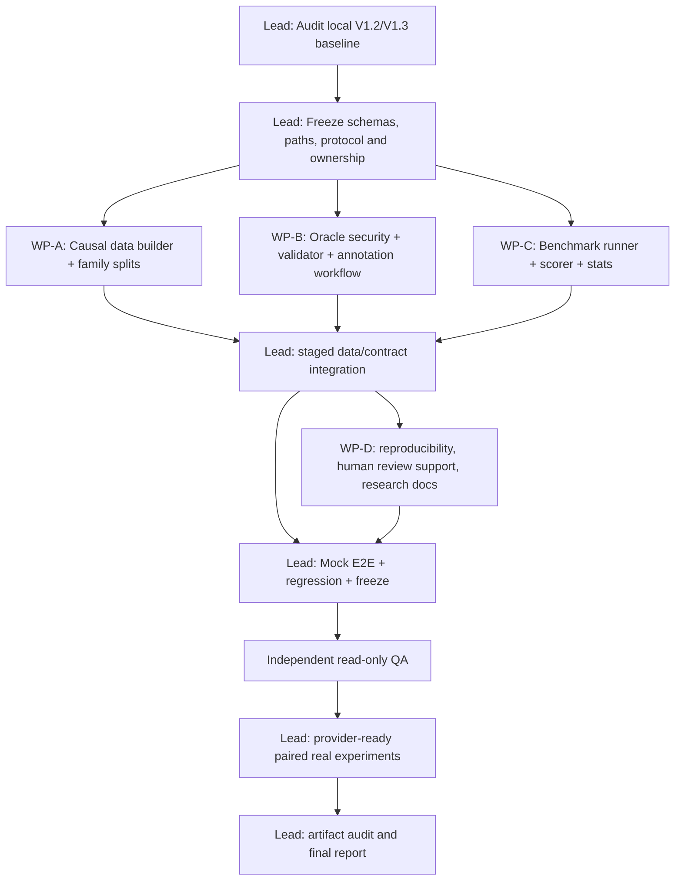

# IncidentLens V1.4 — IncidentBench: A Reproducible Evidence-Grounded RCA Benchmark

**Multi-Agent Parallel Coding Implementation Plan / 可直接交给 Codex 的详细执行文件**  
**项目正式名称：** IncidentLens: An Evidence-Driven Multi-Agent System for Software Incident Investigation  
**文档版本：** Plan 1.0 · 2026-10-13  
**状态：** 待实施的规范与研究实验预注册草案；**不是已经生成的数据集、执行结果或已完成的 V1.4**。  
**远程仓库：** https://github.com/celvelzel/IncidentLens  
**审计参考远程 HEAD：** `3629b0695ed1`（2026-10-13 检查），本地实际工作树与 V1.3 交付状态才是实施依据。  
**上游依赖：** V1.2 核心与 Database/Monitoring/Remediation/TaskManager/StopController；V1.3 Provider Reliability 必须至少通过兼容性 Gate，才能开展正式真实模型实验。  
**总体方向：** 研究可信度、课程高分优先；算法创新次之；不增加新业务 Agent、不实现 Tree Communication、不执行真实修复。  
**交付形式：** 独立版本化数据集、严格标注与校验、冻结的公平评测、人工证据审核、统计结果、研究文档及向后兼容的代码和测试。

> **一句话定义：** V1.4 的目标不是给现有五种故障模板“随机扩写更多数字”，而是构建一套能区分「运行是否成功」「是否找对根因」「引用是否真的支持结论」并能公平比较 Single / Fixed / Dynamic / Full 的 IncidentBench。

---

# 0. MASTER PROMPT — 直接复制给 Codex Lead

```text
You are the Lead Coding Agent for IncidentLens V1.4 (IncidentBench).

Project: IncidentLens: An Evidence-Driven Multi-Agent System for Software Incident Investigation.
Repository: https://github.com/celvelzel/IncidentLens.
Authoritative specification: the ENTIRE local file IncidentLens_V1.4_CodingAgent_Implementation_Plan.md. Read it before delegating.

MISSION:
Deliver a reproducible, scientifically honest, independently auditable evidence-grounded
software incident benchmark and evaluation pipeline as an incremental extension of
LOCAL V1.2/V1.3 IncidentLens. Do not rewrite the investigation graph or legacy evaluator.

DELIVERABLES:
1. Versioned IncidentBench V1 dataset with immutable case IDs, diverse scenario families,
   core RCA Seed/Dev/Frozen-Test splits, and separately scored monitoring/OOD challenges.
2. Strict offline public/private evidence contract: public incident/logs/metrics/changes/
   configs/database files compatible with EvidenceProvider; detailed evaluator-only oracle,
   evidence sufficiency and counterevidence labels; causal and leakage validation.
3. Reproducible data builder, manifest/hash/family-split validator, adversarial/paired
   counterfactual fixtures, normal vs misleading vs incomplete coverage.
4. Explicit frozen protocol for paired Single, Fixed, Dynamic-no-Verifier and Full
   comparisons; fair equal tool information, budgets, model/provider, cache off,
   error-aware denominators and all actual request accounting.
5. Semantic citation review workflow, double-blind review where practicable, disagreement
   adjudication and truthful coverage; no auto-grading semantic support by existence alone.
6. Effect size, family-clustered paired uncertainty, preregistered comparisons, complete
   artifacts, README, test suites and independent QA.
7. Backward compatibility of V1.2 and V1.3 CLI, four legacy variants, data, tools,
   FinalizeGate, isolation, semantic cache and STOP/ACK semantics.

HARD RULES:
- Start with P0 local repository audit; inspect uncommitted work, git log, V1.3 status,
  existing tests, latest schemas and real-provider failure evidence. Never overwrite work.
- Establish a READ-ONLY baseline and freeze public interfaces before parallel workers.
- Use <=3 simultaneous WRITE-capable Codex subagents, in isolated git worktrees.
  Read-only QA may review in parallel. Workers cannot modify shared graph.py,
  contracts.py, evaluator orchestration or config entrypoints; Lead owns integrations.
- Keep the ORIGINAL data/ seed/dev/test/database cases unchanged and keep the original
  scripts/run_eval.py behavior. Put IncidentBench in a NEW versioned root and new scripts.
- Frozen-Test private labels must not be publicly committed before evaluation. Use a
  restricted local evaluator-only oracle root and commit only an opaque commitment/hash.
  If a genuinely blind test set cannot be secured, label the outcome as non-blind.
- A private oracle is never read by EvidenceProvider, LLM, Agent, ToolRegistry,
  Coordinator, Verifier, Monitoring, Remediation, cache or prompt builders.
- Keep core graded RCA cases within clearly supported mechanism/finalizer contracts;
  treat truly unknown mechanisms and multiple independent roots as a separate
  diagnostic challenge until their task definition and scoring support them.
- For all architecture tests, separate technical completion, root correctness,
  correct abstention, citation EXISTENCE and human-verified semantic SUPPORT.
  Unknown metrics are NULL, never fabricated zero or assumed 100%.
- Source-family splits must be independent; synthetic variants with common causal
  blueprints, prompts, timelines, near-duplicate texts or shared counterfactual
  seeds cannot be divided between Dev and Frozen Test.
- No tuning on Frozen Test; no reusing disclosed test labels to publish a new blind
  result. Never present Mock deterministic runs as real-model reasoning results.
- Do not force changes to the five/supported failure-mode FinalizeGate merely to
  improve benchmark scores. Record unsupported mechanisms as OOD or defer them.
- Implement only V1.4; preserve V1.5 CAES as a future consumer of the benchmark.

EXECUTION:
P0 Audit/baseline -> P1 Freeze benchmark schemas + interfaces -> Parallel Work Packages
WP-A/WP-B/WP-C with protected file ownership -> P2/P3 staged integrations ->
WP-D independent labeling/review and WP-E read-only QA -> P4 dry runs ->
P5 preregistration, Frozen-Test sealing -> P6 real-model experiments (only when
provider compatible and budget approved) -> P7 independent replay, statistical
analysis, documentation and release.

At each gate provide exact files changed, commands truly run, test counts, source/data
hashes, worktree merge refs, unresolved risks, next dependencies. Do not claim
completion without reproducible artifacts. Start P0 now; delegate only after P1.
```

**粘贴说明：** `Master Prompt` 需要和本文件一起交给 Codex。可将文件存入仓库 `docs/plans/IncidentLens_V1.4_CodingAgent_Implementation_Plan.md`，再发出上面的 Prompt；不能让 Codex 假定能够读取 ChatGPT 临时下载目录。

---

# 1. 上游基线与远程审计事实（必须尊重）

本节基于 GitHub `main` 代码与文档查阅，旨在定位增量改造点；**不是 V1.4 本地运行验收**。

| 真实文件 / 模块 | 已有功能与契约 | V1.4 实施关注点 |
| --- | --- | --- |
| `src/incident_lens/tools/provider.py` | `EvidenceProvider(root)`；public allowlist 为 `incident.json`、`logs.jsonl`、`metrics.csv`、`changes.jsonl`、`configs.jsonl`、可选 `database.jsonl`；严格路径与 ID 校验；`dataset_revision` 来源于公开数据 | 新数据根目录必须复用兼容公共 Evidence Pack；不能悄悄扩容允许的公共文件；禁止 oracle 路径越界 |
| `src/incident_lens/schemas/contracts.py` | Pydantic v2 严格模型，`CasePublicInput`、`EvidenceRecord`、`RCAReport`、`InvestigationState` 等 | 优先写独立 Benchmark Schema；原输出不强制新增必填字段 |
| `src/incident_lens/orchestration/guards.py` | FinalizeGate 要求有证据、两个不同来源、区分性检查、解决冲突和 Verifier；支持既定故障机制与部分数据库机制 | Core Score 不能混入根因机制超出既有门禁的案例；不能为 Benchmark 偷改业务门禁 |
| `scripts/generate_cases.py` | 原有五类合成因果模板、固定随机种子、公开日志/指标/变更与私有标签 | 不能通过换时间/数字/错误措辞伪装成真正独立的 Scenario Family |
| `scripts/generate_database_cases.py` | 4 个数据库专项案例 | 保留作 Legacy/V1.2 兼容；可借其数据契约，不直接计入新独立测试样本 |
| `src/incident_lens/evaluation/runner.py` | 原四种架构、每次独立 Provider、初始公开哈希、运行结束后加载 Oracle、逐次持久化 CSV/JSONL、缓存关闭 | 新 Benchmark 适配器需要支持单独 Oracle 根、版本冻结、额外指标、来源与家族分组 |
| `src/incident_lens/evaluation/metrics.py` | RCA accuracy、Correct Abstention、Citation Existence、runtime_failure 等，V1.2 区分了正常 STOP 与真正运行错误 | 保留旧函数语义，新增新的评分模块；绝不把正常 STOP 算技术失败，或将技术失败算正确弃权 |
| `scripts/run_v12_eval.py` | Database Agent 配对实验、阶段/停止/修复提案的有效性字段 | Benchmark 公平对照需考虑新增数据库工具及监控/修复预算；避免把工具权限优势误认为 Agent 优势 |
| `docs/acceptance/V1.2.md` | 记录旧版本 308 passed、2 skipped，以及真实 Provider 仅有有限 Smoke 测试 | 只是历史审计记录；本次新提交须独立实际运行与记录 |
| `docs/acceptance/live-continuation.md` | 历史 Real Dev/Test 大量 Provider HTTP、超时和格式失败，缺少可评价 RCA 的成功样本 | V1.4 正式 Real Benchmark 必须由 V1.3 Provider Gate 授权；缺条件时成果是数据与评测系统，不得虚构模型效果 |

## 1.1 明确留存的旧实验

- **Legacy Seed / Dev / Test：** 6 / 10 / 20 旧案例。维持原字节、原 split、旧 CLI 和评测命令可运行。
- **Legacy DB 专项：** 4 个 DB 事故（`incident_037`–`incident_040`），维持 V1.2 路径。
- **旧 Benchmark 执行历史：** 不改写 `results/acceptance` 中的历史结果或错误记录；新 Benchmark 产生全新 Artifact 路径。
- **V1.3：** 与最新本地 V1.3 工作分支建立明确 commit/patch 依赖，冻结 Provider 恢复策略和参数；不让 V1.4 Dataset PR 意外改变它。

## 1.2 课程研究主张与边界

**主研究问题（primary research question）：**

> Under comparable model, tool access, incident inputs and budgets, does evidence-driven dynamic multi-agent investigation with independent verification provide better grounded root-cause diagnosis than a strong single-agent or fixed expert workflow?

**主要有效性约束：**

1. 研究比较的是系统方法与架构，不是“哪个组偷偷用了更多数据库证据”。
2. 只把有真实标签与明确充分性标准的 RCA 案例放入可计分的核心集合。
3. Mock 只能证明离线执行/数据合同/评分代码正确，不能当作大模型准确率。
4. 所有成功、放弃判断与运行故障分开统计；样本较小，绝不预言统计显著。
5. 语义支持的人审标签不等于工具引用存在，两类结果必须分别给出。

---

# 2. Scope、非目标、成功标准

## 2.1 本版范围（In Scope）

1. `IncidentBench V1` 全新、版本化数据根：目标 **100 个 RCA 事故案例**，建议 **Seed 20 / Dev 40 / Frozen Test 40**，根据独立人工审核能力允许正式缩减并记录原因。
2. 多来源证据：Logs、Metrics、Changes、Configs、Database、Topology；复用现有 `EvidenceProvider` 公共契约和现有服务拓扑。
3. Scenario Family 设计、反事实配对、误导线索、时间错位、缺失记录、普通（无 decoy）事故、跨服务传播的可审计生成。
4. 私有因果标注、最小充分证据集合、支持/反对/误导线索、可辨识性说明和双人复核。
5. 冻结分组且防泄漏；Dev/Frozen Test 不共享可追溯同源模板；Frozen Test Oracle 尽可能脱离公开 GitHub。
6. 实际运行的公平架构对照、可重算的评分和研究统计；主实验清楚处理 DB 工具等价性及 STOP 语义。
7. Monitoring/Remediation 的**单独**可选专项评测，不能掺入核心 RCA 主指标分母。
8. Independent QA、回归测试、版本 Manifest、双语文档与课程报告所需图表数据。

## 2.2 暂缓（Out of Scope）

- 不在 V1.4 引入 V1.5 的 CAES 主动证据选择、信息增益策略、成本策略权重训练。
- 不开发 Tree Communication、Agent 自主生产修复或真实服务重启。
- 不引入大型真实云集群、长期在线监控、模型训练或独立向量数据库。
- 不为了扩大新故障类型而重写原有 FinalizeGate。
- 真正 OOD/多根因案例可建设为 `challenge`，但在 Core RCA 单根因评分支持前不进入主要准确率。
- 不把自动 LLM Judge 当作已经核准的 Semantic Support 真值。
- 不直接声称生产泛化能力、统计显著性或真实修复效果。

## 2.3 Done Definition / 发布门槛

- 新 Root 和 Split 可由 `EvidenceProvider`/`ToolRegistry` 正确加载；无旧数据变更。
- **所有** Core 案例存在可验证因果 Oracle，且两位 Reviewer 确认 `is_identifiable` 或明确争议裁定；不确定标注不得进入 Frozen Core。
- 公开数据无答案字段、私有路径、测试答案原文或 Family 泄露标记；自动审计通过；不同分区无 Family、Counterfactual-Pair、近重复模板交叉。
- 正常/误导/缺失与不同机制的覆盖率用真实 `coverage.json` 给出；空切片写 0，不编造样本。
- Legacy 4 variants 与 V1.2 response 模式回归通过，新 Benchmark 主入口能离线 Mock 完整运行并导出真实产物。
- 真实 Provider 通过 V1.3 兼容 Gate 后，正式跑同模型/可比预算/关闭缓存的配对实验；若不可用，状态为 `REAL_EVAL_PENDING`。
- 原始每次运行输出可重算、不可在失败时删除分母；使用真实模型时记录实际错误/请求/Token 不完整性。
- 至少一份盲态语义 Citation Review 和冲突裁定记录，报告支持度审核覆盖率，未审核部分保持 null。
- 研究结果包含样本数、置信区间或不确定性说明，以及限制和反例；不伪造多 Agent 优越性。

---

# 3. P0 — 本地审计与兼容基线（Lead 独占）

**任何 Coding Subagent 改代码之前执行。**

## 3.1 本地审计清单

1. `git status --short`、`git branch --show-current`、`git log -8 --oneline`、`git remote -v`；比较本地与远程，不 pull/rebase 覆盖脏工作树。
2. 识别最新 V1.3 实现是否已合入、本地测试及 Provider Recovery 新接口；如果仍在并行实施，先完成兼容接口 Freeze，再开展新 Benchmark 纯数据工作；真实实验等待 V1.3 Gate。
3. 列出 `EvidenceProvider` 允许的文件和元数据、`CASE_ID`、私有真值读取函数与 Corpus 版本逻辑，输出精确契约表。
4. 检查实际 `FailureMode` 分类、`cause_discriminator()`、`AgentRole` 权限，确认 V1.2 Database 模式是否可用于四种 baseline。
5. 检查 `evaluation.metrics.score_completed()` 和 `runner.evaluate_split()` 的输入输出、STOP reason 计分、旧脚本 CLI 标志、`MeasurementProvider` 用量来源与失败分类。
6. 运行并记录全量 pytest、Ruff、旧 CLI/Mock Seed 与 V1.2 DB Smoke；若失败，先判定是先存问题还是当前工作树引入，禁止将失败藏起来。
7. 保存哈希：源代码、公开数据、Prompt/Schema、配置、Python/依赖 lock；保存默认 profile 说明。
8. 与组员确认是否有足够人工审核资源；没有的话缩小 Core 而不是偷偷跳过标注或假设 100 个案例均有效。

## 3.2 不要做的事

- **不修改** Legacy `data/incidents`、旧 `data/splits` 和已有历史 `results/acceptance`。
- **不将** Frozen Test 真值推送至公开远程 GitHub；首个本地提交不能意外包含 private label。
- **不以**随机打乱 100 份同一脚本样本作为「独立未见测试」。
- **不以**新的 Benchmark 强行修改原模型判定逻辑使正确率上升。

## 3.3 P0 输出物（建议）

`docs/incidentbench/p0-repo-audit.md`、`results/acceptance/v14/p0/`（真实运行日志）、`docs/incidentbench/contracts-freeze.md`、`docs/incidentbench/experiment-preregistration-draft.md`。

> P0 Exit Gate：公开证据接口、Oracle 读取边界、评分、源码所有权、失败计数与 V1.3 状态可用文字和单测证明；任何 P0 实际失败都必须在后续阶段跟踪而不是忽略。

---

# 4. P1 — 冻结 IncidentBench 文件树与接口合同

建议使用**新数据根，不入侵旧文件夹**：

```text
IncidentLens/
├── data/
│   ├── incidents/                      # LEGACY: UNCHANGED
│   ├── splits/                         # LEGACY: UNCHANGED
│   ├── monitoring/                     # V1.2: UNCHANGED
│   └── incidentbench_v1/
│       ├── rca/                        # EvidenceProvider(data_root=.../rca)
│       │   ├── topology/services.yaml
│       │   ├── incidents/
│       │   │   └── incident_1001/
│       │   │       └── public/
│       │   │           ├── incident.json
│       │   │           ├── logs.jsonl
│       │   │           ├── metrics.csv
│       │   │           ├── changes.jsonl
│       │   │           ├── configs.jsonl
│       │   │           └── database.jsonl   # optional
│       │   └── splits/
│       │       ├── seed_ids.json
│       │       ├── dev_ids.json
│       │       └── test_ids.json
│       ├── monitoring/                 # independent normal/alert challenge data
│       ├── manifest.json
│       ├── public_case_index.json
│       └── public_catalog/             # opaque public metadata only; NO causal blueprint
├── src/incident_lens/incidentbench/
│   ├── __init__.py
│   ├── schemas.py
│   ├── builder.py
│   ├── family_split.py
│   ├── validator.py
│   ├── oracle_store.py
│   ├── normalizer.py
│   ├── scorer.py
│   ├── citation_review.py
│   ├── manifest.py
│   ├── statistics.py
│   └── experiment.py
├── scripts/
│   ├── build_incidentbench.py
│   ├── validate_incidentbench.py
│   ├── run_incidentbench.py
│   ├── analyze_incidentbench.py
│   ├── prepare_citation_review.py
│   └── seal_incidentbench.py
├── docs/incidentbench/
│   ├── README.md
│   ├── scenario-catalog.md
│   ├── annotation-guide.md
│   ├── fairness-protocol.md
│   ├── statistical-analysis.md
│   ├── blind-test-protocol.md
│   ├── workstream-handoffs.md
│   └── release-report.md
└── tests/incidentbench/
    ├── test_contracts.py
    ├── test_generation.py
    ├── test_family_split.py
    ├── test_oracle_leakage.py
    ├── test_evidence_compatibility.py
    ├── test_scoring.py
    ├── test_monitoring_cohort.py
    ├── test_review_workflow.py
    ├── test_statistics.py
    ├── test_experiment_fairness.py
    └── test_cli_e2e.py
```

**私人标签路径建议（不推送）：** `local_oracles/incidentbench_v1/rca/incidents/<id>/private/ground_truth.json` 和 `benchmark_oracle.json`；目录加入 `.gitignore`，并由独立 Reviewer 持有。不要在 `public/` 或 `data/incidentbench_v1/` 内暂存测试标签。Seed/Dev 标签可按团队教学需求放在受控目录，但 Test 默认仅供测试后评分器读取。

**注意：** 现有 `EvidenceProvider` 仍要求标准 `root/incidents/..`、`root/topology/services.yaml`；新 `manifest.json` 置于该 `root` 外层，避免被公共证据工具误读。`dataset_revision` 只代表公开 evidence 快照，实验还需要单独 `manifest_sha256` / `oracle_commitment`。

## 4.1 稳定接口草案：PublicCase + BenchmarkOracle

```python
# Pydantic v2 sketch; final exact schema after P0 contract freeze.
from typing import Literal
from pydantic import BaseModel, ConfigDict, Field

class BenchmarkRootCause(BaseModel):
    model_config = ConfigDict(extra="forbid")
    culprit_service: str
    failure_mode: str
    root_cause_code: str

class EvidenceSupportSet(BaseModel):
    # ANY one complete sufficient set can count; not only one canonical path.
    evidence_ids: list[str] = Field(min_length=1)
    rationale: str

class BenchmarkOracle(BaseModel):
    model_config = ConfigDict(extra="forbid")
    incident_id: str
    scenario_family_id: str
    mechanism_id: str
    counterfactual_pair_id: str | None = None
    is_identifiable: bool
    true_primary_root: BenchmarkRootCause
    acceptable_support_sets: list[EvidenceSupportSet]
    contradicting_evidence_ids: list[str]
    misleading_evidence_ids: list[str]
    required_discriminator_types: list[str]
    causal_sequence: list[str]
    identifiability_rationale: str
    annotator_status: Literal["pending", "adjudicated", "accepted"]
    review_version: str

class BenchmarkCaseMetadata(BaseModel):
    # This file is NOT exposed as model input; never contain answer metadata in public.
    model_config = ConfigDict(extra="forbid")
    incident_id: str
    split: Literal["seed", "dev", "test"]
    scenario_family_id: str
    scenario_variant_id: str
    challenge_tags: list[str]
    public_sha256: str
```

规则：

- 对证据不足案例 `is_identifiable=False`，`acceptable_support_sets=[]` 合法，但 `true_primary_root` 仍可存在于私有 Oracle（模拟世界中的真实原因不代表公开证据足够），供评分器确认不可辨识性。
- 对证据充分案例 `acceptable_support_sets` 至少包含一组**可见、时间上合理且能支持原因区分**的记录；每组必须有人工解释；不要仅从根因类别自动生成并当作人审结论。
- `misleading_evidence_ids`、`contradicting_evidence_ids` 允许空数组。旧的 `scripts/validate_dataset.py` 要求非空、特定记录数量的规则只对 Legacy 生效；V1.4 写自己的更通用验证器，**不能削弱旧规则以通过新数据**。
- 如果将扩展 Oracle 转换为现有 `ground_truth.json`，保留 `root_cause_code`、`culprit_service`、`failure_mode`、`is_identifiable`、`causal_chain`、`decisive_evidence_ids`、`misleading_evidence_ids`、`split` 等 Legacy 评分字段；使用版本化转换器而不是破坏现有评分器。
- 允许多组因果证据路径，但现在的 Core 最终答案仍为**单一主要根因**；多根因任务单独计分或延后。
- `BenchmarkCaseMetadata.scenario_family_id` 存在于 Benchmark 元数据而非 Agent 输入；如果公开提交，需确认不会使模型通过 ID 推断根因。

## 4.2 Canonical Oracle adapter（强制）

```python
class OracleStore(Protocol):
    def load_after_completion(self, incident_id: str, completed_state: dict) -> BenchmarkOracle:
        ...

# Implementation rules:
# 1. Exact incident ID check and completed report required.
# 2. No oracle path is passed into a runtime Graph or EvidenceProvider.
# 3. Safe-path validation rejects .., symlinks, reparse points and foreign IDs.
# 4. Expose evaluator-only service, not ToolRegistry method.
# 5. Return a separate scoring object, never merge oracle into InvestigationState.
# 6. Log ONLY oracle digest and review_version in public artifacts as permitted.
```

**不充分的安全设计：** 把 `ground_truth.json` 放在同一个公开 GitHub 仓库后，仅靠“不在 Prompt 中输入”仍不能宣称严格盲测。较高可信度的 Frozen Test 需要让 Prompt 作者/Agent 实施者拿不到真实 Test 标签；如果组员已知所有答案，必须诚实声明 non-blind。

---

# 5. Scenario Catalog — 数据设计与机制覆盖

## 5.1 Core RCA 的目标规模（建议而非强行承诺）

**目标：** 100 个经过严格审查的 RCA 事故案例，Seed 20、Dev 40、Frozen Test 40。

- **正常无事故监控样本不属于 Core RCA**，单独建立 `monitoring` 专项 cohort；正常波动可用作 RCA 证据中的背景噪声。
- **真正未知故障机制/不可被当前 FinalizeGate 支持的机制不混入 Core 主要准确率**，放 `challenge/ood`，记录 `unsupported_by_current_taxonomy`；若后续扩展分类器/门禁，应作为全新版本实验声明。
- **多独立根因** 可作为多故障 `challenge`，不强迫现在的单根因评分给出一个“唯一正确”答案。
- 若只拿得出 60 个真正独立、可复核的案例，就交付 60 个，报告真实分母；不可复制同一家族变体滥充 100。

## 5.2 场景矩阵（预设计目标，真实覆盖由程序导出）

| 维度 | Core RCA 要覆盖的情景 | 独立性要求 |
| --- | --- | --- |
| 故障机制 | 既定 Backend pool regression、Postgres exhaustion、Redis unavailable、Payment timeout、Backend saturation；V1.2 支持时加入 DB lock contention、slow query | 每个 Core 机制由现有 `failure_mode` 与公开 evidence discriminator 支持 |
| 线索类型 | 无明显误导（ordinary）、单个误导信号、多条跨角色误导信号 | 禁止全部为 misleading；至少普通与误导均有案例 |
| 可辨识性 | 有充分证据、关键区分性证据缺失、多个根因暂不能区分 | 缺证据案例不能被模型从 ID 或模板结构猜中 |
| 传播路径 | Gateway → Backend → DB；Cache fallback；External Payment；上游资源饱和 | 日志、指标和时间顺序一致；不能靠一个关键字定答案 |
| 数据质量 | 抖动、缺采样、重复日志、异步延迟、滞后指标、不同粒度窗口 | 噪声不能泄露标签；因果核心不被乱数破坏 |
| 反事实 | 症状近似但根因不同；改变一个关键条件使可信结论改变 | 一对反事实同属一个 split，必须由 Reviewer 解释变化点 |
| DB 专项 | 真 DB connection cap、应用 pool 配置、DB lock/slow query 与 downstream timeout | 需要 Database Agent 观测值，而不只换一条 timeout 日志 |
| 对抗信息 | 日志含提示注入、表面相似错误文本、无关部署变更 | 不信任日志文本；Grounding/ACL 不变 |

## 5.3 Scenario Family / 反事实成对机制

每个 `scenario_family_id` 必须为不携带故障答案的**不透明标识**（例如 `fam_0019`，不要写 `dbpool_B` 暴露答案），对应**一套可独立解释的事故因果蓝图**。真正的 causal blueprint 仅应保存在受控的生成器输入或 evaluator-only 目录，不应作为公开 Benchmark 资料投喂给 Agent。蓝图包含：

- 初始健康基线、触发事件、受影响组件、依赖传播、观测机制与缺失机制。
- 真正产生的信号及相关时延；噪声/decoy 与主故障之间的关系。
- 为什么至少一组可用证据足以排除主要竞争假说。
- 两名独立 Reviewer 可以不查代码也能重建因果关系。

不能仅以机制名字不同就称不同家族，也不能给同一脚本换种子便跨分区。建议优先设计 **18–24 个质量较高且互不共享蓝图的独立家族**（资源不足时可降低案例数量），使 Frozen Test 至少有约 6 个、尽量 8 个以上独立家族；每个家族只衍生数个留在同一分区的情境变体。如果 Test 只有 2–3 个独立家族，即使包含 40 个 Case，配对区间也可能非常不稳定，必须在统计报告中降级声明。要保证 Dev/Test 均有能够评价的主要机制：**同一故障机制可以出现在不同家族，但具体蓝图、文字模板、扰动链和反事实族不可交叉**。

实例（示意，非新增数据已完成）：

```text
fam_010 (DEV only; private description: backend pool family)
  - load baseline: DB healthy, backend pool_max incorrectly reduced after deployment
  - variant_01: concurrent checkout spikes before pool acquire timeout
  - variant_02: delayed database telemetry + unrelated Redis warning
  - cf_pair_01A: DB healthy, backend pool regression is actual root
  - cf_pair_01B: backend pool unchanged, DB connection capacity truly exhausted

fam_021 (TEST only; private description: independent database family)
  - an independently authored workload/telemetry layout with different
    causal chronology, observability placement and background services
  - NOT a reskin of family_dbpool_A templates
```

特别注意反事实 01A/01B 常见“只换标签但公共证据不变”的错误，Validator 和 Reviewer 必须证明关键公有观测真的改变并区分因果原因。

## 5.4 可辨识性是实验定义，不是“证据条数”

- 若公开证据中两种竞争根因产生的观测等价，则应设 `is_identifiable=False`，即便生成器内知道真实根因。
- 对可辨识案例，至少一组证据链应包含跨来源的观测与关键区分性检查；仅引用同源重复日志不算独立支持。
- 不能因为模型回答错误就事后改标签为不可辨识；可辨识性在模型评测前由 Reviewer 冻结。
- 如 Reviewer 对 identifiability 有实质分歧，先 `pending`，不进入 Frozen Core，交给第三人/仲裁；不能在测试后改 Oracle 迁就模型。

## 5.5 Monitoring 专项 cohort（独立）

建议从已有 `data/monitoring` 兼容接口出发，额外构造约 **12–24 个**独立的正常、轻微波动、异常快照/时间序列：

- 标注 `alert_expected`, `first_detectable_at`, `false_alarm_cost`, `observable_prefix`。
- `NO_ALERT` 和真正 Incident 的 ALERT 是**监控二分类/检测延迟**，不得和 Core RCA 的 Correct Abstention 混为一个分母。
- 离线 Replay 时 Agent 只能看到当前前缀，禁止读取未来监控点或私有 Event Label。
- 样本数量按可人工审核程度决定；不得把这部分计入 100 个 RCA 故障案例冒充主实验规模。

## 5.6 Remediation 评测边界

V1.2 `PLAN_ONLY` 不执行修复，因此 V1.4 只能评估：Schema/版本匹配、Evidence 关联、操作步骤与实际已确认 Root Cause 的逻辑一致性、风险/验证/回滚覆盖、危险建议的人工标注。

**不能称** `PLAN_READY` 就是修复成功，也不能以计划的文字流畅度代替实际恢复率。没有人工或沙箱执行结果时 `remediation_effectiveness=null`。

---

# 6. Dataset Builder、真实性与可重现性

## 6.1 两阶段生成：Causal World → Observations

禁止直接从 `failure_mode` 拼接固定故障句式作为全部证据，推荐：

```text
Scenario Spec (private causal blueprint)
    ↓
Deterministic World State / Event Timeline
    ↓
Service dependency propagation rules
    ↓
Independent observation encoders (logs/metrics/db/changes/config)
    ↓
Public Evidence Pack with provenance/timestamps/metadata
    ↓
Private Oracle with explicit causal/rationale labels
    ↓
Separate Validator + independent human Review
```

给不同类型的噪声设计可控生成器，而不是从同一个五模板变数值：日志顺序、相关性窗口、采样缺口、指标 lag、与因果无关的部署事件、其他服务健康记录、长尾背景日志等。

**可复现性：** 每个家族、每个 case 的独立 RNG seed；记载 builder version、public schema version、scenario family version、generated_at（固定或由 deterministic seed 推导）、oracle review version 和 source code digest。不得以本机 wall clock 写不可复现的数据；再次生成相同版本应得到同样的 public 哈希。

## 6.2 公共数据严格复用旧格式

```text
public/incident.json    # CasePublicInput, neutral title and observable symptoms
public/logs.jsonl       # EvidenceRecord objects
public/metrics.csv      # columns compatible with EvidenceProvider CSV loader
public/changes.jsonl    # change_id/type + public excerpts
public/configs.jsonl    # config diff evidence
public/database.jsonl   # optional V1.2 schema and database metadata
```

所有 `evidence_id` 均应唯一且可在本 case 内追溯；`source_path` 与现有公共文件对应，`incident_id` 和 `service` 与 case summary 一致。时间应为带时区 ISO 格式。避免在公有字段中出现 `root_cause_code`、`failure_mode`、`culprit_service` 等答案关键词；**误导线索可以客观存在，但不能携带 evaluator 元数据字段**。

**原 `PUBLIC_FILES` 和安全目录白名单不变。** 每个新 Case 至少可完成一个合法的 ToolRegistry 调查；`EvidenceProvider.validate_public()` 必须全量通过。

## 6.3 private Oracle 与 Legacy 适配

- `ground_truth.json`：保留原 evaluator 可使用的 minimal fields；在 Core 适用时通过独立转换器生成。
- `benchmark_oracle.json`：存放更丰富的语义支持、反证、可辨识理由、family 和 reviewer 状态。
- Frozen Test Oracle **只存于 evaluator-only restricted root**。公开仓库中不应包含其完整版或可还原的映射。
- Oracle 标签由 causal world 输出作为初始候选，必须经人审确认，不能把生成器自报答案等同已复核真值。
- 对 `unknown` 或 `multi-root`，可用另一个 `ChallengeOracle` Schema，不调用只支持单根因的 `score_completed()`。

## 6.4 生成器质量门槛

必要的自动断言：

1. 时间序列有合理的原因→症状传播关系；误导事件不应自动更早且更强以至无法区分。
2. 故障 Core 的根因机制与 FinalizeGate 当前允许的 taxonomy 一致；所需判定型记录确实可以被相应授权工具查询。
3. Identifiable=True 的 case 至少一组最小支持集合全部位于 Public Evidence Pack；缺失的 case 不允许让所有支持集合保持完整。
4. 任何 evidence 引用在同一 case 内存在、source path 与类型匹配；不同 incident 不共享 ID。
5. 反事实对有明确公有判别变化，且两例不能跨 split。
6. Generator 重跑与生成副本哈希稳定；自然随机性不得流入 Data Manifest。
7. 正常/误导/不可辨识的分布可从标签中真实导出；覆盖不足时失败或明确标记，不静默充数。
8. 使用旧 `tools/provider.py` 加载数据时不会访问评测标签或自动补充不存在的文件。

---

# 7. 数据泄漏控制、Frozen Test 封存与预注册

**这是 V1.4 最关键的科学性 Gate。公开 GitHub 仓库的 `private/ground_truth.json` 对模型开发者并非真正不可见，不能靠“目录叫 private”宣称盲测。**

## 7.1 分组约束

```text
Group key = scenario_family_id
            + source_blueprint_id
            + counterfactual_group_id (when any)
            + near_duplicate_cluster_id
```

分区算法必须在组级别进行；若一个 pair 出现在 Dev，则整个 pair 在 Dev。禁止 Seed/Dev 与 Frozen Test 共享相同的原始场景蓝图、复制的完整 Evidence 行、指令模板/无害改写版、几乎一致的故障时序和对应 Oracle。

**当机制与 Family 冲突时：** 保证 Family 隔离优先于机械追求每个 split 的机制比例；分层统计真实覆盖，并考虑新增独立家族，不得强行拆散家族。

## 7.2 可审计近重复检测

建议组合：

- exact public blob / excerpt hash 重复检查；
- 移除时间戳、request_id、service-neutral numeric 后的规范化 token / shingle 相似检查；
- 对长日志使用局部 MinHash/Jaccard；
- 显式检查场景蓝图与 counterfactual pair 的 ID 链接。

算法只作为**泄漏预警**，不能证明语义完全独立。类似高频运维短语不必一律报错，但对于超高相似、同源蓝图跨分区必须拒绝；可写审核豁免及理由。不要让 Test 标签或 Cause Blueprints 为 Agent 所见。

## 7.3 Frozen Test Protocol

1. Seed/Dev 数据、Prompt 调整和 Benchmark 评分代码先成熟。
2. 冻结公共 Test evidence，生成 `manifest.json`，计算 public bundle SHA256、split hash、源代码与配置版本。
3. Test Oracle 由独立 Label Owner 保留在**非公开、非 Codex 工作树、非自动上传**的位置；Lead 不应直接依赖其内容调参。
4. 发布公共数据哈希和**不泄露标签的完整性承诺**。可用带随机秘密 salt 的 Hash Commitment：
   `commitment = SHA256(canonical_test_oracle_bytes || private_salt)`；salt 暂不公开，保证未来可核查同一标签版本。
5. Test 开始前冻结模型 ID、Provider/response format、temperature、Prompt、RCA gate、预算、重试策略、工作流 profile、cache OFF、指标与统计方法。
6. 正式执行期间数据和源代码哈希发生变化必须拒绝继续。
7. 只有完整运行返回后，独立 Evaluator 才通过受限接口解封对应 incident 的 Oracle 用于评分；运行过程中的 Agent/Tool 不得拿到句柄。
8. 保存原始失败 trace、Provider status、请求数、partial artifacts；不删除或重跑后掩盖失败。
9. 完成一轮 Frozen Test 后不能为改善结果修改 Prompt 再宣称同一 Test 仍为 blind；新的实验须标记 `test_exposed`, 或重新设计第二套真正未见 Test。
10. 需要公开成果时可以发布匿名汇总及可验证 hash；若想开放全部标签，必须说明这会让将来同套 Test 不再是严格未见。

若小组无法实施独立保密，标记 `blindness_level=development_visible`，并把主张降为“冻结条件下的留出比较”，不称严格独立盲测。

## 7.4 实验预注册最小字段

```yaml
protocol_id: incidentbench-v1-main
benchmark_version: incidentbench-v1
primary_comparisons:
  - [full, strong_single_equivalent_tools]
  - [full, fixed_four_equivalent_tools]
primary_quality_metric: root_cause_accuracy_identifiable
primary_reliability_metric: investigation_completion_rate
secondary_metrics:
  - correct_abstention_rate
  - human_grounded_success_rate
  - citation_existence_validity
  - total_tokens_per_incident
  - llm_requests_per_incident
  - latency_ms_per_incident
  - provider_failure_rate
split: frozen_test
model_id: TO_FILL_BEFORE_FREEZE
provider_id: TO_FILL_BEFORE_FREEZE
cache_mode: off
budget_profile: TO_FILL_BEFORE_FREEZE
jobs: 1
run_order_seed: TO_FILL_BEFORE_FREEZE
repeat_policy: TO_FILL_BEFORE_FREEZE
analysis_plan: family_clustered_paired_bootstrap_plus_exact_discordance
```

所有 `TO_FILL_BEFORE_FREEZE` 必须在 P5 关闭，不能在 Test 后倒填。保留 `protocol.lock.json` 与哈希；若更改就是新 protocol version。

---

# 8. 标注协议：两层真值与两层人工核验

## 8.1 事故级因果标注（Dataset Truth Review）

每个 case 两名 Reviewer 独立填写：

- `root_cause_service` / `failure_mode` / `causal_chain`；
- `is_identifiable` 和为什么；
- `minimal_support_sets`（允许多组）、`contradicting_evidence_ids`；
- `misleading_evidence_ids`（允许空）；
- `required_discriminator_types`、时序一致性、可达工具；
- `ordinary/misleading/missing` 标签和 `family` 归属；
- “如果去掉关键一条证据，能否仍然区分原因？”之 counterfactual 检查。

冲突必须记录**两份原始审核+裁决原因**；实质争议未解决时不能冻结进 Test。

## 8.2 报告级 Citation Support Review

当前算法自动检查 evidence ID 存在，但无法单凭 ID 判断它是否真的支持主张。必须将报告拆为 reviewable atomic claims：

```json
{
  "run_key": "incident_1001/full/rep0",
  "claim_id": "claim-0001",
  "claim_type": "root_cause | causal_step | remediation_action",
  "claim_text": "Backend pool max configuration caused local acquire timeout",
  "citation_ids": ["incident_1001-D003", "incident_1001-L019"],
  "review_label": "SUPPORTED | CONTRADICTED | INSUFFICIENT | NOT_APPLICABLE",
  "reviewer_id": "anonymous_reviewer_A",
  "rationale": "...",
  "annotation_status": "pending | adjudicated | final"
}
```

Labels 定义：

- **SUPPORTED：** 引用确实支持这条具体主张（而不仅是描述同一服务的异常）。
- **CONTRADICTED：** 引用明确与主张冲突。
- **INSUFFICIENT：** 引用相关但不足以推出因果主张、仅出现同词或缺少区分条件。
- **NOT_APPLICABLE：** 非事实可验证主张/纯背景；从被审核的事实主张分母排除，但需要理由。
- **UNREVIEWED：** 不等于 Supported；保留 null，不能计算成 0% unsupported。

**独立盲审：** Reviewer 最好不看到实验 variant、模型名、预期排名；每条 claim 附当前 run 实际可见的 Evidence 原文及来源，不展示私有 Oracle 判断引导（裁决阶段可在严格受控流程中对照）。先双人独立标注，后仲裁；计算真实观察一致性（percentage agreement，必要时 Cohen's κ），数据不足时不给“高一致性”虚称。

## 8.3 样本量与务实退路

理想：对 Frozen Test 产出的**全部可审计核心 RCA 事实主张**双人审核。若经费/时间不足，应在看模型结果前预定义**分层抽样规则**（所有架构和机制均覆盖、事先锁定种子），给出真实分母、评审覆盖率和可推断范围。未审核 case 的 `human_grounded_success` 必须 null；不能用自动规则偷偷替代人工结论。

即便根因诊断错误，也要保留其声称依据的语义支持标签，因为“错误但有证据支撑的局部观测”与“纯粹幻觉”不同。不要把 `Citation Existence`、`Oracle Key Evidence Overlap` 与 `Semantic Support` 混成一个指标。

## 8.4 保密与贡献边界

- 可以用人工填写的 CSV/JSON 作为 review source；只允许使用匿名审查编号。
- 不要在自动调用的 LLM 输入中提交 `benchmark_oracle.json` 或标注答案。
- 评测代码与生成数据不能证明六位组员实际劳动分工；真实负责人与复核人需要自己确认贡献。

---

# 9. 指标合同（分母明确、失败不能洗白）

**主指标对任何正式实验在 P5 预先冻结。**

## 9.1 必须分开的三个维度

1. **Technical Completion**：整个工作流是否在协议内完成、无不可恢复 Provider/Graph/Stop 错误。
2. **Diagnostic Correctness**：当 Oracle 认为可辨识时，`culprit_service AND failure_mode` 是否均正确；不可辨识时是否正确弃权。
3. **Evidence Grounding**：引用的证据是否存在/已查询、其语义是否支持具体主张。

技术失败不能视为“识别不了事故所以正确弃权”；HTTP 429、schema invalid、预算耗尽也不能隐含地使模型 RCA 准确率变成更高。

## 9.2 核心指标及公式

| 指标 | 精确定义 | 重要边界 |
| --- | --- | --- |
| `investigation_completion_rate` | 技术正常终止的 runs / 发起的 runs | 正常 STOP(INCONCLUSIVE/PLAN_READY/NO_ALERT) 与 RUNTIME_ERROR 区分；不同 profile 分开 |
| `root_cause_accuracy` | identifiable cases 上，根因服务+机制均匹配且无 runtime failure 的 runs / identifiable 总 runs | 技术失败在分母中按不正确计，拒绝筛去失败 run 来提高成绩 |
| `correct_abstention_rate` | unidentifiable cases 上，正常 INCONCLUSIVE 且无根因断言的 runs / unidentifiable 总 runs | 不含 NO_ALERT 监控样本；错误停止不获分 |
| `citation_existence_validity` | 被引用且已真实查询/共享、属于同事故的唯一 ID 数 / 全部唯一引用 ID 数 | 无引用时 **null**，不是 100%；非语义支持 |
| `human_support_rate` | final 状态事实主张中 SUPPORTED 的条数 / 人审事实主张条数 | 只有有独立标注时才提供，部分抽样附 coverage |
| `unsupported_claim_rate` | CONTRADICTED + INSUFFICIENT 的事实主张数 / 人审事实主张数 | 缺标注必须 null；NA 不计入分母 |
| `human_grounded_success_rate` | 根因完全正确 **且** 所有预注册关键因果主张被审核为支持的可辨识 runs / 具有完整审核标注的 identifiable runs | 只在完成审核子集计算；另报告 audited coverage |
| `misleading_accuracy` | 存在误导信号的 identifiable runs 中正确根因 / 该组 total | 不是所有案例都 misleading，未观测 decoy 与否可补充次指标 |
| `request_count` | 包括 Provider 重试和结构化修复的真实物理 HTTP 请求次数 | 与逻辑 Agent call 分账，按 V1.3 contract |
| `total_tokens` | 所有**可确认**的模型 token；有缺失时总量标记 incomplete/null | 不以 null 当 0；单次调用可另记已知下界 |
| `latency_ms` | 单次 run 整条 Graph 的单调时钟 elapsed，包括重试/监控/修复如该实验启用 | 主 RCA 对照最好固定 `legacy_rca` 或统一 response phase 配置 |
| `cost_usd` | 根据官方计量和明确定价版本得出时才填 | 没有可靠计价则 null，不猜 token 价格 |

**补充指标**：resolved coverage、conditional accuracy among resolved（选择性风险）、工具调用数、总模型调用数、Provider failure by category、重复工具调用比例、Reviewer challenge follow-up 与 STOP completion。报告相同公式下的真实 n 和每类失败数。

## 9.3 评分 pseudocode

```python
# Evaluator-only. Never invoked before graph completes.
def score_benchmark_run(completed_state, oracle, citation_annotations=None):
    technical_ok = classify_termination(completed_state) == "NORMAL_COMPLETION"
    report = completed_state["report"]
    root = report.get("root_cause")
    # A normal, deliberate INCONCLUSIVE is not a runtime failure.
    correct_root = (
        technical_ok and oracle.is_identifiable and report["status"] == "RESOLVED"
        and root is not None
        and root["culprit_service"] == oracle.true_primary_root.culprit_service
        and root["failure_mode"] == oracle.true_primary_root.failure_mode
    )
    correct_abstain = (
        technical_ok and not oracle.is_identifiable
        and report["status"] == "INCONCLUSIVE" and root is None
    )
    # Citation existence uses actual observed tool-result IDs and same-incident provenance.
    citation_exists = score_citation_existence(completed_state)
    # Human semantic support is NULL until appropriate blind review is complete.
    human_supported = score_human_reviews(citation_annotations) if citation_annotations else None
    return {...}  # explicit numerator/denominator flags and missing values
```

**注意：** 单次 Return 的 `root_cause_correct` 对 `is_identifiable=False` 应是 null，不是 False；`correct_abstention` 对 identifiable 同理。V1.2 `diagnosis_match` 与旧 failure-aware 根因分数含义可能不同，必须在指标字典里说明并做回归测试。

## 9.4 覆盖率与结果公开

`coverage.json` 明确输出按 split/family/mechanism/identifiability/ordinary-vs-misleading/DB-role/source-type 的样本数量；空组标记 0。至少提供 per-case CSV、per-variant aggregate、failure taxonomy 分布、人工审核覆盖、source/protocol hashes 和错误分析。

---

# 10. 公平的架构对照与消融设计

## 10.1 主要比较（预注册）

V1.4 旨在量化三种核心作用：单 Agent vs 多 Agent、固定专家 vs 动态调度、独立 Verifier 的贡献。

| 试验组 | 结构 | 可比性说明 |
| --- | --- | --- |
| `strong_single_equivalent_tools` | 单 Agent，允许查询与 Full 同等的公共工具，并自行规划/反思 | 主要对照之一；必须真的能访问数据库等价数据 |
| `fixed_four_equivalent_tools` | 一次固定调度 Logs + Metrics + Database + Changes，固定顺序/批次；共享原 Grounding Gate | 新增 benchmark-only 固定四专家对照；避免旧 fixed3 少 DB 造成不公平 |
| `dynamic_no_verifier` | 现有动态派发和 Grounding Gate，但无独立 verifier | 验证独立反证审核贡献 |
| `full` | Coordinator 动态调查 + Database + Verifier + FinalizeGate | 主要研究方法 |

旧 `fixed`（仅 logs/metrics/changes 一批）继续作为 **Legacy Diagnostic** 可展示，但**不要**将它与带 Database Agent 的 Full 主比较当作“纯协作差异”，否则工具信息/专业角色集合不一致。

**实施方式：** 不删除旧 variant；在新 Benchmark adapter 中引入显式 `fixed_four` 条件或新策略包装，须走真实现有 Graph 和工具 Registry，而不是保存一个 mock 固定报告。如果四专家批次集成需要修改 Graph 并可能影响旧行为，由 Lead 独占写入、配置显式 opt-in、全回归通过才可使用；若届时无法可靠实现，就把 `fixed_four` 状态记为 PENDING，不以 legacy fixed3 替代来下强因果结论。

## 10.2 固定哪些实验条件？

- 相同 `incident_id` 公共输入及 dataset revision。
- 相同 Provider、模型 ID、响应格式、Prompt/Schema 版本、Temperature 和已确认 Provider 能力。
- 相同总请求、token（如能硬计量）、工具调用、round、wall 预算；**相同预算上限不等于实际调用相等**，仍需记录实际用量。
- 相同可供查询的数据类型和 Oracle 屏蔽规则；基线可配置数据库等价工具，不能让 Full 独占 DB 数据。
- 缓存 OFF；相同错误恢复/重试策略 V1.3；无 silent Real→Mock fallback。
- 同样的 `monitor` / `remediation` 配置；**主要 RCA 调查实验推荐固定 legacy_rca 直接输入 incident**，避免 Monitor/Plan 阶段掩盖主因。
- 相同 Provider concurrency setting `--jobs`，建议正式主质量比较 `jobs=1` 或小规模固定值，且顺序随机化，避免共享 API 限流偏袒某组。
- 每次跑全新 provider/budget/run_id；Oracle 只在 run 返回报告后加入评分。

## 10.3 运行顺序、随机性与停止

- **配对**：同一 case 上四组均执行；为了弱化时段负载偏差，用预冻结随机种子打乱本批 variant 顺序或采用交错/平衡顺序，而不是总按 Single→Fixed→Full。
- 如需重复试验，在 `repeat_id` 维度保存独立 run，明确重复不等于独立新事故；统计按 family/case 聚合，不能把同事故三次运行当作三倍样本数。
- Timeout、429、API quota、用户手动中断，都保留 unfinished/failed record，并加入相应分母，不能自动丢弃不利运行。
- 正式测试途中大规模 Provider 故障时允许依据**预注册的技术暂停规则**暂停，并保留失败尝试；不允许发现准确率不好后无记录地重跑。
- 若真实 API 本身不可靠，保留研究状态 `REAL_RESULT_INCONCLUSIVE_PROVIDER`, 不声称算法优势。

## 10.4 V1.2 Monitoring 和 Remediation 另测

**RCA Primary**：`legacy_rca` + 四变体，一次只研究根因判断。  
**Response Secondary**：同一 Core 子集（先 Dev）启用 `incident_response`，对能正常触发 Alert 的案例额外检查监控契约/计划质量；正常监控 cohort 单独计算 precision/recall/false positive/first detection latency。不得把 `NO_ALERT` 计作根因错误，也不得把 Schema 合法的修复计划计作真实服务恢复。

---

# 11. 统计分析计划（先锁定再看 Frozen Test）

## 11.1 预注册主要比较与主要指标

Primary comparisons：

1. `full` vs `strong_single_equivalent_tools`：`root_cause_accuracy` on identifiable Core cases。
2. `full` vs `fixed_four_equivalent_tools`：同一指标，检验动态调度对固定专家的增量价值。

独立 verifier 的 `full` vs `dynamic_no_verifier` 为预注册 secondary/complementary contrast。技术成功率独立主报告，不能只在完成的 runs 上筛选估计根因表现。

Secondary：Correct Abstention、Human-grounded Success（仅人工审毕子集）、total model requests/tokens、延迟、citations、challenge slices。多指标/多组比较需标记探索性，必要时 Holm 控制多重检验，不应随结果挑一个最显著的作为唯一主张。

## 11.2 家族聚类的配对估计

**样本独立单位优先为 Scenario Family，而不是同一模板复制出的 case。**

- Root accuracy 的配对差异：

\[\Delta = \frac{1}{N}\sum_i (y_{i,full} - y_{i,baseline})\]

- 置信区间：建议按 `scenario_family_id` 为重采样 cluster 进行 paired bootstrap（例如固定 RNG 的 10,000 次；样本家族数量很少时结果仅作探索），保留 case 内多 variant 的配对关系。
- 二分类配对 correctness 的 McNemar exact test 可作为补充；由于同家族案例相关，它的独立性假设可能不满足，因此主解释优先使用 family-clustered uncertainty / family-level summaries。
- 延迟/token：使用同一 case 的组内差与其 family-aware bootstrap；计数缺失时报告 completeness，不能拿 0 填空。
- 随机重复：先汇总同一 case/variant 的重复运行，再按 family 聚类；记录重复次数和方差。
- 样本小、模型不稳定、Family 少时只报告效应大小/区间与不确定性，不硬称显著。

## 11.3 不允许的解释

- `full` 5/5 Mock Seed 正确 != Real 模型 100% RCA。
- `citation_exists=1` != 引用真正支持因果主张。
- `tests/` 总数多 != Benchmark 有效。
- `accuracy on completed runs` 高 != 整体实际 RCA 成功率高。
- `Plan validated` != 真实系统恢复。
- `new database agent has more tools` 与 `multiagent collaboration helps` 不能混为因果结论。
- 固定 40 个 Test 且极少 family 时，不声称充分统计证明 5 个百分点改善。

## 11.4 研究结果应展示什么？

最终实验主表建议至少列：

`variant | tested_n | identifiable_n | technical_success | correct_roots / n | correct_abstains / n | citation_validity | human_support_coverage | total_http_attempts | token_completeness | latency | provider_errors`。

图表建议（仅实际数据可画）：机制/误导/缺证据切片、配对每案胜负矩阵、技术故障分布、根因准确率差 CI、tokens/准确率关系、Reviewer 请求补查率；任何缺失指标在图表上明确 N/A。

---

# 12. Work Packages — 多 Coding Agent 并行交付契约

**人类六人分工与 Coding Agent 子任务不是同一件事。** 每个 Agent 的写入范围必须通过独立 Git worktree 限定。最多三个 Write Workers 同时运行，Independent QA 只读。

## 12.1 Lead / Integrator — 唯一跨模块接口 Owner

**独占写范围：** 现有 `src/incident_lens/evaluation/runner.py`、`metrics.py`、`orchestration/graph.py`、`schemas/contracts.py`、`cli.py`、`tools/provider.py`、公共配置、核心 README，其他任何被两条 WP 同时依赖的公共接口。除确实不可避免，不修改这些文件。

任务：

1. P0 基线、P1 冻结 Schema/路径/CLI/hashes、Provider V1.3 兼容性。
2. 审核 WP 产生的独立接口，并将 Benchmark Runner 接到现有 `run_investigation`，只在必要时做可选 adapter。
3. 如必须实现 `fixed_four_equivalent_tools`，在显式 opt-in 路径最小变更，维护旧 `fixed`/single/full 的精确旧行为。
4. 合并后重跑所有旧+新测试，独立审计 Oracle 从不进 runtime。
5. 正式 preregistration、freeze、真实实验和 release signoff。

## 12.2 WP-A — Scenario Design & Causal Data Builder（Worker A）

**写范围：** `src/incident_lens/incidentbench/builder.py`、`family_split.py`、专属 `src/incident_lens/incidentbench/scenarios/**`、`scripts/build_incidentbench.py`、`data/incidentbench_v1/rca/incidents/**/public/**`、`data/incidentbench_v1/rca/topology/**`、自己命名的生成测试 `tests/incidentbench/test_generation.py` / `test_family_split.py`。注意 `schemas.py` 为 Lead 预先冻结，不由 Worker 编辑。

任务：

- 接收 P1 冻结 Schema，先提交 Scenario Catalog 与 3–5 个高质量因果蓝图，审查通过再批量扩展。
- 从 causal sequence 生成跨日志/指标/变更/DB 的真实一致观测；生成 ordinary、misleading、missing、反事实配对。
- split 在 family/pair/near-duplicate 级冻结；保证可复现、ID 唯一、Public 文件兼容旧 EvidenceProvider。具体因果蓝图与未公开 Test 标签只能存放在受控本地输入目录，不提交 GitHub；公开 builder 只能包含通用机制，不可暴露 Test 专属答案映射。
- 同一 Case 生成器在受控私有工作目录产生“候选 Oracle”，由 WP-B/人工独立审核；**不将 Frozen Test 标签写入 public Git worktree**。
- 实施独立哈希/manifest 输入接口；尽量不用外部依赖。

Deliverables：Scenario Catalog、builder、公开 fixtures、family split、确定性回归测试、运行命令与真实覆盖统计。不得宣称所有场景都通过人工标注。

## 12.3 WP-B — Oracle Security, Annotation & Validation（Worker B）

**写范围：** `src/incident_lens/incidentbench/oracle_store.py`、`validator.py`、`manifest.py`、`citation_review.py`、`scripts/validate_incidentbench.py`、`scripts/seal_incidentbench.py`、`scripts/prepare_citation_review.py`、`docs/incidentbench/annotation-guide.md`、`blind-test-protocol.md`、`tests/incidentbench/test_{oracle_leakage,evidence_compatibility,review_workflow}.py`。人工 Label Owner 独立管理 Test Oracle bytes。

任务：

- 检查 Public/Private 文件边界，安全路径与脱敏；实现 Test Label 的 restricted OracleStore。
- 构建两位 Reviewer 的记录合并/仲裁流程，支持 `pending/accepted/adjudicated`。
- 标注审核任务包与 citation review export，不默认其内容已有人评审。
- 做跨 split 家族泄漏/模板重复检测，Test Label Commitment 和发布流程。
- 原始 Oracle 兼容转换（只由评分器在运行结束后访问）。

Deliverables：Validator、Leakage Audit、Review Instructions、Seal Command、Commitment、测试与标注覆盖率。不能审核自己直接生成的全部 oracle 后宣称“独立审查”。

## 12.4 WP-C — Evaluator, Metric Contracts & Statistics（Worker C）

**写范围：** `src/incident_lens/incidentbench/{normalizer,scorer,statistics,experiment}.py`、`scripts/{run_incidentbench,analyze_incidentbench}.py`、`docs/incidentbench/{fairness-protocol,statistical-analysis}.md`、`tests/incidentbench/test_{scoring,statistics,experiment_fairness}.py`。不得改写 Legacy evaluator 或 Graph。

任务：

- 编写 Benchmark Runner/CLI，用现有 `run_investigation(data_root=...)` 执行真正的 Graph，无离线“预先给答案”捷径。
- 通过严格 `OracleStore` 只在 run 完成之后计分；每个 run 对应一个独立 Provider、Budget 与 source/config hash。
- 处理 technical STOP/ERROR vs semantic abstain，保留真实 Provider request/repair/cancellation 计数，未知 usage 不编造。
- 独立 `scorer.py` 对应 9 节所有指标，输出 per-case、per-variant、source/error/coverage 和人工审核待办。
- 做 paired family-cluster bootstrap、case differences、效果大小；对于缺 Family/配对/缺失 token，要显式失败或标记 N/A。
- 加 `experiment.py` frozen policy 与 sanity-check，不允许 Test 前后配置漂移。

Deliverables：CLI、可重算 Raw JSONL/CSV/JSON、评分器、统计脚本、Mock E2E、强失败用例。所有真实模型实验需真实请求后才能有实数。

## 12.5 WP-D — Research Artifacts, Annotations & Reproducibility（后续 Worker D）

**写范围：** `docs/incidentbench/{README,scenario-catalog,release-report,workstream-handoffs}.md`、独立 artifact exporter（若必要，新增 `src/incident_lens/incidentbench/export.py`）、`tests/incidentbench/test_cli_e2e.py`、课程主报告的数据/图表模板（不得预填结果）。不要同时改 WP-A/B/C 文件。

任务：

- 将 Dataset card、Schema 说明、审核表、评测 CLI、数据切片与统计图表接口文档化。
- 制作 Model-vs-Mock 区别明显的演示与研究报告 Skeleton。
- 组织实际人工 Reviewer 样本并记录真正的审核人数、一致性和争议裁定。
- 做 Fresh Clone/reproduce 脚本和 README 的改动建议提交给 Lead。

Deliverables：资料卡、实验运行手册、人工复核记录、可复制报告模板与演示脚本。**人工标注不能由 Coding Agent 自己冒充真实独立评审。**

## 12.6 WP-E — Independent QA（始终只读）

只读检查，不提交功能代码，原则上由单独 QA Coding Agent 执行；人工 Label Owner 验证盲测完整性。

审查：Public/Private 泄漏、证据时序、同家族跨分区、ToolRegistry 与 Cache 越权、normal STOP 计分、baseline 工具公平、模型调用计数、旧功能回归、统计分母、人工审核来源真实性、Test Freeze 的 hash 与 Git 状态。

QA 只可交 Issue/Review 报告；所有修复由对应 Owner 开 PR，再复验。

---

# 13. 多 Agent 并行 DAG / Writer Locks / Handoff



**最多三个同时写代码的 Agent：** P1 后并行 WP-A / WP-B / WP-C。WP-D 等首批集成后再开始。QA 可只读并行审查。

**Worktree 规定：**

- Lead 主工作树持有唯一 shared contract；Worker 在独立 `git worktree` + 分支上执行。
- 每个 Task Packet 显示 immutable base commit、精确写权限、要输出的文件、依赖、预期测试与完成验收。
- Worker 不得改动不属于自己的文件；需要新公共字段时提 `Interface Change Request` 给 Lead。
- 严禁多个 Agent 同时操作同一个数据目录或 `manifest.json`；最终数据 manifest/lock 由 Lead 从各模块重建并冻结。
- Lead 合并顺序推荐 B（独立 contracts/security）→ A（符合 contract 数据）→ C（runner/scorer）→ D（文档/人工审查），**实际取决于接口相容性**。
- 每次合并先跑局部测试，再跑包括 V1.2/V1.3 的回归；已失败旧测试不允许改成 skip 或删断言。

## 13.1 必需的 Handoff 模板

```text
WORK_PACKET:
BASE_COMMIT:
OWNER / BRANCH / WORKTREE:
ALLOWED_WRITE_PATHS:
READ_ONLY_DEPENDENCIES:
INTERFACE_VERSION:
NEW CONTRACTS REQUESTED:
FILES CHANGED:
COMMANDS ACTUALLY RUN:
TEST PASS/FAIL/SKIP:
DATA OR SOURCE SHA256:
ARTIFACT PATHS VERIFIED:
REVIEW STATUS / UNCERTAINTIES:
READY FOR LEAD MERGE: YES | NO
```

---

# 14. 实施阶段 P0–P7（每阶段都有严格 Exit Gate）

| 阶段 | 工作 | Owner / 并行 | 必须交付与 Exit Gate |
| --- | --- | --- | --- |
| **P0** | 审计本地分支、V1.3 是否完工、旧回归、权限/机制/评分契约 | Lead | 审计文件、测试日志、现存问题、source/fixture hash；不可覆盖脏工作树 |
| **P1** | 数据/Oracle/实验配置/路径/指标 Schema Freeze；防泄漏约束冻结 | Lead + QA review | `contracts-freeze.md` 与独立 Schema tests；全体 Worker 确认同一版本 |
| **P2** | 设计家庭、少量高质量示例生成、Blind Label Pipeline、Runner Skeleton | WP-A/B/C 并行 | 至少 3–5 个新独立 family 的少量可执行案例；Oracle 不泄漏，EvidenceProvider 真正可读 |
| **P3** | 扩充候选数据、自动覆盖与 family 检查、人工审核准备 | WP-A/B + 人类 Reviewer | 数据候选数量报告，跨分区无同源 family，oracle review status 真实；不合格案例隔离 |
| **P4** | 完成 Scorer、Fixed-four 对照（若可行）、Mock E2E、统计与 Citation Review exports | WP-C + Lead + WP-D | Legacy + V1.2/V1.3 回归通过；两案例包含正确 RCA 与正确弃权、四组实际 Graph 完整 Mock 轨迹；输出可重算 |
| **P5** | 数据封存、人工签收、冻结 Frozen Test、正式实验预注册 | Lead + Independent QA / Label Owner | Test public hashes + private label commitment；全体 Code/Prompt/Model/Budget/Stats lock；非法变更被自动拒绝 |
| **P6** | 正式真实模型配对实验（Provider Gate 准备好时），断点持久化 | Lead，QA read-only | 所有实际 runs 留存，失败入分母，zero silent fallback；若 API 不可用则标记 Pending/Inconclusive 并保存真实错误 |
| **P7** | 对结果独立重新计分、人工引用审查、cluster CI/误差分析、实验报告 | WP-D + Lead + QA | raw→CSV/aggregate 可重算；标注来源可信；README/数据卡/报告/验收日志齐全 |

**Scope fallback：** 如果 100 案例和双人审核难以在课程交付前完成，优先冻结一个较小、人工复核完整、Family 真正独立的测试集；宁可数据少，也不要将噪声复制算新研究样本。若 V1.3 真实 Provider 仍失败，完成 V1.4 的离线正确性与人工标注、记录真实 Pilot 失败并将能力结论留空，不伪造最终对照。

---

# 15. 强制自动测试矩阵（推荐至少 36 项有意义的测试）

## 15.1 数据与 Schema（T01–T10）

- **T01**：同一 scenario/case seed 两次独立生成 public SHA256 一致。
- **T02**：旧 `EvidenceProvider` 能读取新 Root 的 6 种公共文件，V1.2 Database 可选文件兼容。
- **T03**：`incident_id`/`evidence_id`/`source_path` 真实一致，不跨 case 混用。
- **T04**：timestamp 带时区、原因先于传播症状；断言无倒因果或超过设计窗口的离谱时延。
- **T05**：元数据数值符合 Schema 和工具参数约束；不可信日志不产生指令执行。
- **T06**：普通 case 中 `misleading_evidence_ids=[]` 合法（仅新 Validator），旧 Validator 不变。
- **T07**：证据不足 case 不被注入完整关键 discriminator 组合。
- **T08**：伪造 Unknown Mechanism 被拒绝进入 Core，允许进入 `challenge`。
- **T09**：反事实两个案例根因确实变化，关键公共证据对照变化且共享 pair_id。
- **T10**：数据 Root 和所有公共 Evidence 不包含根因答案字段或硬编码 oracle 标签。

## 15.2 Family/Blind/Security（T11–T18）

- **T11**：任一 family 跨 Dev/Test 自动报错。
- **T12**：同一 counterfactual pair 跨 split 自动报错。
- **T13**：高相似 source blueprint 跨 split 被拦截或产生人工审核 Gate。
- **T14**：测试标签被误加入 Git tracked/未忽略目录时 `seal` 失败。
- **T15**：Oracle 在报告完成前无法读取；错误 incident_id/foreign-run 被拒。
- **T16**：Path traversal、symbolic link/junction、未知文件类型拒绝；不露完整敏感路径。
- **T17**：Test 标签 SHA commitment 可验证重算，修改 byte 使验证失败。
- **T18**：运行过程中改变 public bundle、model/prompt/split hash，正式实验立即中止并记录失败。

## 15.3 评分与人工支持（T19–T28）

- **T19**：辨识案例 root/service/mode 全匹配计 1；任一不匹配计 0。
- **T20**：不可辨识案例正常 INCONCLUSIVE 计正确弃权；错误 Provider 停止不计。
- **T21**：V1.2 正常 STOP(PLAN_READY/INCONCLUSIVE) 不判为 runtime failure。
- **T22**：budget exhaustion、Provider 429 等技术错误留在分母、归入 runtime failures。
- **T23**：Citation ID 存在但没有实际 `TOOL_CALL` 观测或未共享 → existence invalid。
- **T24**：Citation Existence=1 但 Reviewer 标记 INSUFFICIENT → 语义 Unsupported 仍非零。
- **T25**：无 Citations 或无 Human annotations 输出 None/null，不输出 100%。
- **T26**：同一 claim 两审冲突保存两份记录、仲裁前状态 pending。
- **T27**：匿名 Reviewer 覆盖率按真实已审唯一 case/claim 计算，重复标注不虚增分母。
- **T28**：仅有 Contract-valid RemediationPlan 时 `remediation_effectiveness=null`。

## 15.4 公平实验与统计（T29–T38）

- **T29**：同 case 四架构 Public initial hash 相同，Provider/model/temperature/cache/budget 配置一致。
- **T30**：Single/Fixed-four 获取等价 database tool schema；不允许 Full-only oracle data。
- **T31**：旧 fixed3 不被静默重定义，Legacy 结果可复算。
- **T32**：每次 run Provider 与预算独立，不跨 incident 串线；Cache 强制关闭。
- **T33**：Oracle 只在 complete/ERROR record 保存之后进入 evaluator scoring。
- **T34**：每 case/variant/repeat 仅有一个主键，断点恢复不重复计分或覆写。
- **T35**：四组 variant 执行顺序基于锁定 seed，改变 seed 才会改变打乱结果。
- **T36**：缺失 Token/价格返回 null，aggregate 不填零；Provider Repair/Retry 物理请求计数准确。
- **T37**：Bootstrap 按 Family 成组 resample，同 case 所有 variant 不会被分拆。
- **T38**：更换 Test labels、source hash、protocol 参数后重新评分被拒或记录 protocol mismatch。

## 15.5 旧功能回归（T39–T46）

- **T39**：Legacy 6 seed + 旧 dev/test 数据验证行为不变。
- **T40**：V1.2 Database/Monitoring/Remediation Mock E2E 不回归。
- **T41**：TaskManager retry、StopController ACK/timeout 正常。
- **T42**：缓存 strict namespace/引用校验正常，新 Benchmark 不污染旧 cache。
- **T43**：RBAC、防 Ground Truth 泄漏、run isolation 正常。
- **T44**：旧 CLI & Replay 的 `result.json/trace.json/report.md` 可解析。
- **T45**：V1.3 HTTP 故障注入与预算/格式修复回归全部通过。
- **T46**：全量 pytest、Ruff、fresh install、dataset validator 均实际运行并保存日志。

**注：** 46 项为建议验收行为，不是“46 个测试已经通过”。每项可对应多个 pytest 参数化用例，计数以实际结果为准。

---

# 16. CLI、实验运行与 Artifact 合同（建议命令，开工时校验）

下面新命令**只是将要实现的接口示例**，不得当作仓库当前已存在的命令。Windows PowerShell 下执行时优先使用项目 `.venv\Scripts\python.exe`。

## 16.1 Dataset

```powershell
# Legacy smoke: must still pass
.venv\Scripts\python.exe -m incident_lens.cli validate-data
.venv\Scripts\python.exe scripts/run_eval.py --split seed --variant all --provider mock --out results/acceptance/v14/legacy-seed

# Proposed V1.4 new commands:
.venv\Scripts\python.exe scripts/build_incidentbench.py --config configs/incidentbench-v1.yaml --out data/incidentbench_v1
.venv\Scripts\python.exe scripts/validate_incidentbench.py --dataset data/incidentbench_v1 --mode public
.venv\Scripts\python.exe scripts/validate_incidentbench.py --dataset data/incidentbench_v1 --oracle-root local_oracles/incidentbench_v1 --mode privileged
.venv\Scripts\python.exe scripts/seal_incidentbench.py --dataset data/incidentbench_v1 --protocol configs/incidentbench-protocol.yaml --out results/acceptance/v14/seal
```

`--mode public` 只读公开资料，CI 可以执行；`--mode privileged` 仅离线 Label Owner / Evaluator 执行，需要受限 Oracle。`seal` 默认不得把原始 test labels 或 secret salt 写到 public artifacts。

## 16.2 Mock E2E（仅证明流程）

```powershell
.venv\Scripts\python.exe scripts/run_incidentbench.py --dataset data/incidentbench_v1/rca --split seed --variant all --provider mock --cache-mode off --out results/incidentbench/v1/mock-seed
.venv\Scripts\python.exe -m pytest tests/incidentbench -q
.venv\Scripts\python.exe -m pytest -q
.venv\Scripts\python.exe -m ruff check src tests scripts
```

若没有审计认可的 Frozen Oracle，Mock Seed/Dev 评分可使用 Seed/Dev 受控标签，但 Test 可先只执行并保存无评分 Raw Traces。执行器不允许读取不授权的 Test Oracle。

## 16.3 Real Provider Pilot（先 Dev，再 Freeze Test）

```powershell
# PROPOSED - Only after V1.3 compatibility and local explicit credentials:
.venv\Scripts\python.exe scripts/run_incidentbench.py --dataset data/incidentbench_v1/rca --split dev --variant all --provider real --cache-mode off --jobs 1 --protocol configs/incidentbench-protocol.yaml --out results/incidentbench/v1/real-dev-pilot

# Formal Frozen Test requires pre-sealed locked protocol and evaluator-only oracle:
.venv\Scripts\python.exe scripts/run_incidentbench.py --dataset data/incidentbench_v1/rca --split test --variant all --provider real --cache-mode off --jobs 1 --protocol-lock results/acceptance/v14/seal/protocol.lock.json --out results/incidentbench/v1/frozen-test

# Analyze saved artifacts without re-running provider/graph:
.venv\Scripts\python.exe scripts/analyze_incidentbench.py --input results/incidentbench/v1/frozen-test/raw-runs.jsonl --out results/incidentbench/v1/analysis
```

**Safety:** 以上正式 Test 命令是否可使用不含 Oracle root 的 Runner 取决于实现；推荐将评分作为独立授权步骤：`run` 不读取 Oracle，`score` 必须在完成后由受限环境提供 `--oracle-root`。不要在 CLI 命令历史中写 API Key、Test Oracle 明文或 Label Owner private salt。

## 16.4 完整 Artifact 合同

```text
results/incidentbench/v1/<experiment-id>/
├── protocol.lock.json              # frozen, non-secret experiment settings + hashes
├── progress.jsonl                  # durable per-completion/technical errors
├── raw-runs.jsonl                  # each run's actual state and traces
├── case-level.csv                  # score fields / exact denominators / source hashes
├── aggregate.csv                   # variant-level sums/rates
├── coverage.json                   # observed slices, include zero-count groups
├── paired-differences.csv          # full vs baselines matched by case/repeat
├── family-summary.csv              # family-cluster samples
├── statistical-analysis.json       # intervals, n, declared method and seed
├── failure-categories.json         # provider/graph/score failures
├── citation-review-bundle.jsonl    # NO fake human labels; pending when unreviewed
├── review-coverage.json            # truly completed review totals and disagreement
├── manifest-lock.json              # public data, code, prompt, version digests
├── reproducibility.txt             # actual Python/dependency/version commands
├── errors.jsonl                    # errors with sanitized details
└── research-report.md              # conclusions, caveats, honest unknowns
```

**模型请求与花费：** 不可确认的数据留空/null；无法得知 Provider 账单费用时不估算成“精确成本”；只报告确实测得的物理请求数和已知 token 范围。

---

# 17. 独立 QA、反例、回滚与研究伦理

## 17.1 Independent QA 禁止放过的事项

- Agent 实际观察公共数据里混进 private/`ground_truth.json` 片段；工具、缓存、UI 或 trace 含可还原答案。
- Test 与 Dev 同源蓝图、重复代码/同一 counterfactual pair 被分拆到两边。
- 评测器运行之前就加载私有标签；或者按答案评价后让 Prompt/Agent 再次读取测试条目。
- 用固定“正确答案脚本”模拟 Mock 证明真实算法提升。
- 为通过 Dataset Benchmark 更改 RCA 验证阈值，但没有冻结新研究条件。
- 提前知道 Test 答案的 Agent Implementer 做 Test 结果解释而不声明 non-blind。
- 把 `NO_ALERT` 统计成根因正确弃权；把失败触发 STOP 误记为正常弃权。
- 只展示成功案例，删去 429、超时、未完成和错误报告。
- 把两个同一个 Family 的测试案例当成两个完全独立的统计样本。
- 限流期间更换模型或协议而没有版本更新；把恢复了 Provider 视作多 Agent 算法改进。

## 17.2 典型失败和处置

| 问题 | 处置原则 |
| --- | --- |
| Oracle 争议，不能判断公开证据是否充分 | 从 Frozen Core 移到待复核，不“强行设可辨识” |
| Dataset 100 例只有 5 套复制模板 | 不通过 Family QA；缩小有效 Core 或新增真正不同蓝图 |
| Fixed4 难以兼容现有固定三 Agent 调度 | 标记 Pending；保留旧 fixed3 作为非等价诊断对照，不改旧实现 |
| Provider 经常 429/超时，正式 Test 无法完成 | 记录真实错误，冻结结果为 provider-limited；不宣传方法优越性 |
| 缺少人工 Reviewer | 限制语义支持主张；人审指标写 null/待审，报告真实覆盖 |
| Test 私有标签已被上传公开 GitHub | 宣布原 Test 已曝光；按 non-blind 重新标记，建立新测试源才可声称 blind |
| V1.4 增量破坏 Legacy 测试 | Stop merge，回滚到上一个通过的独立 commit，定位兼容性差异 |
| Case 太复杂，当前 FinalizeGate 无法解析 | 先判断属于 OOD Challenge 还是合同缺陷，不改变 Oracle 标签来迎合实现 |

## 17.3 重现性与课程可展示边界

README 提供 `Mock offline demo` 和 `Real benchmark` 两条完全独立运行路径，明确标识缓存/模型/版本。研究报告必须分别描述数据设计贡献、可重算评测协议与结构化人审支持系统，**不以“百分之多少更好”作为必须交付的先验结论**。

---

# 18. 小组分工与最终汇报结构

六位同学应各自确认真实责任，可参考但不能代替真实贡献记录：

| 人员角色 | 研究产出 | 工程产出 |
| --- | --- | --- |
| 1. Architecture/Integration | 研究问题与系统有效性边界 | Lead Graph/Eval adapter、版本控制、集成 |
| 2. Causal Data | 场景族与因果蓝图 | Builder、时间线生成、public evidence 数据 |
| 3. Security/Validation | 数据防泄漏、标注可靠性 | OracleStore、审计验证器、冻结 Manifest |
| 4. Evaluation | 公平对照与主评价指标 | Experiment runner、回放和计分 |
| 5. Statistics/Human Review | 标注协议、统计不确定性 | Review bundle、paired bootstrap、误差分析 |
| 6. Presentation/Repro | 局限分析、讲述与复现 | Docs、报告图表、Demo & reproducibility |

建议演示（≤10 分钟课程视频需按实际课程限制核对）：

1. 为什么旧模板数据不能证明泛化？展示 family leakage 对照。
2. 一个 ordinary + misleading + insufficient 案例，证据链明确。
3. 同一案例真实运行 Single/Fixed4/Full，展示 Trace 与 Reviewer 对因果证据的判断。
4. 展示人审引用、技术失败/正常弃权的分母区别。
5. 展示以 family 为单位的配对效果与不确定性，以及真实反例。
6. 解释未来 V1.5 将在 Frozen Benchmark 上检验主动证据选择，但不提前调 Test。

---

# 19. V1.4 Final Release Checklist

以下每项由 Lead 在实际运行后标记，不得提前填勾：

- [ ] P0 本地 V1.2/V1.3 状态已核对，旧测试和代码快照有日志。
- [ ] P1 contracts、数据根路径、OracleStore、Leakage/Family、评分定义已冻结。
- [ ] Scenario Builder 生成真实且跨来源一致的 Public Evidence Packs。
- [ ] 一组可验证的普通、误导、缺证据、反事实案例及独立 DB 事故样例存在。
- [ ] 新 Core 案例全部至少一轮审核，可辨识争议全部经裁决；真实审核来源有据可查。
- [ ] Core / Monitoring / OOD cohort 明确分开，不混合分母。
- [ ] Family split、near-duplicate、Counterfactual Pair 检验过关。
- [ ] Frozen Test Oracle 不在公开 repo 或 Agent 可读路径；若做不到，主动标记 non-blind。
- [ ] `EvidenceProvider`/ToolRegistry 按原证据和权限契约加载数据；不会访问 Oracle。
- [ ] 新真实 `run_investigation` 四组对照实际跑通；fixed4 不改变旧 fixed3 的行为。
- [ ] `RCAReport` 和 V1.2 PLAN_ONLY 输出兼容；旧评测脚本仍可执行。
- [ ] 正常 STOP 不计技术失败；429/schema/budget 失败留在核心分母。
- [ ] 人审 Citation 有准确分母与覆盖率；缺数据用 null。
- [ ] 统计脚本能重算配对 case/family 结果、区间与来源哈希。
- [ ] P5 模型、预算、Prompt、Provider、cache、数据、原始协议均已 lock。
- [ ] P6 Real Provider 实验实测执行，或有明确 Pending 和真实失败证据。
- [ ] Legacy/V1.2/V1.3 pytest、Ruff、CLI Mock、Cache、security、stop、replay 回归通过。
- [ ] 独立 QA 对 Ground Truth 泄漏、标签曝光、分母/显著性/历史结果篡改完成检查。
- [ ] 发布 `Dataset Card`、`Evaluation Card`、`Model/Provider Card` 和 `Known Limitations`。

## 19.1 Lead Final Response Template

```text
PHASE: IncidentLens V1.4 IncidentBench
LOCAL BASELINE COMMIT / V1.3 STATUS:
VERSIONED DATASET ROOT / PUBLIC SHA:
CORE CASE COUNTS: seed=?, dev=?, test=? (actual, audited)
SCENARIO FAMILIES: ? (actual, no cross-split leakage)
CORE IDENTIFIABLE / INCONCLUSIVE / ORDINARY / MISLEADING:
MONITORING-ONLY / OOD CHALLENGE CASES:
ORACLE BLINDNESS LEVEL / COMMITMENT:
HUMAN REVIEW: reviewers=?, accepted cases=?, claims=?, conflicts=?, unresolved=?
NEW FILES / CHANGED SHARED FILES:
WORKSTREAMS / MERGED COMMITS / OWNERS:
REAL COMMANDS EXECUTED:
FULL TESTS: passed=?, failed=?, skipped=?
LEGACY RCA / V1.2 / V1.3 REGRESSION:
MOCK BENCHMARK: actual run counts and trace paths
REAL PROVIDER BENCHMARK: executed=? / pending=?; actual model/config
METRIC DENOMINATORS / UNKNOWN USAGE:
PRE-REGISTERED PRIMARY CONTRAST RESULTS + UNCERTAINTY:
UNSUPPORTED CLAIM ANNOTATION COVERAGE:
FREEZE HASHES / OUTPUT FILE PATHS VERIFIED:
OPEN RISKS / HONEST LIMITATIONS:
NEXT STEP: V1.5 CAES planning only; no V1.5 algorithm implementation here
```

---

# 20. 最终执行要求

本文件交给 Codex 后，**先做 P0、P1，再按 WP-A/B/C 有约束并行开发**。最终的“完成”必须包含新数据和评分代码真实可用、公开/私有边界可测、旧系统回归通过、实验协议锁定且可复算；真实模型效果在完成 RealProvider 实测以前一律标记待验证。

**研究价值排序：** 健全数据与因果标签 > 实验公平和可重算 > 真实模型完成率 > 手工语义引用审核 > 统计透明性 > 案例数量 > 漂亮 Dashboard。

V1.4 完成后，IncidentBench 可以作为 V1.5 CAES 的统一评价基线；V1.5 不得针对本轮已经揭示的 Frozen Test 标签调优并再次称其为未见测试。
