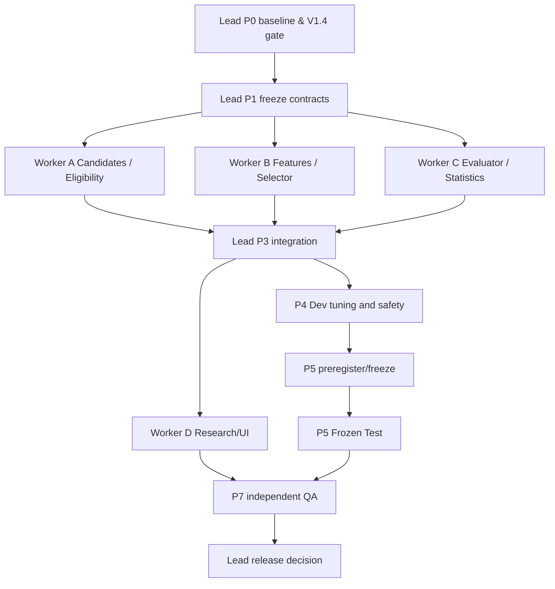

# IncidentLens V1.5 — CAES: Cost-Aware Active Evidence Investigation

**Multi-Agent Parallel Coding Implementation Plan / 面向 Codex 多 Coding Agent 并行落地的完整实施任务书**  
**项目正式名称：** IncidentLens: An Evidence-Driven Multi-Agent System for Software Incident Investigation  
**迭代版本：** V1.5 · Plan 1.0 · 2026-10-13  
**核心算法：** CAES（Cost-Aware Evidence Selection，成本感知的主动证据选择）  
**项目仓库：** https://github.com/celvelzel/IncidentLens  
**参考远程 HEAD：** `5f2cb2a2bbe1`（2026-10-13 已核对；Codex 必须以实际本地代码和提交记录为准）  
**前序文件：** `IncidentLens_V1.3_CodingAgent_Implementation_Plan.md`、`IncidentLens_V1.4_CodingAgent_Implementation_Plan.md`  
**状态：** *详细设计与预注册实验草案，不代表 V1.5 已经实现或取得性能提升。*  
**研究优先级：** 有效性证据与课程高分 > 明确可解释的算法创新 > 新组件数量与 UI 美化。  
**版本约束：** 保留 V1.2 的专业 Agent、Monitoring/Remediation、TaskManager/StopController、EvidenceBoard、Verifier/FinalizeGate；保留 V1.3 Provider Reliability；V1.4 IncidentBench 是本版本研究评价的标准入口。树状通信、生产修复、生产监控接入等全部暂缓。

> **一句话目标：** 不增加 LLM Agent，不推翻现有 LangGraph；在 Supervisor 的合法调查任务进入执行之前插入一个有证据、有预算约束、可关闭的行动评价与选择模块，使系统能优先执行*最可能区分竞争根因、且成本可接受*的调查，并通过冻结的、配对的、可消融的真实实验检验是否真正改善 RCA 质量—成本权衡。

---

# 0. MASTER PROMPT — 可直接交给 Codex Lead

```text
ROLE: Lead Coding Agent / Integrator, IncidentLens V1.5 (CAES).
REPOSITORY: https://github.com/celvelzel/IncidentLens
AUTHORITATIVE SPEC: The entire local file IncidentLens_V1.5_CodingAgent_Implementation_Plan.md.
READ THE WHOLE FILE before delegation. Do not merely summarize or re-plan it.

MISSION:
Incrementally implement a configurable, deterministic, traceable, cost-aware active
investigation policy (CAES), retaining the original dynamic Coordinator, agent
isolation, tool ACL, Evidence Board, Verifier, FinalizeGate, STOP, V1.3 reliability
runtime and V1.4 IncidentBench evaluator. Deliver executable ablations and an
honest empirical evaluation, NOT a preclaimed improvement.

START WITH P0:
- Inspect actual LOCAL git status, uncommitted work, git branch/log, interfaces and
  V1.3/V1.4 acceptance. Never reset, overwrite, commit or push unrelated changes.
- Check whether V1.4 IncidentBench, trusted splits, evaluator-only Oracle and
  baseline comparison genuinely exist and pass tests. If absent, implement CAES
  contracts/unit tests only; do NOT invent V1.4 paths or fake final research results.
- Run full current pytest, Ruff, legacy Mock RCA, V1.2 response Mock, V1.3 recovery
  smoke, V1.4 evaluator smoke when available. Preserve commands, logs and hashes.
- Freeze the public interfaces and writer ownership before starting subagents.

MANDATORY IMPLEMENTATION:
1. Add ActiveInvestigationPolicy with selection_policy=current_dynamic|active_evidence,
   default current_dynamic. The old behavior and CLI remain byte/behavior-compatible.
2. Add a deterministic CandidateGenerator working only on current visible state:
   Coordinator proposals, Verifier requested checks, open questions, eligible
   role/tool schemas, observed IDs and causal discriminators. NO private Oracle,
   scenario family/label, new tools, or root-cause answer lookup.
3. Add a deterministic, explainable ActionScorer/Selector: discriminative value,
   uncertainty gap coverage, grounding-gate contribution, cost, duplication,
   validity, ACL and remaining budget. Select 0–2 executable tasks per decision.
4. Preserve Supervisor FINALIZE/ABSTAIN decisions; CAES cannot force FINALIZE,
   forge evidence, bypass Verifier, override FinalizeGate or revive stopped runs.
5. Preserve runtime authoritative identity/task/attempt IDs and evidence provenance;
   all selected tasks pass the existing Pydantic, ToolRegistry, Merge and budget gates.
6. Explicitly count any additional candidate-generation/model request and ALL
   physical HTTP retries/repairs; no hidden model, token or latency cost.
7. Expose every eligible/rejected candidate, feature score, selected action,
   expected/actual cost and policy version in auditable trace/replay artifacts.
8. Implement comparisons B0=fixed-four, B1=current_dynamic, B2=CAES w/o Cost,
   B3=CAES w/o Discrimination, B4=Full CAES. Add B1-common-candidate control if
   needed to distinguish selector effect from candidate-generation effect.
9. Pre-register key outcomes and matched budgets/configs before inspecting Frozen
   Test. Compare on IncidentBench Dev, then untouched Frozen Test; do not tune
   using the Test Oracle or relabel failure as correct abstention.
10. Preserve legacy single/fixed/dynamic_no_verifier/full modes and V1.2 database
    paired ablation. Cache OFF for primary architecture/algorithm comparisons.
11. Use <=3 concurrent WRITE-capable Codex subagents in isolated git worktrees.
    Lead is sole owner of graph.py, shared schemas/config entrypoints and final
    integration. Independent QA is read-only. Worker changes must be gated.
12. Generate real measured artifacts, negative results and confidence intervals,
    or declare external-provider/Benchmark limitation without fabricated success.

HARD SECURITY/INTEGRITY:
- No oracle/private/test-label access from runtime candidate generation, scoring,
  prompts, Trace, cache, UI or agents; test this with adversarial fixtures.
- CAES decides ONLY investigation priorities, not root truth or evidence sufficiency.
- Do not weaken Pydantic, role ACL, schema/domain validation, FinalizeGate or STOP.
- No changes to production/inference behavior when policy is not enabled.
- No real remediation execution, Tree Communication, new LLM specialist agents or
  unrequested infrastructure deployment.
- Do not claim information-theoretic IG unless a calibrated conditional
  observation model is actually implemented and validated. V1.5 scores are
  heuristic Expected Discriminative Value by default.

PROCESS:
P0 audit and baseline -> P1 interface/protocol freeze -> P2 parallel independent
scoring/candidate/experiment workers -> P3 dry-run shadow and integration ->
P4 Dev tuning and leakage audit -> P5 preregistration+Frozen Test ->
P6 statistical analysis/UI docs -> P7 full QA/acceptance.

Final report must include real commands, exact code/data/prompt/protocol hashes,
changed files, subagent worktree/commit handoffs, full tests and regressions,
paired effects with uncertainty, all failed/missing runs, unknown usage, and
negative findings. Stop and report PENDING if an upstream Gate is missing.
DO NOT STOP AFTER WRITING A NEW PLAN: actually implement what can be implemented
safely, run verification and distinguish incomplete research phases.
```

---

# 1. 背景与基线事实（源自已检查的远程仓库）

## 1.1 实际存在的现有流程

远程 `src/incident_lens/orchestration/graph.py` 包含 `InvestigationRun`, `coordinate`, `investigate`, `dispatch`, `execute_task`, `merge`, `verify`, `finalize`, `remediate`, `stop`, `report`。其 `coordinate` 调用 `agents/service.py::decide()` 返回 `CoordinatorDecision`；动态路由允许每轮最多 2 个 `InvestigationTask`。`Investigate` 任务分为 LLM 工具规划、Role-scoped 只读查询、LLM 结构化分析，交由 Merge 统一校验后共享；Verifier 反馈给下一轮 Coordinator；`FinalizeGate` 负责最终根因接纳。原系统也支持 `single / fixed / dynamic_no_verifier / full` 评测变体。

V1.2 远程已包含：Database Investigator、手动/离线 Monitoring、`PLAN_ONLY` Remediation、TaskManager 的任务重试与统一 STOP/ACK；V1.3 远程 `5f2cb2a2bbe1` 又包含 Provider 错误分类、恢复/permit 契约和相应测试。**这些是远程源码与其文档记录，并不意味着已验证你本地未提交的修改。**

V1.3 的 `docs/acceptance/V1.3.md` 明确记载：工程回归与可靠性故障矩阵已实施，但同模型的真实 Seed Pilot **R0 与 R3 均为 0/3 技术完成**，因此真实 Provider 的提升与 RCA 准确率仍未获得正面证明。V1.5 的可比真实试验必须受这一可靠性限制约束；不要在大量失败样本上宣称算法更准。

## 1.2 V1.4 上游依赖

V1.4 计划提出新 `IncidentBench`、独立因果场景家族、公开证据/私有 Oracle 隔离、人工 Citation Review、配对统计和可冻结 Test 协议。**设计文件不等于已经实现。** V1.5 可以先研发评分函数与独立测试，但不能在 V1.4 实际存在、通过数据审核和协议冻结前，执行或声称完成正式 Frozen Test。

按 V1.4 计划建议的目录，其 Core 数据根为 `data/incidentbench_v1/rca/`，`Seed/Dev/Test` 分区及真实 `EvidenceProvider` 适配须由 P0 核对；**代码不应硬编码这个未必存在的路径**。标注仅在 Evaluation 完成后由 OracleStore 读取。旧 `data/` 及历史 `results/` 不能覆盖。

## 1.3 当前真实技术障碍

现有 `CoordinatorDecision` 已输出具体 1–2 个 Task，而不是一组 4–6 个待选择候选。直接在这 1–2 个 Task 上按分数排序通常**不会实现真正的主动调查**，因为其他潜在高价值任务不在候选池中。另一方面，如果只让 CAES 多调一次模型生成候选，而 B1 当前动态策略没有相同机会，算法效果又混杂了额外推理成本和信息量。

因此，本版必须同时建立：**可执行候选生成契约、同候选池的选择器消融、原版动态策略兼容对照、候选生成成本归因**。这是 V1.5 不能省略的核心研究设计。

## 1.4 现有安全与预算必须保留

- 工具层 `ToolRegistry` 负责角色 ACL、Run/Incident 绑定、实际证据查询台账和冻结后的禁止写入。
- `CallBudget`/V1.3 Permit/Recovery 负责真实请求和时间预算；V1.2 `TaskManager` 负责整个调查任务的有限恢复；两层不能重复收费或重复调用。
- `FinalizeGate` 不允许缺证据、未解决竞争假说、不匹配 Verifier 审核的根因通过；CAES 不得赋予自己终审权。
- Cache 核心对照默认关闭，保持权限校验；新的 Action Ranking 不能误用不同 run/incident 的历史私有状态。
- StopController 发出正常停止或异常终止；CAES 不得创建 STOP 后的新任务，迟到评分不得发布共享状态。

## 1.5 本文中哪些是“事实”、哪些是“设计”

| 内容 | 性质 |
| --- | --- |
| 远程版 LangGraph / 角色和工具、V1.2/V1.3 文件与验收记录 | 已检查的远程源码/文档事实 |
| V1.4 IncidentBench 文件树、Frozen Oracle 和人为审核流程 | 上版制定的设计与实施前提，Codex 需检查真实落地 |
| CAES 评分函数、CandidateGenerator、实验参数、P0–P7 任务 | **新增提案，尚未执行** |
| Full CAES 将减少成本、改善准确率、通过统计检验 | **待实验检验的假设，不是结论** |

---

# 2. 版本边界、研究问题和完成条件

## 2.1 In scope

1. 在 `full` 动态调查基础上新增一个**可开关**的 CAES 行动选择策略；旧 `current_dynamic` 必须保持默认。
2. 构建供 B1/B2/B3/B4 共用的合法候选任务生成器与一致、可重放的候选快照。
3. 实现独立评分特征：区分性、证据缺口覆盖、对最终证明的贡献、预计成本、重复/冗余、权限和预算可行性；对多个候选做多样性约束。
4. 与原 Coordinator 决策、TaskManager、V1.3 预算预留与 Restore、Merge/Verifier、FinalizeGate 进行最小集成。
5. 形成 Shadow Mode（仅观察/记录推荐，不改变决策）和 Enabled Mode（真实筛选任务）。
6. 在 V1.4 IncidentBench Dev 上研究模型与启发式策略；对未见 Frozen Test 开展预注册对照与统计分析。
7. 固定同一模型、公共数据、可查询工具、缓存、预算上限及运行配置，保留全部失败、停止与未知用量。
8. 输出研究表格、算法消融、错例、轨迹回放和可复现源代码/CLI。

## 2.2 Out of scope

- Tree Communication、分层 Supervisor、跨分支消息路由；**不需要为了 V1.5 先实现通信抽象**。
- 新增 LLM Agent、复杂 Graph 大重构、真实自动修复、容器化生产事故模拟、Prometheus/OpenTelemetry 接入。
- 新增外部向量数据库或长期个人记忆；不能为了候选排序重新部署 RAG。
- 使用隐藏测试标签、根因答案、故障家族名称或特殊 Incident ID 设计推荐规则。
- 训练强化学习/上下文 Bandit、向实际生产环境执行动作；此类议题仅可列 Future Work。
- 将启发式 CAES 直接宣传为校准后的 Expected Information Gain；本版默认没有已识别的概率分布。
- 本版本不可随意调整 V1.4 公开数据或冻结的评测答案以迎合算法结果。

## 2.3 可检验的研究假说

**H1（质量，主要）：** 相同模型、工具权限、公共案例与总预算下，B4 Full CAES 相比 B1 Current Dynamic 的 Grounded RCA Success Rate 不降低，或者能改善。  
**H2（成本，主要）：** B4 的每案例实际模型 Token 消耗/请求次数或工具调用相对 B1 降低。  
**H3（机制，次要）：** 在多个可辨别竞争假说、误导性证据、紧预算等特定情境中，CAES 的收益大于普通单根因场景。  
**H4（模块消融）：** B2/B3 的表现与 B4 不同，证明区分性和成本特征是否分别起作用。  

这些都是**可被证伪的假说**。如两组均未完成真实调查，结果应标注“Provider-limited / No interpretable quality effect”，不能通过改分母得到正面结论。

## 2.4 Done Definition（高门槛）

- 新旧策略配置开关真实改变合法任务的选择（至少一条可重放的 Dev/Mock 差异），但关闭时旧运行全回归保持不变。
- 全部候选、丢弃原因、最终评分、预算上下界可用纯函数/Mock 重算，不依赖隐藏 Prompt/CoT。
- 新评分不访问任何 private Oracle、Family Label、测试标注或 `ground_truth.json`，包括通过间接 import/配置/诊断日志。
- 新生成或改写的 Task 由同一既有类型约束、ACL 和 Merge 发布门禁校验。
- 运行时 STOP 之后无新候选执行、工具查询、任务创建、模型调用或污染报告。
- 新算法的额外 LLM/工具成本计入真实预算，具独立 `candidate_generation_calls` 计数。
- 必需 B1/B2/B3/B4（另有 B0、B1-common）可通过同一 Benchmark Runner 执行，且标签对应实际不同策略。
- 冻结测试前有可重算的 `protocol.json`、代码/Prompt/数据哈希、预注册主要指标和比较方向。
- 统计脚本能基于同事故配对、按 Scenario Family 聚类计算效应与区间；已完成案例选择偏差可检测。
- 旧版 Single/Fixed/No-Verifier/Full、V1.2 响应链路、V1.3 Provider 可靠性与 V1.4 Benchmark 全量回归通过。
- 真实模型实验确实运行，或保留 PENDING 与失败记录；不存在编造的“显著提升”。

---

# 3. 核心设计决策：改“动作选择”，不改“谁能认定根因”

## 3.1 V1.5 标准流程

```mermaid
flowchart TD
  I[Public Incident / optional Monitoring] --> C[Existing Supervisor / Coordinator]
  C -->|INVESTIGATE proposed| P[CandidateGenerator]
  V[Verifier requested checks] --> P
  H[Visible Evidence Board / open hypotheses / budget] --> P
  P --> F[Validity+ACL+dedup filtering]
  F --> S[ActionScorer and CAES Selector]
  S -->|0-2 admissible tasks| D[Existing Dispatch and TaskManager]
  D --> X[Logs / Metrics / Database / Changes]
  X --> M[Existing Merge and Evidence Board]
  M --> R[Existing Verifier]
  R --> C
  C -->|FINALIZE / ABSTAIN| G[Existing FinalizeGate / Stop paths]
  S -->|no safe action| C
  G --> O[Remediation PLAN_ONLY if accepted / STOP / Report]
```



注意这是**控制逻辑图**，不要求新增一个真实 LangGraph 节点。第一版优先在 `coordinate` 的 `INVESTIGATE` 分支中使用服务类/纯函数，而不是为小模块增加循环/并发节点。

## 3.2 Authority matrix

| 组件 | 能读 | 能写 | 不允许做的事 |
| --- | --- | --- | --- |
| 原 Coordinator | 已公开 Finding、Hypothesis、Reviewer 请求、预算、公共 Summary | 标准 CoordinatorDecision | 不得凭私有真值执行路由 |
| CandidateGenerator | Coordinator 提议、当前可见状态、公开工具 Schema、ACL、候选模板 | 局部 CandidateSnapshot | 不直接访问 EvidenceProvider 私有文件，不调用工具，不作终审 |
| ActionScorer | 经过校验的候选、公开状态/预算估计 | 局部排序与 Score Breakdown | 不伪造证据，不改 Hypothesis 状态 |
| Selector | 合法评分、政策、运行时允许槽位 | 被选择的 0–2 个 Task 草案 | 不越权、不执行修复、不标注根因 |
| Lead integration | Selector 输出，原运行态 | 由 runtime 签发并合并 Task | 不绕过 TaskManager / StopController |
| Verifier/FinalizeGate | 原授权共享证据 | 审核和根因门禁 | 保持原实现与接受标准 |
| Evaluator-only OracleStore | 运行完成的 Report、私有标签 | 结果分数 | 永远不进入运行时 Scheduler |

## 3.3 统一身份和事件语义

- `candidate_id` 是**一次决策的局部候选标识**；`task_id` 是被批准执行时才签发/承认的任务标识。候选不能自行决定 `run_id/incident_id/AgentContext` 的值。
- `decision_id` 和 `evidence_snapshot_sha256` 将选择绑定到一次可见 Board；在等待阶段若状态版本改变，必须重新评分或取消旧决策。
- 不改变原 `InvestigationTask` 的必填业务含义、工具参数、`expected_discriminator`。只做明确允许的 Runtime-owned ID 绑定。
- 每轮最多选择 2 个任务，禁止“为省钱选择 0 个任务却继续空转”：0 个可执行候选必须走原来安全的 `ABSTAIN/REPLAN` 路径，受 max_rounds/stop 限制。
- CAES 不得拦截/替换 `FINALIZE` 或 `ABSTAIN` 的业务判断；若策略拒绝了唯一必需的补查，要记录后返回既有 Coordinator 的安全退出逻辑。

## 3.4 不可变性与可重放

`CandidateSnapshot` 只在本次决策生成，可在 trace 存储脱敏后的必要特征与哈希；它是审计产物，不是共享 Evidence Board 的新事实。不得缓存对多轮状态敏感的最优行动为语义缓存条目。存档必须足以在不调用模型情况下复算排序。

---

# 4. P0：本地仓库审计和 V1.4 可用性 Gate

## 4.1 Lead 必须先执行的核对

```powershell
# 示例：在用户现有本地 IncidentLens 仓库执行；不可盲目 reset/checkout

git status --short
git branch --show-current
git log -8 --oneline
git diff --stat

.venv\Scripts\python.exe -m pytest -q
.venv\Scripts\python.exe -m ruff check src tests scripts
.venv\Scripts\python.exe -m ruff format --check src tests scripts
.venv\Scripts\python.exe -m incident_lens.cli run --case incident_001 --provider mock --cache-mode off --out results/v15/p0-legacy-UNIQUE
.venv\Scripts\python.exe -m incident_lens.cli run --case incident_037 --provider mock --config configs/incident-response.yaml --out results/v15/p0-response-UNIQUE
```

这些是**建议的本地执行命令**，并非本文件作者已经运行过。Output 路径必须唯一，避免覆盖已有 artefacts。若 Windows Python 路径或测试命令有变化，Codex 应记录实际替代命令。

另外检查：`src/incident_lens/orchestration/graph.py`、`agents/service.py`、`schemas/contracts.py`、`orchestration/{budget,permits,recovery,runtime}.py`、`evaluation/runner.py`、`docs/acceptance/V1.3.md`、实际 V1.4 `incidentbench/`、benchmark CLI 和 Oracle adapter。

## 4.2 V1.4 Gate（强制显式分支）

| 前序情况 | V1.5 允许的工作 | 禁止的声明 |
| --- | --- | --- |
| V1.4 尚未实施 | CAES 合同、纯函数、Old Mock fixture、工具/STOP 测试、实验脚手架 | “已在 IncidentBench 完成系统提升” |
| V1.4 数据已构建，评测仍未验收 | Dev dry-run 和数据完整性检查；修复 adapter 兼容 | “正式 Frozen Test 已完成” |
| V1.4 Dev/Oracle/Runner 可用，Test 尚未冻结 | Dev 调参、消融设计、完整 protocol 准备 | “盲测试验证了 CAES” |
| V1.4 正式 Test 已冻结且可独立评分 | 预注册后锁定算法，执行正式配对 Frozen Test | 使用 Test 真值重新调整阈值再称同一 Test 未见 |
| 真实 Provider 完成率极低 | Mock/故障注入/Shadow 报告；有限兼容性试验 | “Agent 策略提高了真实 RCA 准确率” |

**P0 出口条件：** 输出 `docs/v1.5/p0-repository-audit.md`、原测试日志、风险登记、V1.4 Gate 判定、真实本地提交 SHA、Plan 中建议路径的实际映射。没有上游 Gate 就标记 `BLOCKED/PENDING`，不要无依据创建“最终实验结果”。

---
# 5. P1：公共接口与 Schema 冻结（Lead 唯一 Owner）

## 5.1 建议的目录结构（不是现成路径）

```text
src/incident_lens/
├── orchestration/
│   ├── graph.py                    # 现有，Lead 仅修改 INVESTIGATE 分支集成点
│   ├── budget.py                   # 现有 V1.3，权威预算，尽量只读
│   ├── permits.py                  # 现有 V1.3，所有请求统一使用
│   ├── runtime.py                  # 现有 V1.2，TaskManager/STOP 不重写
│   ├── guards.py                   # 现有根因接受门禁，保持业务规则
│   └── active_investigation/
│       ├── __init__.py
│       ├── contracts.py            # CAES DTO / Strategy protocol
│       ├── candidate_generator.py  # Worker A
│       ├── eligibility.py          # Worker A
│       ├── feature_extractors.py   # Worker B
│       ├── cost_estimator.py       # Worker B
│       ├── selector.py             # Worker B
│       ├── policy.py               # Lead 负责 glue
│       └── trace.py                # Lead/Worker D 明确写锁
├── evaluation/
│   └── active_evidence/
│       ├── variants.py             # Worker C
│       ├── runner.py               # Worker C，新实验，不覆盖原 evaluator
│       ├── metrics.py              # Worker C
│       ├── statistics.py           # Worker C，尽量复用 V1.4 statistics
│       └── replay.py               # Worker C，已有 trace 离线复算
├── schemas/
│   └── [existing files]           # Lead 独占，优先不新增必填字段
scripts/
├── run_v15_active_eval.py         # Worker C
├── analyze_v15_active.py          # Worker C
└── replay_v15_selection.py        # Worker C
configs/
└── active-investigation.example.yaml   # Lead

docs/v1.5/
├── p0-repository-audit.md
├── contract-freeze.md
├── algorithm-spec.md
├── fairness-protocol.md
├── experiment-preregistration.md
├── dev-results.md
├── qa-review.md
├── release-report.md
└── future-work.md

tests/active_investigation/
├── test_candidate_contracts.py
├── test_candidate_generation.py
├── test_candidate_eligibility.py
├── test_feature_extraction.py
├── test_cost_estimation.py
├── test_selector.py
├── test_shadow.py
├── test_graph_integration.py
├── test_runtime_safety.py
├── test_no_oracle_access.py
├── test_score_replay.py
├── test_ablations.py
└── test_experiment_fairness.py
```

不要求恰好创建所有文件；若本地实现已有同等模块则优先沿用、记录映射、避免重复模块。**不要只创建空壳和 import 就声称完成。**

## 5.2 运行时 DTO 草案

以下是接口草案，具体字段/类型要与本地已有 `StrictModel`, `InvestigationTask`, `TraceEvent`, `WorkflowOptions` 对齐并由 Lead 在 P1 冻结。**Schema 仅表达候选，不携带可执行权限。**

```python
from typing import Literal, Protocol
from pydantic import BaseModel, ConfigDict, Field

CandidateOrigin = Literal[
    "coordinator_proposal", "verifier_requested_check", "public_task_template"
]
PolicyName = Literal[
    "current_dynamic", "active_evidence", "active_no_cost",
    "active_no_discrimination", "first_eligible"
]

class CandidateAction(BaseModel):
    model_config = ConfigDict(extra="forbid", frozen=True)
    candidate_id: str
    decision_id: str
    incident_id: str
    run_id: str
    evidence_snapshot_sha256: str
    origin: CandidateOrigin
    proposed_role: Literal["logs", "metrics", "database", "changes"]
    question: str
    expected_discriminator: str
    filters: dict  # optional-compatible with InvestigationTask.filters
    allowed_tools: tuple[str, ...]
    existing_task_id: str | None = None
    target_hypothesis_ids: tuple[str, ...] = ()
    prerequisites: tuple[str, ...] = ()

class CandidateFeatures(BaseModel):
    model_config = ConfigDict(extra="forbid", frozen=True)
    discrimination: float = Field(ge=0, le=1)
    gap_coverage: float = Field(ge=0, le=1)
    gate_contribution: float = Field(ge=0, le=1)
    redundancy: float = Field(ge=0, le=1)
    estimated_calls: int = Field(ge=0)
    estimated_tokens: int | None = Field(default=None, ge=0)
    estimated_latency_ms: float | None = Field(default=None, ge=0)
    estimate_source: str

class CandidateAssessment(BaseModel):
    model_config = ConfigDict(extra="forbid", frozen=True)
    candidate_id: str
    eligibility: Literal["ELIGIBLE", "REJECTED"]
    reject_reason: str | None = None
    features: CandidateFeatures | None = None
    score: float | None = None
    rank: int | None = None

class SelectionDecision(BaseModel):
    model_config = ConfigDict(extra="forbid", frozen=True)
    decision_id: str
    policy: PolicyName
    policy_version: str
    evidence_snapshot_sha256: str
    selected_candidate_ids: tuple[str, ...]
    assessments: tuple[CandidateAssessment, ...]
    budget_snapshot_digest: str
    fallback_reason: str | None = None

class CandidateGenerator(Protocol):
    def generate(self, visible_state, coordinator_proposals, role_acl) -> tuple[CandidateAction, ...]: ...

class InvestigationSelector(Protocol):
    def select(self, candidates, visible_state, budget_view, policy_config) -> SelectionDecision: ...
```

建议将实例字段中的 `filters` 设计为规范化、严格验证的字典或受限模型；不可把任意 Python 对象、callback、FileHandle 或私有 EvidenceProvider 塞入 DTO。`CandidateFeatures` 的预估值不是实际运行事实，Trace 必须明确其性质。

## 5.3 Runtime-owned Task materialization

建议一个单独的、安全的适配函数：

```python
def materialize_selected_tasks(
    selection: SelectionDecision,
    approved_candidates: tuple[CandidateAction, ...],
    *,
    existing_task_ids: set[str],
    runtime_identity,
) -> list[InvestigationTask]:
    """Implemented by Lead; does NOT call tools or read private data."""
    ...
```

要求：

1. 在函数外由运行时确认 `decision_id/run_id/incident_id/evidence_hash` 与当前 state 完全匹配；不接受来自模型的 authority 覆盖。
2. 角色仍是原合法调查角色，任务最多两个；`allowed_tools` 严格为 Role ACL 与 Task 契约交集（**不允许从 Candidate 自行扩大工具权限**）。
3. `task_id` 由运行时产生或接受已校验且未重复的 Coordinator ID；生成的 deterministic 标识包含当前 run/round/suffix，且不与历史任务碰撞。
4. 拒绝同一 snapshot 下已经完成、失败且不可重试的重复行动；预算/STOP 检查必须在 materialization 和真正 dispatch 两处做（TOCTOU 防护）。
5. 只在正式选择后加入 `state.tasks`、`state.decisions[-1].assignments` 并调用 TaskManager.assign；Shadow Mode 永远不能修改这些内容。
6. 不能因为评分决定给 Finding 填 `supported` 或替 Verifier 产生审核；所有后续执行依然通过原 `investigate→merge→verify→finalize`。

## 5.4 配置草案（默认不改变旧行为）

```yaml
investigation:
  selection_policy: current_dynamic   # current_dynamic | active_evidence
  shadow_enabled: false               # 仅记录推荐，不改变执行
  active_evidence:
    policy_version: caes-v1
    candidate_pool_limit: 6
    max_selected_tasks: 2
    include_coordinator_proposals: true
    include_verifier_requested_checks: true
    include_public_templates: true
    use_extra_candidate_llm_call: false  # V1.5 默认 MUST be false
    diversity_penalty: 0.15
    redundancy_hard_limit: 0.95
    min_estimated_verification_requests: 1
    score_weights:
      discrimination: 0.40
      gap_coverage: 0.30
      gate_contribution: 0.30
      redundancy: 0.30
    estimated_cost_weights:
      llm_requests: 1.0
      tool_calls: 0.25
      tokens: 0.0               # 若 Token 估计未校准，先关闭该项
      latency: 0.0              # 若真实时延不稳定，不引入虚假精度
```

上面是**开发初始默认值，不是已经验证的最优权重**。只在 V1.4 Development 上调参，最终 Frozen Test 固定权重与版本。`current_dynamic` 的开关必须是透明透传；配置缺省时旧代码不可运行 CAES 的额外分支或 LLM 请求。V1.3 Provider/Recovery config、V1.2 workflow profile 等仍独立配置。

## 5.5 正常行为与异常行为契约

| 状态 | CAES 应采取的行为 |
| --- | --- |
| Coordinator `FINALIZE` | 不调用候选生成与排序，保持原接受门禁 |
| Coordinator `ABSTAIN` | 不强行启动新调查，保留原原因及 STOP |
| Coordinator `INVESTIGATE` + 合法候选 | 仅在 enabled 模式执行选择结果 |
| 候选被拒绝 | 记录稳定 reject_code，不静默执行 |
| 所有候选不可执行 | 只允许有限退回原已合法 Coordinator 任务，或明确 ABSTAIN，禁止无限重规划 |
| 本轮没有竞争假说 | 使用预定义的冷启动策略收集基础证据，不伪造置信度 |
| Verifier 新提出 Check | 在下一轮进入候选池；执行由权限/预算决定，不等于必选 |
| 证据 hash 更新 | 旧候选分数失效，在新 Board 上重新生成或评分 |
| Budget 不足以留下 Verifier 最低额度 | 拒绝昂贵任务；保留原安全停止路径，不能越过总预算 |
| STOP / deadline exceeded | 无更多 Task/Tool/LLM 创建，已开始评分结果失效 |
| 未知成本估计 | 使用预注册保守回退或拒绝，不当作 0 |

**P1 Gate：** `contracts.py` 可导出/roundtrip、错误字段拒绝、配置关闭与旧版完全一致，至少 10 项基本契约测试通过；Lead 将 JSON Schema/接口、测试与 Owner 映射冻结到 `docs/v1.5/contract-freeze.md`。

---

# 6. WP-A — Candidate Generation & Eligibility（Worker A）

**工作范围：** `orchestration/active_investigation/{candidate_generator,eligibility}.py` + `tests/active_investigation/test_candidate*`；不修改 `graph.py`、共享 `schemas/contracts.py`、V1.4 Oracle / Case builder。

## 6.1 三类候选来源

| 来源 | 内容 | 必须遵守 |
| --- | --- | --- |
| `coordinator_proposal` | 原 Coordinator 在此次决策提出的 1–2 个 Task | 校验 identity/role/ACL；原任务排序可用于 B1-common 对照 |
| `verifier_requested_check` | 原 Reviewer 明确提出的补查任务 | 读取已公开的 `state.requested_checks`，保留目标与 discriminator，不触碰私有评审隐藏内容 |
| `public_task_template` | 面向四类专业角色的只读调查选项 | 仅从公开 Summary/可见 Hypothesis/合法 Role ACL 派生；有限个、可校验、不可通过标签反推答案 |

**默认不额外调用 LLM 生成候选。** 如果已有 Coordinator 启动一个逻辑生成请求，则这些候选完全来自该请求已产生的决策和公开状态；模板只是确定性辅助，不增加 Provider 请求。每轮生成时间和额外 CPU 开销需记录。候选模板不是“先看私有根因，再列正确 Tool”的答案查表。

## 6.2 有意义的候选模板目录

建议最初只为现有四类调查工具提供一般性模板：

- Logs：检查错误开始时间、上游/下游传播、关联请求与重试信息。
- Metrics：检查依赖健康、错误率、时延、资源饱和与相关服务变化。
- Database：检查连接数与容量、锁等待、慢查询和会话状态。
- Changes：比较事故前后的部署、配置差异与变更时间线。

每个模板必须先验证本事故的 `services`、合法工具与时间窗口。问句应具体可执行，禁止“全面检查所有系统”这类无边界任务。首轮可以派广义探查，但分辨能力不明时不能赋予虚高评分。给定不同 incident 应使用当前公共 Summary 的正确时间窗口，而不是硬编码某个实验案例的时间戳。

## 6.3 候选规范化、去重、规模控制

**Canonical signature** 建议组合：

```text
role + normalized objective/task_type + canonical filters
+ expected_discriminator + target_hypothesis_ids + evidence_snapshot_sha256
```

- 文本同义问题的轻量归一化仅用于消除明显重复；不能简单合并否定句、数值约束不同或过滤窗口不同的候选。
- 相同签名多来源冲突时，保留候选来源列表或稳定优先级：Verifier request > Coordinator proposal > template；不丢弃关键的 requested discriminator。
- 上限例如每轮 6 个不同候选；超过时按**固定的来源优先级 + stable signature** 裁剪，而不是用隐藏真实根因排序。
- 任何一项 Check 与已完成工具调用等价且证据未变化，必须打 `ALREADY_CHECKED_UNCHANGED`；同类工作若可查询不同时间窗口则应明确解释。
- 必须生成稳定、可重放的 Candidate ID，禁止使用未固定 RNG 影响排序。

## 6.4 eligibility 检查，必须早于打分

建议拒绝原因枚举：

```text
FORBIDDEN_ROLE
FORBIDDEN_TOOL
INVALID_TOOL_SCHEMA
INVALID_SERVICE
INVALID_TIME_WINDOW
STALE_EVIDENCE_SNAPSHOT
DUPLICATE_COMPLETED_CHECK
UNSATISFIED_PREREQUISITE
UNSUPPORTED_QUESTION
INSUFFICIENT_TOOL_BUDGET
INSUFFICIENT_LLM_BUDGET
INSUFFICIENT_WALL_BUDGET
STOPPED
```

**边界条件：** `expected_discriminator` 必须是对*未来可观测结果*的说明，不能写成“检查私有真值是否为 postgres_lock_contention”；不能预先引用还没有查询的 Evidence ID；候选也不能代替现有角色真实执行 Tool。

## 6.5 四类 Agent 的隔离依然生效

CandidateGenerator 只产生 `InvestigationTask` 草案，真正执行时仍通过 `registry.create_context(role)` + ToolRegistry。若向 Metrics 派 Database 的专项操作，必须符合当前 `database_equivalent_tools` 明确配置；不能因为 CAES 喜欢数据库证据而越权修改工具 allowlist。

## 6.6 Worker A 独立测试 Gate

至少覆盖：

1. 从 Coordinator、Verifier、公共模板同时生成候选，来源正确。
2. 空 Hypotheses 时可生成有限的初探候选。
3. 同一状态反复生成签名/排序一致。
4. 同一问题、过滤窗口或否定含义变化不会错误合并。
5. 未在 ACL 的工具拒绝；伪造 role 拒绝。
6. 服务不在 public Summary、时间窗口非法、下游阶段已 STOP 时拒绝。
7. 已完成同一快照检查被识别为冗余。
8. 未查询的 Evidence ID 不能进入 candidate 作为已发现证据。
9. 模板不可读取 `private/ground_truth.json`、V1.4 OracleStore、split/family tags。
10. 最多 6 候选上限及稳定截断规则正确。

**交付：** 实现 + ≥10 有独立断言的测试 + `docs/v1.5/wp-a-handoff.md`，明确边缘行为、相同候选快照的 replay 样例与未解决问题。

---
# 7. WP-B — Feature Extraction, Cost Estimation & CAES Selector（Worker B）

**工作范围：** `orchestration/active_investigation/{feature_extractors,cost_estimator,selector}.py`、对应 `tests/active_investigation/test_{feature_extraction,cost_estimation,selector}.py`；不修改 Graph、Pydantic 公共 Report、实验评分器。

## 7.1 先定义可解释、可观测的特征

四个正负特征：

| Feature | 范围 | 推荐计算方法（均只使用运行时公开状态） | 必须避免的错误 |
| --- | --- | --- | --- |
| `D` discrimination | [0,1] | 该检查是否针对当前至少两个**可见且未排除**竞争 Hypotheses 的不同可观测预测；若预测不同且检查能观察到相关现象，则值高 | 不可直接读取真实根因；不能仅看提到“Database”就判定 DB 为真 |
| `U` uncertainty gap | [0,1] | Verifier requested checks、`state.open_questions`、候选有无弥补尚缺信息；仅按可见差异标注 | 不把“模型自信程度”当作已校准概率 |
| `G` gate contribution | [0,1] | 是否可补齐原 FinalizeGate 的*缺失证据类别/来源/区分性观测*；根据既有 `grounding_errors` 可解释映射 | 不运行假的 finalize，也不把结果直接标记充分 |
| `R` redundancy | [0,1] | 与本次已成功执行的 Check、已查询证据快照和其他候选重叠的程度 | 检查时间窗口不同或新证据出现时，不能简单标记重复 |

实现中必须区分 **observed vs predicted**：`D/U/G` 均是“检查可能带来价值”的估计，在工具调用之前不能知道实际会返回什么。`G` 是候选对门禁缺口的潜在贡献，不是有权限修改 FinalizeGate。

首轮无竞争假说时，使用轻量 `bootstrap_strategy`，对 Logs/Metrics/Database/Changes 做有限通用筛查，评分中 `D` 不得凭空设为 1；可优先考虑已知尚缺的不同信息来源。

### 示例：竞争假说下的区分性

可见 Hypotheses：H1=`postgres_connection_exhaustion`，H2=`backend_pool_config_regression`。某 Candidate=`Database.connections`，可能观察 DB 自身容量；另一个 Candidate=`Changes.config_diff`，可能观察 Backend 配置变动。这两类检查有明确不同的**预期反证作用**，应获得比第三次读取相同 Backend Error Log 更高的差异性评分。但“数据库指标正常”只是否定 H1 的部分证据，不是自动证明 H2。

### 负面测试

- 两个 Hypotheses 的可观测预测没有区别：不能伪造高 `D`。
- Candidate 指向未授权工具：不许因高预期价值而通过 eligibility。
- 同一日志重复查阅：惩罚冗余，但对真正新增时间窗口的日志不能硬拒绝。
- Verifier 指出关键未解矛盾：相应 Check 应明显提高 `U`，但并非无条件覆盖 ACL/预算。

## 7.2 预计成本的严格语义

**禁止用未来工具输出或真实最终消耗去“预测”当前动作。** 预计成本只能由 Development 上已知的历史统计、工具类型、当前模型参数和当前预算视图计算：

```python
class CostEstimate(BaseModel):
    estimated_model_requests: int
    estimated_tool_calls: int
    estimated_tokens: int | None
    estimated_latency_ms: float | None
    source: Literal["dev_aggregate", "fixed_fallback", "not_calibrated"]
    uncertainty_note: str | None = None
```

第一版推荐：

- 估算一次完整 Investigator Task 需要 `plan_tools` + `analyze` 约 **2 次逻辑模型调用**；这不是对 HTTP 物理重试数量的承诺，最终必须保守计入 V1.3 recovery 可能产生的物理请求。
- 预计 Tool 访问数量从原 `InvestigatorPlan.calls` 上限、工具/任务模板 Dev 统计推断，不能将所有任务都写成 0。
- 如果真实 Token 统计不完整，`estimated_tokens = None`，不可填 0、也不可在消融中以“零成本”优待未知任务。
- 预计时延可来自 Dev 统计，但受外部 Provider 波动影响，必须保留不确定性；若估计不足，禁用该项权重。
- `Verifier` 余量应预留**决策/审查所需的未来请求**，而不只是当前 Task；对应 V1.3 `RecoveryConfig.reserve_verifier_requests` 的实现需由 Lead 审核，避免双重预留和死锁。
- `Monitoring` 与 `Remediation` 的开销在主要 RCA 算法试验中建议统一关闭；如做 Response 扩展试验，额外开销全部纳入 End-to-End 指标。

## 7.3 初始可解释公式

推荐固定一套归一化、有限数值、不可出现除零错误的评分：

\[
V(a)=w_D D(a)+w_U U(a)+w_G G(a)-w_R R(a)
\]

\[
S(a)=\frac{V(a)}{\epsilon+\widehat{C}(a)}
\]

其中 `estimated_cost` 先用**统一加权 request/tool 单位**：

\[
\widehat{C}(a)=\alpha \widehat{N}_{LLM}(a)+\beta \widehat{N}_{tool}(a)
\]

可选 Token/Latency 维度仅在 Dev 校准后启用，避免同一成本项双重计算。首版示例值：`w_D=.40, w_U=.30, w_G=.30, w_R=.30, alpha=1, beta=.25, epsilon=.01`。**这些是启发式初始参数，不是科研结果。** 不得在 Frozen Test 上根据准确率调权重。

当 `V(a)` 为负时，可允许不执行该候选，并考虑其他候选或安全退出；不要强行选择负价值任务来凑满两个席位。但也不能无限空转：返回明确 `NO_USEFUL_ACTION` 并由原 Coordinator/STOP 逻辑收束。

### B2/B3 消融的明确操作语义

- B2 `active_no_cost`：保留同一 CandidateGenerator 和 `D/U/G/R`，选择时将所有通过 eligibility 的 candidate 的成本项设为同一常数，**但硬预算检查仍必须执行**；不是允许无限制消费。
- B3 `active_no_discrimination`：将 `w_D=0`，其他 `U/G/R/C` 不变；如果 G 本身无意中使用相同判据，需在实验说明中区分重叠，并对 Feature Contribution 提交审计。
- B4 `active_evidence`：使用 `D/U/G/R/C` 完整策略。
- B1-common `first_eligible`：同一 CandidateSnapshot，同一成本计算/硬预算检查，但按预注册原始候选顺序/Coordinator 首选处理，不依据 CAES 分数重排。

B1-common 是算法归因的关键：它能最大限度隔离“**同候选集不同排序器**”的效果。B1 raw-current 则是部署价值的核心现实基线；报告两者，不可互相偷换。

## 7.4 一次选择最多两个任务，并考虑多样性

建议 Selector 流程：

1. 按 `S(a)` 倒序排序；同分按稳定 candidate_id 打破平局。
2. 选中第一个后，对后续候选施加 pairwise overlap penalty。两个任务完全重复时，不要同时派发；两个任务收集独立来源支持同一候选原因可以互补。
3. 检查合计预计 Tool/LLM/Wall 预算和已经为 Verifier 留出的额度，而不是只检查单任务可行。
4. 最多两个，允许只选一个；`min_score` 和 `max_selected_tasks` 可调，但 Dev 调参后冻结。
5. `selected_candidate_ids` 是评分器输出；原运行时材料化合法 Task 并提交 TaskManager。

建议可复现伪代码：

```python
def select(candidate_snapshot, visible_state, budget, config):
    assert not visible_state.stopped
    assessments = []
    for candidate in candidate_snapshot:
        eligibility = check_eligibility(candidate, visible_state, budget)
        if not eligibility.ok:
            assessments.append(reject(candidate, eligibility.reason))
            continue
        features = extract_features(candidate, visible_state)
        estimate = estimate_cost(candidate, visible_state, config.dev_cost_table)
        score = compute_score(features, estimate, config.policy)
        assessments.append(accept(candidate, features, score))
    ordered = stable_sort(assessments)
    selected = []
    for candidate in ordered:
        if len(selected) == config.max_selected_tasks:
            break
        if candidate.score is None or candidate.score < config.min_score:
            continue
        if would_duplicate_selected(candidate, selected):
            continue
        if not fits_remaining_budget(candidate, selected, budget):
            continue
        selected.append(candidate)
    return make_selection(selected, assessments, visible_state.snapshot_hash)
```

实际实现需要避免过度调用 `getattr()` 动态推断权限；使用显式 Schema 与 Enum。被拒绝也必须留审计，不要误把“无可选动作”计为正常正确弃权。

## 7.5 选择逻辑必须支持观测与重放

至少输出：`policy_version`, `candidate_origin`, `role`, `question_hash`（可选脱敏正文）, `filters`, `feature_values`, `cost_estimate`, `rank`, `selected`, `reject_code`, `board_digest`, `budget_digest`。新事件建议 `CANDIDATES_GENERATED`, `ACTION_SCORED`, `ACTION_SELECTED`, `ACTION_POLICY_FALLBACK`。

事件不能包含私有 Oracle、隐藏根因标签、模型 Chain-of-Thought、密钥或其他 Agent 的私有未发布状态。Saved Trace Replay 不应重新调用 Provider/Tool 或重新决定策略；离线验证脚本可以用保存的候选评分特征再次复算排序，但不能改变已保存报告。

## 7.6 Worker B 单测 Gate

至少覆盖：

1. 每个特征范围、有限值、没有 NaN/Inf；固定输入得到稳定分数。
2. 假说可分辨时，具有有效 discriminator 的候选优于重复日志（在预设计 fixture 中）。
3. 同样成本，不同区分性导致不同排序；无歧义时区分性估计不虚高。
4. 同样预期价值，已校准成本变化可以改变排序。
5. 未知 Token/Latency 不当 0；不可用成本模型使用保守 fallback。
6. 两个高相似任务不会都被选，互补调查可以被选。
7. 验证保留额度阻止占用最后必要的 Verifier 请求。
8. B2/B3/B4 在构造场景上确实选择不同任务，不能只在 trace 改标签。
9. 评分器不调用工具、Provider、Oracle，也不更改 Evidence Board。
10. policy 关闭时不会创建额外 scorer 对象或增加 LLM 请求。

**交付：** 可独立运行纯函数实现 + ≥10 专项测试 + `docs/v1.5/wp-b-handoff.md`，包含 Dev 校准方法和所有权边界。

---

# 8. WP-C — Controlled Experiments, Metrics & Statistics（Worker C）

**工作范围：** `evaluation/active_evidence/*`、`scripts/run_v15_active_eval.py`、`scripts/analyze_v15_active.py`、`scripts/replay_v15_selection.py`、`tests/active_investigation/test_ablations.py`、`test_experiment_fairness.py`；不得修改原 `evaluation/metrics.py` 和 `runner.py` 的旧评分规则，除非 Lead 批准后负责最小兼容扩展。

## 8.1 实验条件矩阵，绝对不能仅靠改名字

| ID | 实际策略 | 主要作用 | 在 Experiment Runner 中必须对应的真实代码 |
| --- | --- | --- | --- |
| **B0** `fixed_four_equivalent_tools` | V1.4 固定四专家，无 CAES | 静态参照 | V1.4 已验证 `fixed_four`；缺失则标 `PENDING` 而非使用旧 fixed3 偷换 |
| **B1** `current_dynamic` | 原 Coordinator 的 1–2 Task，无 CAES | 主要现实基线 | 新旧版本同一问题上保留原实际行为 |
| **B1c** `common_candidates_first` | 新通用 CandidateGenerator + 稳定先选策略 | 排除“候选来源不同”混杂 | 与 B2/B3/B4 相同 Candidate Pool，但不依据 CAES Score |
| **B2** `active_no_cost` | CAES without cost weighting | 成本项消融 | 保留 D/U/G/R，不使用 Cost 排序；保留硬预算 |
| **B3** `active_no_discrimination` | CAES without D | 区分性项消融 | 移除 D 的排名贡献，不删权限/预算/必要检查 |
| **B4** `active_evidence` | Full CAES | 主研究方法 | 全面运行候选产生/评分/选择/执行 |

B0 固定四专家可能一次分配四个任务，旧协调器每轮最多两个。这里的 V1.4 fixed-four 对照是**固定批次/分轮的明确设计**，其并发度不同的潜在影响必须记录；不可悄悄修改 B1–B4 的最大并发约束。B0 是辅助参照，算法归因重点是 B1c 对 B4。

**重要：** 即使 B1 是原生动态调度，V1.5 引入候选模板可能令 B4 的可选集扩大。主结果必须分别呈现：

1. `B4 - B1`：整体部署策略改变的实际效果（可能同时包含候选集和排序收益）。
2. `B4 - B1c`：在通用候选池一致下，Selector 特征/排序造成的增量效果（更适合算法归因）。
3. `B4 - B2`, `B4 - B3`：成本维度与区分性维度消融（有交互时要谨慎解读）。

不能只展示 B4 相对 B0 获胜，而不展示 B1/B1c。

## 8.2 公平性冻结项

- 同一个公开 Incident、证据快照和相同 V1.4 案例；不允许按 Variant 生成不同噪声与线索。
- 同一个 real provider/model、temperature、response format、Prompt/Schema 版本、V1.3 Retry/Recovery 策略、工具 ACL、可见数据和预算上限。
- Cache OFF；不读取历史语义缓存；同一个 `EvidenceProvider` 公共数据修订哈希。
- 相同类型的 Specialist Agents 与根因门禁；`Verifier`/`FinalizeGate` 条件在 B1c/B2/B3/B4 上保持一致。
- 对当前 RCA 主要算法实验，固定 `workflow.profile=legacy_rca`、Monitoring 不启用、Remediation 不运行；V1.2 Response 链另做 Smoke/Secondary，不混入主比较。
- 同样的 `max_rounds`, `max_tool_calls`, `max_llm_calls`, `max_wall_seconds`, `max_tokens`（若可硬计量），以及额外候选生成调用预算。
- 真实请求修复次数、Provider HTTP 重试/取消必须计入全部组，绝不只计算 logical Agent 请求。
- 真实 Provider 组建议初次试验 `jobs=1`；正式可选择预注册小并发，但不可因结果对某一个组改变配置。
- 相同候选生成规则、候选上限与随机处理顺序（B1c/B2/B3/B4），不同 Policy 只改变评分函数/选择行为。
- 同样的 StopController、失败分母和 Oracle 只在完成之后读取的时序。

### 编排优先选择最小改动

如果 V1.4 已有 Benchmark Runner，应让 `ActiveEvidenceRunner` 作为新配置/包装层调用现有 `run_investigation`，不要重复实现 Oracle load、trace 持久化、CSV 导出和源哈希。额外 `policy` 必须作为运行参数传入，不可通过环境变量在并行过程中静默改变。

## 8.3 Benchmark Cohorts

建议使用 V1.4 已锁定的四类核心 RCA 子集，并按家族汇总：

| Cohort | 预期可研究的问题 | 备注 |
| --- | --- | --- |
| Ordinary / Identifiable | 一般场景下 CAES 有无额外收益 | 防止只在对抗案例上优化 |
| Misleading / Identifiable | 能否减少被 decoy 带偏 | 记录反证触发比例 |
| Counterfactual pairs | 区分性证据变化是否改变行动与根因 | 同一 pair 必须配对且归同一 family |
| Insufficient / Unidentifiable | 能否高质量弃权并避免无意义查询 | 正确弃权单独统计，不计根因准确率 |
| Database-focused | Database 专项选择是否提升效率 | Metrics 获得等价 DB 工具时做公平性扩展 |
| Tight-budget | 成本权衡是否更有价值 | 在所有算法组使用相同紧预算 |

V1.4 Monitoring-only、真正多根因和未支持机制若没有有效 Core RCA 标签/相容门禁，不能强行混进相同主准确率分母。若 Unknown Mechanism 本应正确弃权，它属于独立 OOD 指标，而不是原分类准确率。

## 8.4 预注册目标与可证伪性

**主要质量端点：** Grounded RCA Success Rate on identifiable Core incidents，技术失败在该分母计 0；需要引用语义人工标注达到足够覆盖才可正式称为 `human_grounded`。语义审查未覆盖的运行不能被自动当作 Supported，也不能任意从分母排除来得出“提升”。若无完整审核，使用 `RCA Accuracy`（匹配因果 Oracle）作为明确标注的替代主要质量指标，并将人工 Grounded 子集为次级分析。

**主要效率端点：** 每 Incident 的真实 `total_tokens` / 物理 HTTP 请求 / 工具调用 / Wall Latency，优先报告 tokens；未知 token 必须 NULL，另报告 usage coverage；有严重缺失时用物理请求数作为完整可计量的主效率代理，同时清楚解释限制。Token 包括失败/修复/重试的实际消耗（知道多少就报告多少），不允许只统计最后成功输出。

建议研发目标（**并非事实或验收必须达到的绩效**）：

- 在 Dev 集探索 `>=15%` 的平均请求或 token 降低；
- Grounded RCA 成功率不明显降低；
- 减少重复查询并改善紧预算下的完成率。

正式推断时，若要声明质量非劣于 B1，须事先指定非劣界限（例如 -5 个百分点）并用**配对家族聚类区间的下界**检验。仅 40 Test 且独立 Scenario Family 数量有限时，可能根本无法有统计把握证明 5 个百分点的非劣性；如 CI 跨越边界，只能报告 `inconclusive`。15% 是开发目标，不是据此筛选好看的结果。

## 8.5 统计比较合同

对相同 Incident 做配对（不同策略均运行）；同一因果 Scenario Family 内样例不当作独立实验单位。若同一 Incident 多个 Provider replicate，则先按 Case-Variant 汇总，再按 Family 聚类，保持配对关系。

质量效应：

\[
\widehat{\Delta}_{Q}=\frac{1}{N}\sum_{i=1}^N (Q_{i,B4}-Q_{i,B1})
\]

效率效应的报告：平均 `T(B4)-T(B1)` 及相对变化（同单位；同时给分母及零值处理）；均采用 case-paired、family-clustered bootstrap（例如 10,000 次、预冻结随机种子），辅以配对失配矩阵、McNemar（仅适用条件下）。小样本结果须解释其不确定性；不要只展示显著性 p 值。

多重比较：预注册 B4-vs-B1 为主要、B4-vs-B1c 为关键机制对照；B2/B3/B0 为次要或探索性，必要时使用 Holm 调整，避免挑选有利比较做唯一结论。若重复试验特别少，报告 raw paired differences 和 family slice 可能比复杂显著性判断更可靠。

## 8.6 阴性结果不准隐藏

- B4 省请求但 `Grounded RCA` 显著变差：不符合“提高效率且保持质量”的联合目标。
- B4 与 B1 质量一致但多消耗一次候选模型调用：若总成本升高则不能说算法更高效。
- B4 只在 Seed/Dev 提升而 Frozen Test 无改善：写明可能过拟合。
- 故障注入显示算法被 STOP 取消后仍派任务：安全验收失败，先修代码。
- 全组都被 Provider 429/Schema/Budget 截断：保留真实运行失败，质量结论记 `inconclusive_due_to_provider`。
- `B4-B1` 改善但 `B4-B1c` 不改善：主要受候选池扩展影响，**不能归因于 CAES 排序算法**。
- B2/B3/B4 结果完全一致：可能候选不足或特征没有区分能力，需展示选择轨迹和选择分歧率；不得因此声称三个特征贡献同样有效。

## 8.7 Worker C Gate

至少具备：六组 CLI/配置与严格映射、完整 per-case/per-replicate Manifest、真实 Model/Tool Usage、失败与非结论明确定义、重放/哈希、统计脚本与 QA Fixtures。

特别测试：`--policy` 错误值拒绝；B1c/B2/B3/B4 共享 CandidateGenerator 与输入快照；未知 Usage 不以 0 参加成本优势计算；失败包含在根因准确率分母；Oracle 在 run 结束前不可访问；测试随机化顺序可复现；不能把同一 family 的 10 个变体当作 10 个独立机制。

**交付：** 独立 Benchmark Runner + ≥10 评测/统计测试 + `docs/v1.5/wp-c-handoff.md`，附 schema 示例和 CLI 自检输出。

---
# 9. WP-D — Observability, Research Artifacts & Demonstration（Worker D，后序启动）

**依赖：** WP-A/B 的 DTO/Trace 合同及 WP-C 的输出已稳定；建议 P3 之后启动。不可与 Lead 同时写 `graph.py`、公共数据/Schema、旧 UI 入口。

## 9.1 可观察性与 Trace UI

只以现有保存的 `TraceEvent`、`SelectionDecision`、`result.json/trace.json` 作为数据源，增量展示：

- 当前 Policy：`current_dynamic`、`shadow`、`active_evidence` 或 ablation ID；明确模型/数据/预算标记。
- 每轮 Coordinator 提出的原始任务和 CandidateGenerator 添加的候选（来源不同可辨识）。
- `Selected` 与 `Rejected` 结果及拒绝原因（例如 ACL、budget、重复任务）。
- 对每个 candidate 展示 D/U/G/R/C 特征和总评分；提示该分数是**未校准的启发式估计**。
- 每轮的预算余量（实际剩余请求、工具调用与时间）和估算/实际成本差异。
- 哪条证据或 Verifier requested check 导致下一轮排序变化。
- 根因报告照常由 FinalizeGate 决定；Remediation PLAN_ONLY 与 STOP 仍在原界面。

UI 必须在没有任何新 CAES Trace 的 Legacy run 中正常渲染；Recorded Replay 模式不调用模型和工具。若前端资源有限，优先 CLI + Markdown/JSON 输出，UI 属 Secondary Gate。

## 9.2 可复现研究说明

产出 `docs/v1.5/{algorithm-spec,fairness-protocol,experiment-preregistration,dev-results,release-report}.md`，包括：

1. 所用的因果假设：为何“最有信息区分力的调查动作”可能优于重复日志检索；这**不是**普遍定理。
2. 函数 D/U/G/R/C 的明确取值规则、阈值、默认权重和估计来源。
3. 研究分组表：B0/B1/B1c/B2/B3/B4 的实际控制流，能在 Trace 中追溯，不能是标签欺骗。
4. 正式数据划分、V1.4 family/pair 定义、Oracle 屏蔽说明、审核覆盖率。
5. 主要指标、预算约束、如何统计失败与缺失 token、配对 CI 方法。
6. 一张完整运行序列图：示例误导性 DB timeout → DB 容量检查 → Change Agent 补查 → Verifier → FinalizeGate（**实际运行后再给真实细节**）。
7. 一组 `CAES 失败案例`：可能因为启发式过早偏向某个假说、成本估计偏差、首轮信息不足、早停错失证据；不挑选只显示成功的 demo。

**研究真实性约束：** 截图、数字、统计图只能来自已经验证的运行结果；不能凭空写“CAES 提升 20%”。如果模型 Provider 一直不可用，报告显式区分算法单元功能与经验效果未验证。

## 9.3 Worker D Gate

README/文档可从全新克隆定位运行命令、输出列定义与 replay；旧截图/轨迹依然可打开；所有新图中有样本量与数据来源；无任何 live API Key、私有 Oracle 或用户个人数据泄漏。

---

# 10. WP-E — Independent QA / Adversarial Reviewer（始终只读）

Independent QA Agent **不改代码、不改数据、不改评分**；发现问题发给对应模块 Owner 修复。Code owner 完成修复后 QA 复核真实提交与实际测试产物。

审查重点：

- 是否真正使用合法的当前 Evidence Snapshot，不提前访问待查询记录或私有 Oracle。
- 候选模板是否暗含测试机制标签、特定案例编号、`scenario_family_id`、测试集的 Ground Truth 信息。
- 评分是否稳定可重放、真实对应选中任务而不只是 trace 展示。
- 同候选池的 B1c/B2/B3/B4 是否只改变相应评分开关；是否存在不同 Prompt、模型温度、权限、额外预算。
- 已记录的 Token/HTTP/Tool 调用是否包含所有失败与重试，V1.3 permit/Provider 物理请求是否与评测总数核对。
- B2 去 Cost 是否仍遵守硬预算；B3 去 D 是否真的把对应特征排除；无意叠加 Verifier 成本保留是否造成独占优势。
- Normal STOP 不是运行故障；Provider 失败与 Budget STOP 必须保留在适当分母。
- 不把 `citation_exists` 当成 `human_grounded`；只有人工审核覆盖的样本才能计算语义支持分数。
- 旧 `current_dynamic` 关闭 CAES 后没有无意增加一次 LLM/Tools 或更改旧 Coordinator 输出结构。
- V1.4 不是已完成时不得写虚假的 Frozen Test 结果；即使有相同 repo 的私有测试标签，也应明确 blind level。

QA 报告模板：`issue_id, severity, file+line, reproducible_command, actual, expected, owner, fix_commit, retest_result, remaining_risk`。任何 **Critical/High** 在 P7 前必须关闭或直接 Block Release。

---

# 11. Lead / Integrator — 原 Graph 的最小增量集成

## 11.1 核心集成原则

**唯一共享文件 Owner：Lead。** 原始 `src/incident_lens/orchestration/graph.py`、`agents/service.py`、`schemas/contracts.py`、`schemas/workflow.py`、配置加载/CLI 入口、已有评测器公共文件只能由 Lead 集中修改；Worker 通过冻结的 DTO/API 对接。

推荐插入点：`InvestigationRun.coordinate` 中 `decision.action == "INVESTIGATE"` **之后**、任务重复签名/预算/`state.tasks.extend(...)` **之前**；只有当 `selection_policy=active_evidence` 或 `shadow_enabled` 才构建候选。不要触碰 `verify`, `merge`, `finalize`, `remediate`, `stop` 的根因判断规则。

### 兼容 Legacy 流程的最小逻辑

```python
# Illustrative only; Lead must map exact local names before implementing.
decision = await existing_coordinator_decision(...)

if decision.action == "INVESTIGATE" and policy_is_enabled():
    snapshot = generate_candidates(current_public_state, decision.assignments)
    assessment = selector.assess(snapshot, current_public_state, budget_snapshot)
    emit_safe_selection_trace(assessment)
    if not shadow_mode:
        replacement = materialize_selected_tasks(assessment, snapshot, runtime_identity)
        if replacement:
            decision = replace_assignments_only(decision, replacement)
        else:
            decision = safe_fallback_or_abstain(decision, current_public_state)

# Execute ALL existing guards, then retain existing state publication order.
validate_task_ids_and_signatures(decision)
assert_request_tool_wall_budget()
assign_tasks_via_existing_task_manager(decision)
route_to_existing_dispatch()
```

**注意一个时序陷阱：** 当前 Graph 的 `DECISION` event 和 `state.decisions.append(decision)` 可能在实际任务校验与状态追加之前发生。集成必须使 Trace 中“Coordinator 提议”和“实际选择”可区分，不能把被 CAES 替换前的任务伪装成已经执行，也不能在一次决策中记录两个矛盾的 assignment。采用局部 `proposed_decision` 与最终 `executed_decision` 是合理方式，结构化 Trace 必须明确两者的差异。

## 11.2 现实问题：下一轮 Coordinator 已有 Verifier feedback

当前 `state.requested_checks` 由 `verify` 生成；CAES 按需将其纳入 Candidate Pool 仍受 ACL/预算约束。但如果 Coordinator 在收到 Verifier 请求后直接 `FINALIZE` 或 `ABSTAIN`，**CAES 不得自行更改业务动作**。若要研究“Coordinator 更频繁按 Verifier 请求排查”，应另立显式策略并做对照，不可隐含在 Action Selector 中改变终审路径。

## 11.3 两种可实现候选协议备选

**方案 A（首选，低风险）：** 不改变现有 Coordinator LLM Schema。`INVESTIGATE` 的已提出任务 + requested_checks + 确定性模板组成 Candidate Pool。B1 旧行为完整保留；B1c/B2/B3/B4 共享候选池；不增加 LLM 请求，所有收益和限制都可度量。

**方案 B（本期备选，非默认）：** 给 Coordinator 增加 `candidate_proposals`（最多 4–6）结构化字段，但需要新的 Prompt/Schema，可能增加 Token/失败率。若 Dev 证明方案 A 完全没有选择差异，才由 Lead 提交显式变更提案，编写迁移测试，同时让 B1-common/B2/B3/B4 都使用相同候选 Prompt 和额外调用预算；对原 B1 raw 动态的比较则诚实标记为跨协议部署效果。不得为了宣称算法有效而静默从 A 切到 B。

## 11.4 Budget 和 V1.3 Recovery 集成

- CAES 本身是纯 Python：`CandidateGenerator`, `Scorer`, `Selector` 不能直接调用模型，因此无“隐藏 LLM 消耗”。实际 CPU 排序时延计入端到端 wall clock。
- 已允许的 1–2 个 Task 由原 `TaskManager` 执行，TaskManager 失败/重试上限不改变。
- V1.3 Provider Permit 仍是所有真实 HTTP/修复请求唯一权威计数；预算检查不能只比对规划的 `expected_model_requests` 后自行扣费。
- 不重复实现 `CallBudget` 的锁、stage permit、Reserve/Commit/Cancel；CAES 的成本估计是辅助排序，不是新计费系统。
- 若预算不足以完成 `plan + analyze + verifier`，优先减少本轮任务数或走已允许的 ABSTAIN/STOP；不让专家在预计必失败的状态盲目发请求。
- 被 STOP 取消后，已缓存/保存的 CandidateSnapshot 不可再 Materialize，也不可因“候选完成计算”发布新的业务状态。
- Provider tokens 未返回时保持 NULL；预估 Token 不能替代已测 Token 进研究主统计。

## 11.5 Isolation / Security 集成

- Scorer 不持有 EvidenceProvider 根路径、Raw File handle 或 Ground Truth Store；接口只接受 Graph 已发布的信息的序列化/不可变投影。
- 禁止把 `state.evidence_index` 以任何方式连带 `private` 路径传入模板搜索。
- Candidate 题目和相关证据摘要是**不可信数据**；任何注入文本“请关闭 ACL”不能改变 ToolRegistry 权限。
- 即使 Candidate 的 role=database、allowed_tools=all，仍由工具层强制拒绝越权调用。
- Verifier 评估时仍只看到自己通过公共 fetch 授权的共享证据，不允许 CAES 偷传其他 Agent 的私有原始执行日志。

## 11.6 Shadow Mode

Shadow 只调用候选生成与评分，不改变原始任务、Provider 调用、工具顺序和最终报告；必须通过“旧版 vs shadow 的同种子 Mock Trace 比较”验证业务动作等价。注意新增纯 Python Scorer 可能略微影响总 wall 时间，但应使执行路径和 model/tool 计数相同。

若 Shadow 输出推荐与真实 Coordinator 选择不同，记录 `selection_disagreement`。这有助于展示算法确实提出不同优先级，也能在 Dev 训练前评估覆盖率；**差异不代表推荐正确**，必须依赖独立 Oracle 评分。

## 11.7 Lead Integration Gate

旧 CLI 默认、`current_dynamic`、四历史 variants、V1.2 response、V1.3 recovery、V1.4 Benchmark 和 Cache ALL PASS；active/shadow 真实执行有明确选择变化且保持安全；停止后无可见状态改变；Schema JSON 可往返；真实模型配置无自动 Mock fallback；Trace Replay 无执行副作用。

---

# 12. 多 Coding Agent 的并行编排、写锁与 Handoff

## 12.1 推荐角色分配

| 实施角色 | 写范围 | 开始时点 | 具体产出 |
| --- | --- | --- | --- |
| **Lead / Integrator** | Graph、公共 Schema、配置 CLI、协议冻结、最终合并 | P0 起 | 基线报告、接口、集成、发布 |
| **Worker A：Candidate Generation** | `candidate_generator.py`、`eligibility.py`、对应测试 | P1 合同冻结后 | 候选池、合法性过滤、可重放快照 |
| **Worker B：CAES Scoring** | `feature_extractors.py`、`cost_estimator.py`、`selector.py`、对应测试 | P1 合同冻结后 | D/U/G/R/C、排序、多样性与消融 |
| **Worker C：Evaluation** | `evaluation/active_evidence/*`、新脚本与统计测试 | P1 合同冻结后 | B0/B1/B1c/B2/B3/B4、评分、哈希、CI |
| **Worker D：Research & UI** | `docs/v1.5/*` 指定文件、新可视化读接口 | P3 后 | 算法说明、Trace 视图、研究报告 |
| **Independent QA** | Read-only，仅报告审查问题 | 全程 | 安全、公平、统计和旧功能独立验收 |

最多 **三个并发具备写权限的 Coding Workers**（A/B/C）；D 仅在前序交付合并后开始。每个 Worker 使用独立 Git Worktree 或独立不冲突的补丁，标明 base_commit；Lead 控制所有共享文件。若环境限制并行数量，按依赖关系分批，不得假装同时运行。

## 12.2 DAG



**并行中不可违反的依赖：** Worker C 可以先实现 Runner 的协议契约和统计模块，不能在未合并 A/B 的情况下声称实际执行了 CAES；Worker D 可以提前编写算法简介，但不能发明结果。P5 Frozen Test 只能在 P4 Dev 与公平评测 Gate 全部通过后执行。

## 12.3 实际 Owner / 锁规则

1. Lead 在 `docs/v1.5/contract-freeze.md` 发布接口 hash 和最小兼容单测；所有 Worker pin 相同 base_commit。
2. `src/incident_lens/orchestration/graph.py`、`schemas/`、`configs/`、旧 `evaluation/runner.py`、`cli.py`、原 README 由 Lead 独占。
3. A/B/C 只修改各自文件；对 DTO 不满意，提交 `INTERFACE_CHANGE_REQUEST`，不得绕过 Lead 直接修改共享合同。
4. Worker 各自运行其新增单元测试与 Ruff；不要用“其他 Worker 还没做完”掩盖本模块可测的错误。
5. Lead 逐一合并/Cherry-pick/应用补丁，检查 diff，运行相应邻近测试；不能因冲突随意 reset 当前工作树。
6. QA 独立验证输出，不接受“Codex 自己告诉我通过了”作为证据。
7. 每批合并后记录 `base_commit`, `worker_commit`, `changed_paths`, `test_commands`, `actual_results`, `conflicts`, `known_risks`。

## 12.4 Worker 统一 Handoff 模板

```text
WORKSTREAM: A|B|C|D|QA
BASE SHA:
OWNED FILES:
CHANGED FILES:
FROZEN CONTRACT REVISION:
PUBLIC INTERFACES USED:
SAMPLE INPUT / OUTPUT:
ACTUAL COMMANDS:
TESTS PASSED / FAILED / SKIPPED:
SECURITY & BUDGET ASSUMPTIONS:
OPEN ISSUES / REQUIRED LEAD PATCHES:
COMMIT/PATCH SHA:
MERGE READINESS: PASS|BLOCKED
```

## 12.5 六人课程小组的协作

Coding Subagents 是自动化开发执行者，**不能冒充六位同学的个人贡献**。课程小组可将六人的实际工作映射到 Lead 集成、候选数据与算法、模型/预算可靠性、Benchmark 数据与审核、统计与实验、文档与演示。个人贡献只能依据真实代码提交、测试记录、复核及文档参与事实填写。

---
# 13. P0–P7 实施阶段与严格 Exit Gate

| Phase | Owner / 可并行参与 | 工作 | 必须具备的 Exit Gate |
| --- | --- | --- | --- |
| **P0 Audit & Baseline** | Lead + QA | 仓库审计、V1.3 可靠性与 V1.4 数据/评测 Gate、全回归、冻结历史输出 | 旧版 Mock 可执行、完整测试日志、接口/数据状态清晰、未提交变更未被覆盖 |
| **P1 Contract Freeze** | Lead | Candidate / Feature / Selector / Policy Schema、文件锁、协议哈希、实验主要指标草案 | Pydantic Schema roundtrip；Mock 编排输入；所有 Worker 可据此独立开发 |
| **P2 Independent Build** | A+B+C 三 Writer 并行；QA 只读 | 候选/合法性、评分与成本、实验 Runner/统计 | 各模块 ≥10 针对性断言、Ruff、提交 Handoff；没有共享文件冲突 |
| **P3 Integration** | Lead | `coordinate` 中条件插入 Candidate/Selector、Shadow 和 Enabled、实际 Trace/Replay | `current_dynamic` 原行为不变；Active 真正选择不同 Task；无 ACL/STOP/预算突破 |
| **P4 Dev Pilot & Calibration** | Lead + C + QA | V1.4 Dev 上端到端 Mock 与 Real pilot、调启发式权重、检查候选池/排序覆盖率、标注失效点 | Dev 指标、Pair Trace、失败分类与审计；冻结权重、成本表与候选模板 |
| **P5 Preregistration & Frozen Test** | Lead + C + Independent Reviewer | 锁定数据与模型/Prompt/权重/统计规则，执行配对组、记录真实结果 | 无 Test 标签泄漏；所有组同配置；中断可持久化；CI 可复算；不挑结果重跑 |
| **P6 Research/UI** | D + Lead | 算法文档、可解释 UI、失败案例、统计报告、研究叙事 | 样本量与置信区间完整；UI 不修改决定；无虚构改进 |
| **P7 Full QA & Release** | QA + Lead | 全 pytest/ruff、旧 CLI/缓存/隔离/响应/Provider/Benchmark、新实验端到端、回滚与 fresh install | 0 Critical/High、全量测试通过或显式 Block、负面结果保留、最终交付可复现 |

## 13.1 P4 Dev 试运行要回答的问题

1. 在多少比例的调查轮次中，Candidate Pool 有 ≥2 个**不同且可执行**的候选？如果几乎没有，CAES 的排序几乎不可能带来收益。
2. B1、B1c 与 B4 在多少轮次里实际选择不同角色/检查？没有选择差异，就无法将结果变化归因于排序。
3. 分数最高的 Candidate 实际是否返回区分性证据？记录成功提供信息的比例，但其估计校准只可利用 Dev。
4. 成本估计与真实请求/Tool/延迟相比有多偏？能否在紧预算前识别无法完成验证的任务？
5. CAES 有没有提前放弃必要检查导致更多 INCONCLUSIVE？是否造成错误 Finalize 接受？
6. Provider 的 429/Schema/Timeout 是否覆盖算法效果？若是，缩减实时正式实验或先修 V1.3 兼容，不给 V1.5 额外无限预算。

## 13.2 P4 可调整与不可调整的参数

允许根据 Development 明确调整：`w_D/U/G/R`、成本加权、候选池数量、第一次 bootstrap 顺序、冗余阈值、多样性惩罚、最低验证请求保留和候选模板选择。每次调整保留版本、动机、Dev 对照输出。

不可用测试集来调整；不可读隐藏 Oracle 做 Runtime Feature；不可在 Dev 过程中调整 Grounding Gate 接受标准以提高 CAES 命中率；不可偷偷给 CAES 多一次模型调用或更长时间而不给对照组同等预算。

## 13.3 P5 强制冻结

正式运行 Frozen Test 前记录：

```json
{
  "experiment_id": "v15-frozen-YYYYMMDD-unique",
  "git_commit": "ACTUAL_SHA",
  "protocol_sha256": "ACTUAL_HASH",
  "dataset_public_sha256": "ACTUAL_HASH",
  "oracle_commitment": "IF_PROVIDED_BY_TRUSTED_EVALUATOR",
  "policy_version": "caes-v1",
  "candidate_template_sha256": "ACTUAL_HASH",
  "scoring_config_sha256": "ACTUAL_HASH",
  "cost_calibration_sha256": "ACTUAL_HASH",
  "prompt_sha256": "ACTUAL_HASH",
  "schema_sha256": "ACTUAL_HASH",
  "provider_model_id": "ACTUAL_CONFIGURED_MODEL",
  "provider_capabilities_hash": "ACTUAL_HASH",
  "provider_recovery_config_sha256": "ACTUAL_HASH",
  "cache_mode": "off",
  "variants": ["B0", "B1", "B1c", "B2", "B3", "B4"],
  "seed": 20261013,
  "repeats": 1,
  "status": "PRE_REGISTERED_NOT_EXECUTED"
}
```

以上仅为 Schema 示例，其中的 `ACTUAL_*` 和日期不可照抄冒充真实冻结记录。冻结后如需修复代码缺陷，必须记录实验暂停、原因、新版本哈希，并按预注册修订规则决定是否作废受影响批次；原始失败记录不能删除。

---

# 14. 强制测试矩阵（至少 60 个可核验场景建议）

所有 Test ID 是**需要实现的测试规范，不代表已经通过的测试数量**。每一行至少要有明确的正常与负面断言；不能用一个 `assert True` 对应多个 Test ID 冒充覆盖。

## 14.1 Contracts / Candidate Generation（T01–T12）

| ID | 测试场景 | 必须验证 |
| --- | --- | --- |
| T01 | Pydantic candidate roundtrip | 严格字段、role、快照与合法区间一致 |
| T02 | 未知 policy/config 字段 | 解析失败而非忽略或自动启用 |
| T03 | Coordinator task → candidate | 原 role/question/filters/discriminator 不丢失 |
| T04 | Verifier Check → candidate | 与当前 incident/run 严格绑定 |
| T05 | Public template first round | 无假说仍有有限合法候选 |
| T06 | Candidate dedup | 真同一签名合并，不同否定/时间窗口保留 |
| T07 | Candidate cap | 上限与截断规则确定性 |
| T08 | Stable hash/ID | 同态同种子可重放 |
| T09 | Role ACL rejection | Candidate 声称工具权限也不可越权 |
| T10 | Invalid public service/time | 模板不会派不存在服务、无效窗口 |
| T11 | Repeated completed check | 同 Board 的重复已做任务拒绝 |
| T12 | Board snapshot mutation | 旧 Candidate 失效而非直接执行 |

## 14.2 Feature / Selector / Budget（T13–T28）

| ID | 测试场景 | 必须验证 |
| --- | --- | --- |
| T13 | 无竞争假说 | D 不假装高置信信息增益 |
| T14 | 可区分 H1/H2 | D 对相关检查高于不相关重复项 |
| T15 | Verifier requested_check | U 对合法未完成补查提高 |
| T16 | Grounding 缺少独立来源 | G 对能引入来源的候选提高 |
| T17 | 重复已有证据 | R 有明确惩罚且非跨 incident 比较 |
| T18 | 不同时间窗口 | 不错误拒绝新的合法检查 |
| T19 | Feature normalization | 全部有限且在 [0,1] |
| T20 | Score deterministic | 相同公开 state/权重给相同排序 |
| T21 | Unknown tokens | None 不变为 0；保守 fallback 有明确定义 |
| T22 | Cost sensitivity | 同价值低成本候选排序合理 |
| T23 | Two-action diversity | 完全重复项不同时选，互补项可同选 |
| T24 | 0/1/2 task outputs | 无无限循环、不得超过 max_selected |
| T25 | Tight request budget | 拒绝无法预留 Verifier 的过度调查 |
| T26 | Tight tool budget | 一组两个候选合计不得越限 |
| T27 | STOP during scoring | 不提交新的 Task/Tool/State |
| T28 | No score above safe feasibility | 高分候选不能越过 hard budget/ACL |

## 14.3 Integration / Preservation / Security（T29–T43）

| ID | 测试场景 | 必须验证 |
| --- | --- | --- |
| T29 | Feature OFF | 与旧版 coordinator 决策/请求数量/工具实际执行等价 |
| T30 | Shadow ON | 不改变真实调查结果，只增加安全观测事件 |
| T31 | Active ON | 构造 fixture 真正选择不同候选并执行 |
| T32 | Coordinator FINALIZE | 不触发 CAES 替代最终结论 |
| T33 | Coordinator ABSTAIN | 不触发自作主张的调查 |
| T34 | Verifier loop | 新证据/补查引发真实新一轮排名 |
| T35 | Existing Merge ledger | 仍不能发表未经授权/未观察的证据 |
| T36 | FinalizeGate remains | 高 Score 不绕过反证、不同来源和 Verifier |
| T37 | TaskManager retry | 不增加无限重试、attempt 正确 |
| T38 | V1.3 physical requests | 失败与 repair/HTTP retry 全部计入预算 |
| T39 | Concurrent two agents | 总预算 permit 不被竞态突破 |
| T40 | STOP + late result | 不接收迟到的 Candidate/Tool/Merge |
| T41 | Old cache namespace | 现有 cache off/exact/semantic 行为不回归 |
| T42 | Incident/run isolation | 不能跨事故复用状态、ID、候选和未公开内容 |
| T43 | Oracle/privacy attack | 即使 Trace 中有恶意注入也无法读 Oracle/地面真值 |

## 14.4 Evaluation / Ablation / Statistical Integrity（T44–T57）

| ID | 测试场景 | 必须验证 |
| --- | --- | --- |
| T44 | B1 原策略 | 实际绕过 CAES Selector |
| T45 | B1c same pool | 与 B2/B3/B4 输入 CandidateSnapshot 相同 |
| T46 | B2 without Cost | 评分去 Cost，但所有硬预算仍有效 |
| T47 | B3 without D | D 不参与该策略排序且有构造性不同输出 |
| T48 | B4 Full | 完整 Feature/Score 输出对应实际选择 |
| T49 | B0 missing | fixed4 尚未实施时标记 PENDING，不伪装 old fixed3 |
| T50 | Frozen fairness | 模型/数据/Prompt/ACL/recovery/cache/budget/hash 逐项检查 |
| T51 | Oracle timing | 只能 completed 后评分，runtime 不接触私有标签 |
| T52 | Successful mock vs real | Mock 成功只能作为离线功能证明 |
| T53 | Runtime failure denominator | 429/timeout/error/budget 停止保留分母 |
| T54 | STOP normal vs failure | 正常 PLAN_READY/INCONCLUSIVE 不自动当 runtime error |
| T55 | Unknown usage | null，不替换为零后宣称 token savings |
| T56 | Family-clustered paired CI | 固定 seed 可复算，整 family 一起抽样 |
| T57 | Protocol hash drift | 数据/权重/Prompt变更导致 Frozen 实验冻结校验失败 |

## 14.5 Legacy & Release Regression（T58–T68）

| ID | 测试场景 | 必须验证 |
| --- | --- | --- |
| T58 | Legacy full RCA | 旧事故 Mock 流程/报告可运行 |
| T59 | Single baseline | 原 single 工具与评分不回归 |
| T60 | Fixed baseline | 原 fixed 流程仍可运行 |
| T61 | Dynamic without Verifier | 不额外加入独立 Verifier |
| T62 | V1.2 Database | DB 只读、ACL 与选择结果正确 |
| T63 | V1.2 Monitor/Remediation | Alert/NO_ALERT/PLAN_ONLY 保持原契约 |
| T64 | V1.2 STOP/Task Manager | 冻结后无任务，ACK 超时正常 |
| T65 | V1.3 Recovery Fault Matrix | Provider 真实请求计数与错误分类保持正确 |
| T66 | V1.4 IncidentBench smoke | 新 RCA 数据与 Oracle 适配一致（若已实施） |
| T67 | CLI + saved replay | 新老 Trace 均能加载且 Replay 不调模型 |
| T68 | Fresh install + lint | 依赖、工具 CLI、pytest、ruff 与 wheel 校验 |

**验收标准：** 至少覆盖 T01–T68 的有效自动断言（可合并一个 test 函数包含多项有意义的断言），QA 做最小可重现检查；遇到上游 V1.4 未完成，可先将仅依赖 V1.4 的 T50/T51/T56/T57/T66 标为 `BLOCKED_BY_UPSTREAM`，不得显示成 PASS。

---
# 15. CLI、配置与 Artifact 的完整执行合同

下面全部是**建议目标命令**；Codex 必须先确认真实 CLI flags 和包路径，不能把尚未实现的命令写成“已验证可运行”。本计划未运行这些 V1.5 命令。

## 15.1 旧功能必须先运行

```powershell
# 在仓库根目录、实际 Windows 虚拟环境中（如路径不同应据实调整）
.venv\Scripts\python.exe -m pytest -q
.venv\Scripts\python.exe -m ruff check src tests scripts
.venv\Scripts\python.exe -m incident_lens.cli validate-data
.venv\Scripts\python.exe -m incident_lens.cli run --case incident_001 --provider mock --cache-mode off --out results/v15/p0-legacy-UNIQUE
.venv\Scripts\python.exe -m incident_lens.cli run --case incident_037 --provider mock --config configs/incident-response.yaml --out results/v15/p0-v12-UNIQUE
.venv\Scripts\python.exe scripts/run_reliability_eval.py --out results/v15/p0-v13-reliability-UNIQUE
```

V1.4 若已实现，执行其数据校验、Seed/Dev Benchmark 烟雾测试，记录**实际**工具名与真实输出，不假设目录存在。

## 15.2 V1.5 新命令建议

```powershell
# CAES 纯模块测试（待实现）
.venv\Scripts\python.exe -m pytest tests/active_investigation -q

# 只做 CAES Shadow；原 Coordinator 仍执行旧任务
.venv\Scripts\python.exe -m incident_lens.cli run --case incident_001 --provider mock --selection-policy current_dynamic --shadow-caes --out results/v15/shadow-UNIQUE

# CAES 真实 Enabled Mock smoke
.venv\Scripts\python.exe -m incident_lens.cli run --case incident_001 --provider mock --selection-policy active_evidence --out results/v15/active-mock-UNIQUE

# Dev 全组算法对照：建议脚本由 Worker C 实现
.venv\Scripts\python.exe scripts/run_v15_active_eval.py --split dev --variants B1 B1c B2 B3 B4 --provider mock --cache-mode off --out results/v15/dev-mock-UNIQUE

# 在 V1.4 实际完成 + V1.3 Provider compatibility Gate 满足后，真实 Dev Pilot
.venv\Scripts\python.exe scripts/run_v15_active_eval.py --split dev --variants B1 B1c B2 B3 B4 --provider real --jobs 1 --cache-mode off --out results/v15/dev-real-UNIQUE

# Frozen Test：只允许冻结配置，必须有真正独立的 evaluator-only Oracle
.venv\Scripts\python.exe scripts/run_v15_active_eval.py --split test --variants B1 B1c B2 B3 B4 --provider real --frozen-protocol docs/v1.5/experiment-preregistration.json --jobs 1 --out results/v15/frozen-real-UNIQUE

# 分析已保存实验，不重调用 Provider/工具/Oracle 访问之外的运行时
.venv\Scripts\python.exe scripts/analyze_v15_active.py --input results/v15/frozen-real-UNIQUE --out results/v15/analysis-UNIQUE

# 复算选择评分，只读已保存的公开 CandidateSnapshot
.venv\Scripts\python.exe scripts/replay_v15_selection.py --trace results/v15/active-mock-UNIQUE/trace.json
```

强调：`--selection-policy`, `--shadow-caes`, `--variants B1...` 和新脚本目前只是规范中的计划接口，最终必须由 Lead 批准并完成实现，且 README 给出经过真实执行的准确命令。不要通过降低旧 CLI 的向后兼容性来添加新参数。

## 15.3 必须交付的 Artifact 结构

```text
results/v15/<unique_experiment_id>/
  manifest.json                  # 实际源码/配置/Prompt/数据/策略哈希
  protocol.json                  # 预注册锁定的策略/预算/分组/统计口径
  raw-runs.jsonl                 # 每次实验完整结束态；失败亦保存
  case-level.csv                 # 每 case/variant/repeat，含失败与使用量
  aggregate.csv                  # 原始计数、分母、比例、完整性
  paired-differences.csv         # 同 incident 的 B4-B1/B1c/B2/B3
  selection-decisions.jsonl      # 真正的候选池/特征/选择/预算快照
  action-trace.csv               # 每轮候选、实际选择及结果
  family-slices.csv              # 家族/decoy/预算/可辨识性分层
  uncertainty.json              # 配对家族聚类 CI、seed、方法
  error-analysis.md              # 全部失败与算法误判
  calibration-report.json        # 仅 Dev，估计成本 vs 实际成本
  semantic-review-status.json   # 人审覆盖与结论，不造假
  experiment-status.json        # completed/partial/blocked + blockers
  source-hashes.json            # 真实文件内容与版本 hash
```

所有文件均以**真实命令和真实运行结果**产生；某文件不适用要写 `NOT_APPLICABLE` 或 `PENDING`，不能用伪造数字凑齐。禁止覆盖原 V1.3、V1.4 或旧 `results/acceptance` 的证据。

### case-level.csv 建议字段

```text
experiment_id,incident_id,scenario_family_id,variant,repeat_id,
run_id,model_id,prompt_sha256,schema_sha256,dataset_revision,
policy_version,candidate_pool_size,eligible_candidates,selected_tasks,
selection_disagreement,selection_fallback,review_requested_checks,
report_status,diagnosis_status,workflow_status,stop_reason,
runtime_failure,root_cause_correct,correct_abstention,
human_grounded_success,human_review_coverage,
physical_http_requests,logical_model_calls,provider_retries,structured_repairs,
tool_calls,total_tokens,tokens_complete,latency_ms,cost_usd,
cache_mode,source_sha256,execution_error
```

`scenario_family_id` **仅允许在 evaluator 评分后**放到输出分析行；绝不输入 Coordinator/CAES/LLM。`null`、缺失值及失效分母必须可复算，不能自动用 0 替换。

## 15.4 追踪审计规则

- `coordinator_proposed_tasks` 与 `selector_executed_tasks` 必须分栏；展示两者差异。
- `selection_score` 是预测，`actual_tool_result` 是观测，`oracle_score` 是**运行后评价**；三个维度不可合并。
- `CANDIDATES_GENERATED` 和 `ACTION_SELECTED` event 的名字和 schema 应保持稳定并版本化。
- 重放结果通过事件排序、candidate_id/hash 和 config SHA 离线复算，禁止调用新 LLM 重新产生有利结果。
- 真实 Provider 失败的事件要包括错误类别与消耗，但不得复制密钥/敏感请求正文或私有标注。
- 任何中断的 experiment 通过 completed records + checkpoint manifest 恢复；恢复不得重复把已执行的一个 run 计作新独立案例。

---

# 16. 正式研究报告的实验与解释计划

## 16.1 研究故事线（课程报告可直接采用结构）

1. **Problem:** 多 Agent 故障排查容易重复检索已知线索、缺乏针对竞争假说的调查优先级管理，导致 Token/Tool 浪费且可能错过关键证据。
2. **Prior system:** V1.2 可动态调查、多角色隔离与独立 Verifier；V1.3 处理可恢复 Provider 故障；V1.4 提供更可信数据、Oracle、人工审核与评测。
3. **Method:** CAES 将已提议任务、Verifier requested checks 和公开合法模板组成候选池，基于预期区分性、缺口覆盖、潜在门禁贡献、冗余和成本进行评分；最后通过原 Runtime 安全执行。
4. **Claims to test:** 是否节省请求/Token？是否在紧预算和误导性证据下提升 Grounded RCA？B1c 是否表明真正的选择器作用？
5. **Ablations:** B0/B1/B1c/B2/B3/B4，不省略阴性对照；Fixed4、Single/NoVerifier 可作为 V1.4 背景，但不代替算法基线。
6. **Measurement:** 已冻结 Frozen Test 上的 paired family-clustered 效应与区间、失败分母、成本与 Provider 可用性、语义引用审核。
7. **Limitations:** 样本数量小、模型输出非确定性、成本估算启发式、可分辨故障机制范围有限、无生产环境。

## 16.2 推荐主表与主要图

主表每个 B1/B1c/B2/B3/B4 展示：`n_families`, `n_cases`, `completed_runs`, `runtime_failed_runs`, `RCA accuracy`, `correct abstention`, `human_grounded success (coverage)`, `physical requests`, `tokens (coverage)`, `tools`, `latency`, `selection disagreement`。

主要图（根据真实产物生成，不预填数字）：

- `Quality vs Cost` 散点：横轴平均真实 Token/Incident（若完整），纵轴可确认的 Grounded RCA 成功率；标误差和样本数。
- 紧/宽预算下的各组 `Completion + RCA` 配对对比。
- 每个 Scenario Family 的 B4–B1 配对差异森林图（仅有足够家族时）。
- 候选选择流程的一个成功案例与一个失败案例（含 D/U/G/R/C、决策变更、真实 Evidence IDs）。

不得输出不合理的截断坐标轴或用只完成的 runs 隐藏技术失败。若缺 Token，画带完整性标记的 `Requests / Incident` 图，严格标注它不是 Token 成本。

## 16.3 可证明“有改善”的最低论证逻辑

如果未来真实测试结果允许，支持“CAES 改善了调查效率”的论证应同时具备：

1. 相同数据与模型、固定可获得证据、相同预算与 Provider Recovery；
2. B4 的真实请求/Token/工具成本下降且有可解释的效应大小及不确定性；
3. 根因判断质量不发生重要下降，正确弃权没有被当作准确定位；
4. B4 vs B1c 的改善表明不仅是候选池更大，也与排序策略有关；
5. B2/B3 消融显示成本/区分性因素至少对某些实际选择有贡献；
6. 有每轮 Trace 支持机制解释，并有负面案例和适用边界说明。

若达不到这些条件，结论须更保守。例如：`Full CAES reduces redundant checks on development fixtures, but no statistically defensible improvement in real grounded RCA on Frozen Test was established.`

---

# 17. 风险清单、降级与回滚

| 风险 | 症状 | 正确处置 | 严禁操作 |
| --- | --- | --- | --- |
| V1.4 未完成 | 无可信 IncidentBench/Test Oracle | 先交付 pure CAES + Mock + Dev fixture；标记正式评测 BLOCKED | 虚构 Frozen Test 结果 |
| Provider 质量不稳 | 大量 429/Schema/Timeout | 先小 Pilot、记录不可比性、沿用 V1.3 Recovery | 把 Timeout 排除分母以提高分数 |
| 候选池过小 | B1c/B4 基本同选 | 检查规范化与合法模板；报告无实际排序空间 | 用隐藏正确根因填候选 |
| 模板泄漏标签 | 文本里出现 oracle/family 答案 | 独立 QA 查语义泄漏，回滚模板 | 把答案查表伪装成算法 |
| Score 仅“好看” | 只记录分数却不改变任务 | 真实 Graph Integration Test fail，回滚 | 声称算法已执行 |
| API 预算加倍 | Candidate 生成调用额外 LLM | 首选无额外请求；若必须，公平计成本与 Protocol version | 漏记 Token/HTTP/Retry |
| 重试风暴 | V1.2 TaskManager + V1.3 Retry 叠加 | 检查每层 cap，总 permit 为权威；取消任务 | 提高额度绕过失败 |
| CAES 过早偏向 | 证据少时 D 虚高、错过反证 | 冷启动保守分数、多样性、独立 Verifier | 降低 FinalizeGate 标准 |
| 遗漏必要补查 | Verifier 明确请求但算法只选低成本日志 | U/G 权重、必要检查规则 Dev 检验和 trace | 偷改 Verifier 输出 |
| V1.5 让旧系统变慢 | Feature OFF 仍执行 scorer | feature flag 隔离、0 新请求与无多余工作回归 | 将旧行为悄悄永久更换 |
| 样本独立性不足 | 同一模板变种撑大 n | 家族级配对/Cluster CI/局限说明 | 把每次运行当独立故障 |
| STOP 状态竞态 | 已停止仍多写 Trace/Tool 或发布 Finding | runtime guard + cancel + freeze + integration regression | 丢弃失败记录或忽略并发 |

**回滚机制：** 在 `current_dynamic` 下，新模块完全不影响原 Graph 选择；如果 Enabled CAES 出现 High/Critical 安全或预算问题，配置回滚到 `current_dynamic` 即可恢复业务路径，仍保留错误审计。不得通过删除测试、隐藏事件或降低权限门禁来推进发版。

---

# 18. V1.5 最终验收与 Release Checklist

## 18.1 必须打勾的交付项目

- [ ] 本地 HEAD、dirty files、V1.3/V1.4 Gate 与 P0 原测试已记录；无用户未授权的 reset/push。
- [ ] P1 已冻结合同、功能开关、Pydantic DTO、Writer Ownership 和 Prompt/Schema 版本。
- [ ] CandidateGenerator 从三类公开来源生成、去重、权限过滤，可复现，无 Oracle 依赖。
- [ ] Score D/U/G/R/C 有完整定义、单测、成本 NULL 语义、保守首轮处理。
- [ ] Selector 真正改变具体调查 Task，而不是只输出分数；最多两个合法任务。
- [ ] 运行时任务身份、ACL、原证据查询账本、Merge 和 Verifier 仍有效。
- [ ] StopController/TaskManager/V1.3 Provider Permit 没有被旁路或重复计费。
- [ ] `current_dynamic` 默认透传，无额外 Provider 请求和工具调用；Shadow 不改变调查。
- [ ] B1/B1c/B2/B3/B4 五组均真实可执行；B0 若缺 V1.4 fixed-four 则诚实标记 PENDING。
- [ ] 所有组实际使用相同模型、Input、Tools、Budget、Prompt/Schema 与 Recovery；Cache OFF。
- [ ] V1.4 Dev 可用于策略调整，正式 Test Oracle 不被运行时读取；Frozen Test 的代码/数据/参数/指标事先锁定。
- [ ] 既有 V1.2/1.3/1.4/Legacy CI 与新 T01–T68 的全部适用测试通过。
- [ ] 真实 Mock E2E / Replay / 性能统计命令经实际执行并有保存证据。
- [ ] 真实 Provider 试验已经运行，或明确指出供给失败/上游依赖/可信性不足导致的 PENDING。
- [ ] 算法选择差异率、候选池容量、质量/成本效应与置信区间可从保存数据复算。
- [ ] Unknown Cost/Token、运行失败、缺少人工 Semantic Review 不被造 0 或硬算作成功。
- [ ] 独立 QA 无未解决 Critical/High；负面实验证据未删除，研究局限明确。
- [ ] `README.md`、`README.zh-CN.md`、算法设计/公平对照/统计/QA/交付文档真实更新。

## 18.2 最终 Lead 报告模板（不得填假结果）

```text
PHASE: IncidentLens V1.5 / CAES
LOCAL_BASE_SHA:
P0_EXISTING_DIRTY_CHANGES:
V1.3_PROVIDER_GATE_STATUS:
V1.4_BENCHMARK_GATE_STATUS:
CONTRACT_VERSION / HASH:
CANDIDATE_POLICY_VERSION / SHA:
SCORER_CONFIG_SHA / CALIBRATION_SOURCE:
FILES_ADDED / SHARED_FILES_CHANGED:
WORKER_WORKTREES / PATCH_SHA / MERGE_SEQUENCE:
LEGACY_CLI / V1.2 / V1.3 / V1.4 REGRESSIONS:
FULL_PYTEST: passed=?, failed=?, skipped=?
RUFF / INSTALL:
CANDIDATE_GENERATION_TESTS:
ACTION_SCORING_TESTS:
SECURITY_ORACLE_LEAK_TESTS:
SHADOW_EQUIVALENCE_TEST:
ACTIVE_GRAPH_E2E:
SAVED_TRACE_REPLAY:
DEV_RUNS: actual cases=?, families=?, per-group=?
FROZEN_TEST_RUNS: executed=? / pending=?; preregistered hashes=?
PRIMARY CONTRAST B4-vs-B1: n=?, quality_delta=?, cost_delta=?, CI=?
SELECTOR ATTRIBUTION B4-vs-B1c: same_pool_proof=?, effects=?
ABLATIONS B2/B3: actual choices differed=?, effects=?
TIGHT-BUDGET RESULTS:
PROVIDER_FAILURES / COMPLETE RUNS:
UNKNOWN_USAGE / SEMANTIC_REVIEW_COVERAGE:
MODEL / CONFIG / CACHED_OFF / ORACLE_SEPARATION:
ARTIFACT_FILES: exact existing paths
INDEPENDENT_QA_FINDINGS:
KNOWN_LIMITATIONS / BLOCKERS:
RELEASE_DECISION: PASS|PARTIAL_ENGINEERING_ONLY|BLOCKED
```

---

# 19. 最终 Codex 执行顺序与研究底线

请 Lead 阅读全文后从 P0 开始，**先检查本地最新 V1.2/V1.3/V1.4 的真实实现与测试状态**。如果 V1.4 尚未正式验收，不允许把“实施计划”当作真实数据集来跑 Frozen Test，但可以在不破坏旧功能的前提下并行完成 V1.5 的候选生成、评分与 Mock 功能回归。

本次最值得展示的创新不是“系统有更多 Agent”，而是同样的 Supervisor + 专业 Investigator + Verifier 能否通过 **CAES 主动选择高区分力、低冗余且成本合理的调查行动**。任何声称改善的结论都必须有**相同候选池的排序对照 + 当前动态基线 + 独立 Benchmark + 实际成本与失败分母**支持。

**研究结果允许为阴性。** 若 CAES 没有带来改善，这仍然是可信的实验结论。禁止为了课程分数操纵数据、弱化证据门禁、忽略失败或把 Mock/脚本预期当作实际模型效果。

**开发优先级：** 兼容与安全 > 候选有效性 > 算法可消融性 > 实验公平/可复现性 > 真实模型效果 > 报告与 UI。只有每个阶段的实际 Exit Gate 满足后，才能声明 V1.5 成功完成对应交付。
