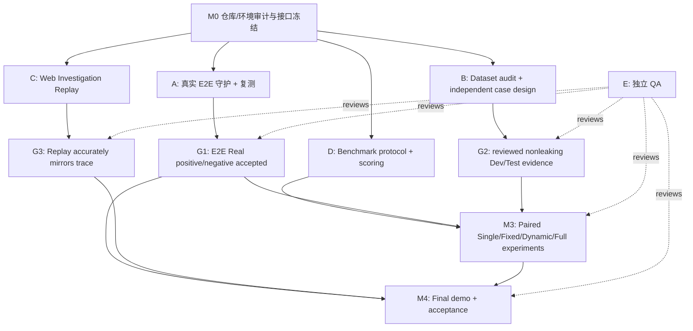

# IncidentLens V1.6 — End-to-End Validation, Benchmark & Investigation Replay

> **用途**：可直接交给 Codex Lead Agent 执行的多 Agent 实施规范（Implementation Plan + Acceptance Protocol）。
>
> **规划日期**：2026-10-15。**已核对的 GitHub 基线**：`celvelzel/IncidentLens`，`main` 的 `62ec53475f4f4c71b9e1cccf33532763c90156f2`。开始时必须重新运行 `git rev-parse HEAD` 与 `git status --short`；若实际 HEAD 不同，以工作区现状审计为准，不强行回滚。
>
> **项目目标**：先完成真实 Provider 的端到端 RCA/正确弃权闭环；与此同步审计和建设 IncidentBench 案例集；并行升级现有 Web UI 的 Agent 协作 Replay；最后开展 Single-Agent 与 Multi-Agent 的公平、可重复比较。**CAES 算法优化不属于本阶段交付范围。**

---

## 0. 给 Codex Lead Agent 的执行指令（最高优先级）

你是 IncidentLens V1.6 的 Lead Coding Agent / Integration Owner。**不要只给出建议或第二份计划，按本文件启动实际实施、测试、记录、集成。** 先审计现有仓库与文档，再在能力许可范围内把工作拆分给彼此隔离的子 Agent；若当前 Codex 环境不支持真正并行子 Agent，则顺序执行相同 Work Packages，保留同等所有权和验收要求，不能假装已经并行。

### 不可协商的执行原则

1. **先查已有代码再动手**。优先复用 `src/incident_lens/orchestration/graph.py`、`scripts/retest_live_provider_fix.py`、`scripts/run_incidentbench.py`、`scripts/analyze_incidentbench.py`、`src/incident_lens/web/`、`artifacts.load_replay`。不重复实现 Graph、Runner、Benchmark 或另建全新 UI。
2. **三路并行**：A 真实 E2E、B 测试集与标签流程、C Web Replay。D 评估协议/对照 Runner 在 A/B 合约冻结后并行准备，实际真实模型全量实验必须等 M1 和 M2 Gate。E 独立 QA 全程只读检查。
3. **任何外部付费 API/真实 Provider 请求**在实际执行前必须有用户明确授权、可用配置和总费用/请求/时间上限；不得为了达标不受控重试。无额度时持续完成 Mock/离线/数据/UI 工作，标记 `LIVE_BLOCKED_AWAITING_APPROVAL`。
4. **不修改安全边界以制造成功**：禁止放宽 ACL、绕过 Merge/Verifier/FinalizeGate、删除错误或负样本、将部分证据当全部证据、自动改写 Ground Truth、静默 Mock 代替 Real。
5. **实验不伪造**：`MockProvider` ≠ 真实 LLM 准确率；`RESOLVED` ≠ 正确 RCA；离线 state continuation ≠ 从事故输入完成的真实闭环；声明的 family ID ≠ 已审计的独立实验家族；0 个人工审核 ≠ 已人工审核；未取得 Token/成本时记 `null`，不是 0。
6. **保持历史可追溯**：不覆盖任何已有 `results/`；各运行用新的输出目录；保留失败、超时、中断以及源版本哈希；不可选择性地只保留成功实验。
7. **变更最小化**：禁止在本阶段添加 Agent 类型、生产写操作、OS 沙箱、大型分布式基础设施、自动改进 CAES 或与目标无关的重构。
8. **保留本地未提交修改**：禁止 `git reset --hard`、`git clean -fd`、force push、删除历史数据；遇到冲突先记录与隔离。优先独立 worktree/branch，Lead 控制主干集成。
9. **不泄漏秘密与标签**：`.env` 和 API key 不进 trace/git/日志；私有 Oracle 与真正 Held-out 标签只能由评估器独立加载；调查 Agent 的输入、Prompt、UI Replay 不得包含这些标签。任何人工签字只能由真实组员完成，Coding Agent 不可代签。
10. **任何结论注明证据级别**：`UNIT / OFFLINE_MOCK / ADAPTER_FIXTURE / LIVE_DEVELOPMENT / HUMAN_REVIEWED_TEST`。QA 通过与研究结论是两个不同 Gate。

### 每次阶段性交付必须回答

- 做了什么？实际修改了哪些文件？
- 执行过哪些测试命令？原始日志、退出码、PASS/FAIL/SKIP 分别是多少？
- 哪个 Gate 已经通过？哪个 Gate 没通过？为什么？
- 使用的是 Mock、离线回放、真实 API，还是人工审核？有没有源码/数据漂移？
- 下一步依赖、风险、预计调用成本与需要用户批准的事项是什么？

---

## 1. 实际仓库起点（不可把历史数据当最新的实时结果）

### 1.1 现有技术资产

- LangGraph 中央 Graph：Coordinator → specialist tasks (logs, metrics, database, changes) → validated Merge → Verifier（Full）→ FinalizeGate → report/STOP。
- 变体：`strong_single_equivalent_tools`、`fixed_four_equivalent_tools`、`dynamic_no_verifier`、`full`；开发复测脚本的 short variants 为 `single`、`fixed`、`dynamic_no_verifier`、`full`，两套 CLI 名称**不要混淆**。
- 离线 Mock、真实 `RealChatProvider`、有界失败恢复、实际调用计数、证据 ACL、trace/replay、两类 UI 均已存在。
- IncidentBench V1：20 个公开 Seed，16 个 identifiable candidate、4 个 missing discriminator；Dev 0、Test 0、accepted labels 0、audited independent families 0。现有 Seed 的 4 个 declared source groups 共享生成编码器 lineage，不可当作独立泛化样本。
- V1.5 CAES 的 Mock Seed 实验不证明真实质量优势，且严格预算下出现大量耗尽；本阶段保持 `current_dynamic`/CAES bypass 和 `cache_mode=off` 做架构对比。
- 2026-10-15 提交有最终收尾修复及历史状态离线续接。历史 914 passed、3 skipped 是该次记录中的全量测试，不是本次计划执行的实际结果；最后补修版本**尚缺从初始事件重新完成的完整真实模型正例**。
- 当前 Web UI：`python -m incident_lens.cli web`（默认本地 `127.0.0.1:8022`），`/api/traces`、`/api/replay`、`/api/run`、`/api/download`；前端 `src/incident_lens/web/static/js/views.js` 已有运行详情/Trace Library。

### 1.2 必读文件（先读后执行）

`README.md`、`README.zh-CN.md`、`docs/acceptance/rca-retest-iteration-20261015.md`、`docs/acceptance/finalize-resume-20261015.md`、`docs/incidentbench/README.md`、`docs/incidentbench/scenario-catalog.md`、`docs/incidentbench/fairness-protocol.md`、`docs/incidentbench/annotation-guide.md`、`docs/incidentbench/blind-test-protocol.md`、`docs/incidentbench/experiment-preregistration-draft.md`、`docs/v1.5/experiment-results.md`、`docs/demo.md`。

### 1.3 研究问题

**RQ1（主）**：在**相同可见数据、等价工具权限、同一真实模型和相同预算上限**下，动态 Full Multi-Agent 是否比 Single-Agent 获得更高的**经验证的 RCA 正确率和正确弃权率**？

**RQ2**：相比 Fixed 专家调度，动态任务分配是否更有效？

**RQ3**：Verifier 是否降低未经支持的定案、改善证据支持率，代价是什么？

**RQ4（描述性）**：不同复杂度/证据干扰/证据缺失的案例上，质量与请求成本如何变化？避免在样本很少时做夸张的显著性宣称。

---

## 2. 调度拓扑和多 Agent 工作包

### 2.1 任务依赖图



**共享接口 Gate（M0）**：Lead 明确 Trace 事件契约、case metadata 和 benchmark 结果 schema；Agent C 仅消费现有 replay payload 或做兼容性 adapter，不自行创造私有新 API；Agent B 不改 graph，Agent A 不改 benchmark evaluator 的真实标签逻辑。

### 2.2 Agent 所有权（如具备多 Agent 能力，应建独立 worktree）

| Work Package | 负责角色 | 可写主路径 | 禁止未经 Lead 批准修改 |
|---|---|---|---|
| WP-A | Runtime & Real-E2E Engineer | `src/incident_lens/agents/`, `src/incident_lens/orchestration/`, `src/incident_lens/llm/`, `tests/integration/`, `tests/reliability/`, `docs/acceptance/v16-*`, 新增 E2E 复测脚本 | benchmark Oracle/评分、前端、私有标签 |
| WP-B | Dataset & Data Provenance Engineer | `src/incident_lens/incidentbench/builder.py`, `scenarios/`, `family_split.py`, `validator.py`（需与 WP-D 接口核对）、`tests/incidentbench/test_generation*.py`、`docs/incidentbench/v16-*`、新建 data manifest/案例 | `src/incident_lens/orchestration/*`、生产 UI、评估结果造假 |
| WP-C | Web Replay Engineer | `src/incident_lens/web/static/`, `tests/web/`（或仓库当前等价目录）、`docs/ui/v16-*` | Graph/Provider、原始 trace、Oracle、共享 backend route（需要 Lead 所有权） |
| WP-D | Evaluation & Statistics Engineer | `src/incident_lens/evaluation/`, `scripts/run_incidentbench.py`、`scripts/analyze_incidentbench.py` 及新的 eval 脚本、`tests/evaluation/`、`docs/evaluation/v16-*` | 构造/修改事故 Ground Truth、Runtime 决策、前端 |
| WP-E | Independent Read-only QA | 只写独立 QA 报告/测试建议；测试代码经 Lead 指派独立路径 | 业务代码及原始运行/评分文件 |
| Lead | Integration / Contracts / Release | `src/incident_lens/web/server.py`、`src/incident_lens/schemas/`、`configs/`、root docs、pyproject、共享文件与集成 | 不得吞并子 Agent 改动、用静默改动消除失败 |

**重叠路径约束**：任何两个 Agent 如果都需改动同一文件，先向 Lead 提 RFC，Lead 决定顺序、补丁接口和合并方案。可先在各自分支提交，禁止多个 Agent 同时写主工作树。文件路径按实际目录调整，修改所有权要在 `docs/v16/ownership.md` 留痕。

### 2.3 Work Packet 交付模板

```text
WORK_PACKET: WP-A / WP-B / WP-C / WP-D / WP-E
BASE_COMMIT: <actual sha>
WORKTREE_AND_BRANCH: <name>
ALLOWED_WRITE_PATHS: <paths>
DEPENDENCIES_AND_CONTRACTS: <version>
CHANGED_FILES: <paths>
IMPLEMENTED_BEHAVIOR: <brief>
COMMANDS_ACTUALLY_RUN: <commands and exit codes>
TEST_COUNTS: <passed/failed/skipped>
DATA_SOURCE_AND_HASHES: <sha256 or not applicable>
RAW_RESULT_DIRS: <verified actual paths>
BLOCKERS: <specific>
CLAIMS_LEVEL: UNIT | MOCK | FIXTURE | LIVE_DEV | HUMAN_REVIEWED_TEST
REVIEWER_FINDINGS: <QA findings>
READY_TO_MERGE: YES | NO
```

---

## 3. 里程碑总体计划与阻塞规则

| Milestone | 建议日期 | 最小验收成果 | 阻塞下游 | 可继续并行 |
|---|---|---|---|---|
| M0 — Audit & Freeze | 10/15–10/16 | HEAD/dirty state、基线测试、依赖、合同、工作树/Ownership 和风险记录 | A/B/C/D 接口性改动 | 无破坏的只读检查 |
| M1 — Real E2E Vertical Slice | 10/16–10/20 | 真实可诊断正例 1 次完整成功 + 证据不足负例 1 次正确弃权；有可验证 trace/report/usage | 正式 LLM 对照实验 | B 数据集与 C UI |
| M2 — Dataset + UI Pilot | 10/16–10/27（并行） | Seed 审计、Dev 和隔离 Held-out 设计/真实成员审核、校验；可播放的 Web Trace | 研究质量/测试推断 | M1 runtime 失败修复 |
| M3 — Fair Four-Variant Study | 10/27–11/06 | 同源冻结模型/输入/权限/预算的四组对照；质量+错误+成本，按来源级别标注 | 最终“有优势”结论 | UI 打磨与 Demo 准备 |
| M4 — Delivery + Demo | 11/06–11/12 | clean install、全量回归、可复现 demo、真实实验说明、贡献与局限 | 发布/提交 | 答辩文档 |

日期是建议排程，不是课程已核定的截止时间。**M1 没有真实成功，不能宣布 M3 实验完成；M2 没有人工审核，可执行公开 Dev/Mock 工程实验但不能做“严格盲测/真实准确率已被独立验证”宣称。**

---

## 4. M0 — 冻结基线（Lead，必先做）

### 实施步骤

1. 读取上面必读文件；检视最近提交，记录原有测试、已知失败、UI/评估入口。
2. 记录 `git status --short`、`git log -5 --oneline`、`git rev-parse HEAD`，区分已有未提交修改与本阶段修改。
3. 确认 Windows/PowerShell venv 可用；避免升级依赖造成隐性漂移。必要时安装时保留旧锁定依赖。
4. 跑核心 pytest、Ruff、已有 Mock E2E、IncidentBench CLI E2E、Trace Replay 测试，保留日志。
5. 建立 `docs/v16/contract-freeze.md`：四组对照名称、trace schema、case/oracle metadata、验证状态枚举、输出目录规范；建立 `docs/v16/ownership.md` 和 `docs/v16/status.md`。
6. 启动独立工作树并分配 A/B/C/D，E QA 读取源/产物。若无 Agent 分工工具，串行模拟执行但不谎称并行。
7. 仅在发现不可避免的接口阻塞时调整合约，并通报所有 Agent；版本号记录变更。

### PowerShell 起始命令（从仓库根目录）

```powershell
git rev-parse HEAD
git status --short
git log -5 --oneline
.venv\Scripts\python.exe -m pytest -q
.venv\Scripts\python.exe -m ruff check src scripts tests
.venv\Scripts\python.exe -m incident_lens.cli validate-data
.venv\Scripts\python.exe -m incident_lens.cli list-cases
.venv\Scripts\python.exe -m incident_lens.cli run --case incident_001 --provider mock --cache-mode off --out results/v16/preflight/unique-mock-positive
.venv\Scripts\python.exe -m incident_lens.cli replay --trace results/v16/preflight/unique-mock-positive/trace.json
```

**注意**：若输出目录已存在，换唯一新目录，不删除旧结果。上面的命令必须以实际运行日志为证据，不能根据历史 README 抄一个通过数。`verify_install.py` 最终阶段单独运行。

### Gate G0（全需满足）

- 记录真实 HEAD/dirty state；Baseline FAIL 有完整、可归因的记录而非隐藏。
- `docs/v16/contract-freeze.md` 与 OWNERSHIP/共享接口发布，至少包含 Replay schema 和 dataset public/private 边界。
- Mock positive 能通过 CLI 及 Replay，不能被误报为 Real success。
- WP-A/B/C 可在不相互写同一文件的情况下开始；QA 知道检查对象。

---

## 5. WP-A — 真实端到端闭环（最高产品优先级）

### A1. 定义严格的 E2E 结果判定

从**初始公开 Incident 输入**运行实际 Graph + `RealChatProvider`，走真实 Agent decision/真实 ToolRegistry 查询、Merge、Verifier、FinalizeGate、STOP 和 Reporter，落地 `trace.json`、`result.json`、`report.md`、`verification.json`/等价用量证明。

至少选择两种开发可见的案例：

- **正例 A+**：已知可由公开证据辨认根因，例如 `incident_2001`（已有开发复测，配置差异导致 pool regression）；期望真实模型完成 `RESOLVED` + 正确 `root cause` + 可核查 citations + `protocol_valid` + 完整 STOP。**仅 RESOLVED 不够，必须人工或可信开发 oracle 复核机制、服务、因果链及支持证据。**
- **负例 A−**：缺少关键辨别证据，例如 `incident_2002`；期望正常 `INCONCLUSIVE`/有意弃权，而不是技术错误、预算耗尽或凭空根因。若事实标准认为仍可确定根因，必须修正案例判断并记录缘由，而不能修改程序结果来匹配预期。

### A2. 预飞行（免费/离线）

1. 复现最新源码的全部相关有界回归：证据发现、Finding ID 唯一性、数据缺口、模型阶段重试、候选更新后重新 review、finalize-resume、STOP、报告 groundness。
2. 检查开发数据和现有复测 `protocol.json` 是否存在、是否匹配真实配置 `model_id/response_format/request_timeout`；缺失就记录 blocker，绝不猜路径或用 Mock 标记替代。
3. 检查 API base URL 不经错误代理，模型 JSON Schema / JSON-mode 能力与超时；**只在获批后的有限实际探针中检查真实兼容性**。
4. 设定 run config：`cache=off`、默认 CAES bypass、严格证据守卫、完整请求上限和超时；完整记录有效参数及源码哈希。

### A3. 最小真实复测（授权后的付费阶段）

使用现有脚本，而不是另写一套简化版调查：

```powershell
# Codex 先检查以下两项真实存在，并保证 protocol.model_id 与配置一致
$DATASET = "<verified local development dataset root>"
$PROTOCOL = "<verified matching real-protocol.json>"
.venv\Scripts\python.exe scripts/retest_live_provider_fix.py --dataset $DATASET --protocol $PROTOCOL --incident incident_2001 --variant full --out results/v16/live-e2e/unique-positive-01
.venv\Scripts\python.exe scripts/retest_live_provider_fix.py --dataset $DATASET --protocol $PROTOCOL --incident incident_2002 --variant full --out results/v16/live-e2e/unique-negative-01
```

不要将示例尖括号传给程序；Codex 必须找到实际参数。若现有完整真实实验更适合 `run_incidentbench.py --provider real`，必须先满足其 development protocol/readiness contract，并注明该 Runner 的 split/formal gates，不可绕过正式实验拒绝路径。

### A4. 验证矩阵

| 场景 | 行为期待 | 自动判定 | 人工/语义判定 |
|---|---|---|---|
| 正例、证据充分 | 调查→核实→接受根因→报告 | `protocol_valid`, `stop_completed`, report nonempty, required evidence referenced, no fatal runtime | 根因与 causal chain 是否正确，引用是否真正支持结论 |
| 负例、证据不足 | 没有证据的根因不应被接受 | `INCONCLUSIVE` 且非 `UNRECOVERABLE_ERROR`，有正常 STOP | 缺失 discriminator 是否真实无法辨别、是否误拒正确答案 |
| 工具空结果 | 暴露 data gap，不乱引用 | no invented evidence ID，未绕过 tool ACL | 数据缺口说明是否合理 |
| Verifier 一次运输超时 | 有界重试并计费/计数 | `MODEL_RECOVERED` 或按预算终止，有限 attempts | 失败原因解释不得混淆模型能力与网络 |
| Coordinator 更新根因 | 新的 review 必须对应新快照 | old review invalidated，strict finalization | 支持和反证被正确重评 |
| STOP/预算耗尽 | 干净终止、统计失败而非伪成功 | no post-STOP illegal events; attempt denominators accurate | 不能计为正确弃权 |
| 证据注入/跨角色越权 | 拒绝 | `FORBIDDEN`/相应错误，不能访问私有 Oracle | 不展示秘密或 private state |

### A5. 失败定位（不得靠无限扩大 wall-clock）

对每次失败至少记录：阶段（coordinate/investigate/merge/verify/finalize/report）、最后成功事件、provider error code、工具查询/过滤条件、预计/已测 token、实际物理请求数、是否候选或证据快照变化、终止码、是否仍可从已有状态正确确定性收尾。按以下根因分类分别修复：

- 查询过滤误排除或证据不可见 → 修复 public discovery/工具实际查询，不能将私有标签注入输入。
- 调用返回 Schema 无效 → 仅在既有受控 structured repair 框架内修复。
- 本应重新 review 但没审 / 通过后重复决策 → 修复状态机与快照一致性，不放宽守卫。
- HTTP/Provider transport 超时 → 有界重试、真实耗时/未知 usage 保留、优化冗余调用；不可假定切模型后可比。
- 真正推理错 / 过多无价值工具调用 → 收集错误轨迹供以后算法改进；本阶段只修妨碍 E2E 的局部问题。

### Gate G1 分两层

- **G1a（必须，最小闭环）**：在冻结的真实源码版本上，至少 1 个公开开发正例达到完整 `RESOLVED` 且根因/证据核验正确、至少 1 个负例正常正确弃权，二者都有真实 API 请求、全程 trace、明确完成的 STOP、无 source drift。都不能靠 FileQueueBridge、MockTransport 或离线 checkpoint continuation 代替。
- **G1b（推荐，稳定性）**：经用户同意追加预算后各重复至少 3 次，在**同一冻结配置**下披露每次结果、完整尝试分母、失败率/变异性和请求/Token/latency 统计。若部分失败，不得移除失败样本以制造稳定性。G1a 能先解锁小规模研究 pilot，G1b 支持可靠性陈述。

如果外部 Provider 无法满足 G1a，报告 `G1_BLOCKED_LIVE_PROVIDER`，说明已有成功的 UNIT/MOCK/FIXTURE 范围；继续 B/C/D，不得改写为 E2E PASS。

---

## 6. WP-B — 测试集与 Ground Truth（和 WP-A 同时启动）

### B1. 对已有 IncidentBench 做 Dataset Audit（先盘点，不先造数据）

检查 `data/incidentbench_v1/` 中 manifest、coverage、`public_case_index.json`、拓扑、incidents 及 public evidence 的支持集合。输出 `docs/incidentbench/v16-dataset-audit.md` 与机器可读 `docs/incidentbench/v16-inventory.csv`：

每个案例至少有：`incident_id`、现有 split、机制类别、场景（ordinary/misleading/missing/counterfactual）、public evidence source families（logs/metrics/changes/database/config）、是否需要多来源证据、是否有竞争假设、真实决定性证据在哪里、反证在哪里、公开数据是否缺损、candidate cause、候选依据、provenance、生成器 lineage、family/cluster、人工 review 状态、推荐用于 DEV 或新 TEST 的资格、明确局限。

**本阶段不能把现有 20 Seed 任意改名为“独立 Test”**。现有共享生成器编码器和测试过程中可见的规则容易带来泄漏；要定义 Family-based split，不只是 `incident_id` 随机切分。

### B2. 明确案例目标和覆盖矩阵

建议开始从 15–20 个高质量开发/评估案例规划，但强制记录**独立家族数与案例数不是同一回事**。理想覆盖：

| 类别 | 目标数量（可重叠） | 具体目的 |
|---|---:|---|
| ordinary identifiable | 3–4 | 基础 RCA 是否正确 |
| misleading / decoy | 3–4 | 能否区分症状与根因 |
| joint evidence | 3–4 | 单种证据不足，多来源联合才能定案 |
| competing hypotheses | 3–4 | 同时有两个以上可疑机制，Verifier 必须处理反证 |
| missing discriminator | 3–4 | 应正确 INCONCLUSIVE，不应强行给因果结论 |
| counterfactual pair | ≥2 组 | 只改变关键因果条件，看根因是否随之改变；成对同 split |

建议选择至少一个可用于演示的**误导性事故**：日志提示 PostgreSQL 超时，而时间前后的配置 diff + 数据库健康状况支持 `backend_pool_config_regression`；还需挑一个没有关键变更记录的负例。不同场景需具备实质不同的因果生成机制，而不仅换名称/时间戳。

### B3. 公开证据与私有 Oracle 的生成合同

保留现有 IncidentBench 文件结构（依其 schema 严格校验）：

```text
data/<verified-dataset-root>/
  manifest.json
  coverage.json
  public_case_index.json
  rca/{topology,splits,incidents/<incident_id>/public/}
    incident.json
    logs.jsonl
    metrics.csv
    changes.jsonl
    configs.jsonl
    database.jsonl  # optional

local_oracles/<verified-private-evaluator-root>/
  rca/incidents/<incident_id>/private/benchmark_oracle.json
```

每个案例定义（字段名以当前 `BenchmarkOracle` Pydantic schema 为准，**下面是语义要求而非强制新 schema**）：

1. `root cause / mechanism`（或标记 insufficient/不可唯一辨识）。
2. `causal mechanism / chain`：触发器、指标/日志传播路径、受影响服务、起始时间。
3. `minimal sufficient evidence set`：哪些真实 public evidence IDs 构成最低支持集。
4. `against / counter-evidence`：如何排除主要竞争假设，包括正常基线不能机械当反证。
5. `decoy`：刻意误导的信息及**为何不足以定案**。
6. `missing discriminator`：删除哪些真实判别证据导致不可辨识。
7. `family/lineage`：模板/因果机制/观测编码器来源；同源、counterfactual 配对不能跨 Dev/Test。
8. `review provenance`：候选生成与独立真人审核区分，不能把模型生成 reviewer 当真人。

### B4. 分层数据计划（按实际进度调整）

- **Smoke/visible pilot**：2–4 个明确开发可见案例（包括 `incident_2001`/`2002` 若现存且可验证），供 WP-A 验证 E2E、WP-C 设计 replay；这些不能作为公平的盲测结论。
- **Development**：建议 8–12 个经小组复核的案例，覆盖多类机制和不充分证据；允许观察结果、调 Prompt、修缺陷，留版本变更历史。
- **Held-out test candidate**：建议 6–8 个来自与 Dev 实质不同且可审计的家族/编码器；在冻结 Prompt/模型/源码前由独立标签责任人保管，不暴露到执行 Agent 或 UI。如果没有真实独立 reviewer 或没有足够独立家族，**保持 `PENDING_REVIEW`，如实降级为开发验证，不宣称严格盲测或研究显著性**。

初始数量只是资源规划，不是要求不顾质量凑 20 个。宁愿少量审计可信的案例，也不要 100 个同模板重命名案例。**不要将已公开或开发期间观察的 20 Seed 假装作为真正独立新 Test。**

### B5. 人工审核流程（此部分是明确的团队任务，不由 Codex 虚构）

1. 数据制作者写 public case、private candidate oracle、简短 evidence map。
2. **两位真实组员独立**检查：公开证据是否真能支持 oracle、因果链是否与时间一致、是否存在另一个同样合理根因、Missing 是否真的缺乏 discriminator。保留原始独立记录、reviewer_ID、真实时间、修订说明。
3. 不一致则由第三名真实组员裁定并保留分歧记录；按当前 `annotation-guide.md` 的合约记录，而不是直接改 ground truth 后不留痕。
4. Coding Agent 可以检查 Schema、引用 ID、时间/因果一致性和数据生成逻辑，**不能声称自身代表独立人类判断**。
5. 用于实际评估的 Oracle 由 evaluator 在 run 状态持久化后读取，不得提供给 Agent Prompt、Coordinator、UI 或公共 Git 历史。

### B6. Dataset 验收和抗泄漏测试

用现有脚本生成及检查，而非改变旧数据；新 `data` 目录和 `local_oracles` 目录依实际路径选定：

```powershell
.venv\Scripts\python.exe scripts/validate_incidentbench.py --dataset data/incidentbench_v1 --mode public
# 对新数据，目录和 private root 必须存在；下行只是模板
.venv\Scripts\python.exe scripts/validate_incidentbench.py --dataset <new-dataset-root> --mode public
.venv\Scripts\python.exe scripts/validate_incidentbench.py --dataset <new-dataset-root> --mode privileged --oracle-root <private-oracle-root>
.venv\Scripts\python.exe -m pytest tests/incidentbench -q
```

- 保证 Public/Private 不同根目录；无 oracle 标识、答案提示、同模板伪独立组泄漏到 public。
- 指定具备 discriminator 的正例可以验证有足够公开记录，Missing 样本缺乏足够判别集；两个反事实案例公共证据与原因真的变化。
- 所有 evidence ID 在对应 public 包内存在、服务/time/status/citation schema 正确，validator 通过。
- 生成确定性与 source hashes 持久化；修改数据版本时重新生成独立 ID 与 manifest，不能无记录覆盖旧样本。
- 检查相似案例跨 split 近重复/共享 causal encoder，发现则标注泄漏并重分，不伪造独立性。

### Gate G2

- **G2a（工程可用）**：原始 20 Seed 审计完成，新的 development case manifest/公开数据和独立 private candidate oracle 校验通过，含可诊断/不可诊断、decoy 和 counterfactual 的最小集，Mock 四变体可运行；人工未审部分标注 `PENDING`。
- **G2b（高可信研究）**：实际有效的家族隔离、两名真实组员的独立 truth review、分歧解决、标签封存、测试集不经开发 Prompt 读取，review provenance 可验证。未满足则不允许标注 `HUMAN_REVIEWED_TEST`。

---

## 7. WP-C — Web Investigation Replay（与 A/B 并行）

### C1. 设计边界

**沿用现有 Web**：`src/incident_lens/web/static/js/views.js`、`components.js`、`app.js`、CSS，以及后端 `src/incident_lens/web/server.py` 的 `/api/traces`、`/api/replay`。保留总览、发起调查、运行详情与 Trace Library。新增或增强一个 `Investigation Replay` 体验；避免重新做新的前端框架和未知依赖。

**只展示已保存的真实事件/共享证据**：Replay 不能调用 LLM 生成伪造的 Agent 对话；如果原 Trace 没有自然语言沟通信息，展示真实 `task/decision/finding/review` 的结构化摘要，不得虚构内部推理、隐含的 CoT 或没有发生的消息。

### C2. 最低可用 UI（从现有 `renderRun` 扩展）

1. **顶部事故概览**：标题/incident ID、source（REAL/MOCK/RECORDED）、model ID、workflow variant、dataset/source hash（可用则显示）、根因状态与 STOP/错误结果；Recorded 回放要显著标注。
2. **Workflow Overview**：Coordinator、Logs、Metrics、Database、Changes、Verifier、Finalize、Report 组成可见工作流节点；显示真实状态（not scheduled/running/completed/skipped/failed）及事件方向。可采用动态节点高亮而非复杂图算法。
3. **Communication Timeline**：按原 trace 序号/时间排序，展示任务派发、工具查询结果摘要、Finding 合并、假设状态变化、Verifier Review/请求检查、Coordinator Replan/Finalize、Stop。点击任一事件高亮相关 Agent、Task、Evidence IDs。
4. **Hypothesis Evolution Panel**：每个假设从 OPEN 到 SUPPORTED/REJECTED 的事件链，可观察反证如何触发状态变更；不要以单次最终状态伪造历史阶段。
5. **Evidence Inspector**：可按 `evidence_id` 点击查看授权的公开证据 excerpt/来源/查询参数、相关 task 与引用；不存在/不可用显示 `unavailable`，不能生成推测数据。
6. **Playback**：首步、上一步、播放/暂停、下一步、末步、速度（至少 1×/2×/4×）和同步的可见状态；默认不会偷偷重发真实运行。可选过滤事件类别。
7. **Outcome & Report**：最终 RCA 或弃权原因、可点回证据位置的 citation、实际使用与失败信息；证据无法定位时明确标注。
8. **示例选择**：演示案例选发生过真正“初始数据库怀疑 → 正常 DB 证据 → 重新分派 Changes → 配置 diff → Verify → RCA”的一条保存 Trace；如果真实 Trace 没发生该链条，不要构造虚假成功示意，只在演示选取真实可回放案例。

### C3. 前端实现和数据接口约束

- `ReplayViewModel` 适配器以现有 `/api/replay` 返回的 `trace` 和 `state` 为输入；保留原始 Trace 不变，不在浏览器读私有 Oracle。
- 实现 `replayReducer(state, event)` 或同等纯函数，从事件前缀重建**可证实的可见状态**，而非直接把最终 report 显示在第一帧；对于旧 Trace 不能恢复的字段，显示 `not recorded`，而不是由最终值倒灌。
- 兼容老 Trace、异常终止和 0/缺失字段；选择 1 个成功 Mock、1 个 Missing Mock、1 个 Provider 失败、真实成功（获得后）作为固定回归样本。
- 优先客户端播放，不需要前端每一步访问后端；Web server 若必须改 API，由 Lead 集中修改、记录 contract 版本并通知 WP-C。
- 防 XSS/HTML 注入：所有不可信 log/tool excerpt 必须 escape；路径通过现有安全解析；不展示 API secrets/private labels；大事件列表需保持可用性能。
- 兼容常见桌面屏幕大小及窄屏；键盘与可读的时间/状态标签；颜色以外还应有文本状态。

### C4. UI 验收

- 回放操作不触发新的 Provider/Tool 调用；`Recorded Replay` 标识从开始到结束可见；Mock 与 Real 不混淆。
- 相同 Trace 在重复打开时事件顺序稳定、证据/假设 ID 对应一致；播放与手动逐步应得到同一个末态。
- 从事件点击到 evidence 必须引用真实公共 ID；对跨 incident/未授权引用、任意 path traversal、脚本注入进行负例测试。
- 三类示例都能打开：成功、正确弃权、Provider 失败；不得 UI 只支持成功报告。
- 最少提供带事件注释的 2–3 分钟操作演示脚本和自动化（或可重现手工）截图/断言证据。

### Gate G3

- existing `web` 启动、API Replay 有效、前端播放/假设时间线/证据检查完整；无 runtime/Provider 重调用；旧 Replay 不回归；通过相关测试、无 XSS/越权；所有显示数据真实来源可追溯。
- 若只完成布局静态图，不能算 G3 PASS；至少一个**真实保存**的误导案例 Trace 必须能重放真实协作事件。没有真实 live success 时可先使用清晰标注的 Mock trace 验证 UI，但最终成果不得将其写成真实模型演示。

---

## 8. WP-D — 对比实验协议、Runner 和指标（结构准备可并行，真实执行待 G1/G2）

### D1. 对比组的精确定义

| 名称（Benchmark 实际枚举） | 行为 | 解答的问题 |
|---|---|---|
| `strong_single_equivalent_tools` | 一个身份拥有等价公共工具并自我检查 | Full 是否优于单 Agent |
| `fixed_four_equivalent_tools` | 一轮固定 4 类专家，不自适应无限加专家 | 动态选择是否有效 |
| `dynamic_no_verifier` | 同样动态协调，但无 Verifier | Verifier 是否值得成本 |
| `full` | 动态协调 + Verifier，保留严格守卫 | 完整多 Agent 表现 |

**控制变量**：同一模型 API/实际确认的 model ID、temperature、response_format、Prompt/version（**架构必要差异**须记录）、可见证据、等价工具权限、相同 request/tool/round/wall ceilings、cache off、provider recovery policy、固定评估分组与随机顺序、独立运行 ID。不要用旧版本、不等超时或 FileQueueBridge 与真实 API 混成公平对照。

### D2. 指标和分母必须先定义再运行

**质量主指标**：
- `root_cause_correct_rate`：可诊断案例中，候选 root cause mechanism 和 service 与独立 Oracle 一致，且基于核对的证据支持。分母为该条件所有尝试，包括 Provider/预算失败；可另报 completed-only 作诊断，但不可替换主分母。
- `correct_abstention_rate`：Ground Truth 证据不足案例中，正常 `INCONCLUSIVE` 且未编造根因；Provider error / timeout / budget exhausted **不计作**正确弃权。
- `false_resolution_rate`：Missing 案例中却发布错误 RCA 的频率；以及 Identifiable 案例中的错误 RCA。
- `citation_validity` 两层：存在性/授权校验 + **人工语义支持**（没有 review 则为 `null`，不可只用 ID 存在冒充 Grounded）。

**技术/效率指标**：
- `technical_completion_rate`、`runtime_failure_rate`、`budget_exhausted_rate`。
- requests：区分逻辑模型调用、实际 HTTP 物理发送、重试与 structured repair；未知统计标记。
- `tool_calls`、`elapsed_ms`/percentile（同一机器时序环境）、`tokens_in/out/total`、`cost`（若未可确认则 `null`）。
- `investigation_rounds`、`replans`、Verifier 审查次数、处理证据数量；当作描述性机制指标。

**统计**：首先展示每案例配对表和各组分子/分母；候选有效家族很少时只报描述性差异、具体错例，不做虚假置信区间/显著性。若实际具备独立 family，可用事先固定种子的 case/family clustered bootstrap，并注明宽置信区间与重复采样假设。不能对同一个生成器衍生的 20 条当 20 个完全独立样本。

### D3. 实验阶段

**Stage 0：离线管道检查**（可立即执行，明确 Mock）

```powershell
.venv\Scripts\python.exe scripts/run_incidentbench.py --dataset data/incidentbench_v1 --split seed --variant all --provider mock --cache-mode off --jobs 1 --out results/v16/eval-smoke/unique-mock
# 不传 oracle-root 时为未评分/工程验证；已有原始运行可选择用对应私有 oracle 离线评分。
.venv\Scripts\python.exe scripts/analyze_incidentbench.py --input results/v16/eval-smoke/unique-mock/raw-runs.jsonl --out results/v16/eval-smoke/unique-mock-analysis
```

验收：20 Seed × 4 variants 的**尝试数按真实 manifest/runner 输出核对**；四变体实际走 Graph；失败保留；Analysis 能从保存状态独立重算；不能宣称 Mock 准确率是 LLM 准确率。

**Stage 1：真实 Provider 小样本 pilot**（需要 G1a + G2a + 用户预算）

- 推荐从 2–4 个 visible dev cases × 4 variants × 1 repeat 开始，验证对照实验不会系统性超时/Schema 失败。对每个失败保留相同分母。
- 若 `run_incidentbench.py` 不支持从其 CLI 选择少数案例，**不得静默改 CLI 或挪用另一个实验名字**；可以建立单独版本化的 `pilot manifest/protocol` 或扩展兼容参数并先通过单元与公平性测试。不得借此开放 Formal/Test 守卫。
- 使用有效 `--readiness`、matching real protocol、真实模型鉴权；锁定全流程源码/配置/Prompt/模型参数；未获批准仅生成 DRY RUN 报告。

**Stage 2：开发组四架构对照**（需要 G1b 推荐 + G2a；研究性结论需 G2b）

- 建议 8–12 Dev cases × 4 variants，若预算允许每案例/变体 ≥3 重复，随机执行顺序但保持配对、same model/config；**实际规模由预先审批的请求/Token/time budget 决定，不可私自翻倍**。
- 保存完整 `raw-runs.jsonl`、`scores.jsonl`、`aggregate.csv`、`paired-differences.csv`、`error-analysis.md`、citation review bundle、source/protocol/artifact hashes（或现有同等输出）。
- 对三条关键对比 `Full-Single`、`Full-Fixed`、`Full-NoVerifier` 单独分析正确率/弃权/技术失败/平均成本；按误导、竞争、Missing 分层但小样本只说明趋势。
- 对失败案例进行“最小错误轨迹”：哪一个 Agent 获取何种证据、是否漏查、何时犯错、Verifier 是否阻止错判，必须有 evidence/ref 对应。

**Stage 3：Held-out/Test（如果严格 Gate 已齐备）**

- G2b 之前，**不称 formal Test**；保留 formal runner 对未满足的人审/封存/独立家族/Model readiness 的 fail-closed 行为。
- 真正封存后，测试集由独立 label owner 控制，冻结源码、模型、Prompt、参数、数据、公平性指标、主/次对比、预算、run order seeds 和评分协议；Agent 不得在运行过程中读测试 Oracle。
- 需要时以正式、经过 review 的扩展允许 sealed run；遇数据/版本漂移立即停，不应为交付冲破 G2b。

### Gate G4（本项目最重要的实证 Gate）

- 四组对照在同一冻结条件下确实运行、数据和结果可重算；至少已有 reviewed Dev 结果并保留未成功尝试；指标口径、真实请求统计明确。
- 若 G2b 满足且真实新 Test 已执行，可升级称独立 Held-out 结果；否则只报告 Development evidence。
- **绝不要求 Full 一定赢**。若 Single 更好也如实报告，给出案例类别、成本、错误机制分析。若真实 Provider 仍全失败，则结论是“当前配置不能可靠评估架构优势”，不是“Full 无优势”或“已证明优势”。

---

## 9. M4 — 最终 QA、演示与交付

### 9.1 最终九分钟演示（可按课程要求缩放）

| 时间 | 内容 | 核心证明 |
|---|---|---|
| 0:00–1:00 | 实际软件事故、证据和整体架构 | 为什么需要多来源调查 |
| 1:00–2:30 | Web 选择一个误导性事故，展示初始假设 | 问题不可能靠第一眼日志直接判断 |
| 2:30–4:30 | 逐帧 Replay：任务派发、专家返回、Replan | 真正多 Agent 动态协作 |
| 4:30–5:45 | Verifier、证据引用、竞争假设变化、RCA | 防止幻觉和解释性 |
| 5:45–6:30 | 证据不足案例合理弃权 | 可靠性而非强制输出答案 |
| 6:30–8:00 | Single/Fixed/Dynamic/Full 数据表与一例错误分析 | RQ1/RQ2/RQ3 的实验依据 |
| 8:00–9:00 | 权限边界、真实 vs Mock、失败限制、贡献 | 工程严谨与科学诚实 |

### 9.2 Release QA 最低标准

- clean checkout/fresh venv（或独立 wheel install）可跑 Mock CLI、Replay、Web；`scripts/verify_install.py` 在全新输出目录成功；正式 Benchmark 如需 source editable checkout，应明确限制。
- 最终完整 pytest/Ruff 通过或将未通过条件列清并决定不发布；Source lock 对应本轮实际结果；Windows symlink skip 的限制如实声明。
- 已保存的正例/负例/失败 Trace 在 UI 中均可正确 Replay；前端不反向从最终 state 伪造历史；敏感标签和 secrets 不进入截图、report 或公开 Git。
- Demo 有确定的 snapshot/path，依赖环境最少；API 实时不可用时明示 Recorded Replay 并非实时模型。
- 有实际 M0–M4 QA Gate 报告、基线、变更记录、贡献证据与数据集/实验/模型卡及 known limitations。
- 任何 Formal Test gate 若未通过，则 release 只宣称工程与开发实验完成，不能声称论文级可推广结论。

### 9.3 推荐交付目录（如不存在由 Lead 创建）

```text
docs/v16/
  status.md
  ownership.md
  contract-freeze.md
  E2E-acceptance.md
  dataset-plan-and-review-status.md
  benchmark-protocol-and-results.md
  replay-demo.md
  qa-release-report.md
  known-limitations.md
results/v16/
  preflight/<unique-run>/
  live-e2e/<unique-run>/
  eval-smoke/<unique-run>/
  eval-real-dev/<unique-run>/
  final-qa/<unique-run>/
```

以上是目标清单，不是暗示路径当前已存在；文件名可按现有仓库风格略作调整，但内容和证据链必须能检索。

---

## 10. 验收状态与机器可检查的发布门槛

**Gate 状态**：`NOT_STARTED | IN_PROGRESS | PASS | FAIL | BLOCKED_AWAITING_USER | BLOCKED_UPSTREAM`，严格不允许“部分通过”被记为 PASS。Lead 将每个 Gate 的一行状态及支持产物写入 `docs/v16/status.md`。

| Gate | 必备证据 | PASS 时才允许说 |
|---|---|---|
| G0 | 源码 SHA、dirty report、基础回归、接口与 ownership | 基线完成，子任务可并行 |
| G1a | 至少 1 次真实正确 RCA + 1 次真实正确弃权，从头真实调查，完整 trace、协议与 STOP | Real E2E 最小闭环已验收 |
| G1b | 同配置各 ≥3 次真实重复，报告所有尝试/失败/请求/usage | 具备初步稳定性资料（不是总体稳定率保证） |
| G2a | 数据盘点、有效新样本、public/privileged validator、家族标签、Oracle 隔离 | 开发评估数据可用 |
| G2b | 真实双人审核、独立家族核查、held-out 封存、无测试标签泄漏 | 符合本项目研究级测试前置条件 |
| G3 | Web 真实 Trace Replay、可见 Agent 任务/引用/假设演化、无伪造事件、安全回归 | 可清楚展示 Agent 协作 |
| G4 | 四架构同条件实际实验、可重算准确度/正确弃权/成本、错误归因、失败保留 | 能回答 RQ1–RQ3 的范围内实证结论 |
| G5 | 完整回归、安装验证、Demo、QA/限制、交付索引 | 完整可提交版本 |

**不合格即暂停相关下游**：真实 Provider 失败阻塞真实性能比较；真实标签缺失阻塞严格盲测；Web 不可回放阻塞 Demo 完整验收；无审批阻塞付费实验但不阻塞离线工作。

---

## 11. 风险清单及触发后的操作

| 风险 | 检测 | 必须采取的措施 |
|---|---|---|
| 真实模型长时间超时 | provider attempt logs + wall/request ceilings | 停止新增大批试跑；分类定位，最大预算受控；保留失败、未知 token |
| 缺少真实有效的测试答案 | accepted labels / citation reviewer records 为空 | 由真实组员审核；Coding Agent 不伪造 reviewer |
| 新案例与 Seed 同模板泄漏 | causal encoder/family/内容近重复 | 改成新机制或重新分组；不视为独立 Test |
| Single 与 Full 工具不等价 | ACL/ToolRegistry 与每组实际可用工具 diff | 在 benchmark 等价工具框架内修正，再重新冻结 |
| Mock 表现被宣传成真实效果 | artifact `provider_id` / HTTP counts | UI/报告显著标签；真实指标单独分析 |
| Replay 从最终状态回填历史 | 将 event-prefix replay 与 final state 比较 | 仅展示事件可恢复字段，不可恢复就写未记录 |
| 人工审查泄漏到 Agent | public prompt/raw log/trace 出现 oracle 值或私有路径 | 立即阻断该批评估，记录事故并重建数据/冻结协议 |
| 多 Agent 写同一文件 | worktree/status/PR diff | Lead 仲裁文件所有权；任何 Agent 不得覆盖未合并改动 |
| CAES 改动污染比较 | selection policy/config 与 source SHA 不一致 | 本阶段禁止 CAES 优化；修正并重新冻结四组实验 |
| 发现 Full 表现不佳 | 真实实验质量低或不优于 single | 如实分析；若需算法优化开下一版本，不允许改 Test 后重测至成功 |

---

## 12. 任务启动顺序（Codex 立即执行，而不是停留在规划）

**Lead Day 0**：

1. 列出仓库 HEAD、工作区状态、上述文档和 CLI 入口；执行 M0 基线测试并保存日志。
2. 创建 `docs/v16/status.md`、`ownership.md`、`contract-freeze.md`（仅列真实接口；用户已存在的旧计划保持不改）。
3. 创建 WP-A/B/C/D 的独立分支和 worktree，发送带任务边界与 Gate 的 Work Packet；启动只读 QA WP-E。

**Wave 1（真正并行）**：

- WP-A：重新验证 `incident_2001`/`2002` 的 public 数据、真实 Provider 协议与回归；在授权后做真实正/负例 E2E；修复与 E2E 直接相关的有限 bug。
- WP-B：20 Seed 审计、场景矩阵、public/private 证据合约、Dev/新 independent-family Test 设计、离线 validator/Mock 检查；提交需要真人审核的材料但不代签。
- WP-C：以现有 `trace.json` + `/api/replay` 做可播放的 Agent Workflow/Communication/Hypothesis/Evidence 页面；先用明确标识 Mock 的成功/弃权/失败 Trace。
- WP-D：不动 Ground Truth，先实现/核对四变体公平性与指标口径、Mock runner 和分析脚本回归，建立 pilot protocol；不运行未经批准的真实批量实验。
- WP-E：审计四路负例、数据隔离、复现性、权限与分母；发 Gate review，但不自我批准。

**Wave 2（按 Gate 整合）**：

- Lead 合并 WP-A/B/C/D 经独立 QA 的结果；冻结一次用于 Dev 的 commit/source hashes。
- G1a + G2a 通过且用户授权时运行 2–4 案例 × 四变体的小样本真实 Pilot；失败如实报告。
- 如具备 reviewed development 案例与费用预算，扩展至全 Dev 对照；只有 G2b 符合时考虑真正 Held-out Test。

**Wave 3（交付）**：

- 选择一条**真实发生**了重规划与 Verifier 的 Trace 做 Demo；若 live Provider 没产生这种案例，展示清晰标注的离线 Mock，而不是补造消息。
- 完成 QA、全量测试、安装检查、交付索引与报告；保留所有已知问题。

### Codex 每轮进度报告格式

```text
V1.6 STATUS / <date and time>
HEAD / WORKTREE / DIRTY:
MILESTONE: M0/M1/M2/M3/M4
G0 G1a G1b G2a G2b G3 G4 G5: <status + evidence paths>
WP-A: <done, actual tests, blockers>
WP-B: <done, data/reviewer status, blockers>
WP-C: <done, demo/replay tests, blockers>
WP-D: <done, protocol/experiment result, blockers>
WP-E: <QA findings / not yet reviewed>
SOURCE_HASHES / RUN_OUTPUTS:
ACTUAL_PROVIDER_REQUESTS / COST_STATUS:
USER_APPROVAL_REQUIRED:
NEXT PARALLEL_WAVE:
```

**开始执行；先完成 M0，并在单次回复中给出真实审计结果、并行分工已经实际启动的状态和第一轮测试结果。之后持续推进可执行工作，而不是收到某个 Gate 的阻塞就把所有不相关工作停止。**

---

## 13. 参考与出处（源代码/文档基础，不代替现场重新验证）

- 仓库：https://github.com/celvelzel/IncidentLens
- 基线提交：https://github.com/celvelzel/IncidentLens/commit/62ec53475f4f4c71b9e1cccf33532763c90156f2
- 10/15 RCA 修复的验收边界：`docs/acceptance/rca-retest-iteration-20261015.md`
- IncidentBench 数据与 CLI：`docs/incidentbench/README.md`
- 20 Seed / 0 Dev / 0 Test 与家族限制：`docs/incidentbench/scenario-catalog.md`
- 公平实验：`docs/incidentbench/fairness-protocol.md`
- 真人审核与盲测限制：`docs/incidentbench/annotation-guide.md`、`blind-test-protocol.md`
- 现有 UI / API：`src/incident_lens/web/server.py`、`src/incident_lens/web/static/js/views.js`
- 当前 Demo：`docs/demo.md`
- CAES 的真实工程观察（不是质量保证）：`docs/v1.5/experiment-results.md`

**注意**：本计划是新的实施规范，时间表、样本建议数、Gate 阈值和交付组织为规划建议；与仓库已发生的结果明确区分。课程原始细则应由 Lead 根据持有的实际评分文件再次核对，不能凭计划文本假造 rubric 权重或截止日期。
