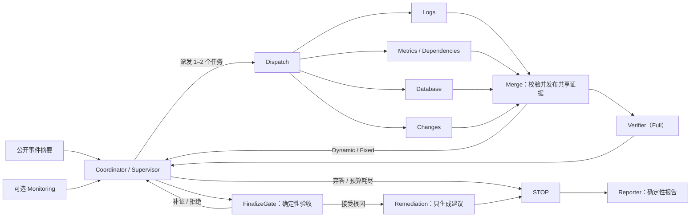

# IncidentLens 课程项目交接指南

本文供后续负责测试验收、报告撰写、PPT 制作、Demo 视频和现场汇报的成员使用。非技术成员可以先读“项目一句话”和“如何解释结果”，再按自己的角色进入对应章节；技术成员可从运行命令、证据路径和限制直接接手。

## 先看结论

**项目一句话：** IncidentLens 让日志、指标与依赖、数据库、变更四类调查员分工取证，由协调者根据当前证据缺口动态派出最需要的 1–2 个调查员；只有经过校验、合并和证据门控的记录才能进入共享证据板，证据不足时系统明确输出 `INCONCLUSIVE`。

最新完整 WP-D 测试中，40 个最终槽位全部技术完成。Single、Dynamic（无 Verifier）和 Full 的质量均为 10/10；Fixed-4 只有 7/10，因为在 `incident_3004`、`incident_3005`、`incident_3010` 三个可识别案例上错误弃答。Dynamic 与 Single 质量相同，但平均耗时、请求、工具查询和 Token 分别降低 **40.3% / 20.5% / 21.3% / 43.6%**。这是本项目当前最有说服力的多 Agent 优势：**动态专家选择在质量不降的前提下显著降低资源使用。**

这些结果来自 10 个开发可见案例、每案例一次重复和候选 oracle，属于描述性开发证据，不是独立盲测、统计显著性或生产部署结论。Full 没有表现出比 Single 更高的质量，反而使用了更多资源；不能把“Agent 数量更多”当作天然优势。

## 课程交付与责任映射

课程 PDF 要求展示 Agent specialization、communication、coordination 或 collaboration，不能只是多次独立调用 LLM。交付物包括源码与运行说明、不超过 10 分钟的 Demo 视频、Presentation slides 和 Individual Contribution Statement。PPT 需要覆盖问题与动机、多 Agent 设计、实现、系统演示与结果。评分权重是：问题定义与动机 15%，多 Agent 设计 30%，技术实现与功能 25%，分析与创新 15%，展示与提交质量 15%。

| 后续工作 | 必须完成的产物 | 本项目应重点呈现的证据 | 建议负责人 |
| --- | --- | --- | --- |
| 测试与验收 | 可复现命令、批次状态、保留的失败尝试、评分表 | 40/40 技术完成、0 最终失败、Full/3010 的三次 attempt、四架构同条件设置 | 测试负责人 + 技术负责人复核 |
| 课程报告 | 方法、架构、实验设置、结果、失败案例、限制 | Dynamic 对 Single 的资源优势；Fixed-4 的 3 个错误弃答；Full 无额外质量收益 | 报告负责人 |
| PPT | 10–12 页，覆盖课程四部分 | 角色与协作图、证据流、四架构消融、质量与成本双轴结果 | PPT 负责人 + 技术审阅 |
| Demo 视频 | 不超过 10 分钟，展示真实工作流和代表性案例 | 动态调度、共享证据、Verifier/门控、明确弃答、离线 replay | 视频负责人 |
| 现场汇报 | 8–10 分钟主讲稿、问答准备、计时演练 | 一句话价值、架构设计、关键数据、证据边界 | 主讲人 |
| 贡献声明 | 每人负责的模块、与其他模块的接口、可核对证据 | 实际提交、测试、文档、汇报或数据工作 | 每位成员确认 |

课程截止时间为 **2026-11-23 23:59**，通过 Canvas 提交，一人代表全组上传；建议 ZIP 命名为 `COMP5584+GroupProject+GroupX.zip`。TA 为 Qi Peng，`qi0125.peng@connect.polyu.hk`，邮件主题建议以 `COMP5584+GroupProject+Group[ID]` 开头。

## Agent 流设计

### 九节点工作流



`monitor → coordinate → dispatch → merge → verify → finalize → remediate → stop → report` 是 LangGraph 中的九个节点。默认 RCA 工作流从 `coordinate` 开始；可选事件响应工作流从 `monitor` 开始。Merge、FinalizeGate、Reporter 是确定性组件，不是额外 LLM Agent。

### 角色与权限

| 角色 | 职责 | 可访问证据 |
| --- | --- | --- |
| Coordinator / Supervisor | 根据共享证据、开放问题和预算，决定调查、补查、定稿或弃答 | 已发布共享状态；无业务查询工具 |
| Logs Investigator | 还原错误时间线与传播过程，区分因果信号与伴随症状 | `query_logs` |
| Metrics & Dependency Investigator | 检查服务健康、容量、依赖和影响范围；基准中可获等价数据库工具 | `query_metrics`、`get_dependencies` |
| Database Investigator | 区分数据库容量、会话、锁、慢查询与应用连接池问题 | 五个只读 `get_db_*` 工具 |
| Changes Investigator | 对照事故时间检查部署和配置差异 | `query_changes`、`get_config_diff` |
| Verifier / Skeptic | 只读取授权共享证据，质疑候选根因并提出具体补查 | `fetch_evidence_by_ids` |
| Remediation | 为已接受根因生成带风险、验证和回滚步骤的方案 | 已接受根因与证据 |
| Single-Agent baseline | 同一身份完成规划、调查和自我反思，串行运行 | 等价的全部公开只读工具 |

所有业务工具都是只读。运行时签发不可变 `AgentContext`，绑定工作区、事件、运行、角色、工具白名单和剩余预算；任务只能进一步收窄权限。公共文件使用固定白名单，拒绝私有真值、路径穿越、符号链接和 Windows junction。证据摘录始终作为不可信数据送入模型。

### 协作不是“自由聊天”

调查员只写自己的局部结果。Merge 先校验任务身份、角色、实际查询账本、引用和来源，再一次性发布到共享证据板；并行任务不能直接覆盖共享状态。Coordinator 只能看到已发布内容。Full 中的 Verifier 通过授权 ID 重新获取共享记录，不能读取未查询证据。候选或证据一变化，旧审查指纹就失效。FinalizeGate 还会检查引用来源多样性、因果判别证据、竞争假设、未决问题和 Verifier 审查。

这套机制回答了课程要求中的四个核心问题：

1. **分工：** 每个调查员有不同证据域、提示词和 ACL。
2. **分解：** Coordinator 每轮最多派出 1–2 个最需要的新检查。
3. **通信：** 调查结果经 Merge 校验后进入共享证据板；Verifier 的补查请求回到 Coordinator。
4. **最终决策：** 证据充分时由确定性门控接受根因，证据不足时正常弃答；Provider 失败不会被伪装成弃答。

### 四种架构

| 架构 | 协调与调查方式 | 独立审查 | 比较目的 |
| --- | --- | --- | --- |
| `single` | 一个身份规划、查询全部证据并自我反思，串行 | 同一身份自审 | 强单 Agent 基线 |
| `fixed` | 首轮一次性固定派出 Logs、Metrics、Database、Changes | 无 | 测试固定四专家批次的成本与覆盖 |
| `dynamic_no_verifier` | 动态选择专家，多轮补查，确定性接地门控 | 无 | 隔离动态选择与独立审查的贡献 |
| `full` | 动态选择专家 + Verifier 反馈 + FinalizeGate | 有 | 完整多 Agent 系统 |

四种架构使用同一公开数据、等价工具、模型、temperature 0、关闭缓存、相同轮次/工具/请求/墙钟上限和相同运行顺序。架构提示词和控制流差异属于实验处理，不应在批次中途热改。

### 为什么适合多 Agent

事故 RCA 不是简单的文本生成，而是多个证据域逐步缩小假设空间。日志可能显示症状，指标提供时间与影响，数据库连接数据区分内部容量与上游池配置，变更记录提供触发机制。单个 Agent 容易把所有材料塞入一次超长上下文，也更容易在相似症状上过度断言。动态分工让每轮只查最有判别价值的一两个来源，再由确定性合并和门控维护证据边界。最新数据支持的是“减少无效查询和上下文”这一优势；Full 的额外审查在本批没有带来更高正确率。

## 评测设计

### 数据与案例

WP-D 使用 `data/incidentbench_v16_dev` 的 Dev10：`incident_3001`–`incident_3010`。公开观测与 evaluator-only oracle 分离；Graph 结束后才评分。8 个案例可识别根因，2 个案例证据不足并要求正常弃答。所有案例为 `development_visible`，oracle 当前为 `pending/candidate-v1`，没有独立人工验收或 blind Test 结论。

可识别案例要求 `culprit_service` 与 `failure_mode` 同时精确匹配；不可识别案例只有在正常终止且 `INCONCLUSIVE`、无根因时才算正确弃答。技术失败仍在对应分母中；证据不足的正常弃答是有效结果；Provider/网络/预算失败不是弃答。

### 控制变量与最新批次

| 项目 | 本次设置 |
| --- | --- |
| 计划与协议 | `results/acceptance/local-gateway-full40-20261031/{plan,protocol,readiness}.json` |
| 模型 | `auto/deepseek-v4.1-flash`，本地 OpenAI 兼容网关 |
| 矩阵 | 10 个案例 × 4 架构 × 1 repeat = 40 slots |
| 并发 | 4；每槽独立 provider、预算和公开数据 reader |
| 采样 | temperature 0，cache off |
| 上限 | 8 轮、40 次工具、64 次逻辑请求、7200 秒/调查、请求超时 1200 秒 |
| 顺序 | seed 14100，固定随机化；所有架构保留在配对计划中 |
| 结果目录 | `results/v16/wp-d/full40-local-gateway-c4-20261031/` |
| 最终状态 | `batch_finished`；40 completed，0 final failed |

### 指标定义

- **技术完成：** 保存产物通过协议、来源不变、STOP 完成、无 runtime failure，且 observability 未降级。
- **正确根因：** 可识别案例的服务和故障模式均匹配 oracle。
- **正确弃答：** 不可识别案例正常输出 `INCONCLUSIVE` 且没有根因。
- **质量成功：** 正确根因与正确弃答之和，分母是全部 10 个案例。
- **耗时：** 围绕实际 Graph 执行的单调时钟时长。
- **请求：** 实际 Provider 物理请求，包括重试和结构化修复。
- **工具查询：** 经 ToolRegistry 实际执行的查询。
- **Token：** Provider 返回的测量 usage；未知值不能填成零。

最终成功均值只使用每个 slot 的最后一个成功 attempt。失败和中断尝试另列在全尝试成本中，避免把额外重试隐藏掉，也避免把未完成 attempt 混入成功均值。

## 最新测试结果

### 总体对比

| 架构 | 技术完成 | 根因正确 | 正确弃答 | 质量成功 | 平均耗时 | 平均请求 | 平均工具 | 平均 Token | 最终结果总 Token |
| --- | ---: | ---: | ---: | ---: | ---: | ---: | ---: | ---: | ---: |
| Single | 10/10 | 8/8 | 2/2 | 10/10 | 391.2s | 17.6 | 15.0 | 257,146 | 2,571,460 |
| Fixed-4 | 10/10 | 5/8 | 2/2 | 7/10 | 96.9s | 7.9 | 7.6 | 56,586 | 565,863 |
| Dynamic（无 Verifier） | 10/10 | 8/8 | 2/2 | 10/10 | 233.5s | 14.0 | 11.8 | 145,035 | 1,450,353 |
| Full | 10/10 | 8/8 | 2/2 | 10/10 | 438.9s | 18.8 | 15.9 | 269,832 | 2,698,325 |

### 多 Agent 优势分析

**Dynamic 相对 Single。** 两者质量同为 10/10，Dynamic 的平均耗时从 391.2 秒降到 233.5 秒（-40.3%），请求从 17.6 降到 14.0（-20.5%），工具从 15.0 降到 11.8（-21.3%），Token 从 257,146 降到 145,035（-43.6%）。这支持“按证据缺口选择专家，减少无关查询与上下文”的设计价值。

**Dynamic 相对 Full。** 两者质量同为 10/10，Full 的耗时、请求、工具和 Token 分别比 Dynamic 高 88.0%、34.3%、34.7% 和 86.0%。本批没有观察到独立 Verifier/Full 带来的额外质量收益，说明完整审查机制在当前 10 个开发案例上成本较高。这不能证明 Verifier 在所有情况下无用，它可能对更难的竞争假设或错误候选更有价值；本批只是没有区分出该收益。

**Fixed-4 相对 Single。** Fixed-4 耗时、请求、工具和 Token 分别降低 75.2%、55.1%、49.3% 和 78.0%，但它在 `incident_3004`、`incident_3005`、`incident_3010` 三个可识别案例错误弃答。它是最低成本的对照，不能作为质量最优架构。

**Full 相对 Single。** 质量同为 10/10，但 Full 最终成功结果的耗时、请求、工具和 Token 分别高 12.2%、6.8%、6.0% 和 4.9%。计入 Full/3010 的额外尝试后，全部已知 Token 高 11.9%，全部已知耗时长 17.9%。本批没有证据支持 Full 优于 Single。

### 逐案例错误定位

| 案例 | 四方均正确？ | 关键差异 |
| --- | --- | --- |
| incident_3001 | 是 | 四架构均正确根因；Fixed-4 最省 |
| incident_3002 | 是 | 四架构均正确根因；Dynamic 明显低于 Single 的资源 |
| incident_3003 | 是 | 四架构均正确弃答；Fixed-4 最省 |
| incident_3004 | 否 | Fixed-4 错误弃答；其余三方正确根因 |
| incident_3005 | 否 | Fixed-4 错误弃答；其余三方正确根因 |
| incident_3006 | 是 | 四架构均正确根因；Dynamic 的工具和 Token 更低 |
| incident_3007 | 是 | 四架构均正确根因；Dynamic 四项资源均低于 Single |
| incident_3008 | 是 | 四架构均正确弃答；Dynamic 和 Full 的成本高于 Single |
| incident_3009 | 是 | 四架构均正确根因；Dynamic 节省明显 |
| incident_3010 | 否 | Fixed-4 错误弃答；Full 的最终成功 attempt 为第 3 次 |

### 全尝试成本

| 架构 | Attempts | 结构化失败 | 中断 | 额外重试 Token | 额外重试耗时 | 全部已知 Token | 全部已知耗时 |
| --- | ---: | ---: | ---: | ---: | ---: | ---: | ---: |
| Single | 10 | 0 | 0 | 0 | 0.0s | 2,571,460 | 3,911.5s |
| Fixed-4 | 10 | 0 | 0 | 0 | 0.0s | 565,863 | 969.1s |
| Dynamic（无 Verifier） | 10 | 0 | 0 | 0 | 0.0s | 1,450,353 | 2,334.7s |
| Full | 12 | 1 | 1 | 179,050 | 223.1s | 2,877,375（下界） | 4,612.5s（下界） |

Full/3010 的 attempt 1 因 Provider 结构化输出失败，attempt 2 因终端/监督进程断连被标记 interrupted，attempt 3 成功。失败尝试被保留；中断 attempt 没有完整 verification/cost 记录，因此 Full 的全尝试 Token 与耗时均为下界。不能把 Provider 失败解释成模型已经给出正确诊断，也不能把断连归因为网关网络故障。

### 结果可以怎样讲，不能怎样讲

可以讲：

- “Dynamic 在 10 个开发案例上保持 10/10 质量，同时显著降低资源。”
- “Fixed-4 的成本最低，但错误弃答揭示了固定一次性批次无法补足关键证据缺口。”
- “Full 在本批与 Single 质量相同、成本更高，因此实验没有支持更复杂架构必然更好。”
- “这是候选 oracle 下的开发集描述性结果，下一步应扩大案例并开展独立标签验收。”

不能说：

- “多 Agent 已达到统计显著优势。”
- “Full 或 Dynamic 在盲测/生产中一定更准确。”
- “40/40 技术完成等于 40/40 诊断正确。”
- “Fixed-4 成本最低所以整体最好。”
- “Mock 结果证明真实模型能力。”
- “修复建议已执行或生产事故已恢复。”

## 测试成员上手

### 环境准备

在仓库根目录使用 PowerShell：

```powershell
python -m venv .venv
.venv\Scripts\python.exe -m pip install -r requirements.lock
.venv\Scripts\python.exe -m pip install -e '.[dev]'
.venv\Scripts\python.exe -m incident_lens.cli validate-data
.venv\Scripts\python.exe -m pytest tests/incidentbench/test_cli_e2e.py -q
```

真实网关配置只放在本地 `.env` 或当前进程环境，不能提交密钥。所需变量包括 `INCIDENT_LENS_BASE_URL`、`INCIDENT_LENS_API_KEY`、`INCIDENT_LENS_MODEL`、`INCIDENT_LENS_RESPONSE_FORMAT` 和 `INCIDENT_LENS_THINKING`。运行前确认 readiness 的 `model_id`、`response_format`、`thinking` 与 protocol/runtime config 完全一致。

### 新批次与续跑

每次实验必须新建唯一输出目录，不得覆盖已验收结果，也不得把失败案例换成后来挑出的“最好一次”。批次采用两阶段操作：

```powershell
# 1. 准备：冻结计划、源码、数据、协议、依赖和环境；不调用模型。
.venv\Scripts\python.exe scripts/run_wpd_batch.py `
  --plan results/acceptance/NEW-BATCH/plan.json `
  --out results/v16/wp-d/NEW-BATCH `
  --prepare `
  --readiness results/acceptance/NEW-BATCH/readiness.json

# 2. 明确执行：使用计划中的并发和模型。
.venv\Scripts\python.exe scripts/run_wpd_batch.py `
  --plan results/acceptance/NEW-BATCH/plan.json `
  --out results/v16/wp-d/NEW-BATCH `
  --execute `
  --readiness results/acceptance/NEW-BATCH/readiness.json
```

查看状态，不调用 Provider：

```powershell
.venv\Scripts\python.exe scripts/run_status.py results/v16/wp-d/NEW-BATCH
Get-Content results/v16/wp-d/NEW-BATCH/supervisor-status.json -Raw
```

失败或中断后先看状态并保留原 attempt。继续未启动槽位使用 `--resume`；已结束失败需要显式 `--retry-failed`；中断槽位需要显式 `--retry-interrupted`：

```powershell
.venv\Scripts\python.exe scripts/run_wpd_batch.py `
  --plan results/acceptance/NEW-BATCH/plan.json `
  --out results/v16/wp-d/NEW-BATCH `
  --execute --resume --retry-failed --retry-interrupted `
  --readiness results/acceptance/NEW-BATCH/readiness.json
```

禁止在批次中途修改源码、协议、模型或预算。冻结输入漂移会阻止下一槽位；正确做法是停止并建立新批次。Supervisor 写入的 `STOP_REQUESTED` 会取消在途工作并保留 attempt。

### 验收检查

至少核对以下内容：

```powershell
git status --short --branch
Get-Content results/v16/wp-d/NEW-BATCH/supervisor-status.json -Raw
Get-Content results/v16/wp-d/NEW-BATCH/batch-state.json -Raw
Get-Content results/v16/wp-d/NEW-BATCH/final-success-comparison.json -Raw
```

验收标准是 40 个唯一案例×架构槽位均有成功终态，最终 `failed_slots=0`；每个成功 attempt 的 scope/trace/result 身份一致，verification 通过协议和 STOP 检查；失败 attempt 仍在 `batch-state.json` 中；最终成功均值不混入失败 attempt；质量正确性按 oracle 单独计算。若重新分析评分，使用新的分析目录，不改写原批次。

## 报告成员上手

推荐叙事顺序：

1. 问题：事故 RCA 要求跨日志、指标、数据库与变更交叉验证，单 Agent 容易塞满上下文或过度断言。
2. 设计：角色 ACL、动态 1–2 任务派发、Merge 发布、共享证据板、Verifier 反馈、确定性 FinalizeGate。
3. 方法：10 个开发案例 × 四架构、同模型同工具同预算、cache off、候选 oracle。
4. 结果：先展示 40/40 技术完成，再展示质量表；重点写 Dynamic 对 Single 的质量保持与资源下降。
5. 失败分析：Fixed-4 的三个错误弃答；Full 的额外成本与无额外质量收益；Full/3010 的重试成本。
6. 限制与下一步：单次重复、开发可见、候选标签；扩大案例、独立人工标签、盲测和更多重复。

报告中的每个结论都应对应到表格或证据文件。不要用“技术完成率”替代“根因正确率”，不要只报告平均值而隐藏错误案例和失败 attempt。若要画图，建议用两个清晰面板：质量成功数与四项相对 Single 的百分比变化；另用单列图展示全尝试成本，避免把最终成功均值和含重试成本混在同一图。

## PPT 成员上手

建议 10–12 页，直接映射评分重点：

| 页 | 内容 | 评分对应 |
| --- | --- | --- |
| 1 | 标题、团队、一句话价值 | 展示质量 |
| 2 | 事故 RCA 的痛点与为什么需要多 Agent | 问题与动机 15% |
| 3 | 系统总览：四专家、协调、共享证据、门控 | 多 Agent 设计 30% |
| 4 | 一轮证据流：缺口 → 1–2 任务 → Merge → 补查/定稿 | 设计 30% |
| 5 | 权限、引用、弃答与 STOP：为什么系统有边界 | 设计 30% |
| 6 | 四架构消融与公平控制变量 | 分析 15% |
| 7 | 总体结果表：技术完成与质量成功分开 | 实现 25% + 分析 15% |
| 8 | Dynamic 对 Single 的四项资源下降图 | 分析 15% |
| 9 | Fixed-4 失败案例与 Full 无额外质量收益 | 分析 15% |
| 10 | UI/Demo 截图：调度、共享证据、审查、报告 | 实现 25% |
| 11 | 限制、失败分类、下一步验证 | 分析 15% |
| 12 | 贡献声明与结论 | 展示与提交 15% |

架构图突出“证据如何流经角色”，少放代码类名。结果页大字写 `10/10 vs 10/10`，副标题写 `-40.3% latency / -43.6% tokens`，再注明开发集和候选 oracle。不要将四个架构画成完全并行的独立 LLM；本项目展示的是中央协调、结构化交接、共享证据和门控。

## 现场汇报与问答

8–10 分钟建议节奏：

- 0:00–1:00：问题与一句话价值。
- 1:00–3:30：Agent 角色、动态派发、Merge/Verifier/门控。
- 3:30–5:00：四架构与公平实验设计。
- 5:00–7:00：总体质量、Dynamic 资源优势、Fixed/Full 反例。
- 7:00–8:30：Demo 或界面截图、失败处理与明确弃答。
- 8:30–10:00：限制、下一步和团队贡献。

面向非技术听众时，用“不同调查员各看一类证据，协调员只安排下一两项最关键的检查，结果要经过合并和验收才能写进报告”解释。先讲业务价值与结果，再按需解释 LangGraph、Pydantic、ACL 和 trace。

建议准备这些问答：

| 问题 | 回答要点 |
| --- | --- |
| 为什么不直接用一个更大的模型？ | 单 Agent 仍可做基线，但动态分工减少无关上下文和查询；本批 Dynamic 与 Single 质量相同且资源显著下降。 |
| 多 Agent 的优势是不是因为模型变多？ | 不是。优势来自专家边界、按缺口派发、校验合并和明确弃答；Full 在本批并未因更多审查而更准确。 |
| 为什么 Fixed-4 更便宜却正确率低？ | 它只做一次固定批次，不能根据缺口补查；3004、3005、3010 因此错误弃答。 |
| Dynamic 没有 Verifier 是否风险更高？ | 它仍保留确定性接地和 FinalizeGate；本批质量与 Single/Full 相同。Verifier 对更难竞争假设的独立价值需要更大数据验证。 |
| 数据是否独立盲测？ | 不是。10 个 Dev 案例开发可见，oracle 为候选状态，每案例一次；结论是描述性开发证据。 |
| 为什么 Full 有 12 次 attempt？ | Full/3010 先 Provider 结构化失败，再遇终端/监督断连，第三次成功；前两次保留并计入全尝试成本。 |
| 弃答是否是失败？ | 在无足够证据案例中，明确弃答是正确业务结果；Provider、网络或预算失败才是技术失败。 |
| 下一步最重要的验证是什么？ | 扩大独立案例、完成人工标签验收、开展盲测与重复实验，并检验 Verifier 在困难竞争假设上的增益。 |

## Demo 视频方案

使用已保存 trace 的离线 replay，不调用模型、工具或私有 oracle。推荐 5–8 分钟：

1. 打开 Web 控制台，说明公开证据边界与当前运行身份。
2. 展示 Coordinator 实际派发、专家任务状态和共享 finding；不要伪造聊天或隐藏推理。
3. 展开一条 Evidence ID，核对来源工具、角色、时间和实际查询 provenance。
4. 展示 Verifier 的 blocking/optional 补查请求与下一轮实际调度；区分“审查建议”和“已执行任务”。
5. 展示竞争假设、FinalizeGate 阻断或接受、最终引用报告和 STOP。
6. 打开一个正确弃答案例，说明系统没有把证据不足包装成根因。
7. 最后展示四架构结果页，重复质量、资源和限制。

启动命令：

```powershell
.venv\Scripts\python.exe -m incident_lens.cli web --port 8767
```

打开 `http://127.0.0.1:8767/` 的 Trace Library，选择已保存的真实或明确标注的 Mock/Replay trace。所有演示记录必须标明来源；如果使用 Mock，要在画面和讲解中明确它是离线契约演示，而不是真实模型质量证明。视频应避免逐条播放全部事件，优先选择有证据、审查、补查和终态的章节。

## 贡献声明模板

每人的声明应写实际负责的模块、工作接口和证据，不能按代码目录机械分配。可使用：

```text
成员：
负责模块：
与其他模块的接口：
本人实际完成的工作：
对应提交 / 文档 / 测试 / 产物：
已知未完成事项或外部依赖：
本人确认：
```

提交前由全组核对：项目源码和运行说明齐全；Demo 视频不超过 10 分钟且文件可播放；slides 覆盖课程四个部分；每人贡献声明与实际工作一致；ZIP 命名与 Canvas 要求一致；不包含密钥、私有 oracle、原始私有运行路径或不必要的超大产物。

## 证据路径索引

| 证据 | 路径 |
| --- | --- |
| 完整中文报告与 40 行明细 | [WP-D 报告](../results/v16/wp-d/full40-local-gateway-c4-20261031/report-final-all-success.zh-CN.md) |
| 机器可读四架构对比 | [final-success-comparison.json](../results/v16/wp-d/full40-local-gateway-c4-20261031/final-success-comparison.json) |
| 最终批次状态 | [supervisor-status.json](../results/v16/wp-d/full40-local-gateway-c4-20261031/supervisor-status.json) |
| 实验计划 | [plan.json](../results/acceptance/local-gateway-full40-20261031/plan.json) |
| 协议与预算 | [protocol.json](../results/acceptance/local-gateway-full40-20261031/protocol.json) |
| Provider readiness | [readiness.json](../results/acceptance/local-gateway-full40-20261031/readiness.json) |
| 架构与实现契约 | [架构总览](code_wiki/01-architecture.md)、[编排层](code_wiki/03-orchestration.md) |
| 指标与评分 | [评估说明](evaluation.md)、[V16 协议](evaluation/v16-protocol.md) |
| IncidentBench 指南 | [测试指南](incidentbench/README.md) |
| 运行、模型、权限与缓存 | [运行与配置指南](readme-guide.zh-CN.md) |
| Demo 回放说明 | [V1.6 replay demo](v16/replay-demo.md)、[WP-C walkthrough](v16/wp-c-demo-walkthrough.md) |

## 交接完成定义

接手成员只有在能够独立回答下面这些问题时，才算完成上手：

1. 本项目为什么需要多 Agent，而不是只调用多个模型？
2. Coordinator、专家、Verifier、Merge、FinalizeGate 各自做什么，哪些不是 LLM Agent？
3. 四种架构如何控制变量，Fixed-4 为什么在三个案例错误弃答？
4. Dynamic 对 Single 的质量与资源变化分别是多少？
5. 为什么 Full 在本批没有证明优于 Single，下一步需要什么证据？
6. 技术完成、正确根因、正确弃答、全尝试成本分别如何统计？
7. 新批次如何准备、执行、检查状态、保留失败并显式重试？
8. 哪些表述会越过开发集、候选 oracle 和单次重复的证据边界？

最新完整报告、结构化数据和批次状态是结果事实的权威入口；本指南负责解释如何接手，不替代原始证据。
