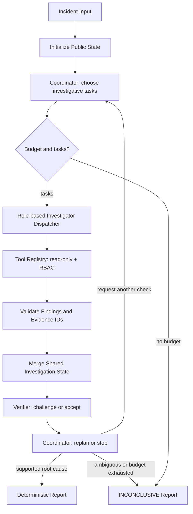

Here is the result of "fetch" for the Page with URL https://app.notion.com/p/3f6511f049228153ab58eeb4a41735c5 as of 2026-10-11T01:19:44.575Z:
<page url="https://app.notion.com/p/3f6511f049228153ab58eeb4a41735c5" icon="🔎">
<ancestor-path>
<parent-page url="https://app.notion.com/p/3e1511f049228149a0a5cc315b299798" title="COMP5584 项目候选"/>
<ancestor-2-page url="https://app.notion.com/p/3e1511f0492280758236f873c1816d60" title="project"/>
<ancestor-3-page url="https://app.notion.com/p/3de511f049228061a36cd82fc8793fbc" title="COMP5584_Agents"/>
<ancestor-4-data-source url="collection://24b511f0-4922-81b1-ad3e-000beaac4a9a" name="Notes"/>
<ancestor-5-database url="https://app.notion.com/p/24b511f04922810abedae4f97518d672" title=""/>
<ancestor-6-page url="https://app.notion.com/p/24b511f0492281d9baa9f41ecc5e2cbe" title="Databases"/>
<ancestor-7-page url="https://app.notion.com/p/24b511f049228148bee5c8c730103f25" title=""/>
<ancestor-8-page url="https://app.notion.com/p/24b511f049228089b7d9e52230094d4c" title=""/>
<ancestor-9-page url="https://app.notion.com/p/805d54bcf3ee4e81bf006c4db499e60c" title="Notes Dashboard"/>
</ancestor-path>
<properties>
{"title":"IncidentLens｜MVP V1 技术设计与课程实施蓝图"}
</properties>
<iconMetadata>{"type":"emoji","emoji":"🔎"}</iconMetadata>
<content>
# 2026-10-11｜正式命名与新增 V1 架构要求
**正式项目名称：IncidentLens: An Evidence-Driven Multi-Agent System for Software Incident Investigation**
以下更新优先于历史暂定名称和缺失的实现要求。项目仓库采用 incident-lens，Python 包名 incident_lens，CLI 和 UI 展示 IncidentLens。此为新增技术要求，并非已实现的软件。
## A. Agent Isolation｜多智能体隔离（必做）
V1 要求有明确的身份、权限、上下文、状态与运行隔离，不等于“在 prompt 里要求不能越权”；不强制每个 Agent 独立 Docker/OS 进程。当前离线工具均只读，没有任意代码执行，V1 用受控 ToolRegistry + 局部任务上下文 + Graph Merge Node 提供可测试隔离。未来若引入代码执行/生产系统写权限，必须升级为进程或容器 sandbox。
<table header-row="true">
<tr>
<td>层次</td>
<td>系统层实施</td>
<td>验收</td>
</tr>
<tr>
<td>Identity</td>
<td>由运行时构造不可伪造的 AgentContext(role, run_id, incident_id, workspace_id, ACL, budget)，LLM 不得指定其角色或改写权限</td>
<td>假冒 role/incident 访问被拒绝</td>
</tr>
<tr>
<td>Context</td>
<td>Investigator 只收到自己的 assignment、最小必要共享事实和自己调用工具得到的证据；不共享彼此完整 prompt/history</td>
<td>Logs Agent 看不到 Changes Agent 未公开配置</td>
</tr>
<tr>
<td>Tool / Data</td>
<td>ToolRegistry 按 role+incident_id 限制 query_logs、query_metrics、query_changes 等；EvidenceProvider 只读取该事故 public evidence</td>
<td>跨角色调用返回 FORBIDDEN，不能访问 private/ground_truth</td>
</tr>
<tr>
<td>State</td>
<td>Agent worker 只生产结构化局部结果，唯一 Merge Node 检查 Evidence ID、task_id、run_id，再发布共享 Hypothesis Board</td>
<td>两 Agent 并发不覆盖、不同 run 不串线</td>
</tr>
<tr>
<td>Secrets</td>
<td>API key 只在后端 Provider，Agent 和 trace 不存密钥、其他角色隐藏状态/CoT</td>
<td>工具数据包含恶意指令不会造成权限提升</td>
</tr>
</table>
消息交换使用 ASSIGNMENT → FINDING / EVIDENCE REF → REVIEW → DECISION。所有被共享的证据 ID 必须经中央 Evidence Registry 验证：真实存在、来自当前 incident、由相应角色实际查询过。Coordinator 不得取得底层数据目录/任意读取接口。
## B. Semantic Caching｜语义缓存（必做）
**目的：** 避免在相同可见证据上重复调用 LLM，同时保证不同事故和证据状态之间不发生错误复用。缓存是独立、可关闭、可度量的优化层，不能替代动态调查决策。
**分层策略：**
- 精确缓存（可选）：无副作用的离线工具查询，按参数+dataset_revision exact key，任何命中之前仍走权限校验。
- 语义缓存（必做）：只适用不改变系统状态的局部解释性工作，例如 summarize_log_slice、interpret_metric_window、summarize_change_diff；同一证据快照内的同义问法可复用结构化结果。
- 明确不适用：Coordinator 动态任务选择、Verifier 定案/是否充分的决策、Hypothesis Board 整体状态和最终 RCA 报告。其结论受时序与累计信息影响，语义相似不代表结果可复用。
**缓存 namespace 必须先精确匹配，才允许语义向量相似匹配：**
```plain text
workspace_id + incident_id + agent_role + task_type
+ evidence_snapshot_sha256 + dataset_revision
+ prompt_version + model_id + model_parameters_hash
+ output_schema_version + tool_acl_version
```
任何事故、role、证据快照、模型或 prompt 变化必须 miss。namespace 内对规范化 task question 做 embedding/cosine similarity；0.95 只是建议的初始阈值，要在 dev 样例上验证、必要时调高或禁用。相似表述但语义相反的问句应拒绝命中。
**命中前后校验：** 先鉴权 → 确定当前证据 hash/namespace → 查缓存 → 检查 TTL、响应 schema、Evidence IDs 是否仍在当前角色的已授权证据集合内 → 不满足则重新调用 LLM。只缓存成功且有证据来源的局部解释结果；绝不缓存 private ground truth 或凭空结论。trace 必须区分 CACHE_HIT、CACHE_MISS、INVALIDATED、LLM_CALL，记录 similarity、role、task、evidence hash、节省的模型请求数；不得把缓存命中伪装成实际 LLM 调用。
**推荐本地 CPU 实现：** src/incident_lens/cache/\{[policy.py](http://policy.py),[embeddings.py](http://embeddings.py),[semantic.py](http://semantic.py),[store.py](http://store.py)\}。SQLite WAL 保存键、向量、Pydantic 序列化响应、创建时间、TTL、hit_count；NumPy 在当前 namespace 的少量向量中做 cosine similarity，不引入独立向量数据库。EmbeddingBackend 可选轻量 CPU sentence-transformers 模型（英文日志可用 all-MiniLM-L6-v2）；首次权重获取可能需要联网。CI / Mock 使用 FakeEmbedder，不强制模型下载。配置 CACHE_MODE=off\|exact\|semantic、CACHE_SIMILARITY_THRESHOLD、CACHE_TTL_HOURS、CACHE_EMBEDDING_MODEL、CACHE_DB_PATH。
**关键测试与实验：**
- 同一事故+相同证据快照+语义等价问句：semantic hit，结果有效。
- 不同 incident、不同 role、新增 evidence、改变 prompt/model/schema：必须 miss。
- 语义相反、缺少证据或错误 citation：禁止误命中/复用。
- 并发访问：SQLite 写入原子性与无污染。
- Benchmark 架构比较统一先 CACHE_MODE=off；另做 cold-cache / warm-cache 比较缓存命中率、避免的模型调用、延迟、token 及错误复用率，不得将缓存带来的收益算成 Multi-Agent 推理能力的提升。
## C. 开发顺序和新增验收要求
P0 增加 AgentContext、只读 Role-scoped EvidenceClient、CachePolicy 数据契约；P1–P3 优先实现安全隔离、动态路由与引用校验；P4–P5 加入 SemanticCacheAdapter 和 SQLite/FakeEmbedder/实际 embedding backend；P6 UI 增加 cache hit/miss 与权限/证据轨迹；P7 专项测试跨事故隔离及误命中安全性。
**完成定义新增：** 权限可被测试而非仅口头保证；并行运行不同事故不窜读；语义缓存可以开启/关闭；同证据同义任务可命中；证据更新和不同事故必不命中；缓存结果仍通过 schema 与 GroundingValidator；报告实际缓存性能，所有基线在未启用缓存时也能正确运行。
---
> **Status: Design specification / Not implemented.** 2026-10-11。本文是首版 MVP 的执行基线，不代表已经完成代码或实验。需求来自原 B2 提案及课程 Project guideline 的 Notion 摘要；课程正式细则应在提交前再次对照 Canvas 最新版本。
# 0. 执行摘要与决策
**Project:** IncidentLens — Evidence-Driven Multi-Agent Root Cause Analysis
**Research Question:** 在相同工具与可比推理预算下，动态证据分派＋独立反证审核，能否比固定流程／强单 Agent 更准确、以更少调查调用定位软件故障根因？
**MVP 交付：** 离线事故包 → 5 类 Agent 节点 → 有界循环、动态路由 → 可核查证据链／可弃权的 RCA → CLI + Streamlit 的事故调查可视化 → 自动评测脚本。
**优先级：** 正确可运行 \> 多 Agent 协作可观察 \> 数据可信 \> 评价对比 \> 美观 UI。
**技术决策：** Python 3.11+；LangGraph StateGraph(Graph API)；Pydantic v2 数据契约；pytest；本地 JSONL/CSV/YAML 证据；SQLite（可选追踪元数据）；Streamlit UI；一个可配置、支持结构化输出的模型 API；MockLLM 离线测试。主要业务功能必须脱离 UI 用 CLI 运行。
**MVP 不做：** Kubernetes / Prometheus 在线接入、云部署、真实系统自动修复、长时记忆／RAG、模型训练、向量数据库、复杂前后端分离与无限制自主执行。
# 1. 课程要求与范围约束
Notion 既有 guideline 摘要记录：问题动机 15%；多 Agent 设计 30%；功能实现 25%；分析创新 15%；展示与提交 15%。交付包括源码＋运行说明、≤10分钟演示视频、slides、个人贡献说明；之前记录截止日期为 **2026-11-23 23:59**，需以最新课程通知复核。
源参考：<mention-page url="https://app.notion.com/p/3e1511f049228149a0a5cc315b299798">COMP5584 项目候选</mention-page> 和 <mention-page url="https://app.notion.com/p/3f2511f04922804fbb34fa3d4dd3f2c6"/>。
MVP 不以 Agent 数量取胜；必须解释各角色的**不同信息可见性、工具权限、交换协议、控制流及冲突处理**。
**Acceptance（最低合格）：** 5 个固定种子事故运行成功；日志与故障说明一致；至少一次 Reviewer 的反证触发新调查；每一条根因证据包含真实 ID；预算到期可给 INCONCLUSIVE，而非猜测。
# 2. 产品边界与用户故事
## 2.1 用户故事
SRE/软件工程师选择一个事故案例，看到摘要（服务、症状、起始时间），点击 Run Investigation；界面展示 Coordinator 的调查计划，Log / Metric / Change 角色通过受限工具查询证据；每个 Findings 包含出处；Verifier 质疑当前候选根因、要求区分性检查；Coordinator 决定补查、定案或弃权；系统输出 Root Cause Report 并可查看可重放的事件流。
## 2.2 非功能约束
- 无密钥时 --mock 模式必须完整离线演示；有模型密钥时支持真实 API。
- 工具只读，仅查询事先存放的案例数据；禁止直接读取隐藏真值；在 API/工具层强制权限而非仅用提示词。
- Agent 输出严格 JSON/Pydantic；反常输出最多一次格式修复，再进入可观察的失败/弃权状态。
- 每个 run 可重复，保存 case_id、run_id、UTC 时间、模型名、prompt 版本、决策轨迹、证据引用、tool_call 与开销。
- 默认隐去所有模型链式思考，只记录外显决定、理由摘要、证据和工具调用。
- 工具返回的日志是**不可信的数据**，其中的“忽略指令”不得越权改变系统/工具执行策略。
# 3. 固定实验世界
## 3.1 微服务拓扑
```plain text
Client -> API Gateway -> Backend API
                          |-> PostgreSQL
                          |-> Redis Cache
                          |-> External Payment API
```
共 5 个可观测组件：gateway、backend、postgres、redis、payment。以固定依赖图 YAML 描述，只进行离线诊断，不实际部署全部组件。
## 3.2 事故类型
- F1 bad deployment / config regression：更新后的应用配置导致故障。
- F2 database connection exhaustion：真实 DB 连接资源瓶颈。
- F3 Redis unavailable：缓存不可用，引发回退/超时。
- F4 payment external timeout：外部 API 超时导致服务退化。
- F5 backend resource saturation：Backend CPU/内存/线程池饱和。
测试既包含直接因果、连锁症状、误导性并发事件，也包含证据缺失/多根因不可区分的 INCONCLUSIVE case。
## 3.3 事故 Evidence Pack 格式
```plain text
data/
  topology/services.yaml
  incidents/
    incident_001/
      public/incident.json
      public/logs.jsonl
      public/metrics.csv
      public/changes.jsonl
      public/configs.jsonl
      private/ground_truth.json     # evaluator only; never mount to agent tools
  splits/
    seed_ids.json
    dev_ids.json
    test_ids.json
```
- seed：5 个手写可运行案例，覆盖五类故障；首个 Demo 使用 seed_001。
- dev：建议 10–15 个变体，按时间/组件/错误传播/噪声生成，允许调 prompt。
- hidden test：建议 20–30 个从未用于调 prompt 的变体，交由评测负责人冻结；不足时如实声明样本量。
- 使用中性的 case_id 和文件名，不出现真实故障类别；对模型可见文本进行标记泄漏检查。
- **真值结构：** root_cause_code、culprit_service、causal_chain、decisive_evidence_ids、misleading_evidence_ids、valid_alternatives、is_identifiable、split、generator_seed。
- **重要：** ground_truth.json 仅能被 eval/fixture generator 读取；工具层做路径白名单与目录隔离，不允许直接文件浏览／任意 SQL。
## 3.4 核心 Demo 可解释因果链
14:03 API 500 激增；Backend 出现 DB connection acquire timeout；DB CPU、连接数正常。14:00 附近同时出现一次 Gateway 发布（误导）和 Backend 环境变量变更；Backend 的 DB_POOL_MAX 被改成 2，实例并发为 60，池内争用造成 acquire timeout。正确根因是 Backend pool 参数回归，而不是 DB 本身宕机，也不是无关 Gateway 发布。
注意：真实连接池的排队行为需用合理指标/配置和时间线共同佐证；不要设计出物理上矛盾的“Gateway 导致 DB 自身 CPU 异常”。
## 3.5 证据查询接口（只读）
所有工具统一返回 ToolResult（call_id、ok、records、error_code、elapsed_ms、record_count、next_cursor）。返回记录必须保留 evidence_id / source_path / timestamp / service / excerpt，并有最大返回条目限制。
- query_logs(service, start_ts, end_ts, severity?, contains?, limit≤50)：Log Agent 独占；
- query_metrics(service, metric_names\[\], start_ts, end_ts)：Metrics Agent 独占；
- get_dependencies(service?)：Metrics Agent 独占；
- query_changes(service?, start_ts, end_ts, change_type?)：Change Agent 独占；
- get_config_diff(change_id)：Change Agent 独占；
- fetch_evidence_by_ids(ids\[\])：Verifier 可读取**已共享**的 evidence_id 对应原始记录，不可枚举隐含证据；Reporter 按引文取已共享记录。
后端 ToolRegistry 根据 actor_role + case_id 做鉴权。对于批量证据选择，将目录/文件加载在服务器内部完成，不开放任意代码执行给 Agent。
# 4. Agent 角色与交接
<table header-row="true">
<tr>
<td>Role</td>
<td>LLM / 工具边界</td>
<td>结构化输出</td>
<td>禁止事项</td>
</tr>
<tr>
<td>Coordinator</td>
<td>看调查摘要、共享状态、预算；选下一轮要问谁／问什么（可选 1–2 个并行任务）</td>
<td>CoordinatorDecision</td>
<td>不能直接读取私有证据或裁决无证据的根因</td>
</tr>
<tr>
<td>Log Investigator</td>
<td>query_logs</td>
<td>InvestigationFinding</td>
<td>不能读取 change/metrics</td>
</tr>
<tr>
<td>Metrics & Dependency Investigator</td>
<td>query_metrics, get_dependencies</td>
<td>InvestigationFinding</td>
<td>不能读取 logs/changes</td>
</tr>
<tr>
<td>Change Investigator</td>
<td>query_changes, get_config_diff</td>
<td>InvestigationFinding</td>
<td>不能读取 logs/metrics</td>
</tr>
<tr>
<td>Verifier / Skeptic</td>
<td>已共享的 evidence refs / fetch_evidence_by_ids</td>
<td>VerificationReview</td>
<td>不能编造反证或将没有依据的疑虑当成确定事实</td>
</tr>
</table>
Reporter 为**确定性格式化函数**（非第六个 LLM），产生 RCA Markdown/JSON。角色数不必与六名开发成员一致。
## 4.1 状态机 / 编排图

**动态性硬要求：** Coordinator 每轮的 next_actions 由模型根据**新增 Findings、未解决的竞争假说、Verifier requested_check、可用预算**决定。系统只负责校验决策是否合法、预算是否允许，不能硬编码为“先查日志→再查指标→再查部署”。
初始轮可以并行 2 个专业 Agent；从第二轮开始必须支持“新增的证据驱动新任务或改变专业角色”。
## 4.2 Shared State
建议在 Python 将主状态定义为 InvestigationState（TypedDict with explicit reducers or managed Pydantic serialization）：
- incident_id, run_id, case_public_summary
- round_index, max_rounds
- tool_calls_used, tool_calls_limit, token_used, token_limit
- findings: 只追加的 InvestigationFinding 列表；每项有唯一 finding_id
- evidence_index: 以 evidence_id 去重的只读证据登记表
- hypotheses: id、label、culprit、support_ids、against_ids、status、open_questions
- open_questions、requested_checks、assigned_tasks、completed_task_ids
- review_history、decision_history、event_log、final_report、stop_reason
Agent 不能自己更新最终全局字典。Workers 只提交自己的结构化结果；**Merge Node** 验证 ID、去重、追加状态，禁止把并行节点写入同一 scalar key。使用 StateGraph 的 reducers 或单一聚合节点消除并发覆盖。
## 4.3 交流消息 / 输出契约
- ASSIGNMENT：task_id、role、question、allowed_tools、filters、reason、expected_discriminating_result。
- FINDING：finding_id、claim、evidence_ids、relation（supports/refutes/neutral）、confidence_qualifier（supported/weak/unknown）、followup_question。
- HYPOTHESIS：hypothesis_id、service、failure_mode、predicted_observations、support_ids、against_ids、status。
- REVIEW：target_hypothesis_id、verdict（sufficient/insufficient/conflicted）、missing_checks、contradictions、rationale、cited_evidence_ids。
- DECISION：action（INVESTIGATE/FINALIZE/ABSTAIN）、assignments、selected_hypothesis_id、reason、stop_reason。
所有模型输出都经过 Pydantic 和业务约束验证，**不能把模型报告的“高置信度”作为定案证据**。
## 4.4 Finalize Gate（安全终止）
只有满足以下条件才能标记 RESOLVED：
1. root cause 候选有至少 2 条不同出处的有效支持证据，且至少一条可区分主要竞争假说；
2. 没有未处理的关键矛盾或重大缺失检查；
3. Verifier 输出 sufficient 并引用真实 evidence_id；
4. Coordinator 提交 FINALIZE 且预算审计通过。
前述门槛是 MVP 规则，不应当把它写成“理论保证正确”。若用户提供的信息不足、多个根因仍难区分、工具失败或预算超限，输出 INCONCLUSIVE + 缺失证据 + 建议的下一检查。禁止输出凭空猜测的单一结论。
最大调查轮数默认 4、总工具调用默认 12、LLM 调用上限默认 16、校验重试每一步≤1、总时长默认 90s（配置化；本地 Mock 允许放宽或缩短）。
# 5. 技术设计与工程约定
## 5.1 推荐运行栈
- 核心：Python 3.11+、LangGraph、Pydantic v2、python-dotenv、PyYAML、httpx。
- 可视化：Streamlit（最初仅展示结构化状态与事件）。
- 测试：pytest / pytest-asyncio（如使用 async）；lint/format：ruff。
- API 适配：LLMProvider interface，包含 RealChatProvider（从 .env 读取）和 MockProvider（无需密钥）。
- 本地追踪：JSONL，CLI 能 export [report.md](http://report.md)、trace.json、result.json；SQLite 为可选项。没有独立云观测依赖。
- 用 requirements 或 pyproject.toml 锁定可重现版本；不要在计划里盲定尚未验证的 LangGraph 版本/模型字符串。
官方基础参考：[LangGraph StateGraph](https://reference.langchain.com/python/langgraph/graph/state/StateGraph)、[LangGraph Quickstart](https://docs.langchain.com/oss/python/langgraph/quickstart.md)。
## 5.2 推荐目录
```plain text
incident-lens/
  pyproject.toml
  .env.example
  README.md
  docs/{architecture.md,protocol.md,evaluation.md}
  configs/{system.yaml,agents.yaml,model.yaml}
  data/{topology,incidents,splits}
  scripts/{generate_cases.py,validate_dataset.py,run_demo.py,run_eval.py}
  src/incident_lens/
    schemas/{incident.py,evidence.py,agent_io.py,state.py,report.py}
    tools/{registry.py,logs.py,metrics.py,changes.py}
    llm/{base.py,provider.py,mock.py}
    agents/{coordinator.py,logs.py,metrics.py,changes.py,verifier.py}
    orchestration/{graph.py,merge.py,guards.py,budget.py}
    evaluation/{baseline.py,metrics.py,runner.py}
    ui/app.py
    cli.py
  tests/{unit,integration,fixtures}
  results/.gitkeep
```
## 5.3 存储和权限
- EvidenceProvider(case_id, role) 只从 public 分区索引指定服务/记录；测试断言不能返回 private 真值。
- 调用阶段保留 evidence_id 和 record hash，报告先过 GroundingValidator：所有引用需在 evidence_index，且相关陈述不得引用未出现记录。
- 案例材料中的恶意字符串永远以 DATA 处理，忽略“编辑文件”“禁用验证”等注入语句；不提供 shell/eval/文件遍历给运行中的 Agent。
- .env、API Key、真实企业日志不提交到 Git；所有测试数据使用合成或获授权的数据。
# 6. 自动化实验设计
## 6.1 研究对照组（公平条件）
<table header-row="true">
<tr>
<td>ID</td>
<td>方案</td>
<td>变量</td>
</tr>
<tr>
<td>A</td>
<td>Strong Single-Agent + all five evidence tools + same model + reflection</td>
<td>单智能体可自由选择下一工具</td>
</tr>
<tr>
<td>B</td>
<td>Fixed Multi-Agent (same investigators, fixed schedule)</td>
<td>没有证据驱动动态调度</td>
</tr>
<tr>
<td>C</td>
<td>Dynamic Multi-Agent no Verifier</td>
<td>验证机制消融</td>
</tr>
<tr>
<td>D</td>
<td>Dynamic Multi-Agent + Verifier (完整系统)</td>
<td>正式方案</td>
</tr>
</table>
不将 MockProvider 的固定示范表现当成真实 LLM 实验数据。全部模型组使用同一冻结 test split、相同初始信息、模型版本、采样设置、工具可见数据、最多 12 次工具查询；另外报告**实际 token、调用次数和花费**，不能假装完全计算等价。若需公平推理预算，继续对总模型 token / USD 加可比上限。
## 6.2 指标
- Root Cause Accuracy：可识别病例中 culprit_service + failure_mode 同时正确的比例（盲评/真值判定）；
- Correct Abstention：不可识别病例中诚实弃权比例；
- Evidence Citation Validity：被引用 IDs 实存且与该 claim 对应的比例（引用存在性可自动；语义对应需标注审核）；
- Unsupported Conclusion Rate：报告中无证据却断言为事实的关键结论比例；
- Misleading-case Accuracy：含噪声／误导场景的正确率；
- Efficiency：tool calls、LLM tokens、运行时间、model cost；
- Coordination Behavior：Reviewer challenge 导致重新选工具/变更假说的次数与例证。
## 6.3 分组与报告
按 F1–F5、ordinary/misleading、complete/missing evidence 切片；用同一 case 做配对比较，固定样本/seed；若预算允许对每个案例跑 3 个模型随机种子。原始 results.csv、run traces 和 errors.jsonl 必须保留。报告平均值、分母及逐案例失败原因，不对小样本过度宣称统计显著性。
## 6.4 防止伪改进
- 同工具权限、公平初始信息、真实成本记录；
- 测试集隔离，禁止对 test 真值做 prompt tuning；
- 不同时变更模型、温度、工具和角色数后声称“多 Agent 有效”；
- 对反证是否**改变后续动作或最终结论**给出具体 trace；只多一个 Reviewer 文本而行为未变不能算成功。
# 7. 用户界面（只做帮助解释协作的 UI）
Streamlit 采用 4 区：①左栏事故选择/Run/配置摘要；②中部 Investigation Timeline（谁→调用哪个工具→看到什么证据→为何补查）；③右栏 Hypothesis Board（支持/反对 evidence ID、状态变化）；④底部 RCA report + JSON trace/export。
UI 不允许编辑真值或模型内部隐含推理；当节点失败时显示报错与 INCONCLUSIVE 状态。支持复用一个冻结案例播放已保存 trace，现场 API 不通也能演示真实预先录制轨迹（需标注 Replay，不冒充实时）。
# 8. 六人小组分工（沿用既有 Notion 责任矩阵）
<table header-row="true">
<tr>
<td>Owner</td>
<td>代码所有权 / 验收输出</td>
<td>主要接口</td>
</tr>
<tr>
<td>mjy</td>
<td>技术负责人：contracts、LangGraph Coordinator/State/Guards、集成、presentation</td>
<td>schemas,state,orchestration</td>
</tr>
<tr>
<td>yzt</td>
<td>Log Investigator + Change Investigator 的 prompts/tool adapters，协助 reviewer tests</td>
<td>agents/[logs.py](http://logs.py)、[changes.py](http://changes.py)</td>
</tr>
<tr>
<td>sxw</td>
<td>Metric/Dependency Investigator + Verifier，反证、证据有效性校验</td>
<td>agents/[metrics.py](http://metrics.py)、[verifier.py](http://verifier.py)、[guards.py](http://guards.py)</td>
</tr>
<tr>
<td>ymx</td>
<td>案例生成、数据隔离、RBAC ToolRegistry、EvidenceProvider</td>
<td>data、tools、scripts/generate_[cases.py](http://cases.py)</td>
</tr>
<tr>
<td>zbx</td>
<td>Strong single-agent、固定多 agent baseline、评测器、统计/单测/消融</td>
<td>evaluation、scripts/run_[eval.py](http://eval.py)</td>
</tr>
<tr>
<td>whxc</td>
<td>Streamlit UI、时间线、假说板、Demo 视频；接入 CLI/trace 而不改业务状态</td>
<td>ui、demo scripts</td>
</tr>
</table>
请以实际组员协商确认最终代码 Owner；此表是按既有 Notion 初始分工做的模块化映射。全体成员都需各自持有可运行测试和 PR，文档/视频/答辩贡献一并留痕。
# 9. 分阶段里程碑（以 2026-11-23 提交时间为当前规划假设）
<table header-row="true">
<tr>
<td>日期</td>
<td>阶段</td>
<td>硬交付 / Gate</td>
</tr>
<tr>
<td>10/11–10/14</td>
<td>M0 冻结协议</td>
<td>状态 Schema、case fixture 契约、5 个 tool signatures、流程图、定义测试通过</td>
</tr>
<tr>
<td>10/15–10/20</td>
<td>M1 能跑的最小链</td>
<td>单案例 + MockProvider；3 investigator + Coordinator + Verifier；输出 evidence-backed JSON</td>
</tr>
<tr>
<td>10/21–10/27</td>
<td>M2 MVP 演示版</td>
<td>5 seed cases、动态补查、INCONCLUSIVE、Streamlit Timeline、CLI 重放</td>
</tr>
<tr>
<td>10/28–11/05</td>
<td>M3 可靠性</td>
<td>10–15 dev cases；错误处理、权限、预算、golden tests、真实模型适配</td>
</tr>
<tr>
<td>11/06–11/14</td>
<td>M4 评估冻结</td>
<td>20–30 unseen test cases（条件允许）；4 组比较、运行日志、消融分析</td>
</tr>
<tr>
<td>11/15–11/20</td>
<td>M5 报告/视频</td>
<td>项目展示、10分钟内 demo、贡献说明、README；完成人工 spot check</td>
</tr>
<tr>
<td>11/21–11/23</td>
<td>Freeze & submit</td>
<td>仅修复阻断问题，检查 Canvas 最新要求与截止时间</td>
</tr>
</table>
第一交付物定在 10/20：**一个真实执行、能被 Replay 的 end-to-end 事故调查 trace**，而不是 5 个独立的 Agent 聊天样例。
# 10. 质量门槛、风险与降级策略
## 必须自动通过的测试
- dataset validator：case 结构合法、ID 全局唯一、证据归属与时间可解析、私有真值不在公开字段/工具结果中；
- tool RBAC：每种角色调用非许可工具返回 FORBIDDEN；任意路径穿越/读取 private 拒绝；
- parallel merge：并行 findings 不丢失，不重复；task_id 和 evidence_id 去重；
- validator：无效 evidence_id、伪造引用、不支持的 final_reason 一律不能进入 RESOLVED；
- failure injection：模型超时、JSON 无效、工具异常、缺少关键记录时系统不死循环、有明确终止；
- deterministic seed trace：Mock 模式每次重跑得相同结果，并能还原 Coordinator 决策顺序。
## 降级策略
- 若 10/20 前真实模型 API 不稳定：优先完成 Mock + 单个官方支持 Structured Output 的 provider 适配；不扩展多厂商。
- 若 LangGraph 并行 merge 太复杂：M1 可只在每轮串行派 1 个 worker，但 M2 必须支持真正的动态路由并保存跨轮状态。
- 若数据不足：至少 5 手工场景 + 10 dev + 独立留出的少数 blind test；诚实报告规模，不用同一模板反复复制冒充多样数据。
- 若前端赶不上：保留 CLI、[report.md](http://report.md)、trace.json，Streamlit 降级为静态 trace 查看器。
- 若多个假说无法排除：输出 INCONCLUSIVE 作为**正确边界行为**而不是强制定案。
- 若 reviewer 只产生客套评论：禁止过关，必须输出 evidence-backed challenge / requested_check / sufficient 的结构化检验结论。
# 11. Demo 与答辩叙事
- 0:00–1:00 场景：API 500 与数据库 timeout；为什么只看告警容易误判。
- 1:00–2:30 架构：Role+Tool 权限、Shared State、Coordinator 的动态任务分配。
- 2:30–5:30 主场景：Log 发现 DB timeout → Metrics 证实 DB 正常 → Verifier 挑战 DB 假说 → Coordinator 调 Change → 找到 Backend pool config diff → 输出 grounded RCA。
- 5:30–6:30 缺证据场景：不可区分时输出 INCONCLUSIVE 并列缺失检查。
- 6:30–8:30 实验：Single vs Fixed vs No-Verifier vs Full，显示正确率/引用有效率/调用次数，并展示失败案例。
- 8:30–9:30 局限与分工：为何使用合成数据、未来如何接真实日志。
避免只展示固定成功剧本；教师问“把验证模块拿掉会怎样”时，应能切换运行实验或打开消融轨迹。
# 12. Done Definition（达到 MVP V1）
- [ ] 不依赖 API Key，Fresh clone 后按 README 运行 mock/demo + pytest 成功。
- [ ] Case 输入/私有真值隔离；5 个 seed 案例都有一致的 ground truth。
- [ ] 5 个具权限边界的 LLM 专职节点，可运行、有结构化 handoff。
- [ ] Coordinator 真正根据新证据在两轮间**改变调查对象/任务**；Tracer 能显示。
- [ ] Verifier 独立检查，能触发补查，也能阻止不支持的定案。
- [ ] 报告列出根因、因果链、支持/反对 evidence ID、排除假说、未解问题及状态。
- [ ] 工具调用/总预算/超时/错误处理有硬性终止。
- [ ] Strong single-agent 和 fixed multi-agent baseline 均能运行。
- [ ] 至少一次完整评测导出 CSV/JSON 和可复算指标（非预填数字）。
- [ ] 六人贡献与 README/展示材料完备。
---
**下一步：** 按配套子页「Coding Agent IMPLEMENTATION PLAN」把框架、状态契约、任务分配、文件路径、测试与分阶段命令交给 coding agent 执行。请优先建立**真实且可测试的数据/工具边界**，再接入 LLM 编排，不要从做 UI 开始。
<page url="https://app.notion.com/p/3f6511f0492281b4a173fb568622e18f">IncidentLens｜Coding Agent IMPLEMENTATION PLAN</page>
</content>
</page>
