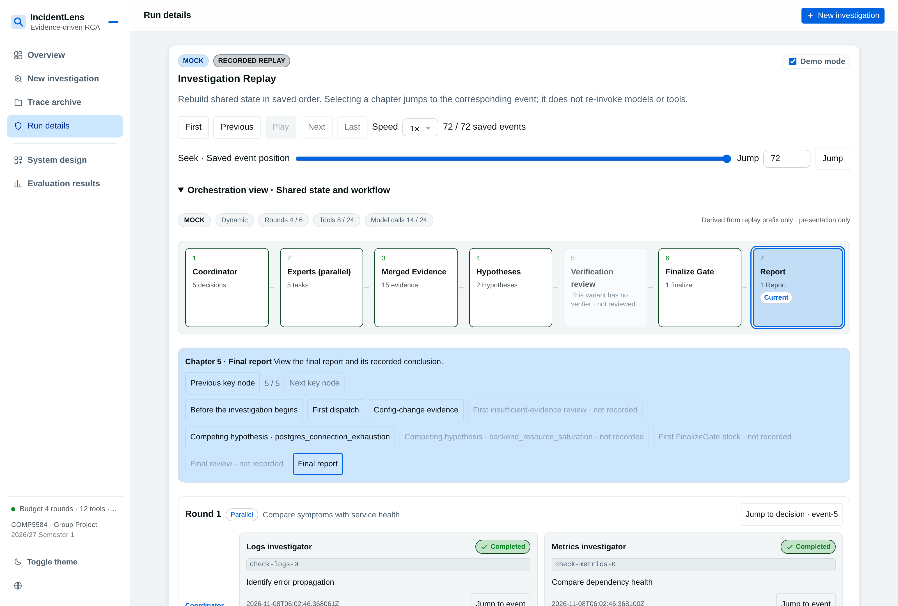
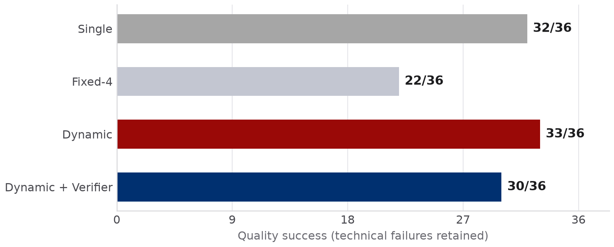
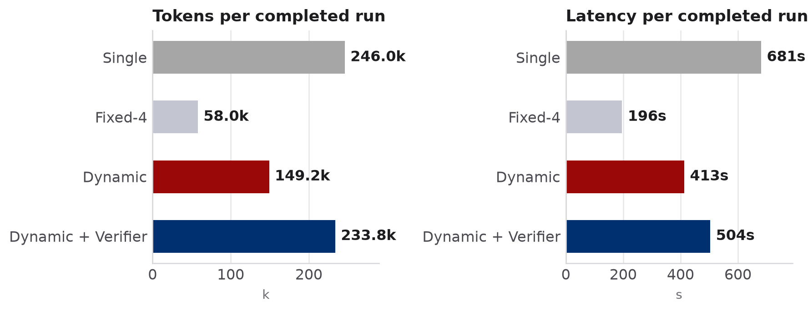
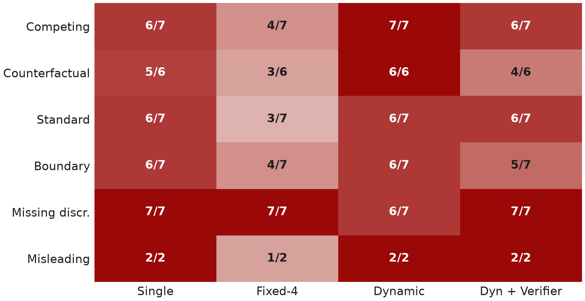

# IncidentLens version_b：汇报大纲（已确认）

状态：**已完成**。用户已确认大纲、素材映射、内置图片工具及缩小后的 Arial 样张。21 页图像已生成并检查，完整英文逐字稿已写入全部 PPT 演讲者备注，并另导出讲稿 PDF。

## 汇报设置

- 用途：香港理工大学 COMP5584 小组作业汇报，Group 5。
- 观众：课程教师、助教和同学；内容重点是多智能体为什么适合这项任务、如何实际协作、系统能展示什么、实验说明什么。
- 语言：**所有幻灯片标题、标签、正文及页内说明均使用英文**。配套英文逐页逐字稿，演讲者可直接参考朗读，并在最终 PPT 中写入每页演讲者备注。中文不进入幻灯片或英文逐字稿。
- 建议页数：**21 页，主线 15 页 + 答辩备份 6 页**。主线目标约 **9 分 35 秒**，为转场保留余量。这是延续原汇报安排的制作目标，课程文件明确限制的是演示视频不超过 10 分钟，未规定口头汇报时长。
- 形式：16:9，按用户指定的 codex-ppt 技能制作整页图像幻灯片。最终 PPTX 中每页为整张图片，文字与图表不能作为独立 PowerPoint 对象编辑。
- 用户已指定并确认配色：科研答辩风，香港理工大学红色为主色，可参考 version_a 的配色。落实为白底、深红 #9A0907 为主、少量藏蓝 #003070、深灰正文，学术图表与流程，页面构图随内容变化。字体统一 **Arial**，大标题/模块标题用 Arial Bold，副标题、正文、图示说明和脚注用 Arial Regular；参考用户提供的 MIT Sloan PowerPoint 字体规范。
- 图片 backend：用户在获知型号无法核验后，**明确接受内置 `image_gen` 工具**。不使用 API/CLI fallback，不宣称内置 backend 的具体模型版本为 GPT-Image-2.6。
- 字号层级：按用户反馈缩小整体字号，尤其是底部备注与图例。主标题视觉目标 28–30 pt；副标题 16–18 pt；图中主要标签 14–16 pt；辅助说明 12–14 pt；脚注与图例 10–11 pt、灰色常规字，不做大号加粗。图像输出按视觉检查，非可编辑字体元数据。
- 执行：遵守当前用户 AGENTS.md 的单 Agent 要求，不因技能的通用逐页 subagent 建议推定多 Agent 授权。

## 全套叙事

软件故障需要跨来源证据。IncidentLens 用受权限约束的专门角色协作调查，用确定性代码决定能否发布结论。在同一批 36 个开发案例上比较四种架构，呈现质量、资源消耗和失败模式，明确实验的适用范围。

## 主线页

### Slide 1: IncidentLens

- 类型：封面；目标是说明项目及研究对象。
- 要点：Evidence-driven multi-agent incident investigation；COMP5584、Group 5；沿用原版六位成员姓名和学号；研究/教学原型。
- 讲述：S1，20 秒。
- 构图意图：简洁的学术封面，项目名与副标题形成清楚层次，成员信息可读。
- Required images：校徽为严格输入，完整保留标志和字标，不能重画或变形。

  

### Slide 2: Incident diagnosis requires evidence across sources

- 类型：问题与动机；目标是让观众理解单一来源的局限。
- 要点：Logs 提供事件顺序；Metrics 提供影响与容量；Database 提供锁、连接与慢查询；Changes 提供变更与起点；结论需要机制与时间上的交叉印证。
- 讲述：S1，35 秒。
- 构图意图：一个故障场景连接四类证据，避免抽象装饰或堆叠长段文字。
- Required images：无。只生成解释性图示，不虚构真实故障记录。

### Slide 3: Can coordination improve diagnosis within a fixed budget?

- 类型：研究问题与贡献；目标是建立可检验的问题。
- 要点：回答可审计的根因或明确弃权；基于证据缺口分配任务；以代码约束证据与结论；同条件比较四种架构；多 Agent 的理由是证据分工和协调。
- 讲述：S1，35 秒。
- 构图意图：一个主研究问题，辅以设计和评测目标；此页不预先宣告优越性。
- Required images：无。

### Slide 4: Dynamic coordinates specialists through shared evidence

- 类型：系统架构；目标是解释真实协作路径，建议作为首张样张。
- 要点：Coordinator 每轮选择 1–2 个专家任务；Logs/Metrics/Database/Changes 返回局部结果；Merge 验证后发布共享证据与假设；协调器依证据缺口继续规划；FinalizeGate 决定接受，统一 stop/report 输出结果。
- 讲述：S2，45 秒。
- 构图意图：横向主流程和清晰反馈回路，直观区分模型步骤与确定性组件；Verifier 标为独立消融分支；Monitor 与 PLAN_ONLY proposal 以可选外围流程呈现。
- Required images：无；架构依据 `docs/ARCHITECTURE.md` 和实际 graph 路由生成。图中不能把 Merge、FinalizeGate、Reporter 画成额外 LLM agents。

### Slide 5: Each specialist has a bounded tool scope

- 类型：角色与权限；目标是说明不同角色有实际能力差异。
- 要点：Coordinator 无证据工具；四类专家使用相应只读工具；任务只能缩小角色权限；Verifier 仅获取已发布证据；Single 对照获得调查工具并集。
- 讲述：S2，35 秒。
- 构图意图：角色、主要问题、工具权限的精简矩阵；等价工具配置的例外放入备注或备份。
- Required images：无。

### Slide 6: Tasks and findings update one shared investigation state

- 类型：协作协议；目标是回答任务如何分配、信息如何交换。
- 要点：任务指定角色、范围、问题与预期判别证据；专家返回带引用的 findings；Merge 是共享发布边界；稳定 hypothesis IDs 支持跨轮累积；重复任务和预算限制阻止无效循环。
- 讲述：S2，40 秒。
- 构图意图：一轮调查的闭环，配小型任务/结果字段示例；示例明确为结构示意，不冒充真实运行输出。
- Required images：无。

### Slide 7: Deterministic checks control conclusion acceptance

- 类型：证据约束；目标是说明模型无法以自信程度绕过验收。
- 要点：引用必须来自本次实际观察；支持记录需跨来源并包含特定机制判别证据；时间与影响需相容；有实质竞争机制时继续调查；不满足条件则 INCONCLUSIVE。
- 讲述：S3，40 秒。
- 构图意图：候选结论经过几个可审计检查，分别到 RESOLVED 或 INCONCLUSIVE；说明结构来源校验不等于人工确认语义支持。
- Required images：无。

### Slide 8: One implementation supports live runs and recorded replay

- 类型：技术实现；目标是呈现可运行系统和复现路径。
- 要点：Python、LangGraph、Pydantic；同一调查服务支持 CLI 与 Web；Mock 和真实模型适配器；保存 trace/result/report；replay 加载保存状态，不重新调用图、工具或模型。
- 讲述：S3，35 秒。
- 构图意图：分层实现示意与保存产物；不把旧测试数写成当前代码的新验证结果。
- Required images：无。

### Slide 9: The dashboard exposes decisions, evidence and outcomes

- 类型：系统演示；目标是让评委看到运行产物及可审查证据。
- 要点：展示一次 Mock 调查或已录制回放；观察协调决定、专家任务与证据；跟踪到 gate 和结论；现场标清 Live/Recorded Replay 及 Mock/Real；同样解释弃权结果。
- 讲述：S3，65 秒，含短演示切换。
- 构图意图：现有真实界面截图为主，周围只保留少量阅读引导。
- Required images：截图为严格输入；保留现有 UI、标识、数值及可见状态，不改写其内部界面，也不称其为实时生产截图。

  

- 截图证据说明：当前图片可见 MOCK、RECORDED REPLAY 和 4/6 rounds。它不能被说成默认 4-round 预算下的截图，也不能仅凭旧讲稿断言与 `demo-live-20261102` trace 一一对应。正文只称现有 recorded replay 界面；生成前如需绑定具体运行，将另核对截图与 trace。

### Slide 10: Four architectures share one evaluation protocol

- 类型：实验设置；目标是建立公平对照与指标边界。
- 要点：Single、Fixed-4、Dynamic、Dynamic with verifier；36 个 synthetic development cases，其中 29 identifiable、7 应弃权；同模型/公共输入/工具访问/预算条件；1 repeat、144 slots；技术失败保留在 quality success 分母。
- 讲述：S4，40 秒。
- 构图意图：四个架构小示意配简洁实验设计；模型写实测 `auto/deepseek-v4.1-flash`，与幻灯片生成模型严格区分。
- Required images：无。

### Slide 11: Dynamic achieved 33 quality successes out of 36 slots

- 类型：主结果；目标是呈现失败包含在内的质量比较。
- 要点：Single 32/36；Fixed-4 22/36；Dynamic 33/36；Dynamic with verifier 30/36；Dynamic 完成的可识别案例为 27/27 root-correct，不能把它写为全部案例准确率。
- 讲述：S4，45 秒。
- 构图意图：原始质量图为视觉主体，辅以一个指标解释及开发集边界。
- Required images：结果图为严格输入，保留柱长、顺序、颜色、坐标、标签和分母，不生成替代数据图。

  

### Slide 12: Dynamic used fewer tokens than Single in this batch

- 类型：资源消耗与消融；目标是解释质量之外的代价。
- 要点：Dynamic 为 149,216 tokens、412.9 s；Single 为 245,971 tokens、680.9 s；Dynamic 相对 Single tokens 少 39.3%、latency 少 39.4%；Verifier tokens 增 56.7% 且未观察到质量增益；均为完成运行的描述性平均值。
- 讲述：S4，35 秒。
- 构图意图：原始双图与一条主结论，避免同时堆入多套资源指标；不等同于美元成本或显著性结论。
- Required images：原始资源图为严格输入，保持两面板、标签、单位、顺序和数值。

  

### Slide 13: Identifiable misses ended in INCONCLUSIVE

- 类型：失败分析；目标是正视漏诊和技术失败。
- 要点：144 slots 中 136 完成、8 技术失败；完成运行中 19 个可识别案例未给出根因，均为 INCONCLUSIVE；观测到 0 个错误命名根因；这说明本批主要错误是过度弃权；机制检查与引用约束不能被推广为消除幻觉。
- 讲述：S5，35 秒。
- 构图意图：分开画质量失败与技术失败类别，避免将它们混为同一分母；细分困难类型图留给备份页。
- Required images：无；计数以保存的 144-slot 记录为准。

### Slide 14: The evidence supports a bounded development study

- 类型：局限与效度；目标是明确哪些结论还不能成立。
- 要点：开发可见合成案例；候选标签 pending；一个模型一次重复；未执行盲测、人类语义支持审核或显著性检验；未来需要独立标注、重复/多模型实验和更真实遥测。
- 讲述：S5，30 秒。
- 构图意图：已测范围与后续验证对应排列，少文字、明确研究边界。
- Required images：无。

### Slide 15: Evidence discipline makes incident investigations auditable

- 类型：结论与 Q&A；目标是收束设计与测量结果。
- 要点：角色权限和共享状态使协作可检查；确定性 gates 明确接受条件；Dynamic 在当前批次取得最高 quality success，并比 Single 使用更少资源；下一步优先改进覆盖率与独立评测。
- 讲述：S6，40 秒。
- 构图意图：一条收束结论、两项具体依据及 Q&A，风格呼应封面。
- Required images：无；可沿用封面已确认校徽，但不要求重复大标志。

## 答辩备份页（不计入主线时长）

### Slide 16: Decision semantics and termination

- 类型：状态协议。
- 要点：INVESTIGATE/FINALIZE/ABSTAIN；RESOLVED 与 INCONCLUSIVE；provisional leading explanation 不是确认根因；统一 stop 与 budget failure 区别。
- 构图意图：紧凑决策状态图，精确保留协议名称。
- Required images：无。

### Slide 17: Metrics use different eligible denominators

- 类型：指标定义与完整结果表。
- 要点：technical completion /36；quality success /36；root correctness 仅看完成的 identifiable cases；correct abstention 仅看完成的 abstain cases；Dynamic 示例为 27 个正确根因 + 6 个正确弃权 + 3 个技术失败。
- 构图意图：一张完整四架构表配分母示例；保留精确值，不混淆 conditional accuracy 与 overall quality。
- Required images：无。

### Slide 18: Paired outcomes and difficulty levers

- 类型：困难类型与配对比较。
- 要点：Dynamic 对 Single 的 win/loss/tie 为 3/2/31；对 Fixed-4 为 12/1/23；对 verifier 为 5/2/29；competing 为 7/7、counterfactual 为 6/6；不能据此宣称统计显著。
- 构图意图：保留困难类型热图，旁侧只列配对计数；解释每项 eligible 分母。
- Required images：原热图为严格输入，保持每个格子的分子分母、行列顺序和色阶。

  

### Slide 19: Technical failures and evidence exhaustion

- 类型：错误与护栏诊断。
- 要点：6 次 STRUCTURED_OUTPUT_INVALID、2 次 FINDING_IDENTITY_MISMATCH；技术失败不自动归因于架构；实测 evidence-exhausted stops 为 27/144；Dynamic 的 6 次均为正确弃权；Verifier 4 个及 Single 3 个可识别损失需披露。
- 构图意图：错误类型与停止原因分组；如提 token guard 的 savings，必须标注 replay-estimated，不能写成新实测。
- Required images：无。

### Slide 20: Public evidence access and replay remain constrained

- 类型：安全与证据完整性。
- 要点：公共文件 allowlist；固定角色 ACL 与冻结 context；actual-query ledger；Merge 发布边界；replay 限于 results 的 trace.json 并核验附属元数据身份。
- 构图意图：运行读取边界及回放边界并列，使用具体规则。
- Required images：无。

### Slide 21: The demonstration can run offline

- 类型：复现与演示后备。
- 要点：安装与 validate-data；Mock dynamic 的 run 命令；保存的 trace/result/report；replay 与 Web；真实 provider 需要单独配置，现场优先使用可复现 Mock。
- 构图意图：短命令和产物路径，避免整屏代码；只列已核实 CLI 入口。
- Required images：无。

## 需要确认的素材映射

| 素材 | 页码 | 用途 | 约束 |
| --- | ---: | --- | --- |
| `assets/polyu_logo_stacked.png` | 1 | 校徽和学校字标 | 严格输入，完整保留 |
| `assets/demo_console.png` | 9 | 真实界面示例 | 严格输入，保留 Mock/Recorded Replay 和可见计数 |
| `assets/chart_quality.png` | 11 | 质量主结果 | 严格输入，不改数据、标签、坐标 |
| `assets/chart_cost.png` | 12 | tokens / latency | 严格输入，不改数值和单位 |
| `assets/chart_levers.png` | 18 | 困难类型热图 | 严格输入，不改格子和分母 |

原有逐页截图是配色和背景阅读参考，不作为新版整页内容；内容和排版可按当前叙事重做。

## 一手依据与核验记录

- 官方任务和 rubric：`docs/project_guidelines/COMP5584_project_guidelines.pdf` 三页已提取核对；设计 30%、实现 25%、动机 15%、分析 15%、展示 15%。
- 实际归档版本：`../version_a/IncidentLens_Deck_version_a.pptx`。
- 事实文档：`docs/submission/source_of_truth.md`、`docs/ARCHITECTURE.md`、`docs/AGENT_DESIGN.md`。
- 测量原始汇总：`results/v16/wp-d/full144-hardened-c4-20261101/final-success-comparison.json`。
- 2026-11-10 从 144 条保存记录重新计算并核对：质量 32/22/33/30，完成 35/34/33/34，完成运行的 latency 和 tokens 均与原报告一致。未重新运行模型实验。
- 2026-11-10 检查了 role ACL、grounding/finalize 函数和 graph 的 verify 条件路由；未运行全量程序测试，最终 PPT 不声称当前代码已通过旧日期的全量测试。

## 下一阶段

已完成全套图像生成、逐页 QA、英文逐页逐字稿、PPTX 组装和 PDF 导出。按用户 AGENTS.md 单 Agent 执行。第 10 页最终采用架构对比表格，以精确呈现调查调度与审查方式；全部原定内容和页码保留。封面校徽保留原标志及英文学校名，按全英文要求裁去原素材中的中文行。
